# QA Evidence — NEARS-3867

**NEARS-3867 QA: mobile Recommended rail blocks add on closed cards (live, 2 clock states, EN+AR)**

**14 screenshot(s).** Click any thumbnail for full resolution.

<table>
<tr>
<td align="center" width="33%"><a href="01-store2-recommended-night-0115.png">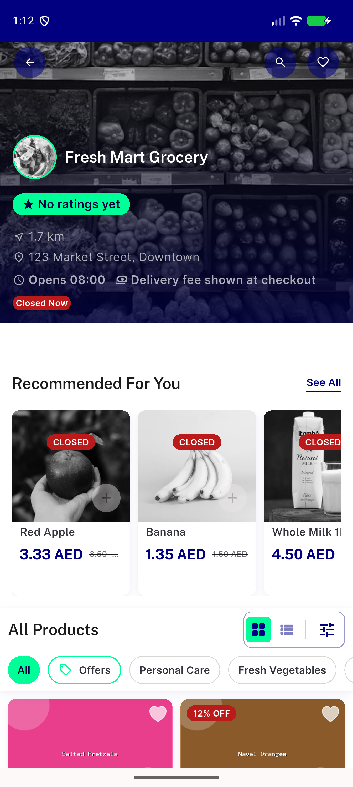</a> store2 recommended night 0115</td>
<td align="center" width="33%"><a href="02-rail-scrolled-open-cards.png">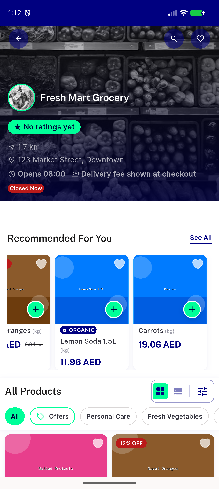</a> rail scrolled open cards</td>
<td align="center" width="33%"><a href="03-open-add-tapped.png">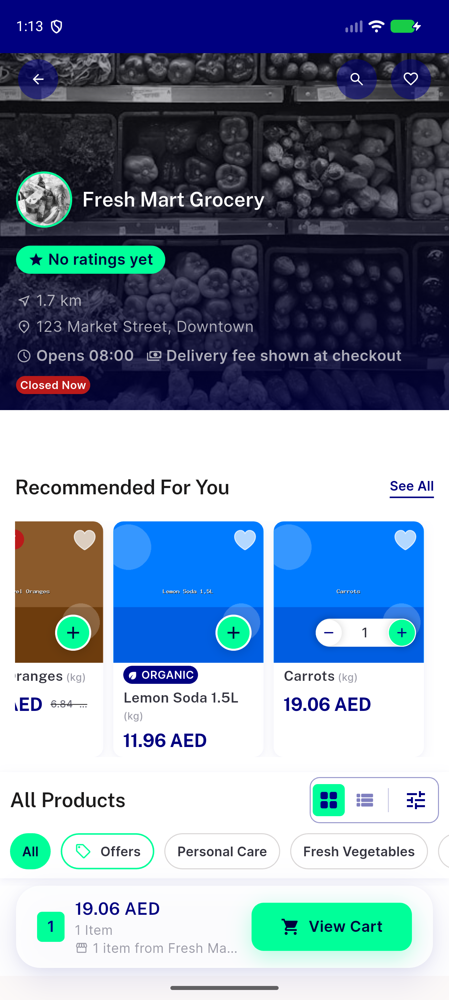</a> open add tapped</td>
</tr>
<tr>
<td align="center" width="33%"><a href="05-before-disabled-tap.png">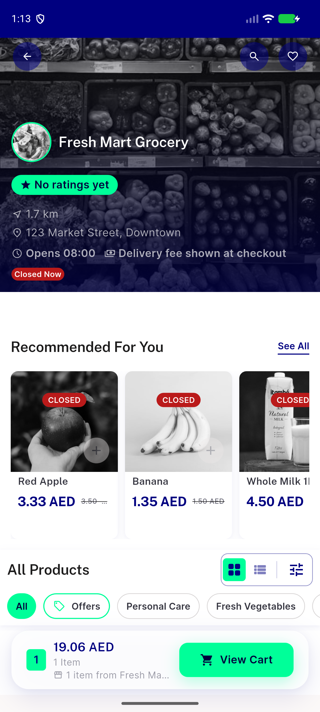</a> before disabled tap</td>
<td align="center" width="33%"><a href="05b-immediately-after-disabled-tap.png">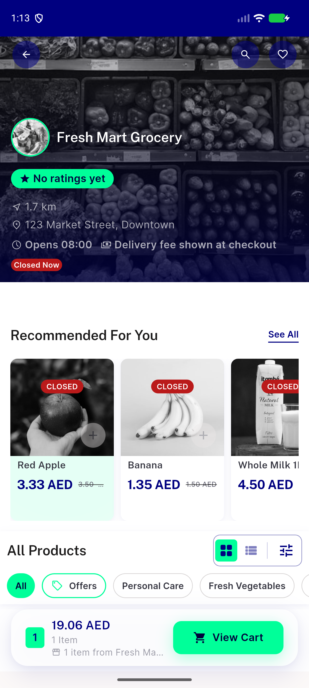</a> 05b immediately after disabled tap</td>
<td align="center" width="33%"><a href="05c-single-tap-1.5s.png">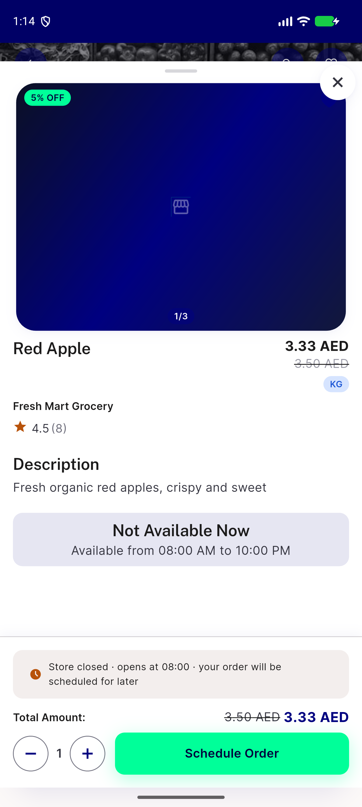</a> 05c single tap 1.5s</td>
</tr>
<tr>
<td align="center" width="33%"> after disabled tap</td>
<td align="center" width="33%"><a href="07-trending-popular-in-your-area-night.png">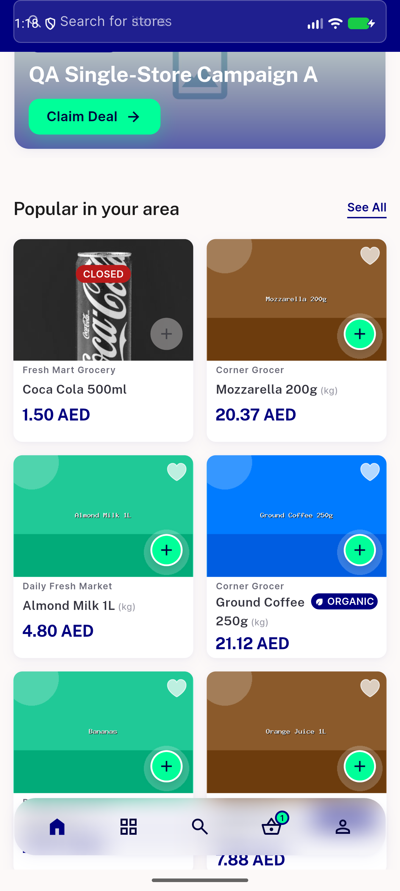</a> trending popular in your area night</td>
<td align="center" width="33%"><a href="08-noon-all-open-store2.png">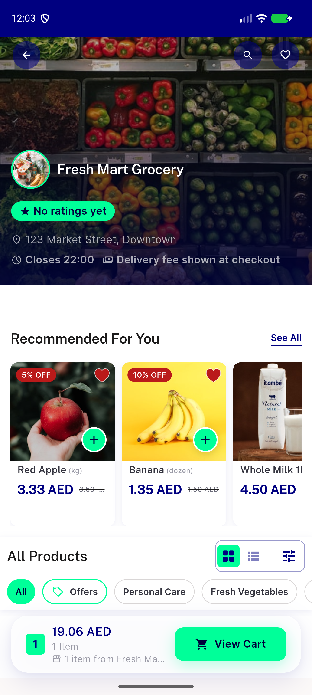</a> noon all open store2</td>
</tr>
<tr>
<td align="center" width="33%"><a href="09-noon-open-add-tapped.png">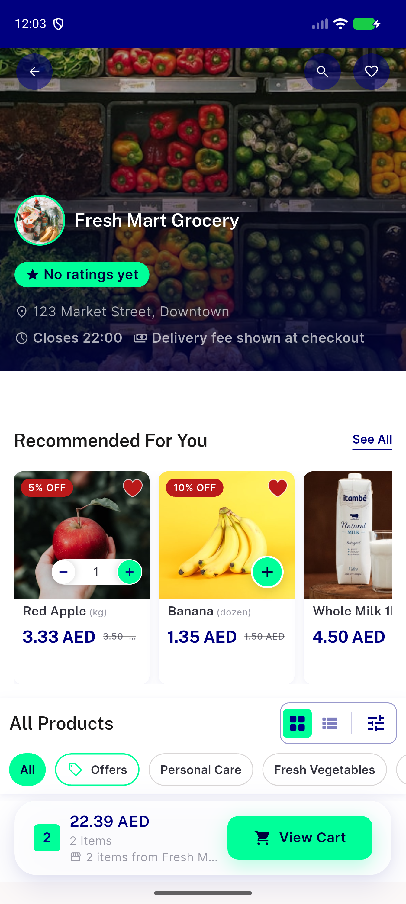</a> noon open add tapped</td>
<td align="center" width="33%"> closed with cart qty 2300</td>
<td align="center" width="33%"><a href="12-rtl-ar-closed-rail.png">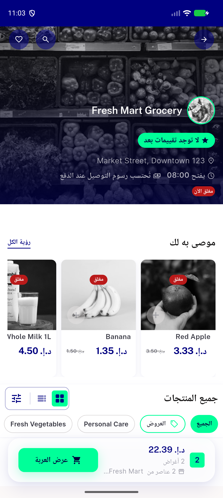</a> rtl ar closed rail</td>
</tr>
<tr>
<td align="center" width="33%"><a href="13-catalog-grid-closed-items-live-add.png">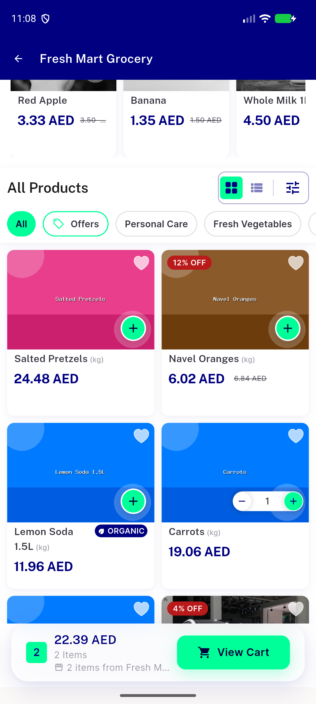</a> catalog grid closed items live add</td>
<td align="center" width="33%"><a href="bug-regression-catalog-grid-closed-live-add.png">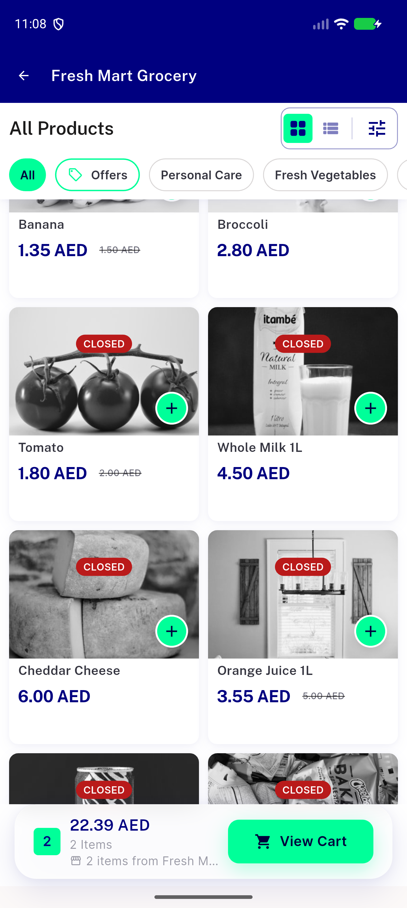</a> bug regression catalog grid closed live add</td>
</tr>
</table>

### Other artifacts
- [`01-dump.xml`](01-dump.xml)
- [`04-dump-closed-cards.xml`](04-dump-closed-cards.xml)
- [`08-dump-noon-open-rail.xml`](08-dump-noon-open-rail.xml)
- [`09-dump-after-add.xml`](09-dump-after-add.xml)
- [`10-dump-closed-with-qty.xml`](10-dump-closed-with-qty.xml)
- [`11-dump-0.6s-after-disabled-tap.xml`](11-dump-0.6s-after-disabled-tap.xml)
- [`12-dump-rtl.xml`](12-dump-rtl.xml)
- [`13-dump-catalog-grid-closed.xml`](13-dump-catalog-grid-closed.xml)
- [`13-grid-scroll1.xml`](13-grid-scroll1.xml)
- [`13-grid-scroll2.xml`](13-grid-scroll2.xml)
- [`13-grid-scroll3.xml`](13-grid-scroll3.xml)
- [`13-grid-scroll4.xml`](13-grid-scroll4.xml)
- [`13-grid-scroll5.xml`](13-grid-scroll5.xml)
- [`bug-regression-catalog-grid-closed-live-add.xml`](bug-regression-catalog-grid-closed-live-add.xml)

---
*From `nears/docs/qa-evidence/NEARS-3867/` · public-repo scrub policy (no live secrets; verified clean).*
