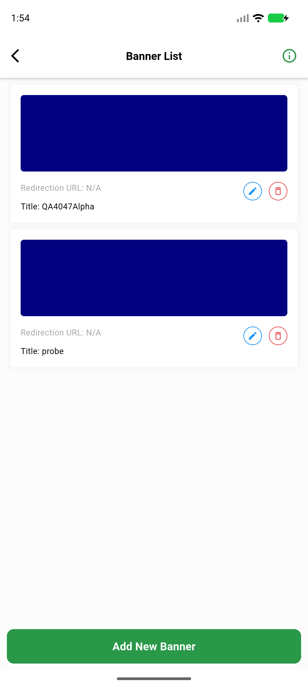
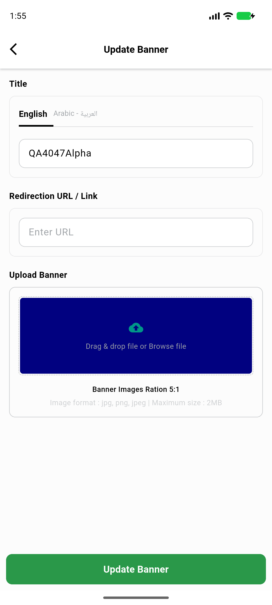
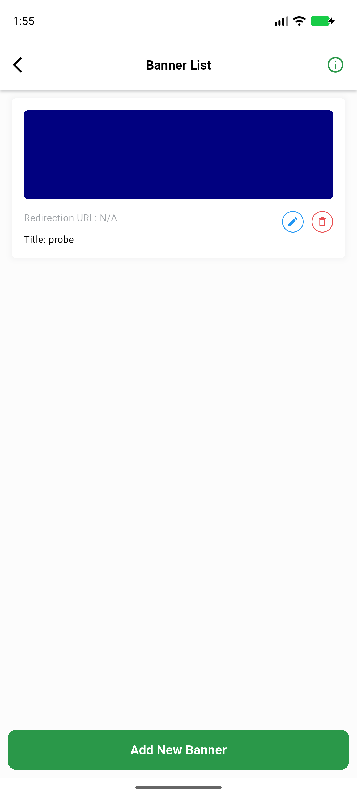

# QA Evidence — NEARS-4047

**cycle 1 delta: AC7 PASS (VendorApp add/edit/delete e2e, EN+light, no 500)**

**4 screenshot(s).** Click any thumbnail for full resolution.

<table>
<tr>
<td align="center" width="33%"> ac7 01 banner added list</td>
<td align="center" width="33%"> ac7 02 edit screen loaded</td>
<td align="center" width="33%"> ac7 03 after edit list</td>
</tr>
<tr>
<td align="center" width="33%"> ac7 04 after delete list</td>
</tr>
</table>

### Other artifacts
- [`ac7-flutter-log-after-add.txt`](ac7-flutter-log-after-add.txt)
- [`ac7-flutter-log-after-delete.txt`](ac7-flutter-log-after-delete.txt)
- [`ac7-vendorapp-e2e.log`](ac7-vendorapp-e2e.log)
- [`api-ac1-edit-and-db-identity.log`](api-ac1-edit-and-db-identity.log)
- [`api-ac2-ac3-ac4-update-delete-status.log`](api-ac2-ac3-ac4-update-delete-status.log)
- [`api-ac6-idor-cross-store-and-admin-banner.log`](api-ac6-idor-cross-store-and-admin-banner.log)
- [`api-regression-smoke-and-be-log-grep.log`](api-regression-smoke-and-be-log-grep.log)
- [`phpunit-green.log`](phpunit-green.log)
- [`phpunit-red-prefix-scratch.log`](phpunit-red-prefix-scratch.log)
- [`progress.md`](progress.md)
- [`vendorapp-build-blocked-memguard.log`](vendorapp-build-blocked-memguard.log)

---
*From `nears/docs/qa-evidence/NEARS-4047/` · public-repo scrub policy (no live secrets; verified clean).*
