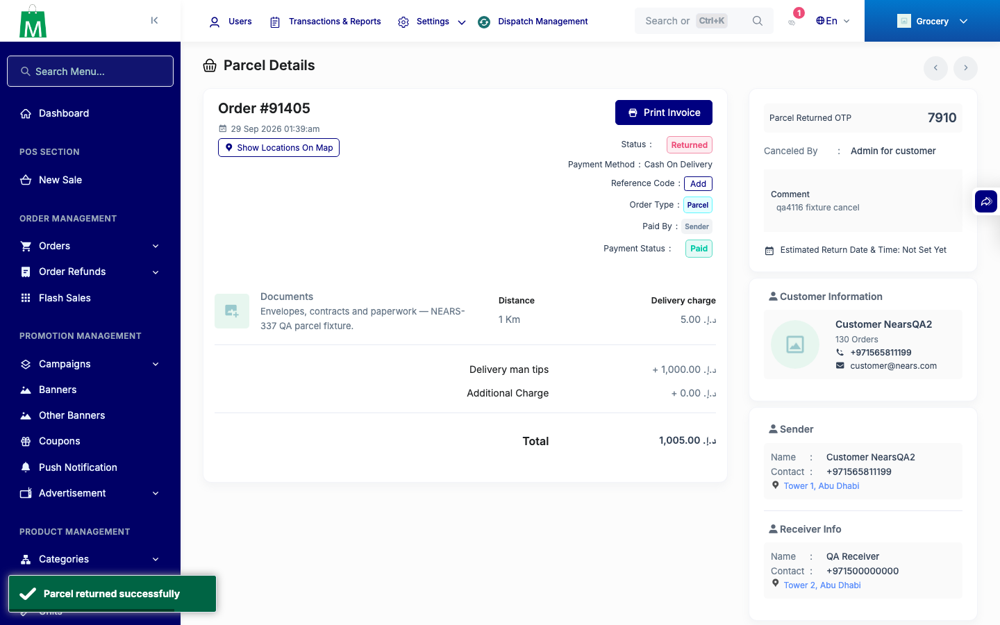
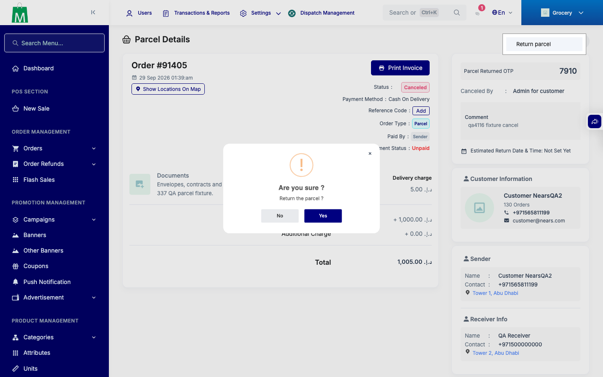
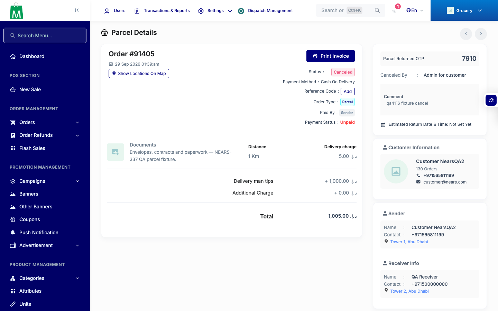

# QA Evidence — NEARS-4116

**QA NEARS-4116: AC1/2/4/5 PASS, AC3 UNVERIFIABLE (Return parcel item unreachable pre-existing), C4 parity PASS**

**3 screenshot(s).** Click any thumbnail for full resolution.

<table>
<tr>
<td align="center" width="33%"> ac3 after yes toast</td>
<td align="center" width="33%"> ac3 swal return parcel prompt</td>
<td align="center" width="33%"> bug return parcel item not rendered 91405</td>
</tr>
</table>

### Other artifacts
- [`ac1-ac2-curl.log`](ac1-ac2-curl.log)
- [`ac2-validation-unauth-positive.log`](ac2-validation-unauth-positive.log)
- [`ac3-ui-run.log`](ac3-ui-run.log)
- [`ac4-grep-routes.log`](ac4-grep-routes.log)
- [`ac5-phpunit-backstop.log`](ac5-phpunit-backstop.log)
- [`bug-before-pickup-0-not-enforced-money.log`](bug-before-pickup-0-not-enforced-money.log)
- [`bug-return-parcel-item-unreachable.log`](bug-return-parcel-item-unreachable.log)
- [`c4-settlement-parity.log`](c4-settlement-parity.log)
- [`log-refused-warn-excerpt.log`](log-refused-warn-excerpt.log)
- [`probe-before-pickup-1.log`](probe-before-pickup-1.log)
- [`progress.md`](progress.md)
- [`security-employee-role.log`](security-employee-role.log)

---
*From `nears/docs/qa-evidence/NEARS-4116/` · public-repo scrub policy (no live secrets; verified clean).*
