# QA Evidence — NEARS-4117

**PASS - AC5 notification entry driven live (3 FCM sends) + AC1-7**

**32 screenshot(s).** Click any thumbnail for full resolution.

<table>
<tr>
<td align="center" width="33%"><a href="ar-collect-94171-feerow.png">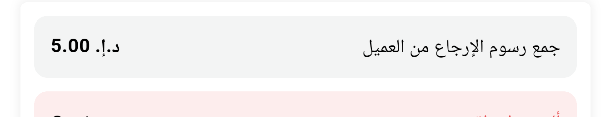</a> ar collect 94171 feerow</td>
<td align="center" width="33%"><a href="ar-collect-94171-full.png">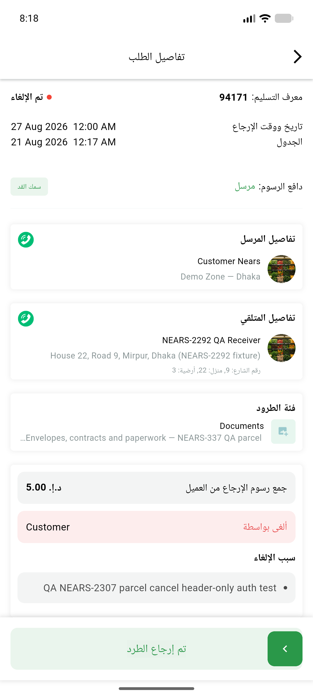</a> ar collect 94171 full</td>
<td align="center" width="33%"><a href="ar-paid-94172-feerow.png">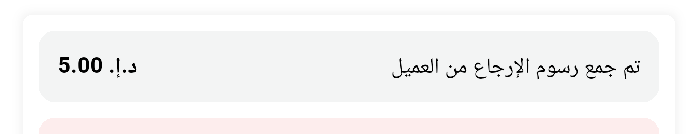</a> ar paid 94172 feerow</td>
</tr>
<tr>
<td align="center" width="33%"><a href="ar-paid-94172-full.png">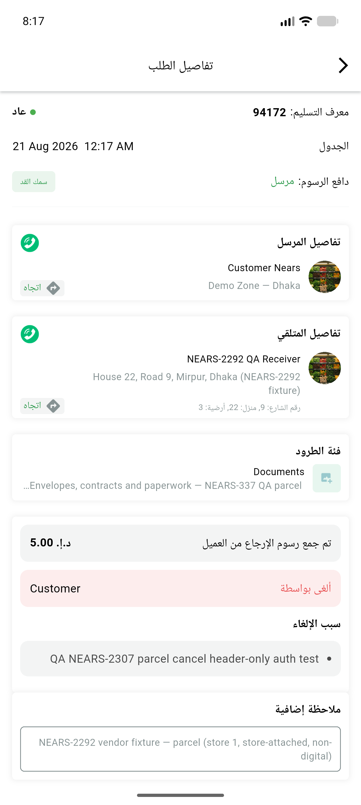</a> ar paid 94172 full</td>
<td align="center" width="33%"><a href="ar-refused-94173-feerow.png">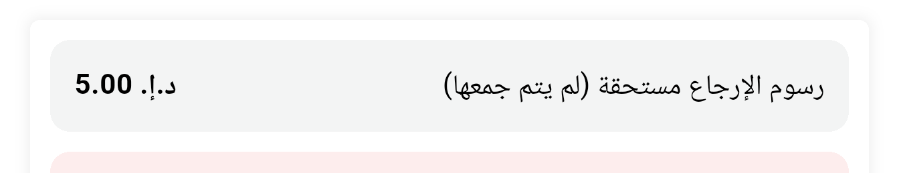</a> ar refused 94173 feerow</td>
<td align="center" width="33%"><a href="ar-refused-94173-full.png">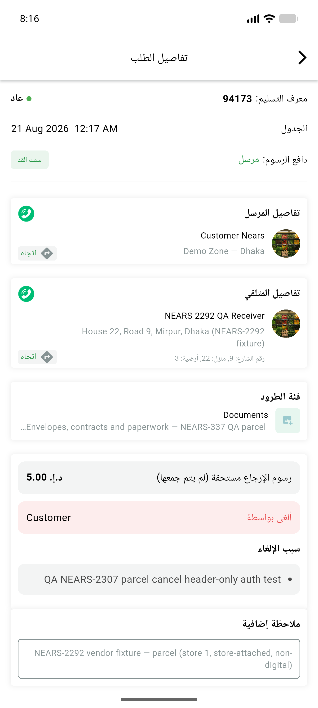</a> ar refused 94173 full</td>
</tr>
<tr>
<td align="center" width="33%"><a href="ar-refused-94173-leftparen-glyph-zoom.png">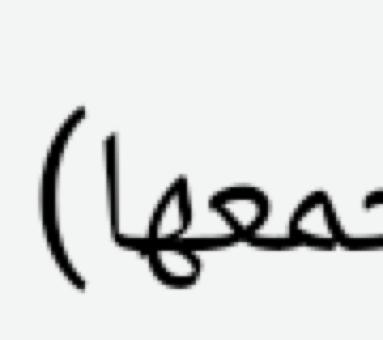</a> ar refused 94173 leftparen glyph zoom</td>
<td align="center" width="33%"><a href="ar-refused-94173-parens-zoom.png">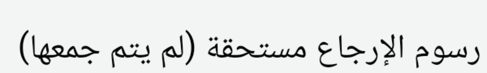</a> ar refused 94173 parens zoom</td>
<td align="center" width="33%"><a href="bn-refused-94173-feerow.png">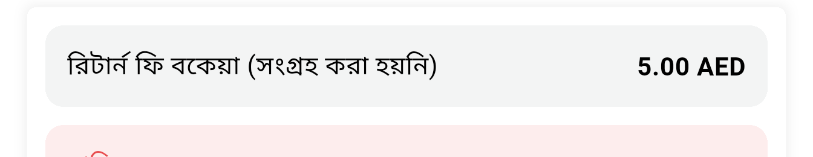</a> bn refused 94173 feerow</td>
</tr>
<tr>
<td align="center" width="33%"><a href="bn-refused-94173-full.png">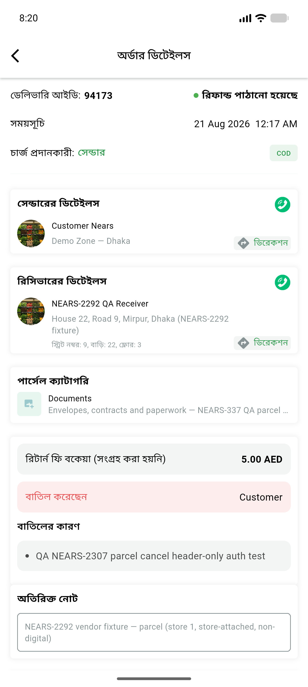</a> bn refused 94173 full</td>
<td align="center" width="33%"> en ac5 notif background 94173 feerow</td>
<td align="center" width="33%"><a href="en-ac5-notif-background-94173-full.png">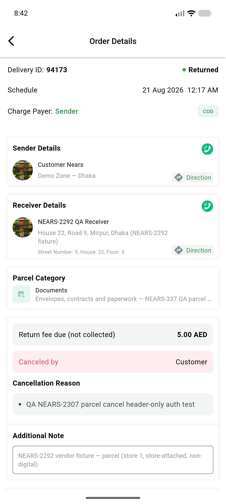</a> en ac5 notif background 94173 full</td>
</tr>
<tr>
<td align="center" width="33%"><a href="en-ac5-notif-background-94173-tray.png">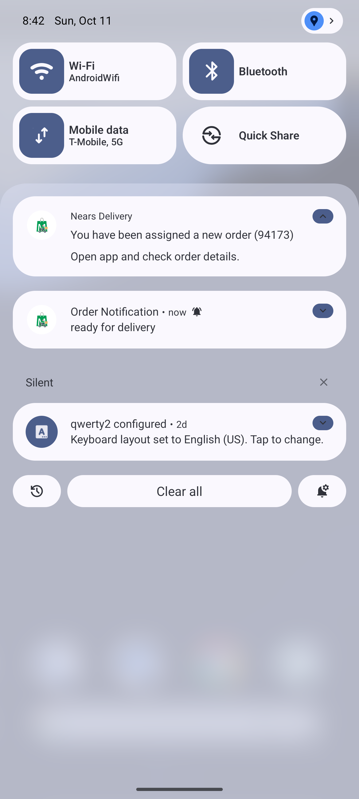</a> en ac5 notif background 94173 tray</td>
<td align="center" width="33%"> en ac5 notif foreground 94173 feerow</td>
<td align="center" width="33%"> en ac5 notif foreground 94173 full</td>
</tr>
<tr>
<td align="center" width="33%"><a href="en-ac5-notif-foreground-94173-tray.png">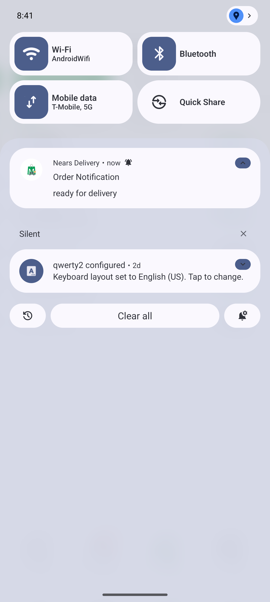</a> en ac5 notif foreground 94173 tray</td>
<td align="center" width="33%"> en ac5 notif killed 94173 feerow</td>
<td align="center" width="33%"> en ac5 notif killed 94173 full</td>
</tr>
<tr>
<td align="center" width="33%"><a href="en-ac5-notif-killed-94173-tray.png">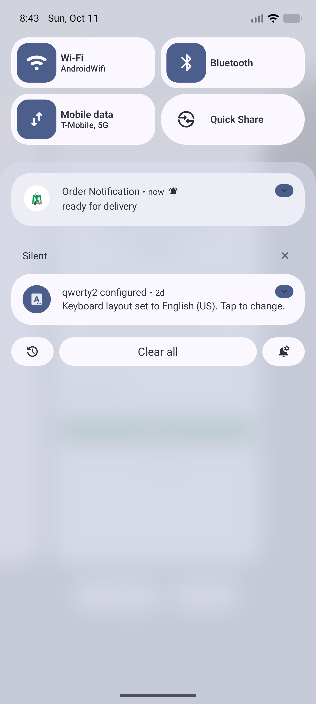</a> en ac5 notif killed 94173 tray</td>
<td align="center" width="33%"><a href="en-canceled-94171-collect-money-sheet.png">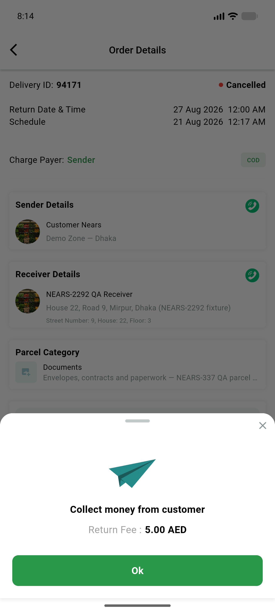</a> en canceled 94171 collect money sheet</td>
<td align="center" width="33%"><a href="en-collect-94171-feerow.png">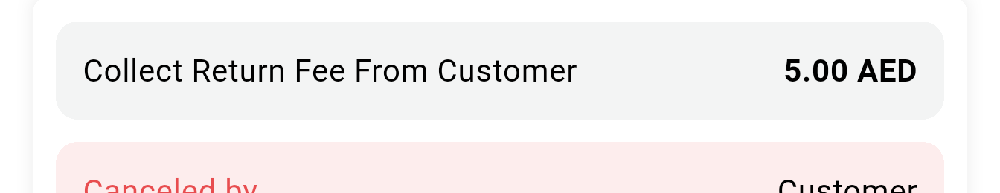</a> en collect 94171 feerow</td>
</tr>
<tr>
<td align="center" width="33%"><a href="en-collect-94171-full.png">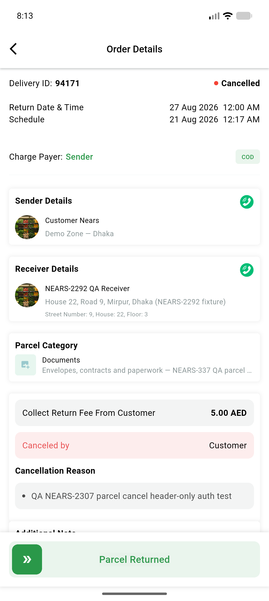</a> en collect 94171 full</td>
<td align="center" width="33%"> en null status 94175 feerow</td>
<td align="center" width="33%"><a href="en-null-status-94175-full.png">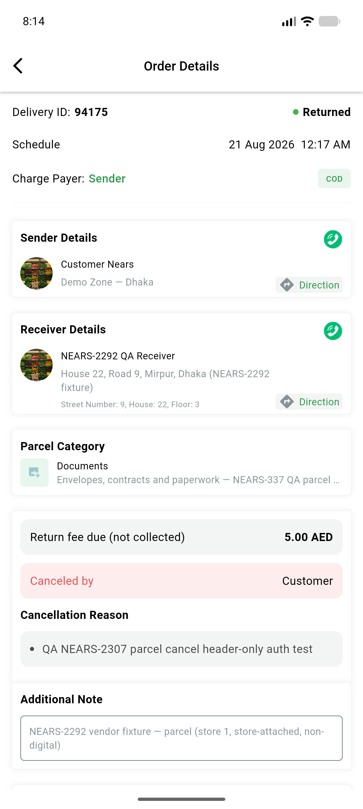</a> en null status 94175 full</td>
</tr>
<tr>
<td align="center" width="33%"><a href="en-paid-94172-feerow.png">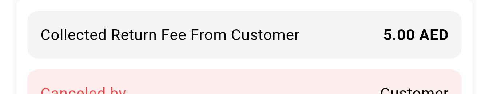</a> en paid 94172 feerow</td>
<td align="center" width="33%"><a href="en-paid-94172-full.png">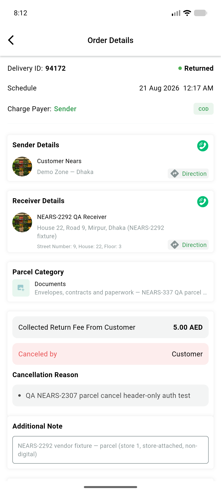</a> en paid 94172 full</td>
<td align="center" width="33%"><a href="en-refused-94173-feerow.png">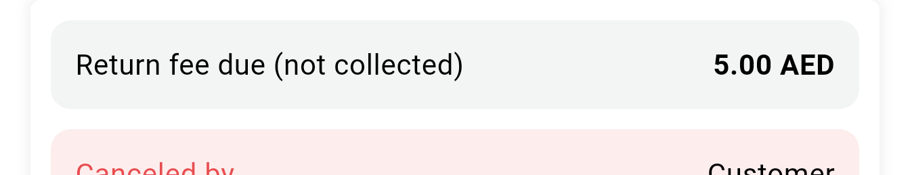</a> en refused 94173 feerow</td>
</tr>
<tr>
<td align="center" width="33%"><a href="en-refused-94173-full.png">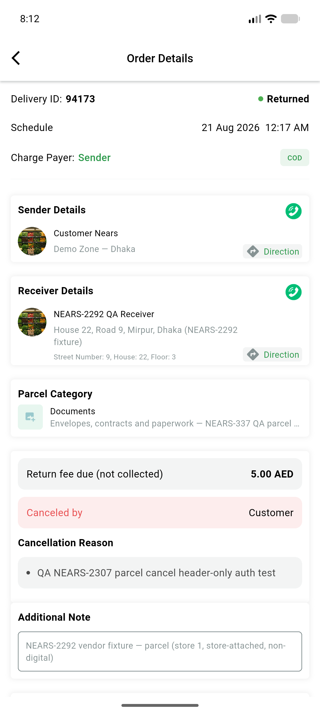</a> en refused 94173 full</td>
<td align="center" width="33%"><a href="en-regress-nonparcel-91187-full.png">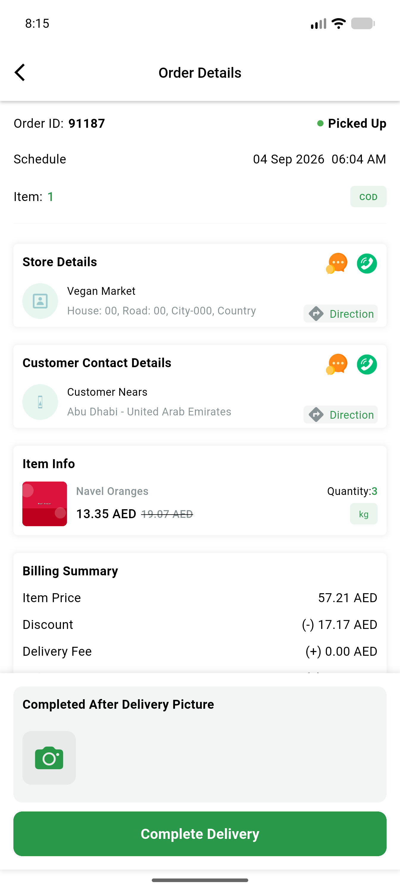</a> en regress nonparcel 91187 full</td>
<td align="center" width="33%"><a href="en-regress-parcel-no-cancellation-94174-full.png">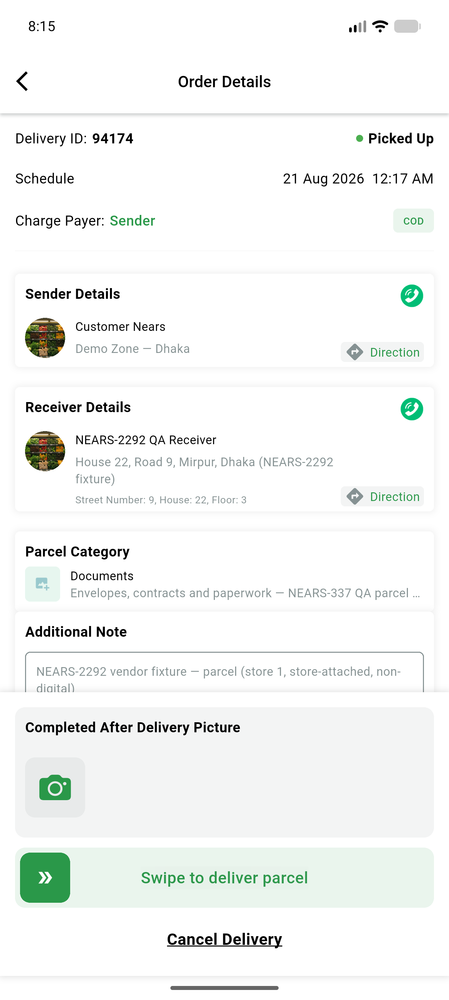</a> en regress parcel no cancellation 94174 full</td>
</tr>
<tr>
<td align="center" width="33%"><a href="es-refused-94173-feerow.png">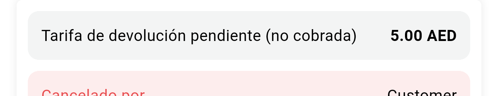</a> es refused 94173 feerow</td>
<td align="center" width="33%"><a href="es-refused-94173-full.png">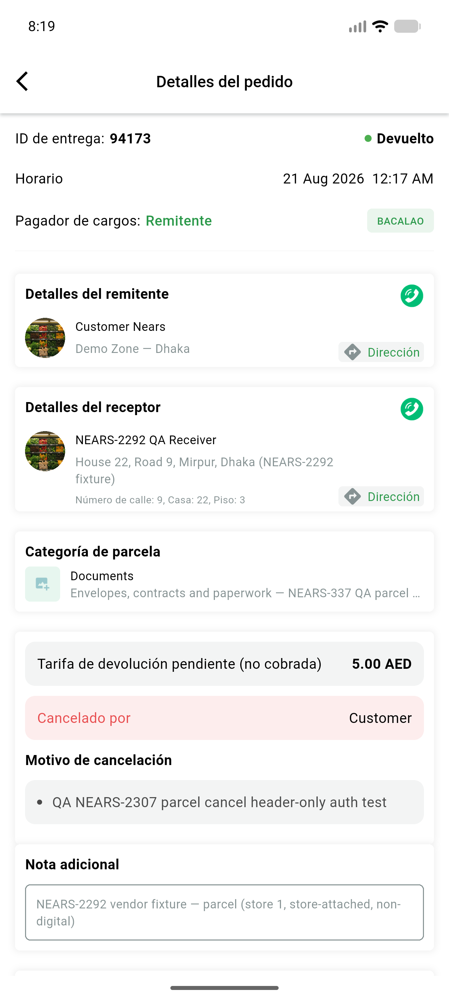</a> es refused 94173 full</td>
</tr>
</table>

### Other artifacts
- [`ac5-api-get-order-fields.txt`](ac5-api-get-order-fields.txt)
- [`ac5-notification-evidence.md`](ac5-notification-evidence.md)
- [`app-flutter-fail-lines-startup-stale-token.log`](app-flutter-fail-lines-startup-stale-token.log)
- [`progress.md`](progress.md)

---
*From `nears/docs/qa-evidence/NEARS-4117/` · public-repo scrub policy (no live secrets; verified clean).*
