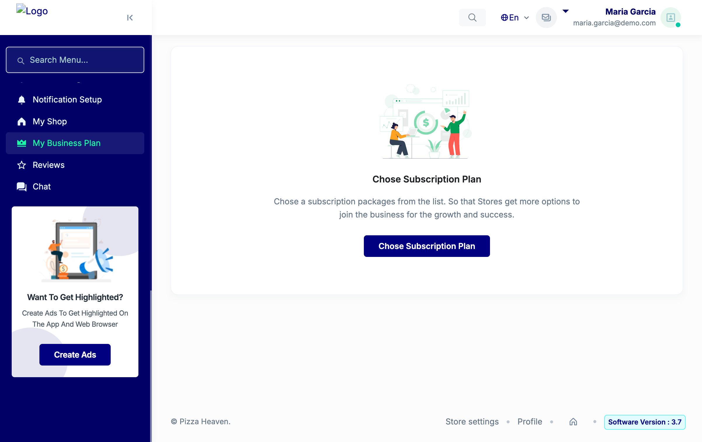
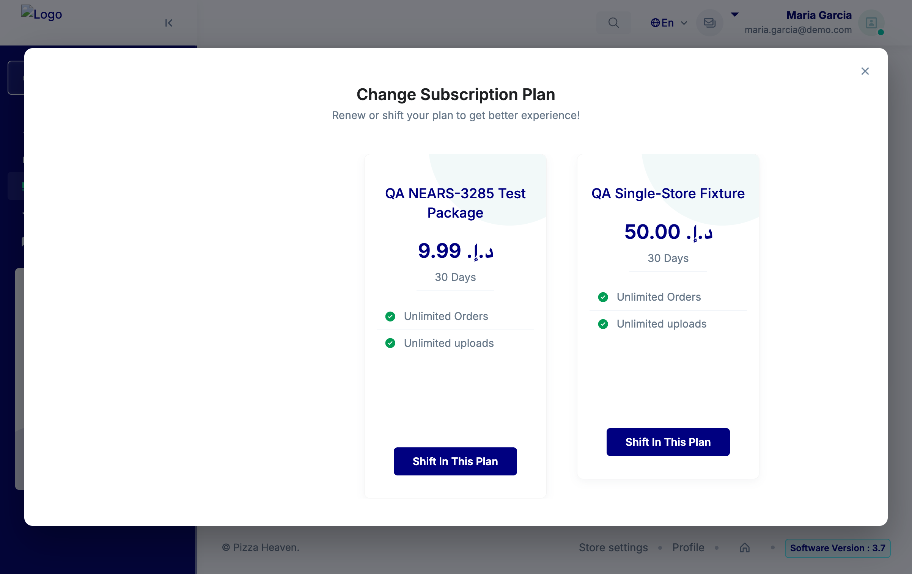
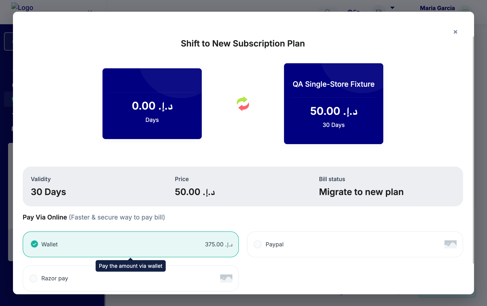
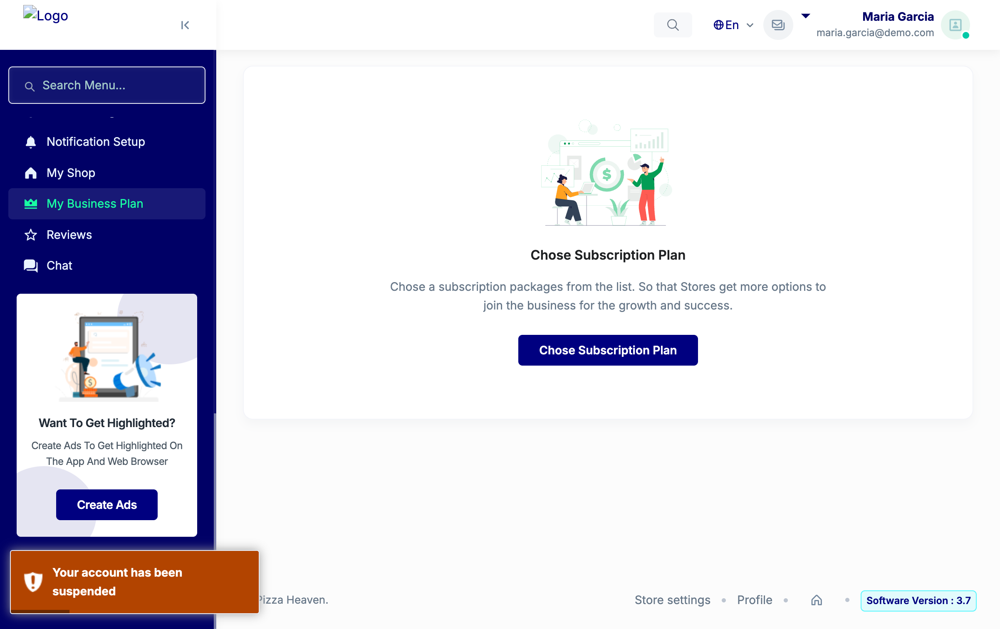
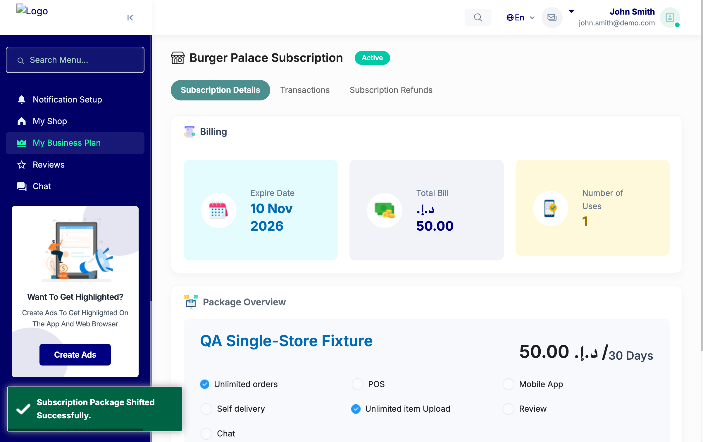

# QA Evidence — NEARS-4119

**PASS live: Store Panel packageBuy refused pre-charge for held store (wallet+gateway), honest-expired still purchases**

**7 screenshot(s).** Click any thumbnail for full resolution.

<table>
<tr>
<td align="center" width="33%"> owner s1 subscriber detail suspended</td>
<td align="center" width="33%"> choose plan clicked</td>
<td align="center" width="33%"> owner s1 package modal wallet selected</td>
</tr>
<tr>
<td align="center" width="33%"> ac1 wallet refused toast redirect</td>
<td align="center" width="33%"> ac2 gateway paypal refused toast</td>
<td align="center" width="33%"> ac3 control store4 modal wallet selected</td>
</tr>
<tr>
<td align="center" width="33%"> ac3 control store4 wallet purchased</td>
</tr>
</table>

### Other artifacts
- [`ac5-log-excerpt.log`](ac5-log-excerpt.log)
- [`db-state-pass1-final.txt`](db-state-pass1-final.txt)

---
*From `nears/docs/qa-evidence/NEARS-4119/` · public-repo scrub policy (no live secrets; verified clean).*
