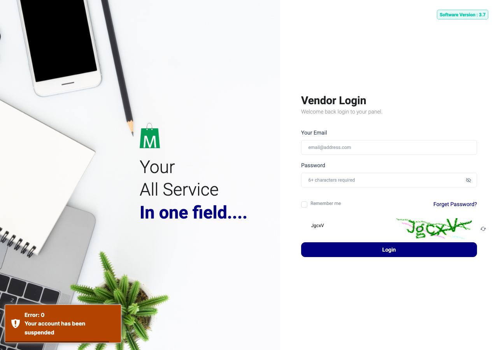
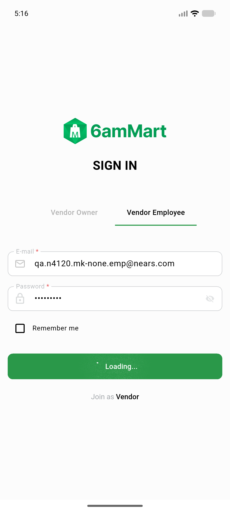
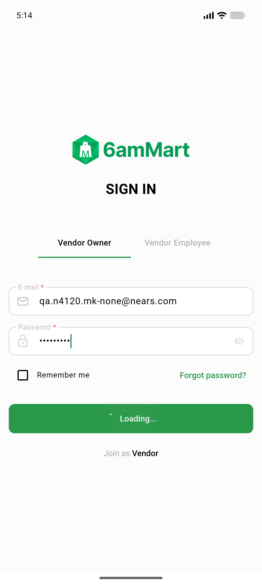

# QA Evidence — NEARS-4120

**NEARS-4120 PASS: vendor login refuses marker-suspended store (API 403 auth-002 + web), controls unchanged, VendorApp snackbar**

**3 screenshot(s).** Click any thumbnail for full resolution.

<table>
<tr>
<td align="center" width="33%"> ac2 web mk none login error</td>
<td align="center" width="33%"> ac5 vendorapp employee mk none suspended</td>
<td align="center" width="33%"> ac5 vendorapp owner mk none suspended</td>
</tr>
</table>

### Other artifacts
- [`ac5-vendorapp-observations.txt`](ac5-vendorapp-observations.txt)
- [`api-marker-live.txt`](api-marker-live.txt)
- [`api-matrix.txt`](api-matrix.txt)
- [`phpunit-backstop.txt`](phpunit-backstop.txt)
- [`progress.md`](progress.md)
- [`web-matrix.txt`](web-matrix.txt)

---
*From `nears/docs/qa-evidence/NEARS-4120/` · public-repo scrub policy (no live secrets; verified clean).*
