# QA Evidence — NEARS-4121

**Delta cycle 1: R1 push-tap cold start lands on My Business Plan via notification branch (PASS)**

**20 screenshot(s).** Click any thumbnail for full resolution.

<table>
<tr>
<td align="center" width="33%"><a href="AC4-r2-after-commission-pick.png">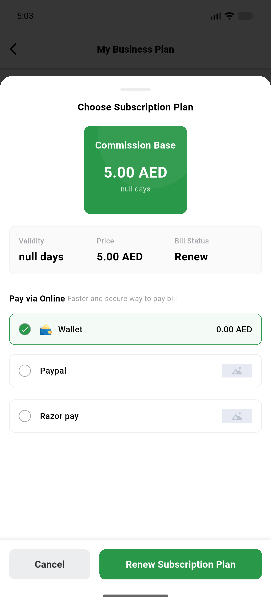</a> AC4 r2 after commission pick</td>
<td align="center" width="33%"><a href="AC6-r3-dashboard-after-approval-relaunch.png">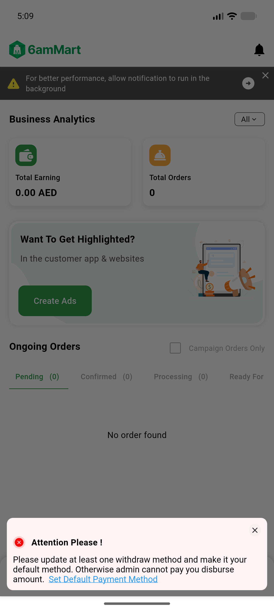</a> AC6 r3 dashboard after approval relaunch</td>
<td align="center" width="33%"><a href="AC7-r4-dashboard-after-cold-relaunch.png">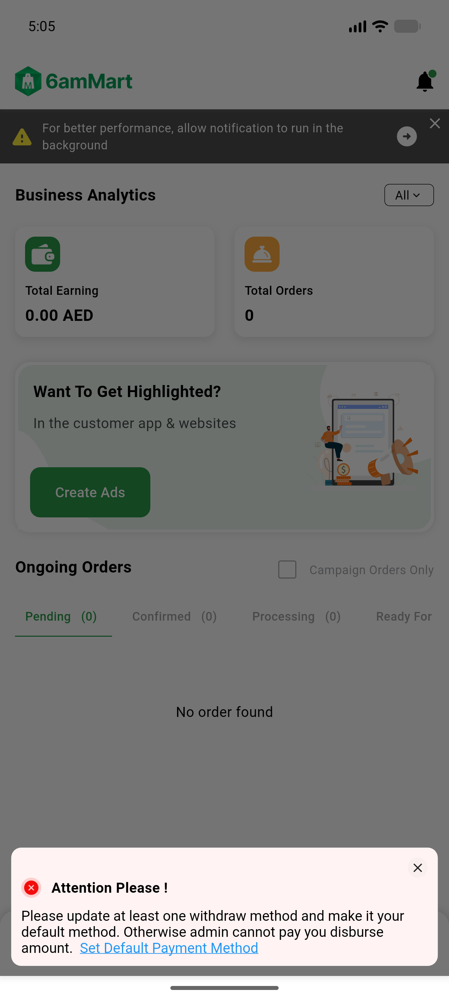</a> AC7 r4 dashboard after cold relaunch</td>
</tr>
<tr>
<td align="center" width="33%"> P1 r1 push tap coldstart mysubscription</td>
<td align="center" width="33%"><a href="S10-loginpath-system-back-dialog.png">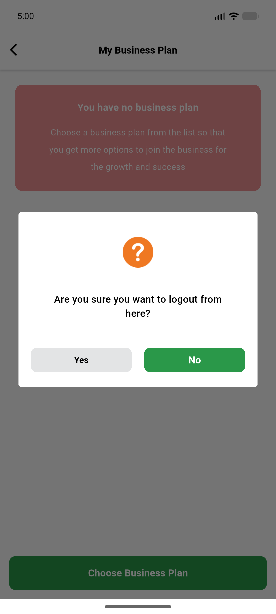</a> S10 loginpath system back dialog</td>
<td align="center" width="33%"><a href="S1a-r1-login-path-mysubscription.png">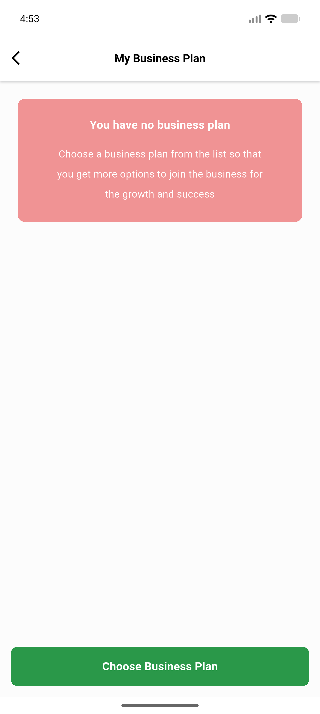</a> S1a r1 login path mysubscription</td>
</tr>
<tr>
<td align="center" width="33%"> S1b r1 cold relaunch mysubscription</td>
<td align="center" width="33%"> S1c r1 relaunch final frame</td>
<td align="center" width="33%"> S1d r1 relaunch first painted frame splash</td>
</tr>
<tr>
<td align="center" width="33%"><a href="S1e-r1-relaunch-first-mysubscription-frame.png">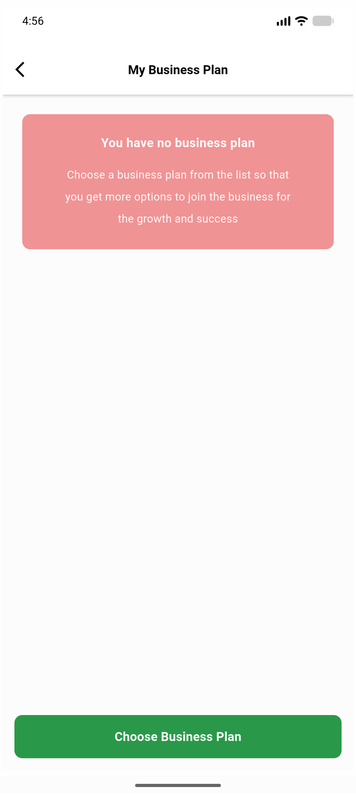</a> S1e r1 relaunch first mysubscription frame</td>
<td align="center" width="33%"><a href="S3-r1-appbar-back-dialog.png">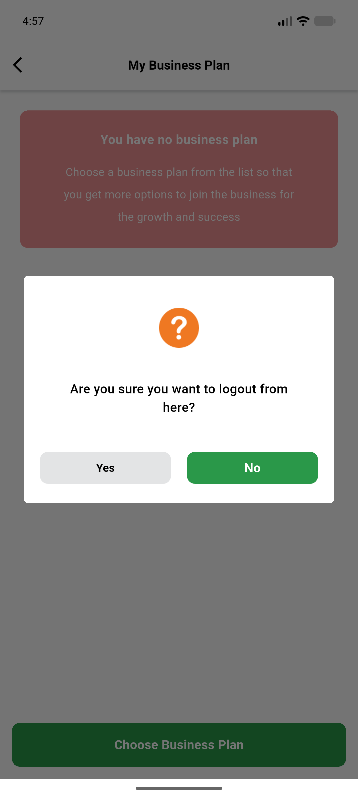</a> S3 r1 appbar back dialog</td>
<td align="center" width="33%"><a href="S4-r4-menu-logout-dialog-reference.png">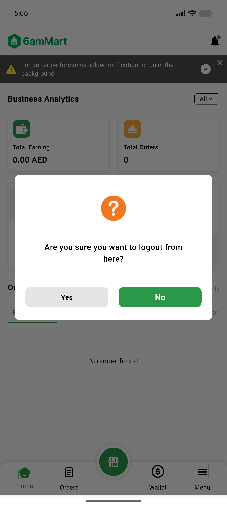</a> S4 r4 menu logout dialog reference</td>
</tr>
<tr>
<td align="center" width="33%"> S5 r1 system back dialog</td>
<td align="center" width="33%"> S6 r1 after No mysubscription</td>
<td align="center" width="33%"> S7 r1 after Yes signin</td>
</tr>
<tr>
<td align="center" width="33%"> S7a yes transition frame1</td>
<td align="center" width="33%"><a href="S7b-yes-transition-frame4.png">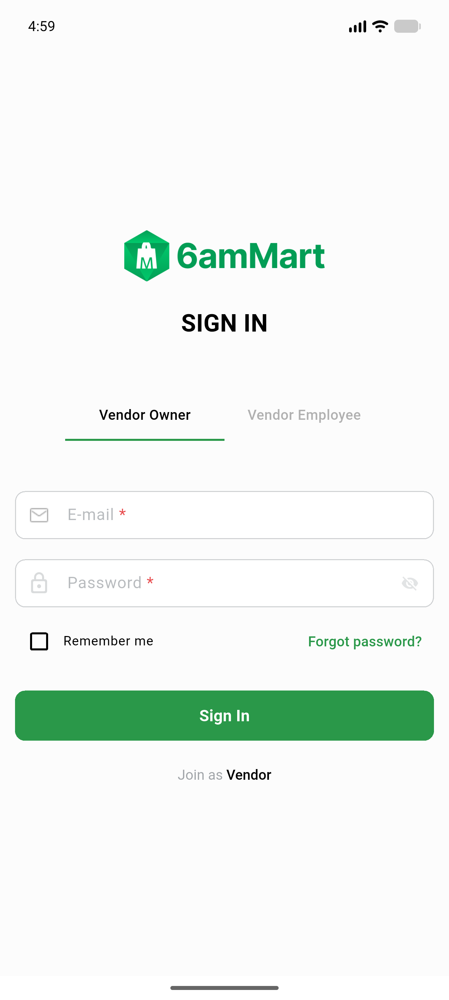</a> S7b yes transition frame4</td>
<td align="center" width="33%"> S9 relaunch after signout signin</td>
</tr>
<tr>
<td align="center" width="33%"><a href="bug-ac4-r2-commission-relaunch-dashboard-403.png">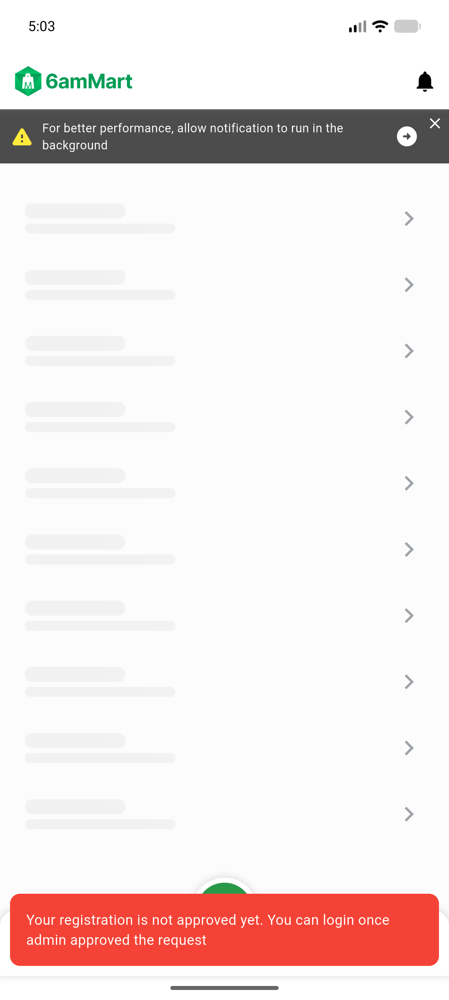</a> bug ac4 r2 commission relaunch dashboard 403</td>
<td align="center" width="33%"><a href="reg-r4-mybusinessplan.png">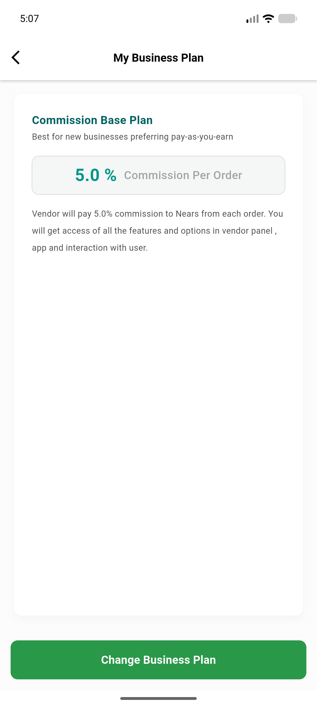</a> reg r4 mybusinessplan</td>
</tr>
</table>

### Other artifacts
- [`P-push-tap-coldstart-flutter-lines.log`](P-push-tap-coldstart-flutter-lines.log)
- [`bug-ac4-r2-a11y-nodes.txt`](bug-ac4-r2-a11y-nodes.txt)
- [`bug-ac4-r2-commission-relaunch-dashboard-403.log`](bug-ac4-r2-commission-relaunch-dashboard-403.log)
- [`progress.md`](progress.md)

---
*From `nears/docs/qa-evidence/NEARS-4121/` · public-repo scrub policy (no live secrets; verified clean).*
