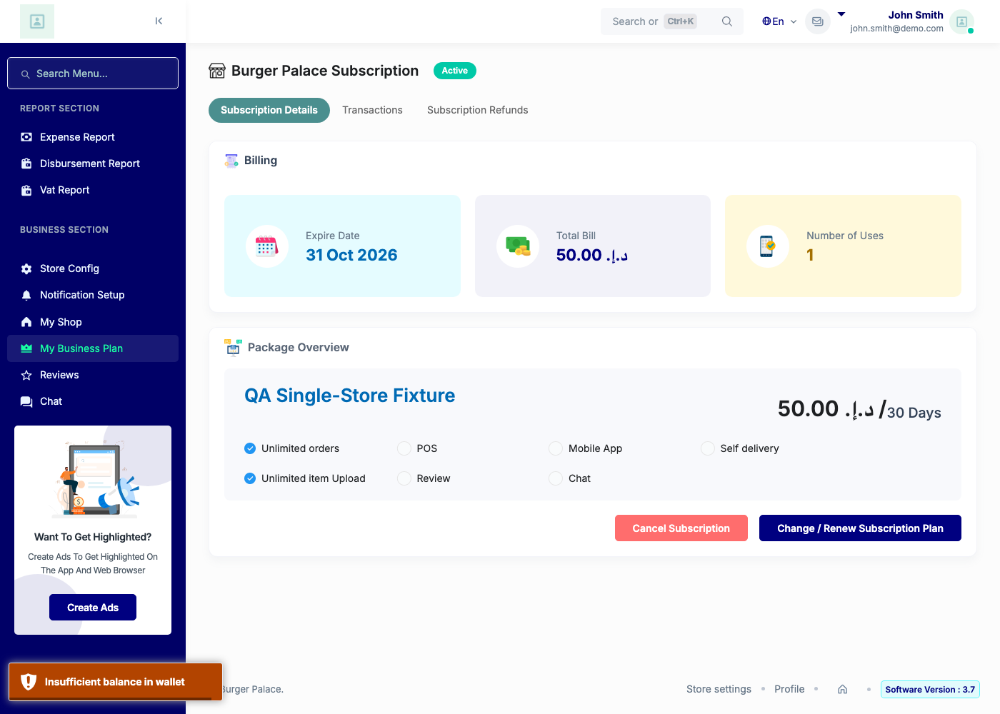
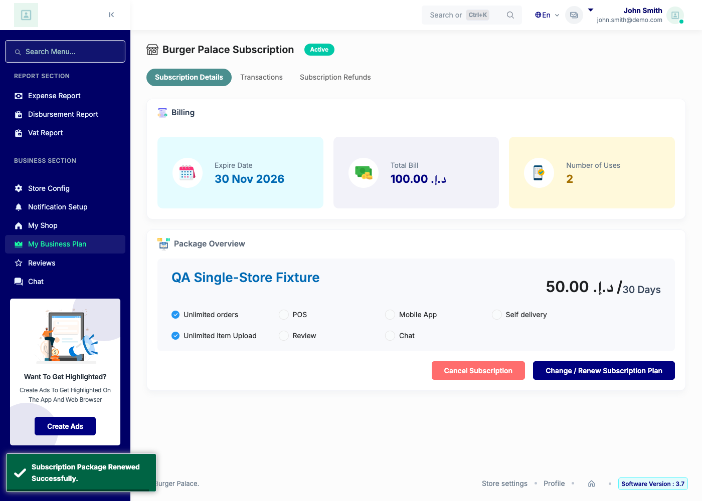
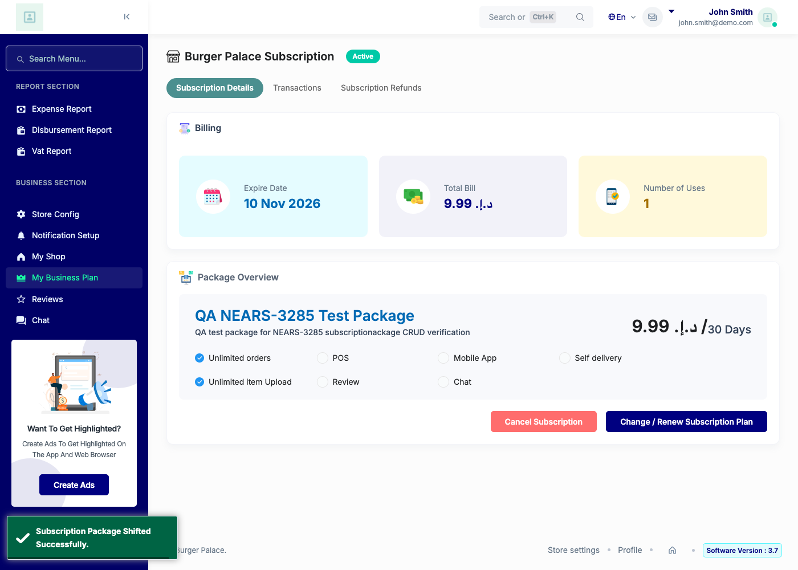
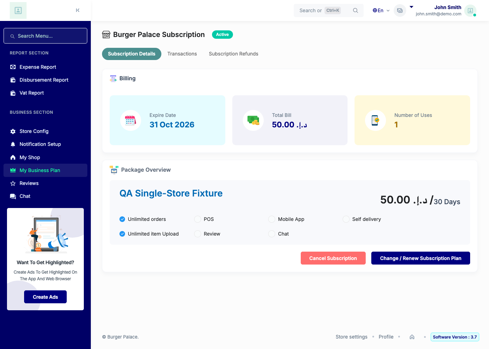

# QA Evidence — NEARS-4125

**PASS AC1-6 live: 3/3 fixed vs RED base, wallet lock serialization witnessed, 74/74 phpunit, base 18 RED**

**6 screenshot(s).** Click any thumbnail for full resolution.

<table>
<tr>
<td align="center" width="33%"> ac3 insufficient toast</td>
<td align="center" width="33%"> ac3 renew success toast</td>
<td align="center" width="33%"> ac3 shift success toast</td>
</tr>
<tr>
<td align="center" width="33%"> discover detail A</td>
<td align="center" width="33%"> regress detail B</td>
<td align="center" width="33%"> regress detail C</td>
</tr>
</table>

### Other artifacts
- [`bug-admin-packagebuy-lost-update.log`](bug-admin-packagebuy-lost-update.log)
- [`bug-userpanel-js-dollar-not-defined.log`](bug-userpanel-js-dollar-not-defined.log)
- [`progress.md`](progress.md)
- [`qa-run-record.txt`](qa-run-record.txt)

---
*From `nears/docs/qa-evidence/NEARS-4125/` · public-repo scrub policy (no live secrets; verified clean).*
