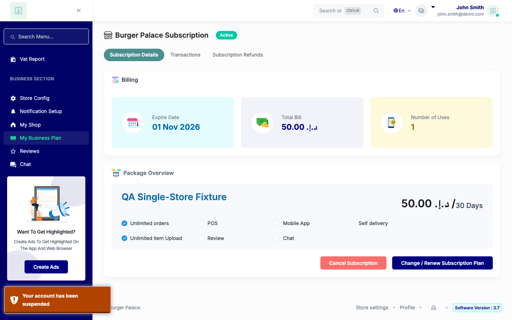

# QA Evidence — NEARS-4126

**PASS live (Store Panel + Admin web): base RED credits held store, fixed refuses 403 auth-003 + suspended toast + one [FAIL] by X-Request-Id, control credits 33.20, door 302**

**1 screenshot(s).** Click any thumbnail for full resolution.

<table>
<tr>
<td align="center" width="33%"> ac3 held refusal toast after reload</td>
</tr>
</table>

### Other artifacts
- [`ac5-fail-line-B1.log`](ac5-fail-line-B1.log)
- [`ac5-fail-line-B2.log`](ac5-fail-line-B2.log)
- [`armA-base-red-part1-update.log`](armA-base-red-part1-update.log)
- [`armA-base-red-part2-confirm.log`](armA-base-red-part2-confirm.log)
- [`armB1-held-fixed.log`](armB1-held-fixed.log)
- [`armB2-held-fixed-repeat.log`](armB2-held-fixed-repeat.log)
- [`armC-control-fixed.log`](armC-control-fixed.log)
- [`armD-door-demo.log`](armD-door-demo.log)
- [`armE-sweep-notheld.log`](armE-sweep-notheld.log)
- [`bug-vendor-common-js-dollar-undefined.log`](bug-vendor-common-js-dollar-undefined.log)

---
*From `nears/docs/qa-evidence/NEARS-4126/` · public-repo scrub policy (no live secrets; verified clean).*
