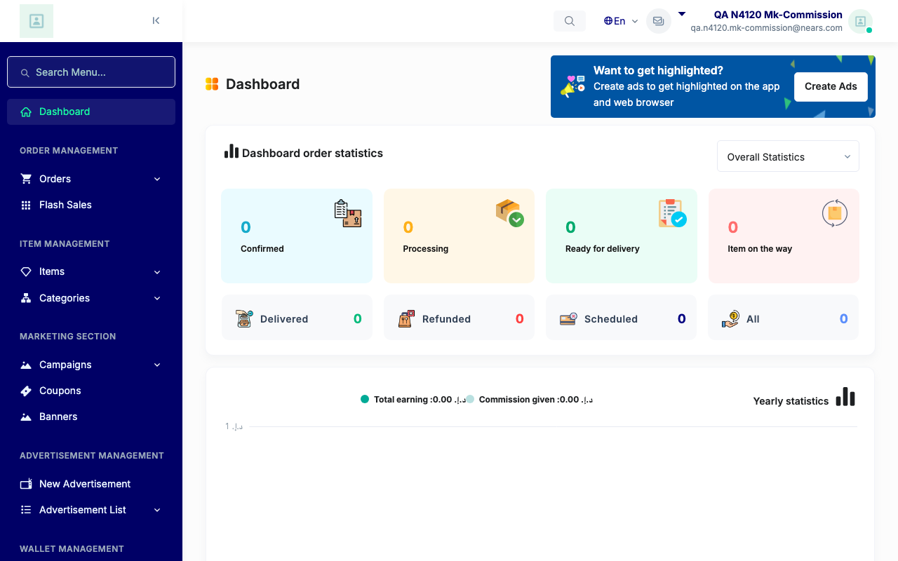
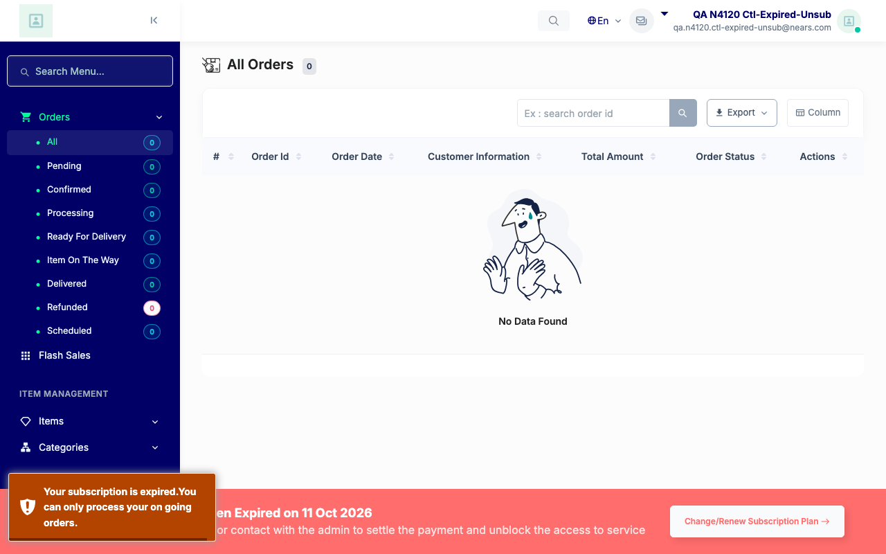
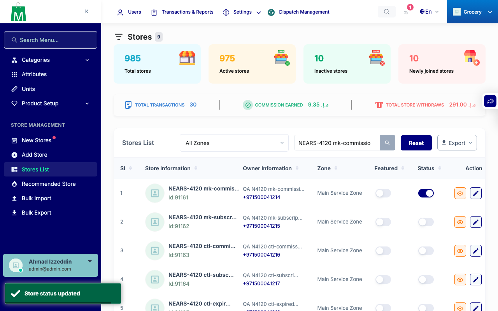
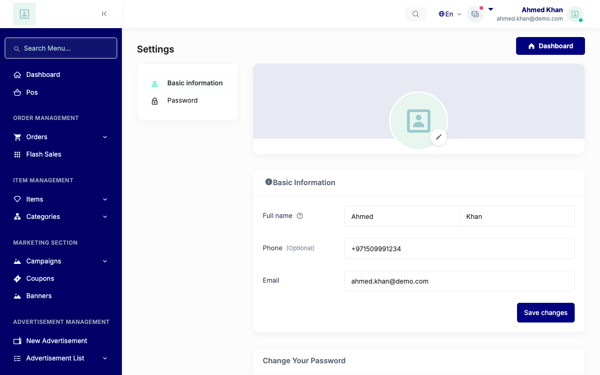

# QA Evidence — NEARS-4127

**PASS AC1-AC5 live, base RED 200 vs fixed 302, 1 [FAIL] line per refusal**

**16 screenshot(s).** Click any thumbnail for full resolution.

<table>
<tr>
<td align="center" width="33%"> ac1 base mkcommission 1 owner session open</td>
<td align="center" width="33%"> ac1 base mkcommission 2 owner after suspension next request</td>
<td align="center" width="33%"> ac1 base mkcommission 3 old tab after reactivation</td>
</tr>
<tr>
<td align="center" width="33%"> ac1 base mkcommission 4 fresh login after reactivation</td>
<td align="center" width="33%"> ac1 base mkcommission 5 idle session first request</td>
<td align="center" width="33%"> ac1 fixed mkcommission 1 owner session open</td>
</tr>
<tr>
<td align="center" width="33%"> ac1 fixed mkcommission 2 owner after suspension next request</td>
<td align="center" width="33%"> ac1 fixed mkcommission 3 old tab after reactivation</td>
<td align="center" width="33%"> ac1 fixed mkcommission 4 fresh login after reactivation</td>
</tr>
<tr>
<td align="center" width="33%"> ac1 fixed mkcommission 5 idle session first request</td>
<td align="center" width="33%"> ac3 base ctl expired unsub renewal</td>
<td align="center" width="33%"> ac3 fixed ctl expired unsub renewal</td>
</tr>
<tr>
<td align="center" width="33%"> emp fixed after suspension</td>
<td align="center" width="33%"> reg admin ui toggle off flash</td>
<td align="center" width="33%"> reg admin ui toggle on flash</td>
</tr>
<tr>
<td align="center" width="33%"> reg normal owner orders</td>
</tr>
</table>

### Other artifacts
- [`ac5-session_suspended-log-excerpt.log`](ac5-session_suspended-log-excerpt.log)
- [`progress.md`](progress.md)
- [`qa-run-results.json`](qa-run-results.json)

---
*From `nears/docs/qa-evidence/NEARS-4127/` · public-repo scrub policy (no live secrets; verified clean).*
