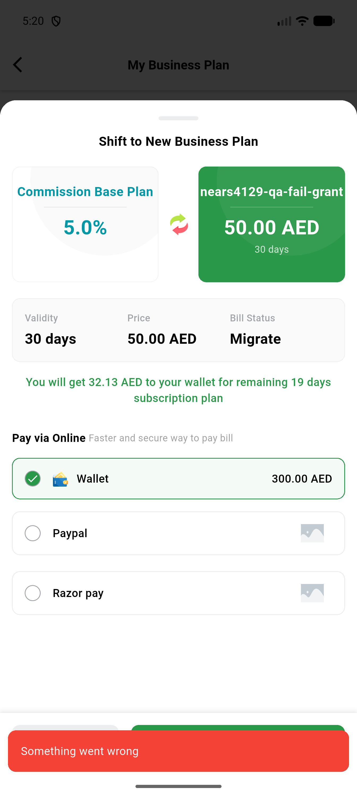
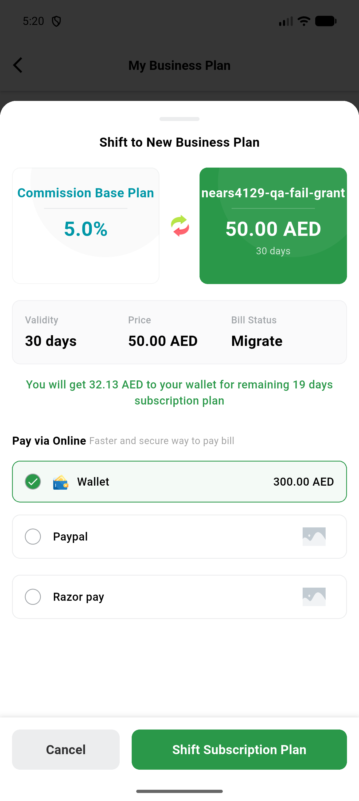
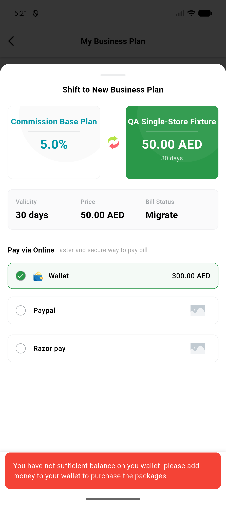

# QA Evidence — NEARS-4129

**QA cycle 0 PASS: AC1-AC8 live base-vs-fixed on clone, VendorApp device arm**

**3 screenshot(s).** Click any thumbnail for full resolution.

<table>
<tr>
<td align="center" width="33%"> app fail package response</td>
<td align="center" width="33%"> app fail package wallet selected</td>
<td align="center" width="33%"> app underfunded response</td>
</tr>
</table>

### Other artifacts
- [`ac7-base-old-log-shape.log`](ac7-base-old-log-shape.log)
- [`app-vendorapp-net-fail.log`](app-vendorapp-net-fail.log)
- [`arm-table.md`](arm-table.md)
- [`arms`](arms)
- [`be-fail-lines-fixed-tree-qa-rids.log`](be-fail-lines-fixed-tree-qa-rids.log)
- [`be-log-base-tree-proof.txt`](be-log-base-tree-proof.txt)
- [`phpunit-summary.txt`](phpunit-summary.txt)
- [`progress.md`](progress.md)
- [`restarts.log`](restarts.log)
- [`serve-exit.log`](serve-exit.log)

---
*From `nears/docs/qa-evidence/NEARS-4129/` · public-repo scrub policy (no live secrets; verified clean).*
