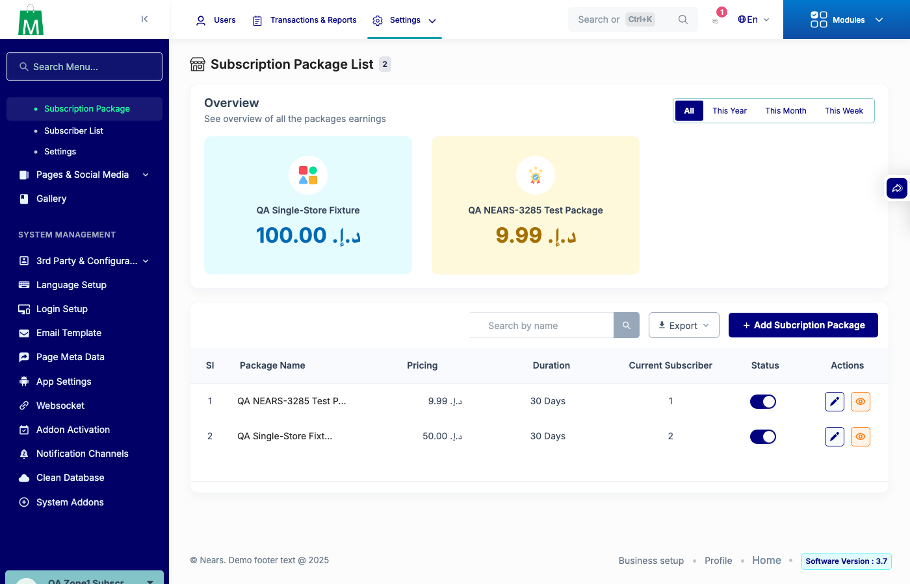

# QA Evidence — NEARS-4130

**NEARS-4130 QA PASS: ZoneScope StoreSubscription label + Store expiry hook (live base-RED vs fixed-GREEN, AC1-AC6)**

**2 screenshot(s).** Click any thumbnail for full resolution.

<table>
<tr>
<td align="center" width="33%"> ac3 zone1 package list BASE red</td>
<td align="center" width="33%"> ac3 zone1 package list FIXED</td>
</tr>
</table>

### Other artifacts
- [`ac3-measure_admin_base.txt`](ac3-measure_admin_base.txt)
- [`ac3-measure_admin_fixed.txt`](ac3-measure_admin_fixed.txt)
- [`ac3-measure_qa.zone1.subscription_base.txt`](ac3-measure_qa.zone1.subscription_base.txt)
- [`ac3-measure_qa.zone1.subscription_fixed.txt`](ac3-measure_qa.zone1.subscription_fixed.txt)
- [`ac3-measure_qa.zone2.subscription_base.txt`](ac3-measure_qa.zone2.subscription_base.txt)
- [`ac3-measure_qa.zone2.subscription_fixed.txt`](ac3-measure_qa.zone2.subscription_fixed.txt)
- [`ac3-notifier-query-tinker.txt`](ac3-notifier-query-tinker.txt)
- [`ac3-package-export-zone1-BASE.csv`](ac3-package-export-zone1-BASE.csv)
- [`ac3-package-export-zone1-FIXED.csv`](ac3-package-export-zone1-FIXED.csv)
- [`ac4-actions-base.txt`](ac4-actions-base.txt)
- [`ac4-actions-fixed.txt`](ac4-actions-fixed.txt)
- [`ac4-business-model-gate.txt`](ac4-business-model-gate.txt)
- [`ac6-label-only-RED-1093.log`](ac6-label-only-RED-1093.log)
- [`ac6-super-control-base.txt`](ac6-super-control-base.txt)
- [`ac6-super-control-fixed.txt`](ac6-super-control-fixed.txt)
- [`progress.md`](progress.md)
- [`regression-out-of-zone-detail-500.log`](regression-out-of-zone-detail-500.log)

---
*From `nears/docs/qa-evidence/NEARS-4130/` · public-repo scrub policy (no live secrets; verified clean).*
