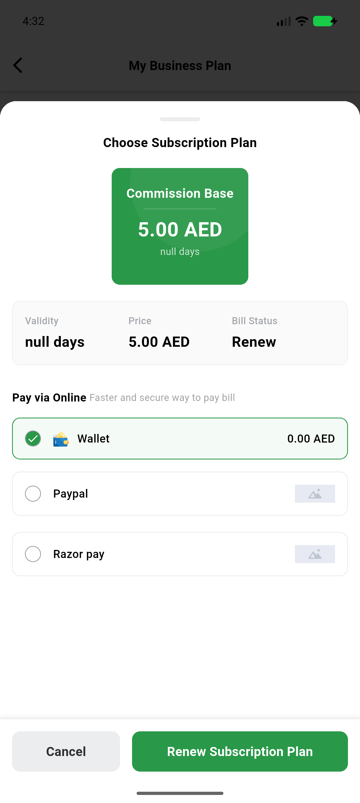
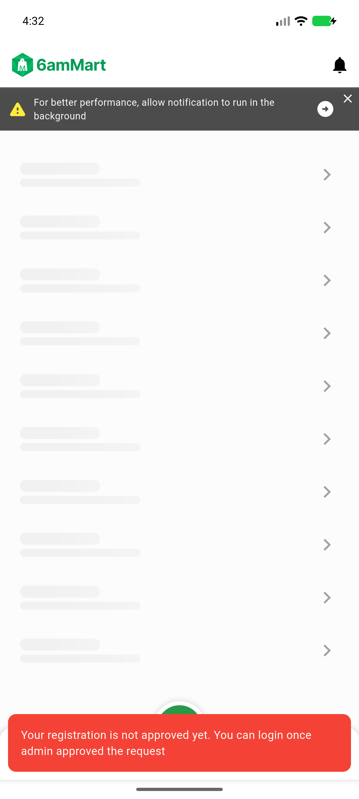
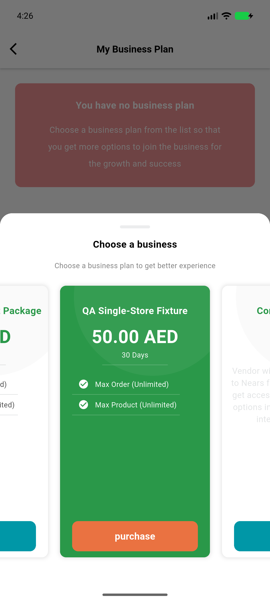
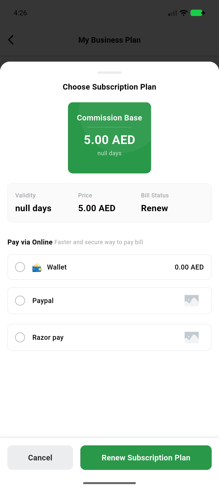
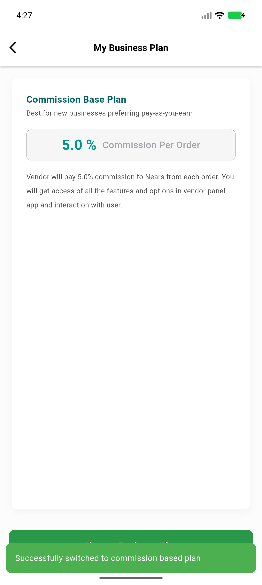
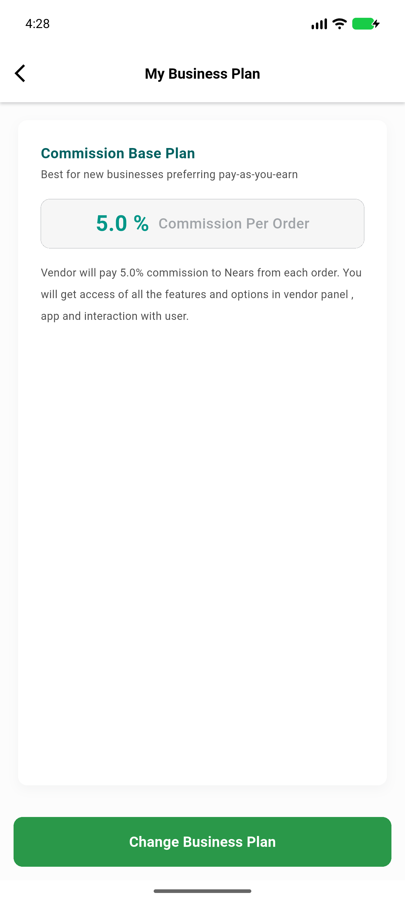
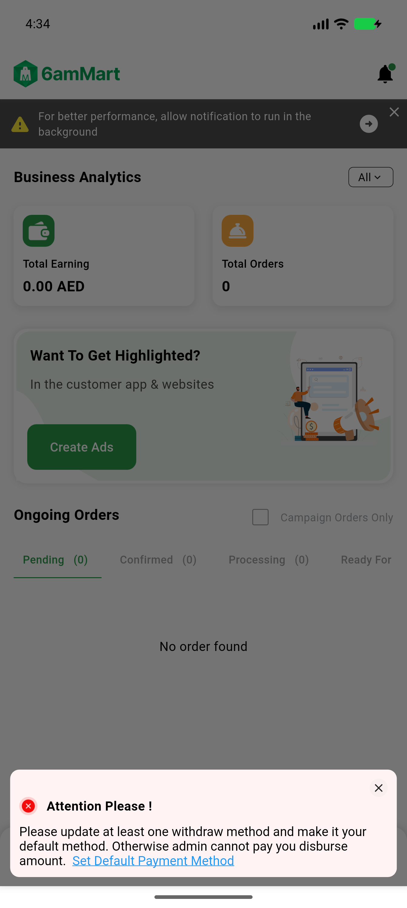

# QA Evidence — NEARS-4144

**NEARS-4144 QA: PASS pending AC-by-AC (tip 4f0c28e87) - four registration routes 200 for commission-picked pending token, rest 403, suspended unchanged, device relaunch green**

**7 screenshot(s).** Click any thumbnail for full resolution.

<table>
<tr>
<td align="center" width="33%"> ac5 base 01 after pick stuck sheet</td>
<td align="center" width="33%"> ac5 base 02 relaunch 403 dashboard snackbars</td>
<td align="center" width="33%"> ac5 fixed 01 plan sheet</td>
</tr>
<tr>
<td align="center" width="33%"> ac5 fixed 02 commission confirm</td>
<td align="center" width="33%"> ac5 fixed 03 after pick snack</td>
<td align="center" width="33%"> ac5 fixed 04 relaunch mysubscription</td>
</tr>
<tr>
<td align="center" width="33%"> ac7ctl fixed r4 relaunch dashboard</td>
</tr>
</table>

### Other artifacts
- [`a1_base.txt`](a1_base.txt)
- [`a1_fixed.txt`](a1_fixed.txt)
- [`a1_r1.txt`](a1_r1.txt)
- [`a2_fixed.txt`](a2_fixed.txt)
- [`a2_universe_fixed.txt`](a2_universe_fixed.txt)
- [`a3_approved.txt`](a3_approved.txt)
- [`a3_suspended.txt`](a3_suspended.txt)
- [`a4-diff-pins.txt`](a4-diff-pins.txt)
- [`ac5-base-relaunch.log`](ac5-base-relaunch.log)
- [`ac5-fixed-relaunch.log`](ac5-fixed-relaunch.log)
- [`ac7ctl-r4-fixed.log`](ac7ctl-r4-fixed.log)
- [`bug-update-bank-info-500.log`](bug-update-bank-info-500.log)
- [`named.txt`](named.txt)
- [`phpunit-backstop.txt`](phpunit-backstop.txt)
- [`progress.md`](progress.md)
- [`snap_after.txt`](snap_after.txt)
- [`snap_before.txt`](snap_before.txt)

---
*From `nears/docs/qa-evidence/NEARS-4144/` · public-repo scrub policy (no live secrets; verified clean).*
