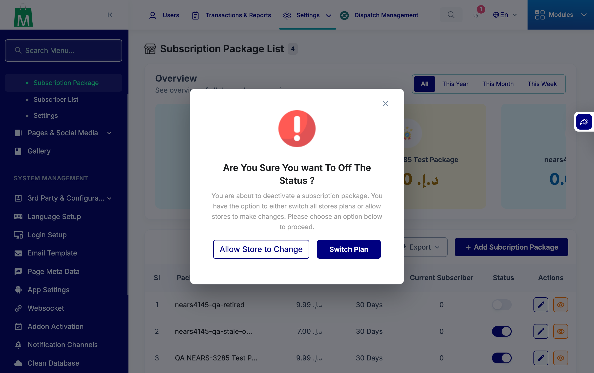
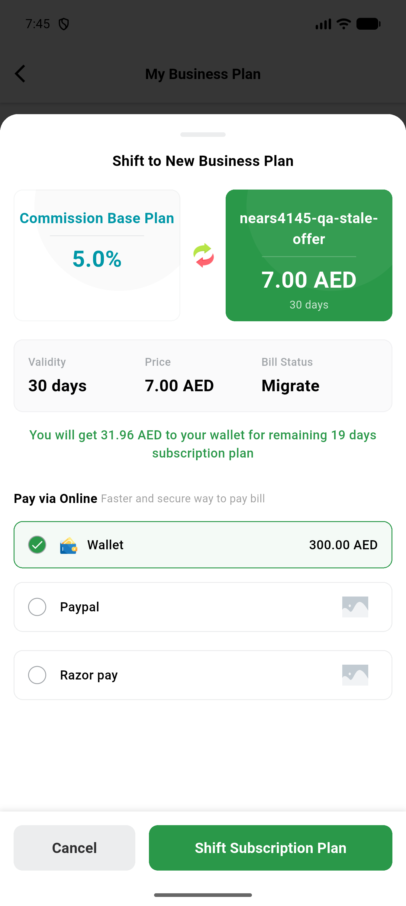

# QA Evidence — NEARS-4145

**PASS cycle0: AC1-5,9 live, AC8 device arm, all refusals 403 no-write; 1 regression-candidate confirmed (web /vendor/payment)**

**2 screenshot(s).** Click any thumbnail for full resolution.

<table>
<tr>
<td align="center" width="33%"> ac8 admin toggle confirm modal</td>
<td align="center" width="33%"> ac8 vendorapp refusal snackbar</td>
</tr>
</table>

### Other artifacts
- [`ac4-balance-note.txt`](ac4-balance-note.txt)
- [`ac8-db-before-after.txt`](ac8-db-before-after.txt)
- [`ac8-vendorapp-log-excerpt.txt`](ac8-vendorapp-log-excerpt.txt)
- [`arms-ac1-ac2-ac3a.txt`](arms-ac1-ac2-ac3a.txt)
- [`arms-ac3b-nonexistent-array.txt`](arms-ac3b-nonexistent-array.txt)
- [`arms-ac4-positive.txt`](arms-ac4-positive.txt)
- [`arms-ac9-base-red.txt`](arms-ac9-base-red.txt)
- [`arms-commission.txt`](arms-commission.txt)
- [`arms-insufficient-balance.txt`](arms-insufficient-balance.txt)
- [`arms-pending-nonce.txt`](arms-pending-nonce.txt)
- [`arms-security-auth.txt`](arms-security-auth.txt)
- [`arms-security-compare.txt`](arms-security-compare.txt)
- [`arms-security-misc.txt`](arms-security-misc.txt)
- [`arms-web-payment.txt`](arms-web-payment.txt)
- [`note-store5-unintended-purchase.txt`](note-store5-unintended-purchase.txt)
- [`package-view-base-vs-fixed.txt`](package-view-base-vs-fixed.txt)
- [`package-view-fixed.txt`](package-view-fixed.txt)
- [`phpunit-backstop.txt`](phpunit-backstop.txt)
- [`served-db-proof.txt`](served-db-proof.txt)

---
*From `nears/docs/qa-evidence/NEARS-4145/` · public-repo scrub policy (no live secrets; verified clean).*
