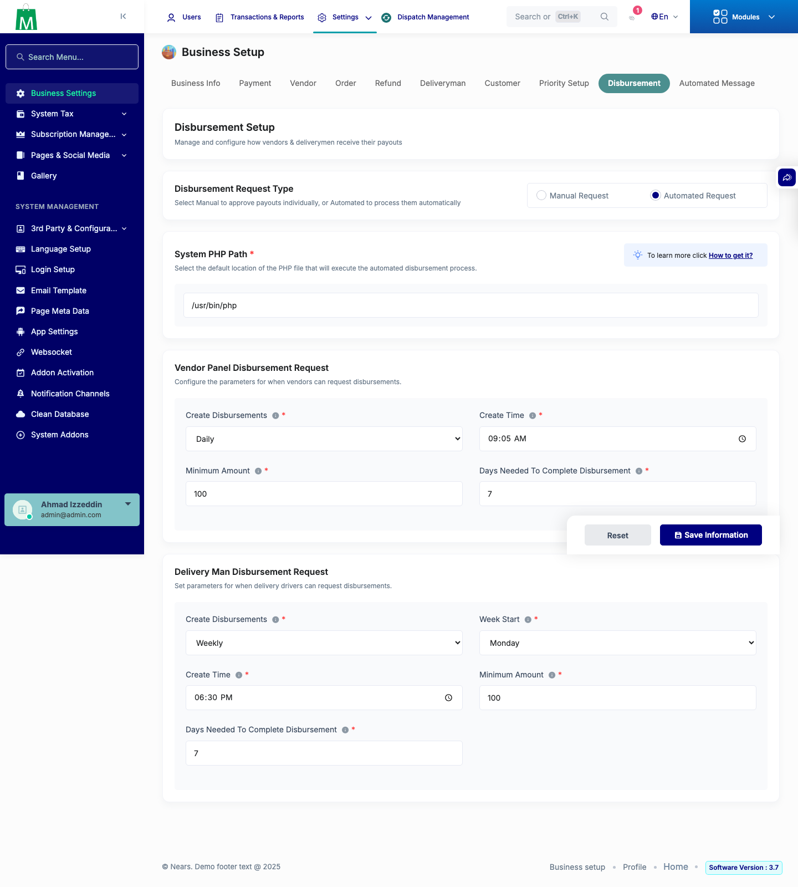
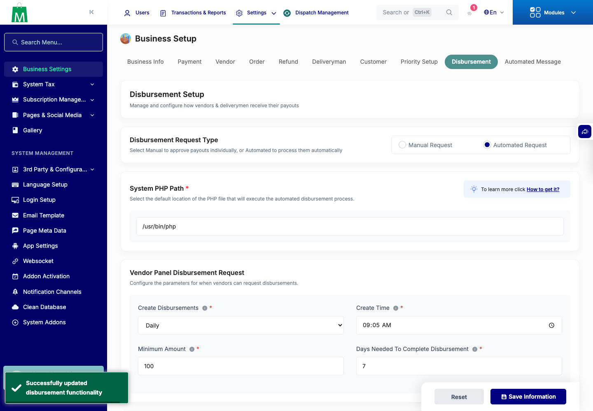
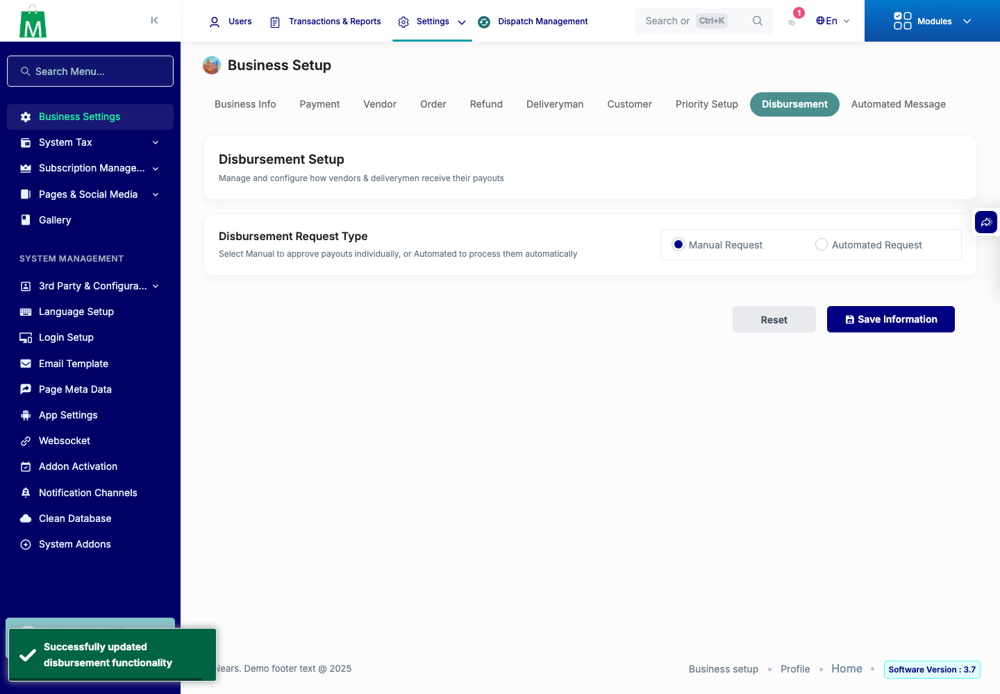
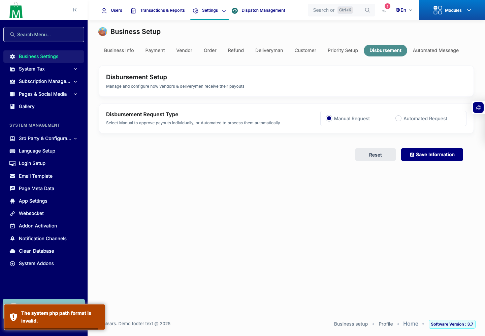
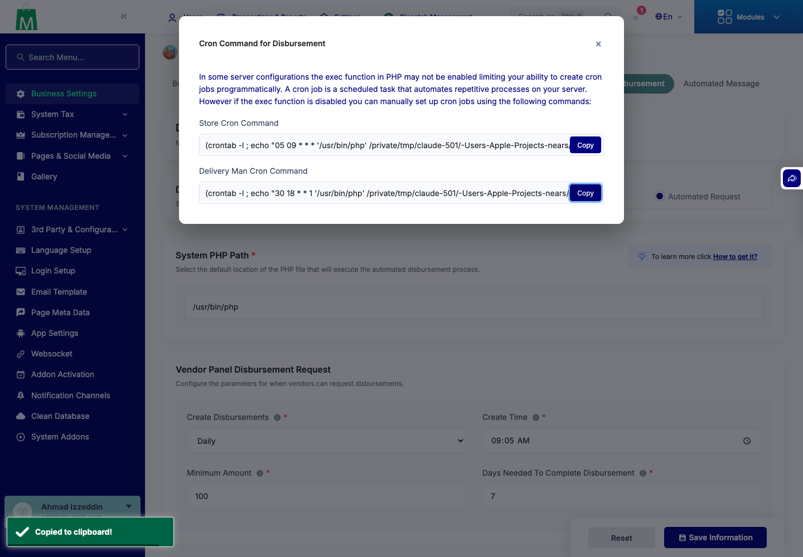

# QA Evidence — NEARS-4150

**PASS: NEARS-4150 disbursement cron injection - base RED (3 sinks exec) vs fixed GREEN, 154 refusals, legit byte-identical**

**5 screenshot(s).** Click any thumbnail for full resolution.

<table>
<tr>
<td align="center" width="33%"> ui 01 page load automated</td>
<td align="center" width="33%"> ui 02 automated save success</td>
<td align="center" width="33%"> ui 03 manual save success</td>
</tr>
<tr>
<td align="center" width="33%"> ui 04 refused php path</td>
<td align="center" width="33%"> ui 05 commands copy control</td>
</tr>
</table>

### Other artifacts
- [`C1.base`](C1.base)
- [`C1.fixed`](C1.fixed)
- [`C2.base`](C2.base)
- [`C2.fixed`](C2.fixed)
- [`C3.base`](C3.base)
- [`C3.fixed`](C3.fixed)
- [`C4.base`](C4.base)
- [`C4.fixed`](C4.fixed)
- [`D2.fixed`](D2.fixed)
- [`arm-B-rows.json`](arm-B-rows.json)
- [`arms.jsonl`](arms.jsonl)
- [`fixed-refusal-log-armB.log`](fixed-refusal-log-armB.log)
- [`progress.md`](progress.md)
- [`ui-run.json`](ui-run.json)
- [`ui2-copy-control.json`](ui2-copy-control.json)

---
*From `nears/docs/qa-evidence/NEARS-4150/` · public-repo scrub policy (no live secrets; verified clean).*
