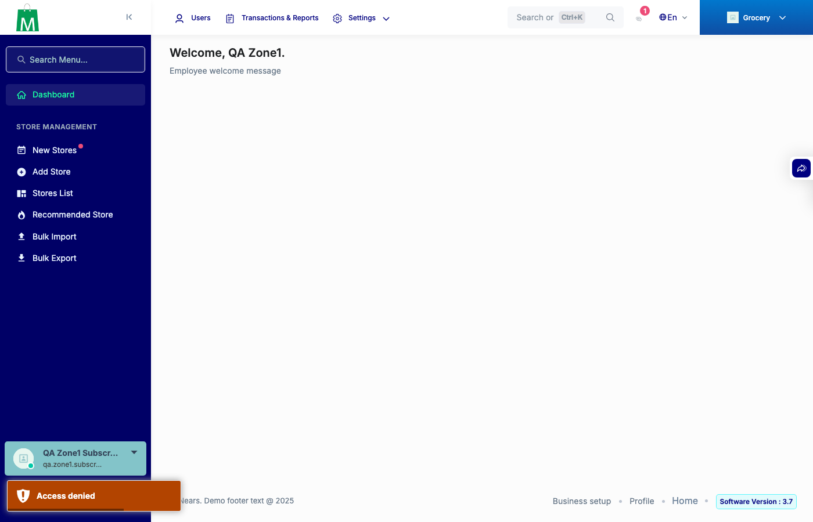

# QA Evidence — NEARS-4151

**PASS - addon publish/activation/delete path allow-list refuses traversal/absolute/foreign/TaxModule paths before any include/write/delete; legit flows unchanged**

**1 screenshot(s).** Click any thumbnail for full resolution.

<table>
<tr>
<td align="center" width="33%"> ac stale tab 403 dashboard confound</td>
</tr>
</table>

### Other artifacts
- [`bug-index-blade-cwd-include-preexisting.log`](bug-index-blade-cwd-include-preexisting.log)

---
*From `nears/docs/qa-evidence/NEARS-4151/` · public-repo scrub policy (no live secrets; verified clean).*
