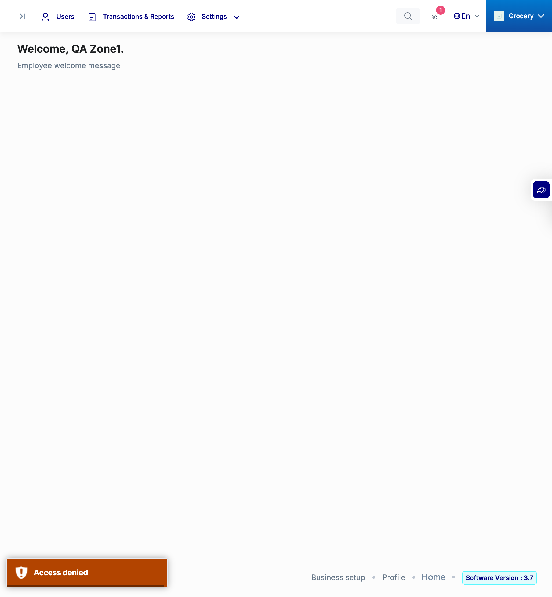

# QA Evidence — NEARS-4152

**NEARS-4152 QA: system-addon group role_id1-only + upload stem/extraction guard, live on tip 0c7a79ede**

**1 screenshot(s).** Click any thumbnail for full resolution.

<table>
<tr>
<td align="center" width="33%"> r1 nonsuper with settings addon index toastr access denied</td>
</tr>
</table>

### Other artifacts
- [`progress.md`](progress.md)
- [`r1_serverA.json`](r1_serverA.json)
- [`r1_serverA_toast_followup.json`](r1_serverA_toast_followup.json)
- [`r1_serverB_nonsuper.json`](r1_serverB_nonsuper.json)
- [`r1_serverC_base_RED.json`](r1_serverC_base_RED.json)
- [`r2_B_a.json`](r2_B_a.json)
- [`r2_B_b_d_e_f_v.json`](r2_B_b_d_e_f_v.json)
- [`r2_B_c.json`](r2_B_c.json)
- [`r2_B_c_lifecycle.json`](r2_B_c_lifecycle.json)
- [`r2_B_d.json`](r2_B_d.json)
- [`r2_C_a.json`](r2_C_a.json)
- [`r2_C_b_c_d_e_f_v.json`](r2_C_b_c_d_e_f_v.json)
- [`regression_sweep_A.json`](regression_sweep_A.json)
- [`sec_confirm_B.json`](sec_confirm_B.json)

---
*From `nears/docs/qa-evidence/NEARS-4152/` · public-repo scrub policy (no live secrets; verified clean).*
