# QA Evidence — NEARS-4153

**PASS live: 5 subscription writes refused for non-super (302+access_denied, DB identical, 1 FAIL line/refusal), role_id 1 control OK, base-RED restricted succeeds**

**32 screenshot(s).** Click any thumbnail for full resolution.

<table>
<tr>
<td align="center" width="33%"> base create</td>
<td align="center" width="33%"><a href="base-edit.png">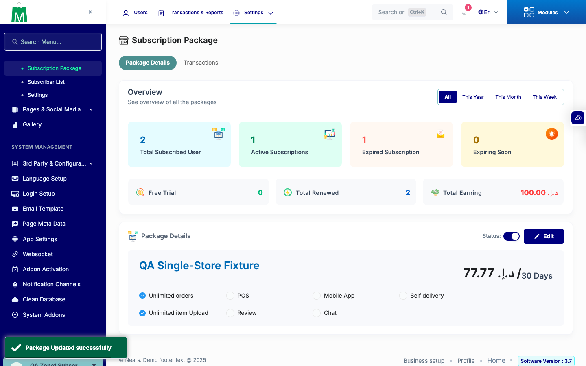</a> base edit</td>
<td align="center" width="33%"><a href="base-restricted-details-after-confirm.png">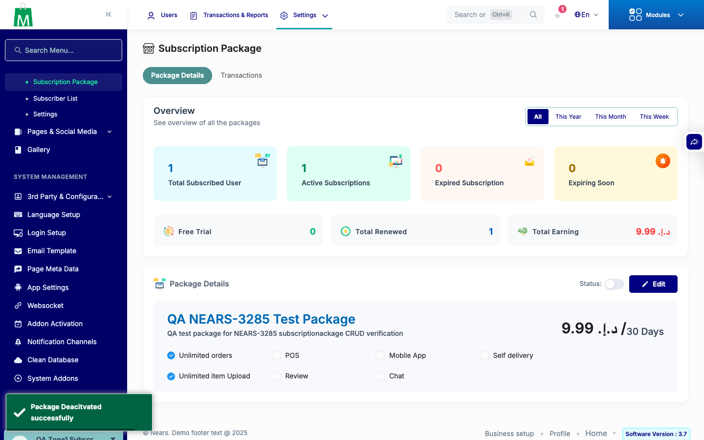</a> base restricted details after confirm</td>
</tr>
<tr>
<td align="center" width="33%"> base restricted details after toggle click</td>
<td align="center" width="33%"> base settings deadline</td>
<td align="center" width="33%"><a href="base-settings_trial.png">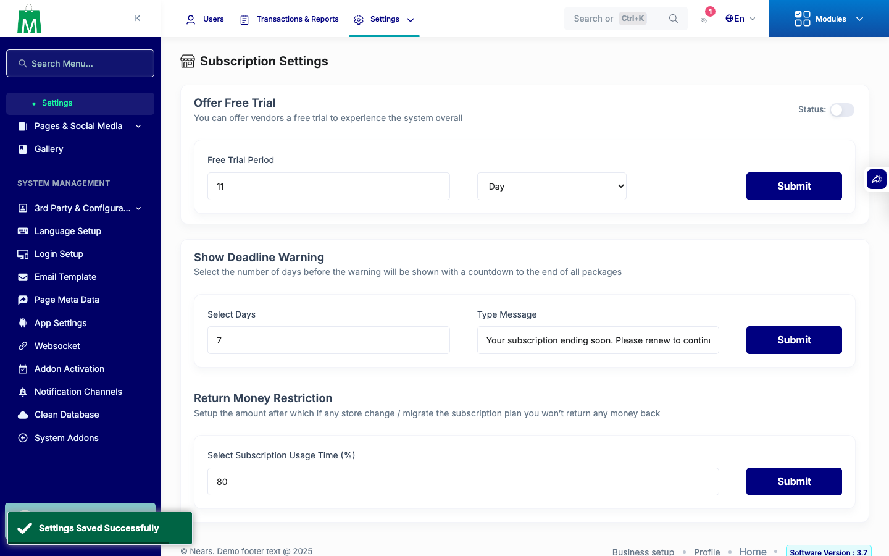</a> base settings trial</td>
</tr>
<tr>
<td align="center" width="33%"> base settings usage</td>
<td align="center" width="33%"><a href="base-status_off.png">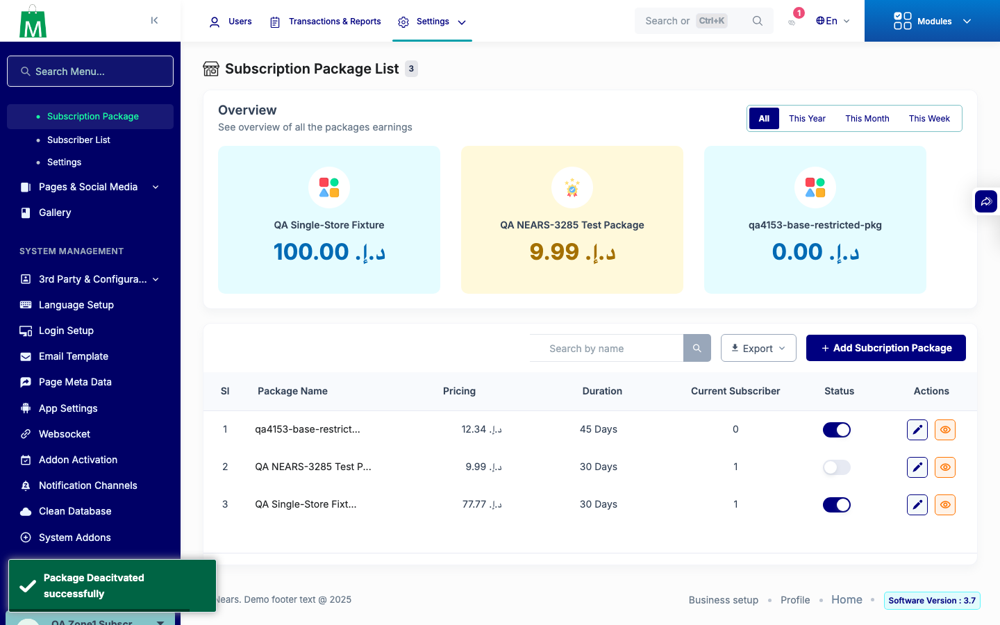</a> base status off</td>
<td align="center" width="33%"> base trial</td>
</tr>
<tr>
<td align="center" width="33%"><a href="base2-status_on.png">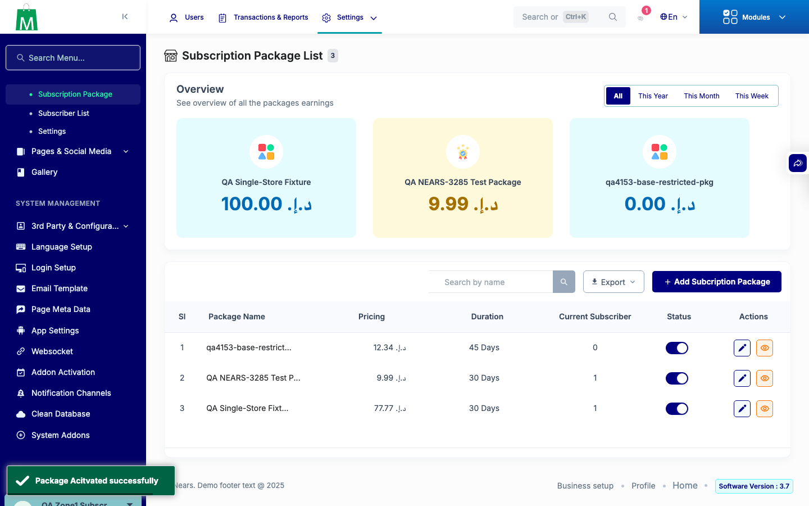</a> base2 status on</td>
<td align="center" width="33%"><a href="fixed-restricted-details-after-confirm.png">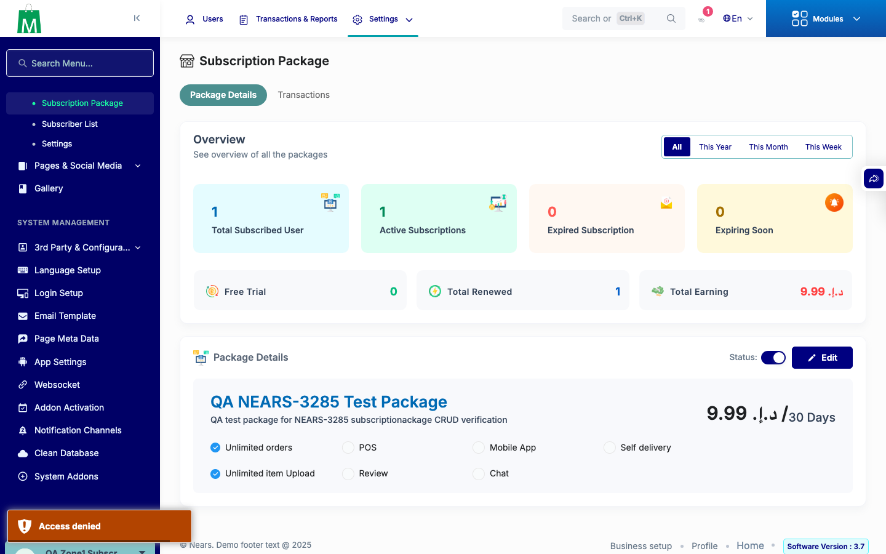</a> fixed restricted details after confirm</td>
<td align="center" width="33%"> fixed restricted details after toggle click</td>
</tr>
<tr>
<td align="center" width="33%"> fixed super details after confirm</td>
<td align="center" width="33%"><a href="fixed-super-details-after-toggle-click.png">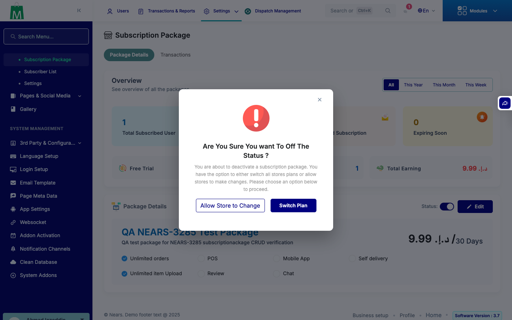</a> fixed super details after toggle click</td>
<td align="center" width="33%"><a href="p2-restricted-create.png">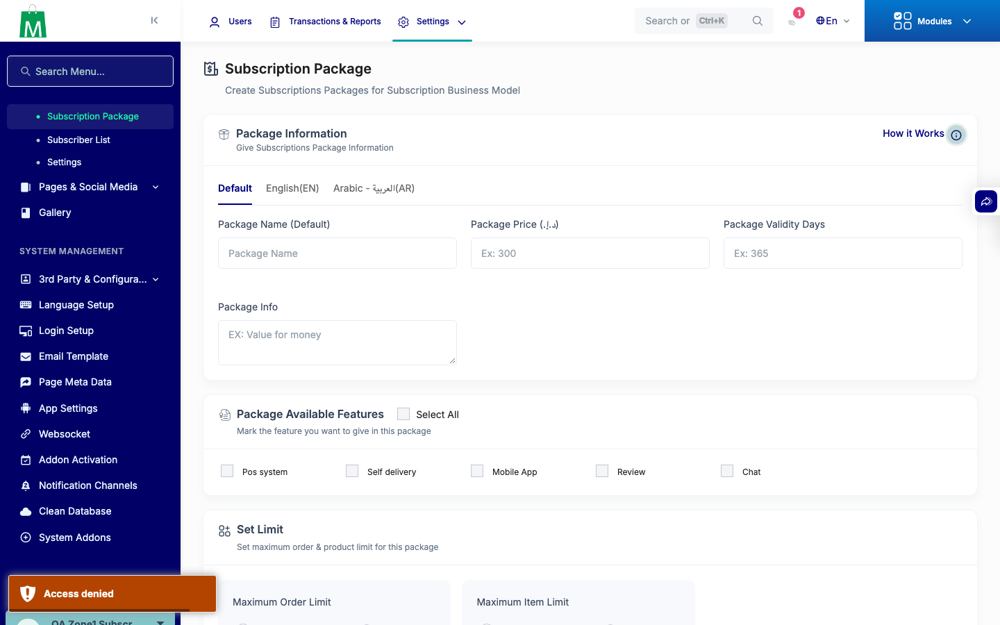</a> p2 restricted create</td>
</tr>
<tr>
<td align="center" width="33%"><a href="p2-restricted-edit.png">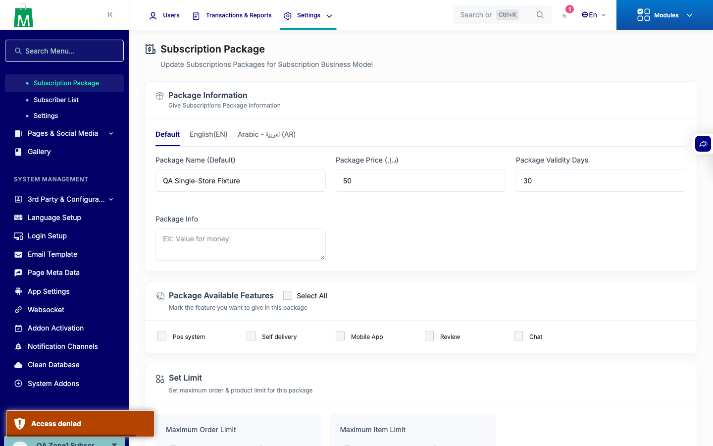</a> p2 restricted edit</td>
<td align="center" width="33%"><a href="p2-restricted-settings_deadline.png">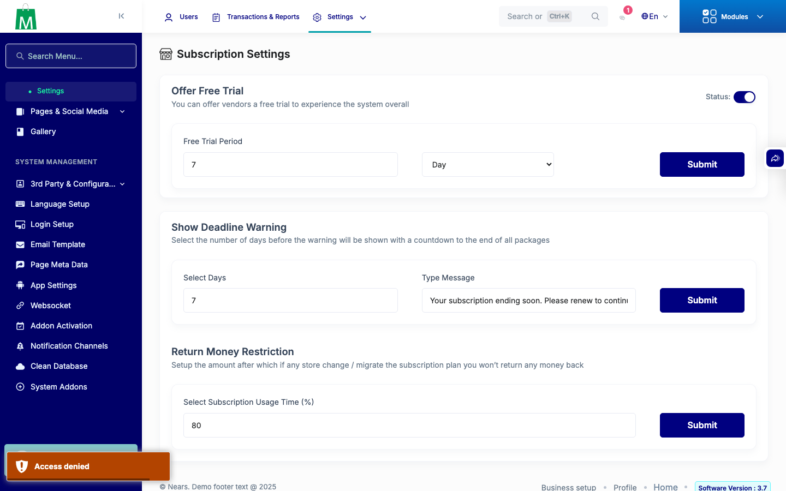</a> p2 restricted settings deadline</td>
<td align="center" width="33%"> p2 restricted settings trial</td>
</tr>
<tr>
<td align="center" width="33%"> p2 restricted settings usage</td>
<td align="center" width="33%"><a href="p2-restricted-status_off.png">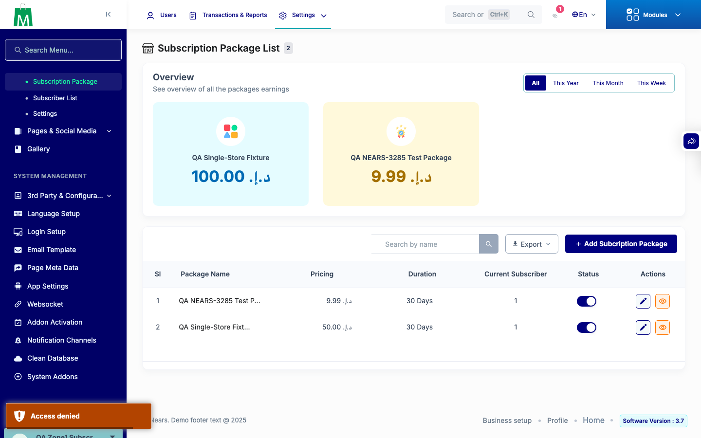</a> p2 restricted status off</td>
<td align="center" width="33%"> p2 restricted trial</td>
</tr>
<tr>
<td align="center" width="33%"> p2 super create</td>
<td align="center" width="33%"><a href="p2-super-edit.png">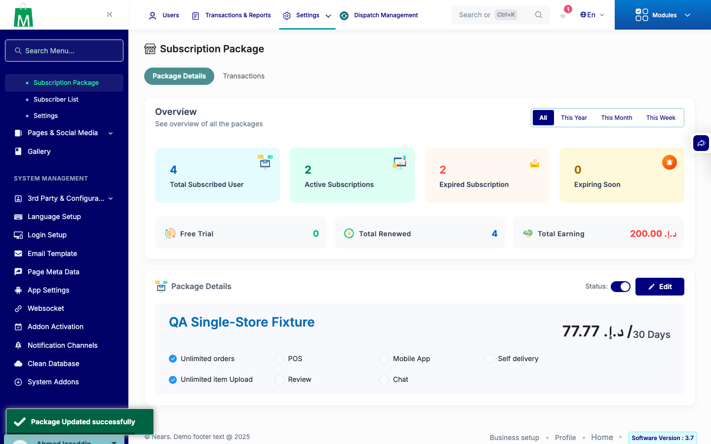</a> p2 super edit</td>
<td align="center" width="33%"> p2 super settings deadline</td>
</tr>
<tr>
<td align="center" width="33%"> p2 super settings trial</td>
<td align="center" width="33%"> p2 super settings usage</td>
<td align="center" width="33%"><a href="p2-super-status_off.png">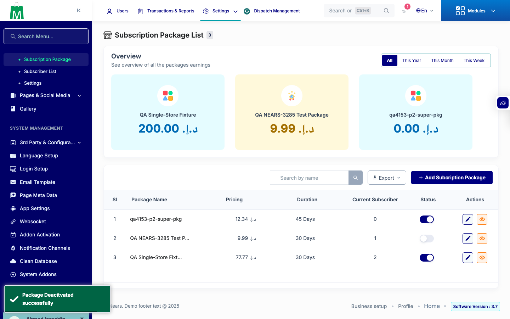</a> p2 super status off</td>
</tr>
<tr>
<td align="center" width="33%"><a href="p2-super-trial.png">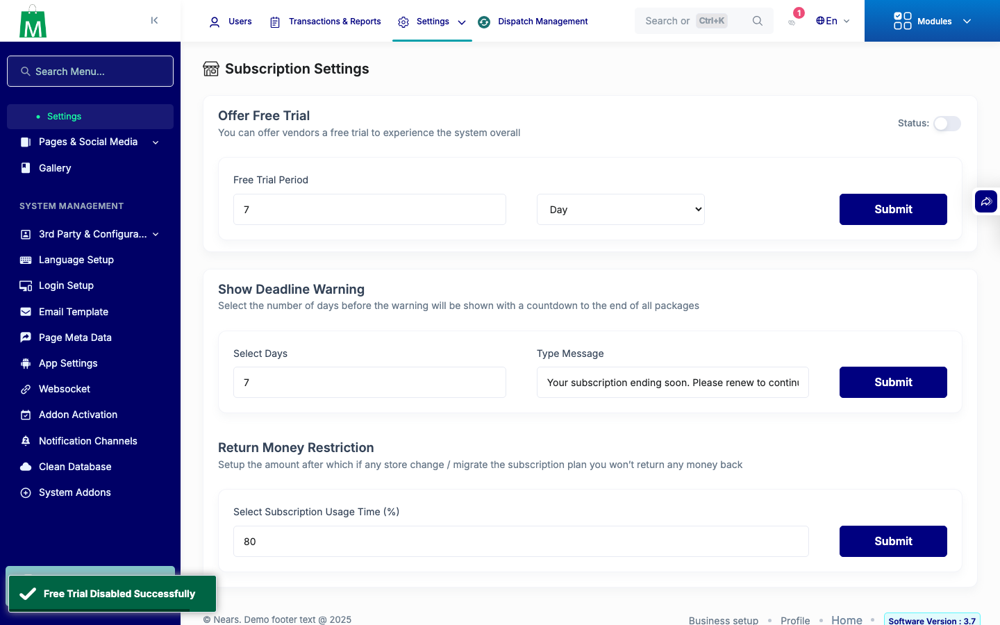</a> p2 super trial</td>
<td align="center" width="33%"><a href="p3-restricted-status_on.png">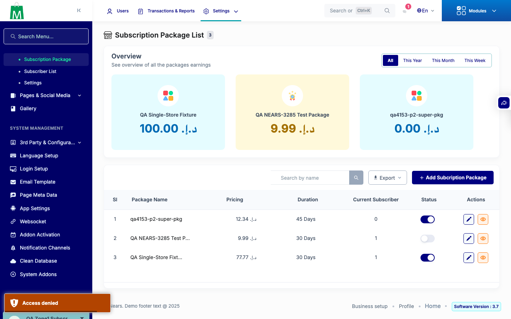</a> p3 restricted status on</td>
<td align="center" width="33%"> p3 restricted trial</td>
</tr>
<tr>
<td align="center" width="33%"><a href="p3-super-status_on.png">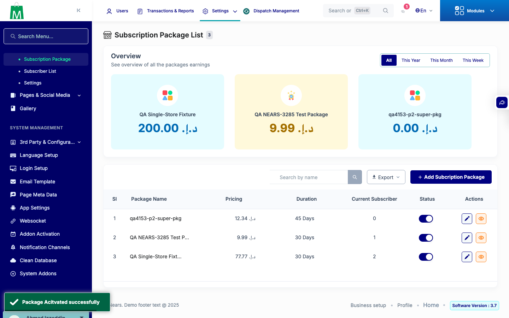</a> p3 super status on</td>
<td align="center" width="33%"> p3 super trial</td>
</tr>
</table>

### Other artifacts
- [`base-restricted-results.json`](base-restricted-results.json)
- [`base2-restricted-results.json`](base2-restricted-results.json)
- [`base2_restricted.jsonl`](base2_restricted.jsonl)
- [`base_restricted.jsonl`](base_restricted.jsonl)
- [`bug-package-details-status-handler.log`](bug-package-details-status-handler.log)
- [`fixed-refusal-log.txt`](fixed-refusal-log.txt)
- [`fixed-restricted-results.json`](fixed-restricted-results.json)
- [`fixed-super-results.json`](fixed-super-results.json)
- [`fixed2-restricted-results.json`](fixed2-restricted-results.json)
- [`fixed2-super-results.json`](fixed2-super-results.json)
- [`fixed2_restricted.jsonl`](fixed2_restricted.jsonl)
- [`fixed2_super.jsonl`](fixed2_super.jsonl)
- [`fixed_restricted.jsonl`](fixed_restricted.jsonl)
- [`fixed_restricted_all.jsonl`](fixed_restricted_all.jsonl)
- [`fixed_restricted_raw.jsonl`](fixed_restricted_raw.jsonl)
- [`fixed_super.jsonl`](fixed_super.jsonl)
- [`p2-refusal-log.txt`](p2-refusal-log.txt)
- [`p2-restricted-results.json`](p2-restricted-results.json)
- [`p2-super-results.json`](p2-super-results.json)
- [`p2_restricted.jsonl`](p2_restricted.jsonl)
- [`p2_super.jsonl`](p2_super.jsonl)
- [`p3-restricted-results.json`](p3-restricted-results.json)
- [`p3-super-results.json`](p3-super-results.json)
- [`p3_restricted.jsonl`](p3_restricted.jsonl)
- [`p3_super.jsonl`](p3_super.jsonl)
- [`routes_base.json`](routes_base.json)
- [`routes_fixed.json`](routes_fixed.json)
- [`unauth.txt`](unauth.txt)

---
*From `nears/docs/qa-evidence/NEARS-4153/` · public-repo scrub policy (no live secrets; verified clean).*
