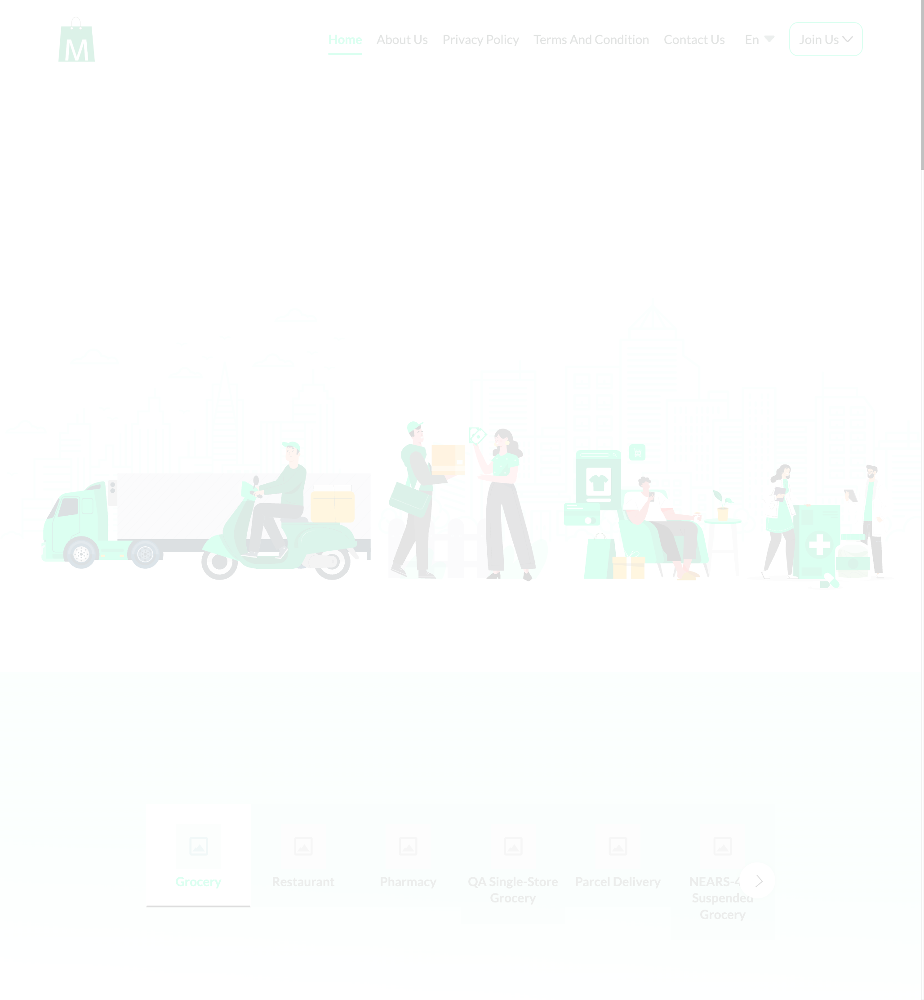
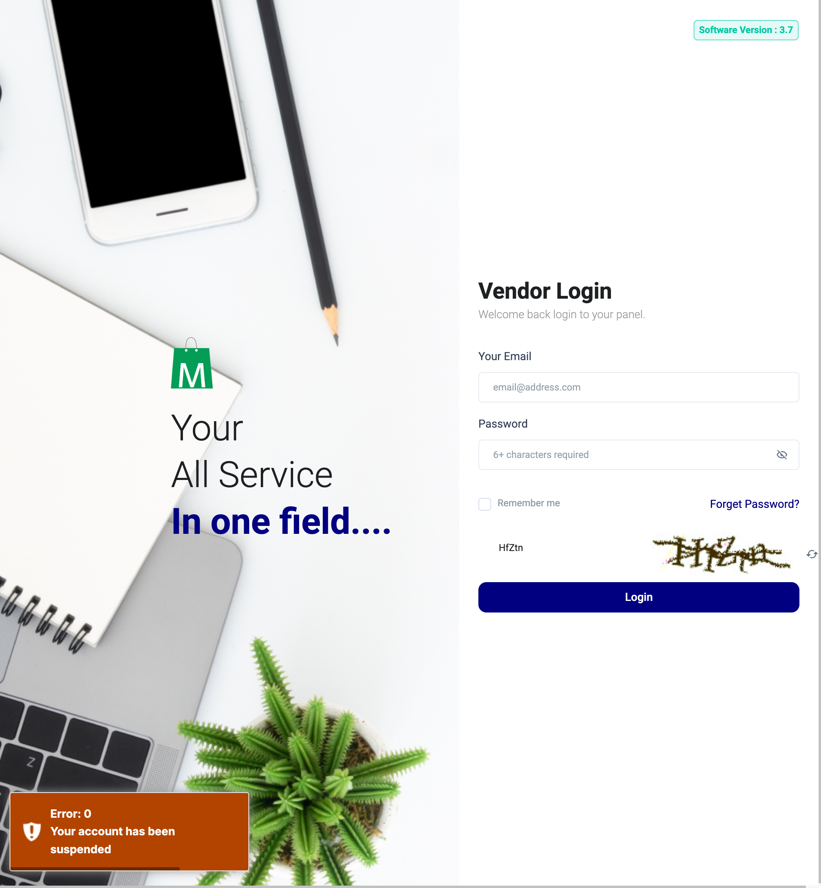
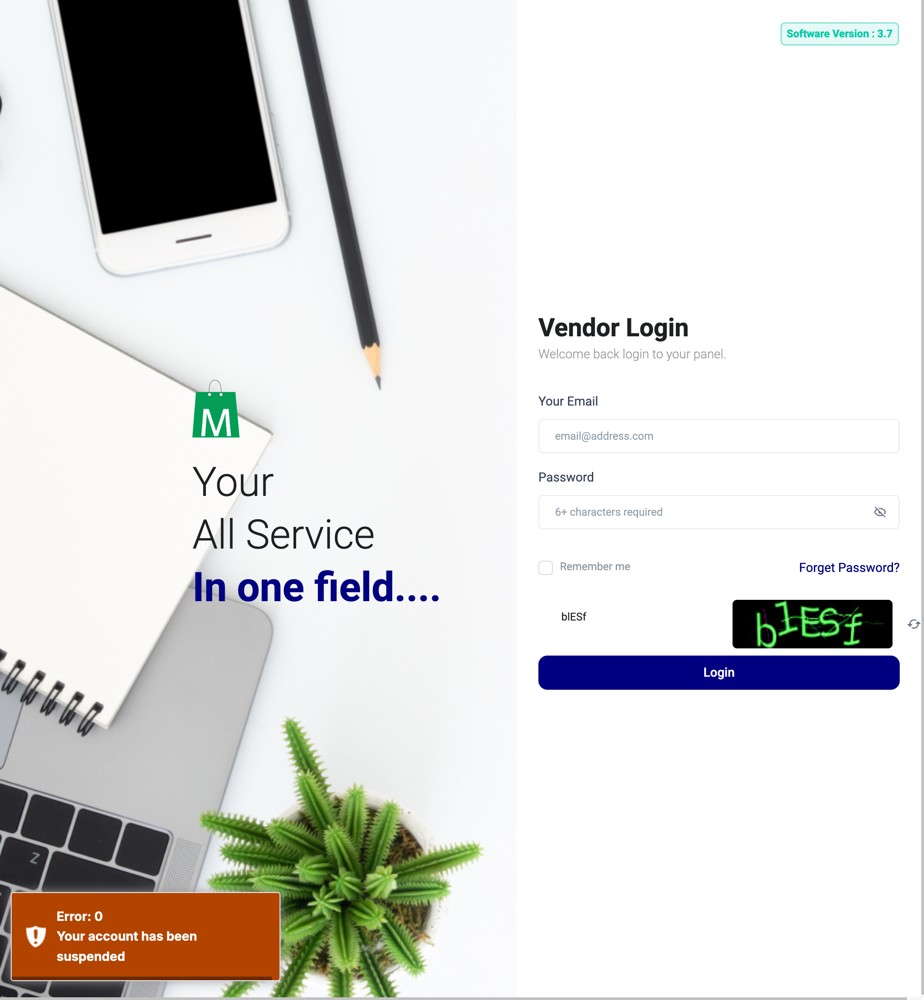

# QA Evidence — NEARS-4155

**cycle 1 delta: O4 fix verified (reload path), poll-then-click ends on home via 419**

**6 screenshot(s).** Click any thumbnail for full resolution.

<table>
<tr>
<td align="center" width="33%"> ac2 B after shift</td>
<td align="center" width="33%"> ac2 F login after shift</td>
<td align="center" width="33%"> ac4 F nav login</td>
</tr>
<tr>
<td align="center" width="33%"> c1 ac2 default config login copy</td>
<td align="center" width="33%"> c1 poll then reload ends on login copy</td>
<td align="center" width="33%"> c1 poll then shift ends on home no copy</td>
</tr>
</table>

### Other artifacts
- [`ac1_api_evidence.txt`](ac1_api_evidence.txt)
- [`ac2_ac5_browser_xhr_log.txt`](ac2_ac5_browser_xhr_log.txt)
- [`ac3_money_pin.txt`](ac3_money_pin.txt)
- [`ac5_control_state.txt`](ac5_control_state.txt)
- [`bug-c1-poll-first-then-post-419-ages-key.log`](bug-c1-poll-first-then-post-419-ages-key.log)
- [`bug-keep-key-consumed-by-xhr-redirect.log`](bug-keep-key-consumed-by-xhr-redirect.log)
- [`c1_O4_live_poll_evidence.txt`](c1_O4_live_poll_evidence.txt)
- [`c1_recheck_ac1_ac2_ac4_o5_o6_o7.txt`](c1_recheck_ac1_ac2_ac4_o5_o6_o7.txt)
- [`observations_O1_O8.txt`](observations_O1_O8.txt)

---
*From `nears/docs/qa-evidence/NEARS-4155/` · public-repo scrub policy (no live secrets; verified clean).*
