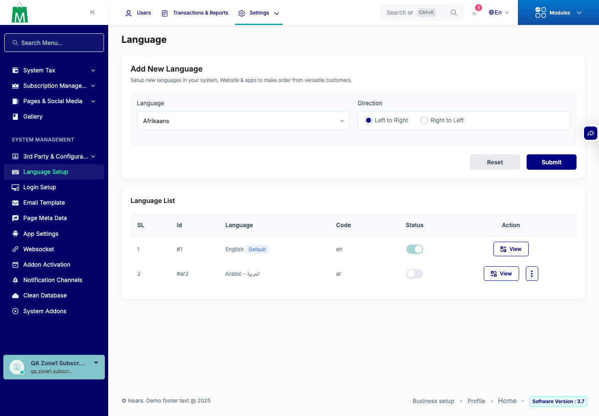
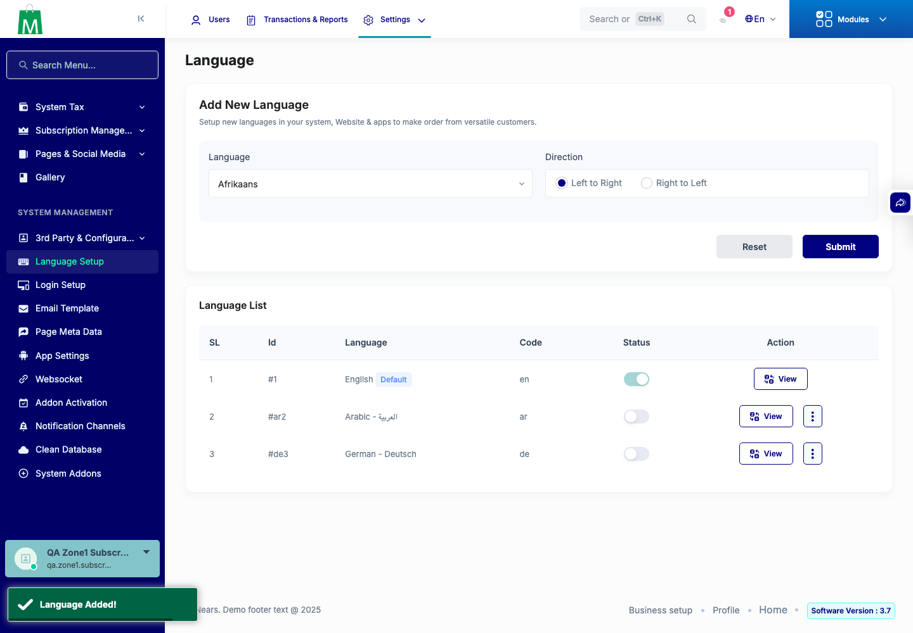
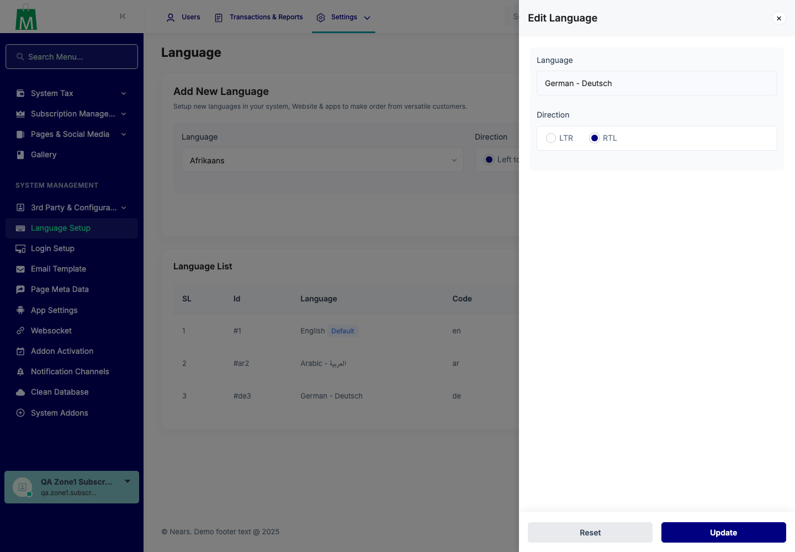
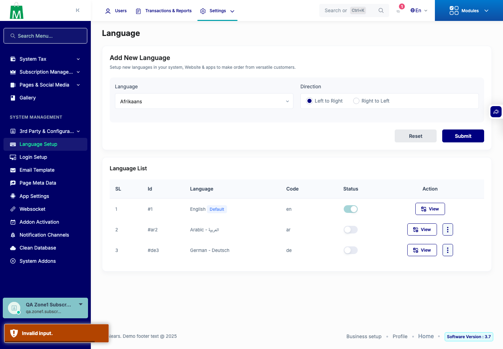
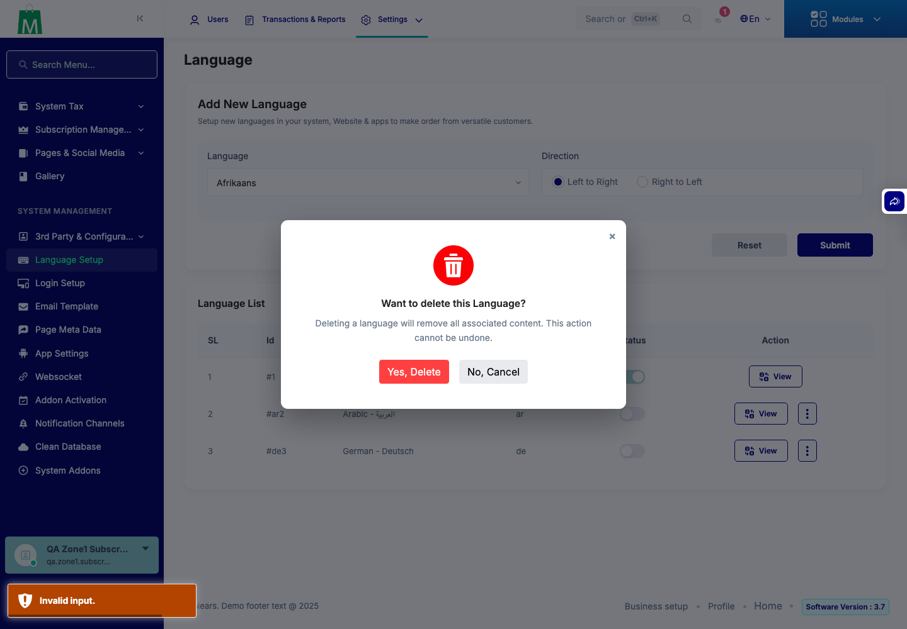
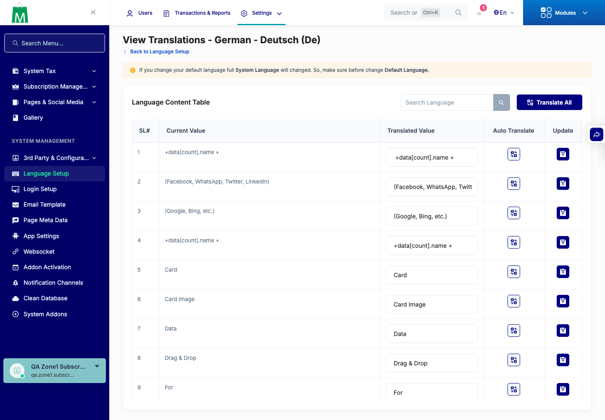
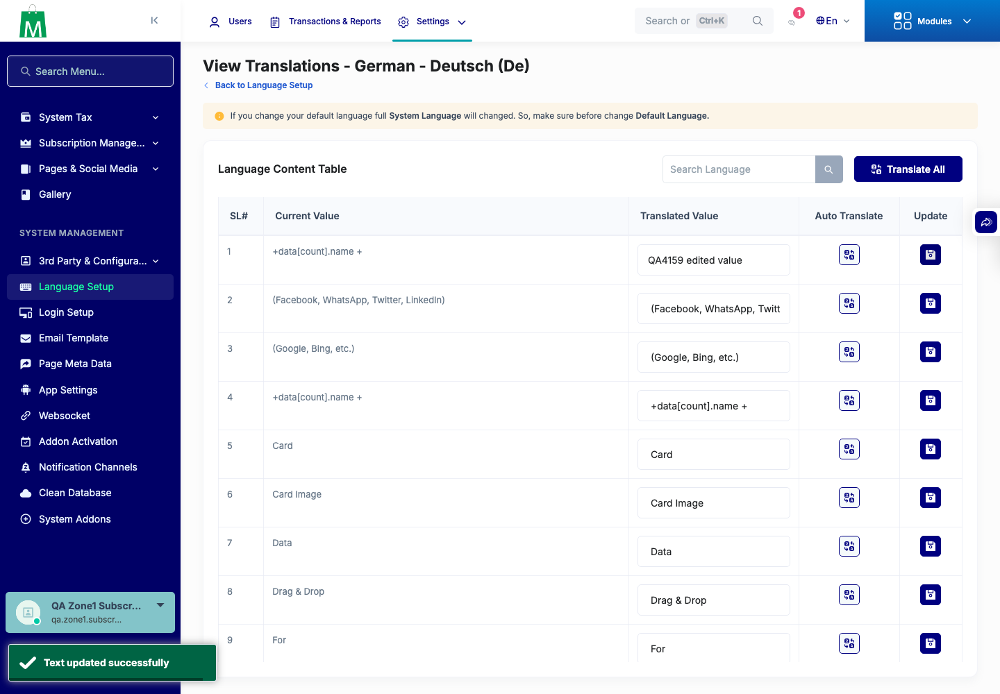
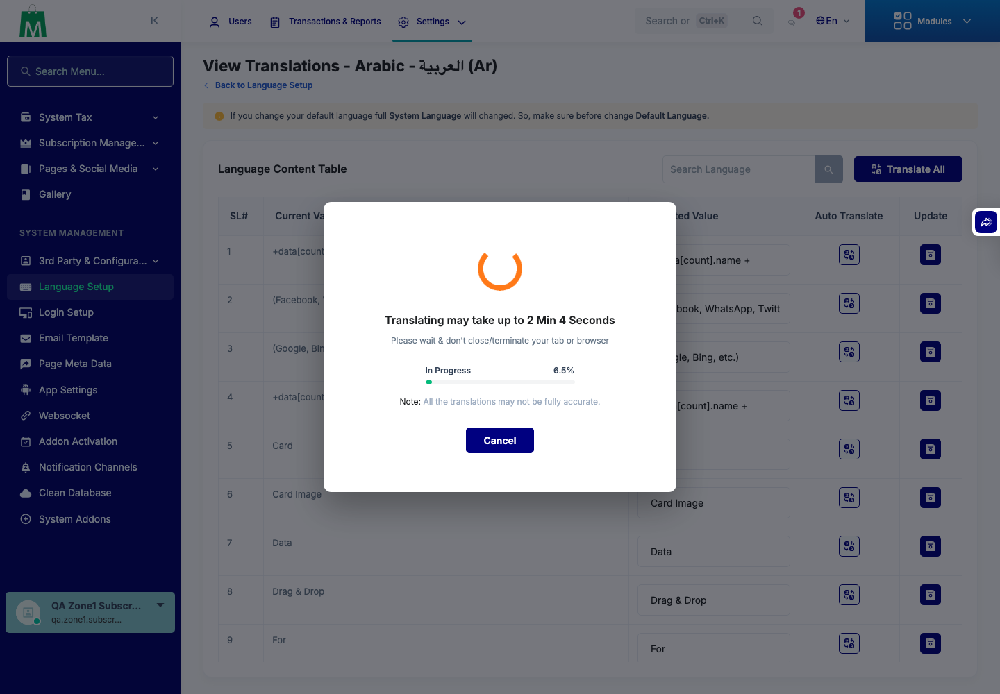

# QA Evidence — NEARS-4159

**QA PASS cycle 0: LanguageController path validation live on scratch copies, base RED / tip GREEN**

**10 screenshot(s).** Click any thumbnail for full resolution.

<table>
<tr>
<td align="center" width="33%"> ui 01 language page employee</td>
<td align="center" width="33%"> ui 02 add de toast</td>
<td align="center" width="33%"> ui 03 edit offcanvas</td>
</tr>
<tr>
<td align="center" width="33%"> ui 04 edit updated toast</td>
<td align="center" width="33%"> ui 05 hostile old code invalid input toast</td>
<td align="center" width="33%"> ui 06 delete modal</td>
</tr>
<tr>
<td align="center" width="33%"> ui 07 after delete</td>
<td align="center" width="33%"> ui 08 translate page de</td>
<td align="center" width="33%"> ui 09 translate submit toast</td>
</tr>
<tr>
<td align="center" width="33%"> ui 10 auto translate all ar progress</td>
</tr>
</table>

### Other artifacts
- [`B-notes.json`](B-notes.json)
- [`B-tested-hostile-arms.tsv`](B-tested-hostile-arms.tsv)
- [`B-tested-symlink-protected-target-arms.tsv`](B-tested-symlink-protected-target-arms.tsv)
- [`C.red.json`](C.red.json)
- [`bug-auto-translate-all-path-disclosure.log`](bug-auto-translate-all-path-disclosure.log)
- [`extra.guest.base.json`](extra.guest.base.json)
- [`extra.guest.tested.json`](extra.guest.tested.json)
- [`extra.role1.tested.json`](extra.role1.tested.json)
- [`extra.sweep.base.json`](extra.sweep.base.json)
- [`extra.sweep.tested.json`](extra.sweep.tested.json)
- [`phpunit-backstop.log`](phpunit-backstop.log)
- [`positive-controls-base-vs-tested.txt`](positive-controls-base-vs-tested.txt)
- [`progress.md`](progress.md)
- [`refusal-log-samples.txt`](refusal-log-samples.txt)
- [`route-inventory-ac4.txt`](route-inventory-ac4.txt)
- [`system_language.reading.txt`](system_language.reading.txt)
- [`ui2.json`](ui2.json)
- [`worktree-lang.after.fp`](worktree-lang.after.fp)
- [`worktree-lang.before.fp`](worktree-lang.before.fp)

---
*From `nears/docs/qa-evidence/NEARS-4159/` · public-repo scrub policy (no live secrets; verified clean).*
