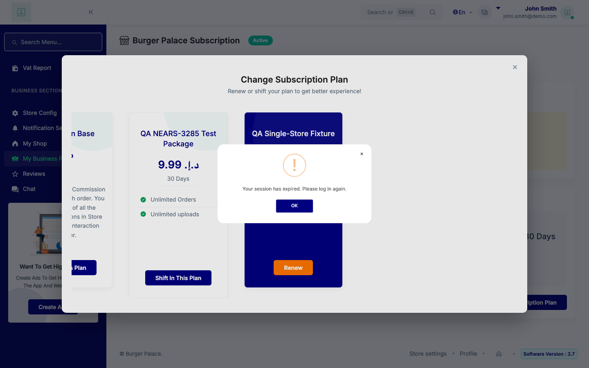
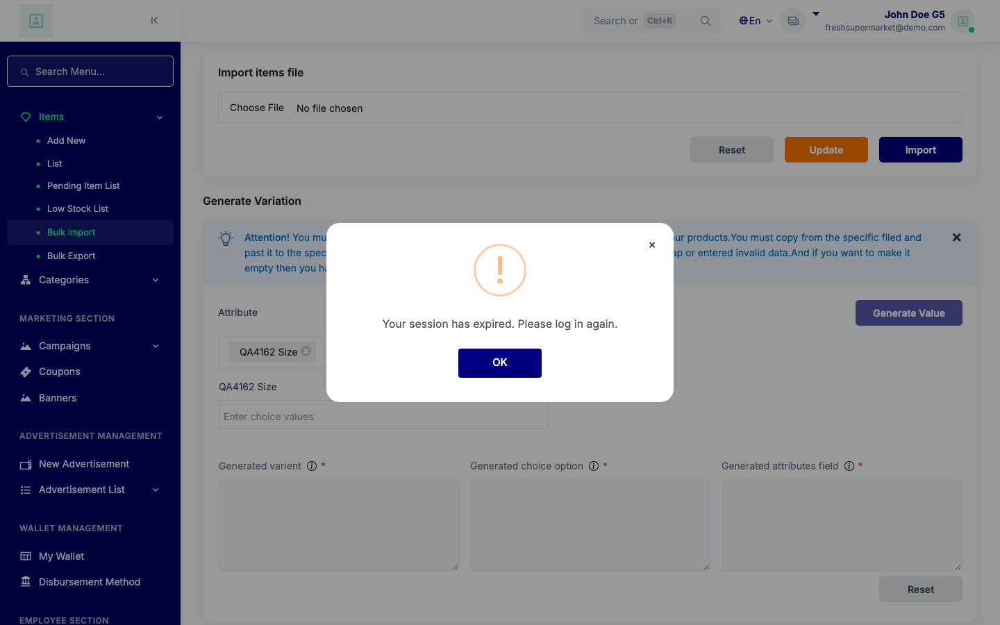
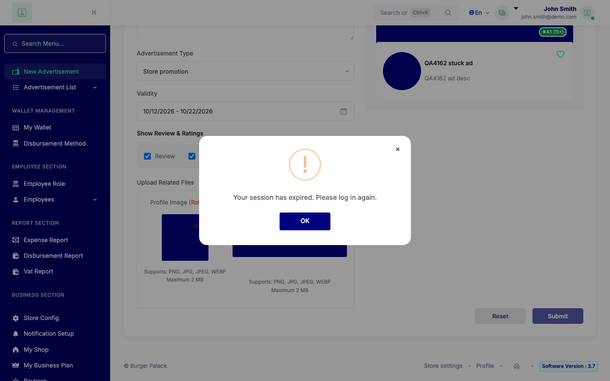
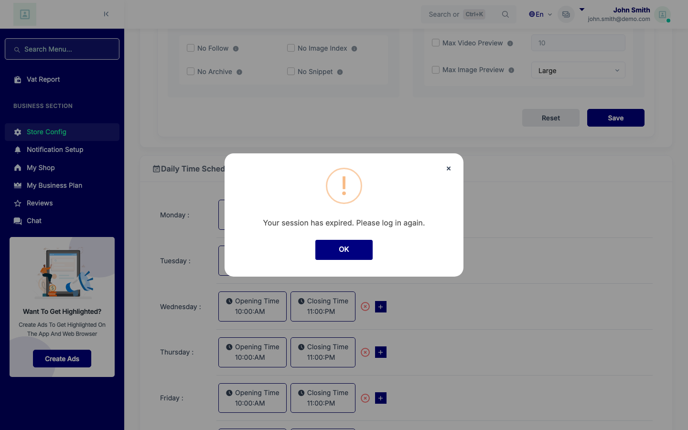
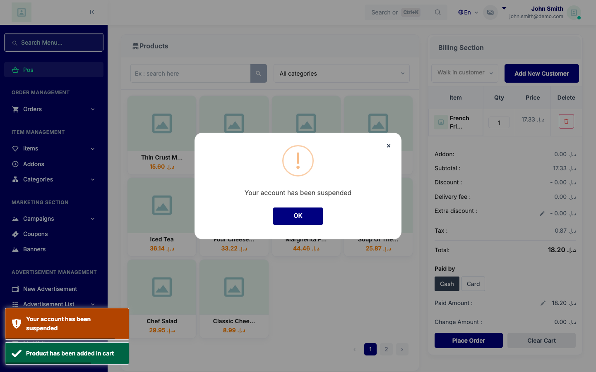
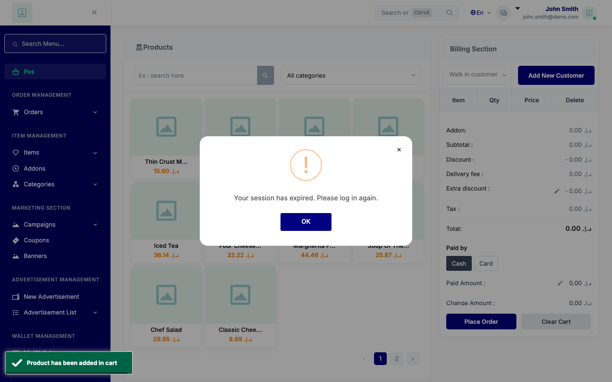
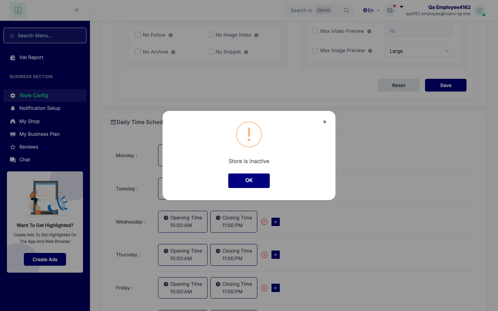
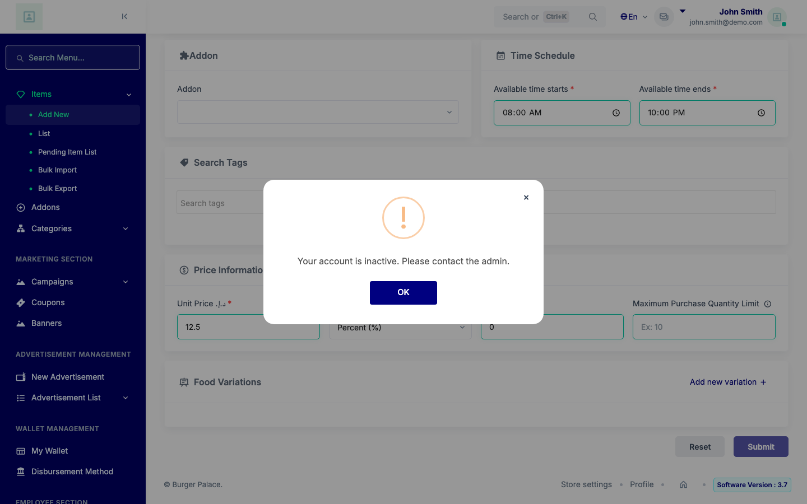
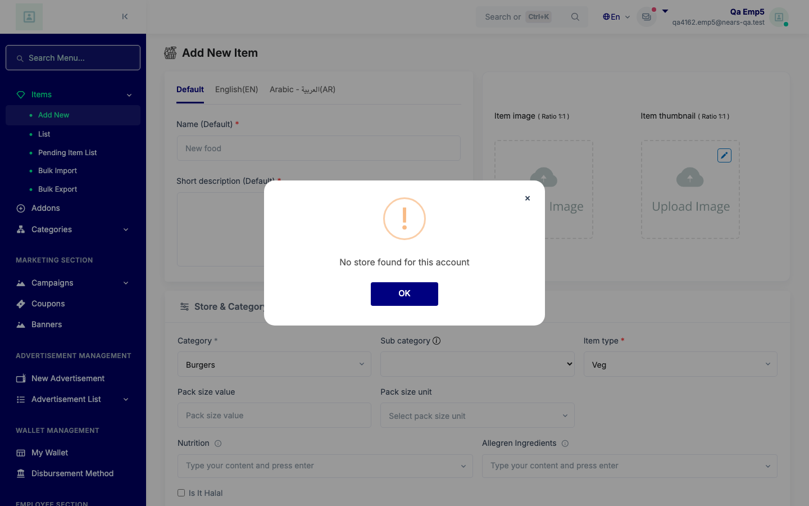
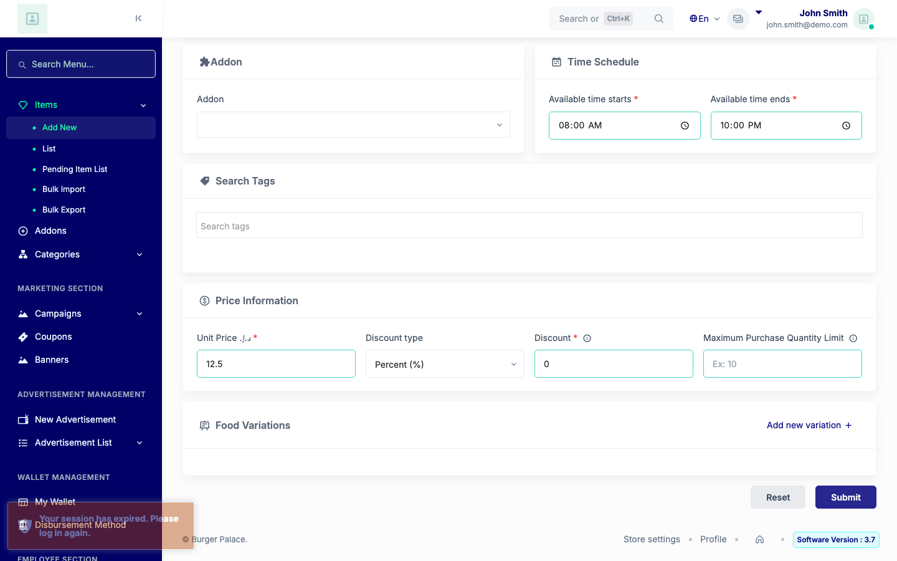

# QA Evidence — NEARS-4162

**NEARS-4162 QA PASS - Store Panel ajax refusals, sha 0778d0e88**

**14 screenshot(s).** Click any thumbnail for full resolution.

<table>
<tr>
<td align="center" width="33%"> ac2 firebase door modal</td>
<td align="center" width="33%"> ac2 firebase modal</td>
<td align="center" width="33%"> ac2 manual door modal</td>
</tr>
<tr>
<td align="center" width="33%"> ac2 manual modal</td>
<td align="center" width="33%"> ac3 T1 add new item.store</td>
<td align="center" width="33%"> ac3 T5b bulk variation generate</td>
</tr>
<tr>
<td align="center" width="33%"> ac3 T7 ad create</td>
<td align="center" width="33%"> ac4 4a modal</td>
<td align="center" width="33%"> ac5 placeorder double surface</td>
</tr>
<tr>
<td align="center" width="33%"> ac5 updatecart modal</td>
<td align="center" width="33%"> ac7 employee inactive store modal</td>
<td align="center" width="33%"> ux account inactive modal 1a</td>
</tr>
<tr>
<td align="center" width="33%"> ux no store modal 1d ii</td>
<td align="center" width="33%"> ux swal absent fallback</td>
</tr>
</table>

### Other artifacts
- [`ac1_destructive_1a_1d-ii.txt`](ac1_destructive_1a_1d-ii.txt)
- [`ac1_employee_arm_1d-iv.txt`](ac1_employee_arm_1d-iv.txt)
- [`ac1_employee_arms.txt`](ac1_employee_arms.txt)
- [`ac1_owner_arms.txt`](ac1_owner_arms.txt)
- [`ac1e_ui_and_sweep.txt`](ac1e_ui_and_sweep.txt)
- [`ac2_firebase.txt`](ac2_firebase.txt)
- [`ac2_manual.txt`](ac2_manual.txt)
- [`ac3_T1.txt`](ac3_T1.txt)
- [`ac3_T2_T3_T4.txt`](ac3_T2_T3_T4.txt)
- [`ac3_T5a_T5b_T6_T7_T8.txt`](ac3_T5a_T5b_T6_T7_T8.txt)
- [`ac3_T6.txt`](ac3_T6.txt)
- [`ac4_ac6_schedule_message.txt`](ac4_ac6_schedule_message.txt)
- [`ac545_vendor_subscription_cancel.txt`](ac545_vendor_subscription_cancel.txt)
- [`ac5_pos.txt`](ac5_pos.txt)
- [`ac6_plan_poll_controls.txt`](ac6_plan_poll_controls.txt)
- [`ac6_pos_business403.txt`](ac6_pos_business403.txt)
- [`ac6_product_controls.txt`](ac6_product_controls.txt)
- [`ac7_employee_ui.txt`](ac7_employee_ui.txt)
- [`bug-back-nav-serves-cached-auth-page.log`](bug-back-nav-serves-cached-auth-page.log)
- [`bug-storeless-vendor-login-errorexception.log`](bug-storeless-vendor-login-errorexception.log)
- [`driver`](driver)
- [`f1_bfcache.txt`](f1_bfcache.txt)
- [`phpunit-backstop.txt`](phpunit-backstop.txt)
- [`playwright-harness.txt`](playwright-harness.txt)
- [`progress.md`](progress.md)
- [`sweep_login_logout.txt`](sweep_login_logout.txt)
- [`ux1_modal_keys_fallback_collision.txt`](ux1_modal_keys_fallback_collision.txt)

---
*From `nears/docs/qa-evidence/NEARS-4162/` · public-repo scrub policy (no live secrets; verified clean).*
