# QA Evidence — NEARS-4163

**r3 xprobe: RTL<=768 option variants VB/VX/VX3 vs base**

**190 screenshot(s).** Click any thumbnail for full resolution.

<table>
<tr>
<td align="center" width="33%"> ac S1 1028 synth5 ltr commission centred</td>
<td align="center" width="33%"> ac S1 1028 synth5 ltr initial</td>
<td align="center" width="33%"> ac S1 1028 synth5 rtl commission centred</td>
</tr>
<tr>
<td align="center" width="33%"> ac S1 1028 synth5 rtl initial</td>
<td align="center" width="33%"> ac S1 1199 synth5 ltr commission centred</td>
<td align="center" width="33%"> ac S1 1199 synth5 ltr initial</td>
</tr>
<tr>
<td align="center" width="33%"> ac S1 1200 synth5 ltr commission centred</td>
<td align="center" width="33%"> ac S1 1200 synth5 ltr initial</td>
<td align="center" width="33%"> ac S1 1440 synth5 ltr commission centred</td>
</tr>
<tr>
<td align="center" width="33%"> ac S1 1440 synth5 ltr initial</td>
<td align="center" width="33%"> ac S1 768 real3 rtl commission centred</td>
<td align="center" width="33%"> ac S1 768 real3 rtl initial</td>
</tr>
<tr>
<td align="center" width="33%"> ac S1 992 synth5 ltr commission centred</td>
<td align="center" width="33%"> ac S1 992 synth5 ltr initial</td>
<td align="center" width="33%"> ac S2 1028 synth5 ltr commission centred</td>
</tr>
<tr>
<td align="center" width="33%"> ac S2 1028 synth5 ltr initial</td>
<td align="center" width="33%"> ac S2 1028 synth5 rtl commission centred</td>
<td align="center" width="33%"> ac S2 1028 synth5 rtl initial</td>
</tr>
<tr>
<td align="center" width="33%"> ac S2 768 real3 rtl commission centred</td>
<td align="center" width="33%"> ac S2 768 real3 rtl initial</td>
<td align="center" width="33%"> ac S3 1028 synth5 ltr commission centred</td>
</tr>
<tr>
<td align="center" width="33%"> ac S3 1028 synth5 ltr initial</td>
<td align="center" width="33%"> ac S3 1028 synth5 rtl commission centred</td>
<td align="center" width="33%"> ac S3 1028 synth5 rtl initial</td>
</tr>
<tr>
<td align="center" width="33%"> ac S3 768 real3 rtl commission centred</td>
<td align="center" width="33%"> ac S3 768 real3 rtl initial</td>
<td align="center" width="33%"> ac1 S1 base 1028</td>
</tr>
<tr>
<td align="center" width="33%"> ac1 S1 tip 1028</td>
<td align="center" width="33%"> ac1 S2 base 1028</td>
<td align="center" width="33%"> ac1 S2 tip 1028</td>
</tr>
<tr>
<td align="center" width="33%"> ac1 S3 base 1028</td>
<td align="center" width="33%"> ac1 S3 tip 1028</td>
<td align="center" width="33%"> ac2 S1 tip 768 after shift click NOT confirmed</td>
</tr>
<tr>
<td align="center" width="33%"> ac2 S1 tip 768 commission card shift button</td>
<td align="center" width="33%"> ac2 S1 tip 768 shift confirm dialog CANCELLED</td>
<td align="center" width="33%"> ac3 S1 base 1028 initial</td>
</tr>
<tr>
<td align="center" width="33%"> ac3 S1 base 1199 initial</td>
<td align="center" width="33%"> ac3 S1 base 1200 initial</td>
<td align="center" width="33%"> ac3 S1 base 1440 initial</td>
</tr>
<tr>
<td align="center" width="33%"> ac3 S1 base 375 initial</td>
<td align="center" width="33%"> ac3 S1 base 576 initial</td>
<td align="center" width="33%"> ac3 S1 base 768 initial</td>
</tr>
<tr>
<td align="center" width="33%"> ac3 S1 base 992 initial</td>
<td align="center" width="33%"> ac3 S1 tip 1028 initial</td>
<td align="center" width="33%"> ac3 S1 tip 1199 initial</td>
</tr>
<tr>
<td align="center" width="33%"> ac3 S1 tip 1200 initial</td>
<td align="center" width="33%"> ac3 S1 tip 1440 initial</td>
<td align="center" width="33%"> ac3 S1 tip 375 initial</td>
</tr>
<tr>
<td align="center" width="33%"> ac3 S1 tip 576 initial</td>
<td align="center" width="33%"> ac3 S1 tip 768 initial</td>
<td align="center" width="33%"> ac3 S1 tip 992 initial</td>
</tr>
<tr>
<td align="center" width="33%"> ac4 S1 base 1028 rtl shipped</td>
<td align="center" width="33%"> ac4 S1 base 768 rtl shipped</td>
<td align="center" width="33%"> ac4 S1 tip 1028 rtl shipped</td>
</tr>
<tr>
<td align="center" width="33%"> ac4 S1 tip 768 rtl shipped</td>
<td align="center" width="33%"> ac5 S1 base 1028 rtl</td>
<td align="center" width="33%"> ac5 S1 tip 1028 rtl</td>
</tr>
<tr>
<td align="center" width="33%"> ac5 S2 base 1028 rtl</td>
<td align="center" width="33%"> ac5 S2 tip 1028 rtl</td>
<td align="center" width="33%"> ac5 S3 base 1028 rtl</td>
</tr>
<tr>
<td align="center" width="33%"> ac5 S3 tip 1028 rtl</td>
<td align="center" width="33%"> bug arrow covers edge card text 768 with vs without arrow</td>
<td align="center" width="33%"> bug arrow covers edge card text 768</td>
</tr>
<tr>
<td align="center" width="33%"> bug ltr centred last blank half stage 1028</td>
<td align="center" width="33%"> bug no visible control 1028 3cards</td>
<td align="center" width="33%"> bug rtl last card all off screen 1028</td>
</tr>
<tr>
<td align="center" width="33%"> bug rtl last card shift unreachable 768</td>
<td align="center" width="33%"> ctrl addon activation base</td>
<td align="center" width="33%"> ctrl addon activation tip</td>
</tr>
<tr>
<td align="center" width="33%"> ctrl package index base</td>
<td align="center" width="33%"> ctrl package index tip</td>
<td align="center" width="33%"> r2 ac1 S1 base 1028 4cards start0</td>
</tr>
<tr>
<td align="center" width="33%"><a href="r2-ac1-S1-base-1028-4cards-start3.png">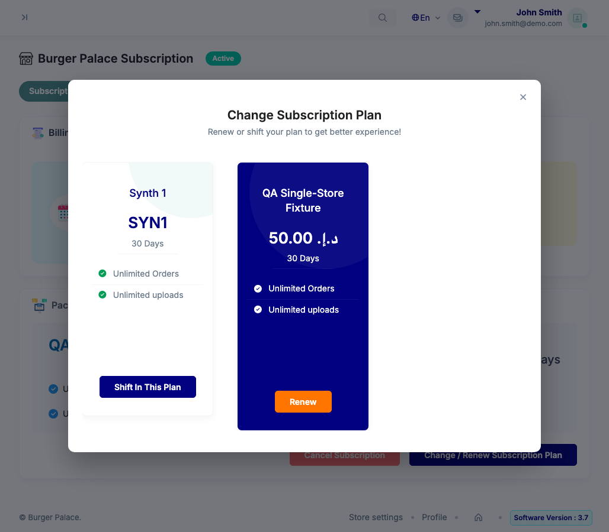</a> r2 ac1 S1 base 1028 4cards start3</td>
<td align="center" width="33%"> r2 ac1 S1 base 1028</td>
<td align="center" width="33%"> r2 ac1 S1 tip 1028 4cards start0</td>
</tr>
<tr>
<td align="center" width="33%"> r2 ac1 S1 tip 1028 4cards start3</td>
<td align="center" width="33%"> r2 ac1 S1 tip 1028</td>
<td align="center" width="33%"> r2 ac1 S2 base 1028</td>
</tr>
<tr>
<td align="center" width="33%"><a href="r2-ac1-S2-tip-1028.png">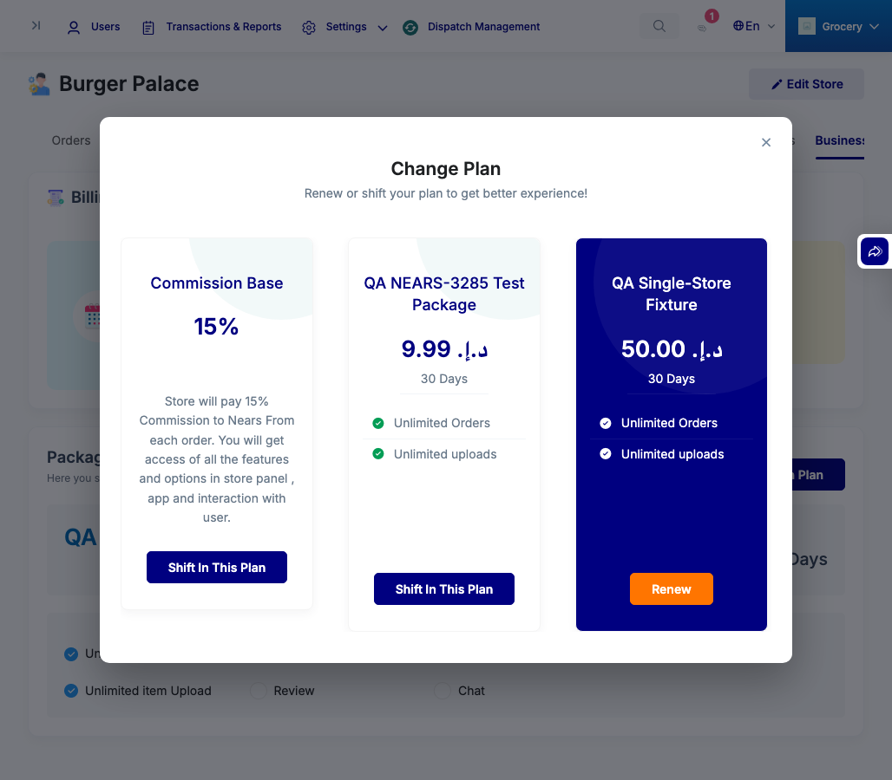</a> r2 ac1 S2 tip 1028</td>
<td align="center" width="33%"> r2 ac1 S3 base 1028</td>
<td align="center" width="33%"> r2 ac1 S3 tip 1028</td>
</tr>
<tr>
<td align="center" width="33%"><a href="r2-ac2-S1-tip-1028-n4-s3.png">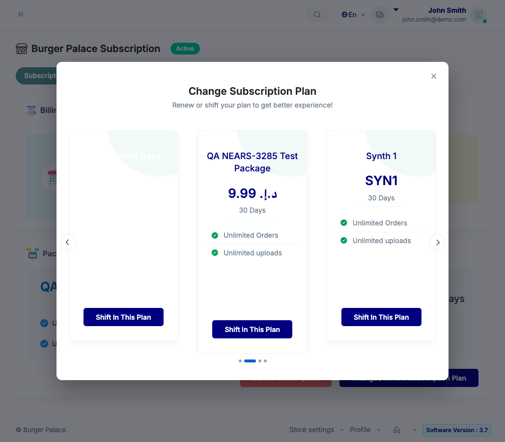</a> r2 ac2 S1 tip 1028 n4 s3</td>
<td align="center" width="33%"><a href="r2-ac2-S1-tip-1028-n5-s4.png">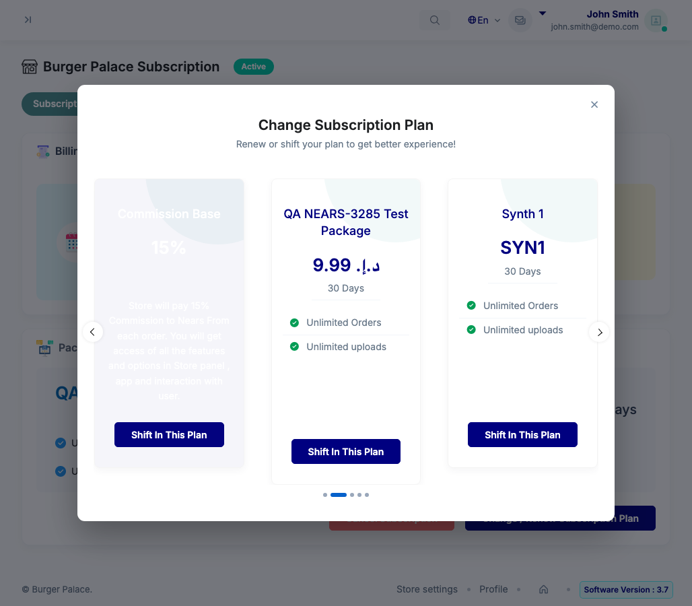</a> r2 ac2 S1 tip 1028 n5 s4</td>
<td align="center" width="33%"> r2 ac2 S1 tip 1028 real3</td>
</tr>
<tr>
<td align="center" width="33%"> r2 ac2 S1 tip 1440 n5 s4</td>
<td align="center" width="33%"> r2 ac2 S1 tip 375 real3</td>
<td align="center" width="33%"> r2 ac2 S1 tip 576 real3</td>
</tr>
<tr>
<td align="center" width="33%"> r2 ac2 S1 tip 768 real3</td>
<td align="center" width="33%"> r2 ac2 S1 tip 992 n4 s3</td>
<td align="center" width="33%"> r2 ac2 switch 1 modal before</td>
</tr>
<tr>
<td align="center" width="33%"> r2 ac2 switch 2 confirm dialog</td>
<td align="center" width="33%"> r2 ac2 switch 3 after reload</td>
<td align="center" width="33%"> r2 ac2 switch 5 reload fresh</td>
</tr>
<tr>
<td align="center" width="33%"> r2 ac3 S1 base 1028 real3</td>
<td align="center" width="33%"> r2 ac3 S1 base 1199 real3</td>
<td align="center" width="33%"> r2 ac3 S1 base 1200 real3</td>
</tr>
<tr>
<td align="center" width="33%"> r2 ac3 S1 base 1440 real3</td>
<td align="center" width="33%"> r2 ac3 S1 base 375 real3</td>
<td align="center" width="33%"> r2 ac3 S1 base 576 real3</td>
</tr>
<tr>
<td align="center" width="33%"> r2 ac3 S1 base 768 real3</td>
<td align="center" width="33%"> r2 ac3 S1 base 992 real3</td>
<td align="center" width="33%"> r2 ac3 S1 tip 1028 real3</td>
</tr>
<tr>
<td align="center" width="33%"> r2 ac3 S1 tip 1199 real3</td>
<td align="center" width="33%"> r2 ac3 S1 tip 1200 real3</td>
<td align="center" width="33%"> r2 ac3 S1 tip 1440 real3</td>
</tr>
<tr>
<td align="center" width="33%"> r2 ac3 S1 tip 375 real3</td>
<td align="center" width="33%"> r2 ac3 S1 tip 576 real3</td>
<td align="center" width="33%"> r2 ac3 S1 tip 768 real3</td>
</tr>
<tr>
<td align="center" width="33%"> r2 ac3 S1 tip 992 real3</td>
<td align="center" width="33%"> r2 ac4a S1 tip rtl 1028 n3 s0</td>
<td align="center" width="33%"> r2 ac4a S1 tip rtl 1028 n3 s2</td>
</tr>
<tr>
<td align="center" width="33%"><a href="r2-ac4a-S1-tip-rtl-1028-n5-both-arrows.png">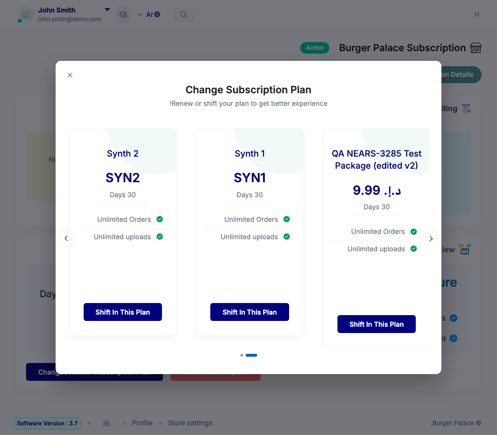</a> r2 ac4a S1 tip rtl 1028 n5 both arrows</td>
<td align="center" width="33%"><a href="r2-ac4a-S1-tip-rtl-1028-n5-s0.png">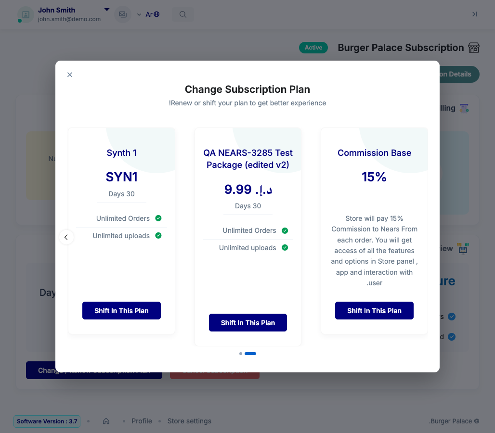</a> r2 ac4a S1 tip rtl 1028 n5 s0</td>
<td align="center" width="33%"><a href="r2-ac4a-S1-tip-rtl-1028-n5-s4.png">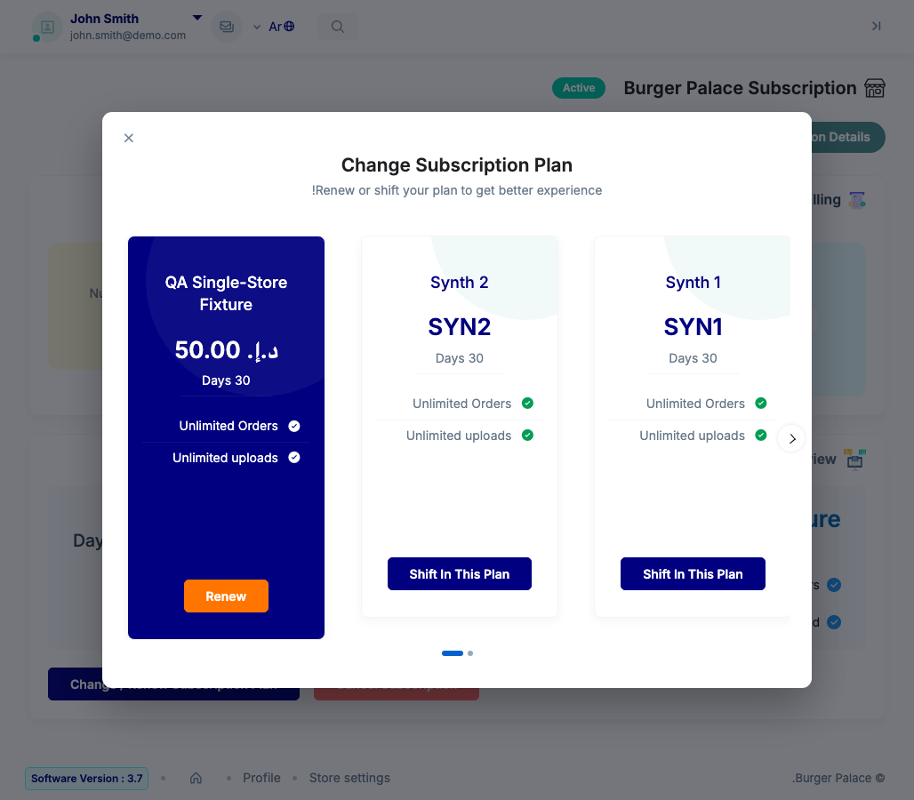</a> r2 ac4a S1 tip rtl 1028 n5 s4</td>
</tr>
<tr>
<td align="center" width="33%"> r2 ac4a S1 tip rtl 1440 n3 s0</td>
<td align="center" width="33%"> r2 ac4a S1 tip rtl 1440 n3 s2</td>
<td align="center" width="33%"> r2 ac4a S1 tip rtl 1440 n5 both arrows</td>
</tr>
<tr>
<td align="center" width="33%"> r2 ac4a S1 tip rtl 1440 n5 s0</td>
<td align="center" width="33%"> r2 ac4a S1 tip rtl 1440 n5 s4</td>
<td align="center" width="33%"> r2 ac4b S1 base rtl 375 n3 s2</td>
</tr>
<tr>
<td align="center" width="33%"> r2 ac4b S1 base rtl 375 n5 s0</td>
<td align="center" width="33%"><a href="r2-ac4b-S1-base-rtl-375-n5-s4.png">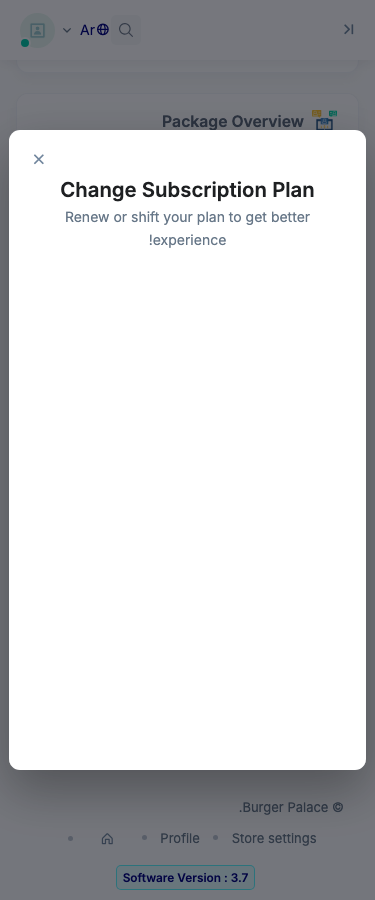</a> r2 ac4b S1 base rtl 375 n5 s4</td>
<td align="center" width="33%"> r2 ac4b S1 base rtl 375 real3</td>
</tr>
<tr>
<td align="center" width="33%"> r2 ac4b S1 base rtl 576 n3 s2</td>
<td align="center" width="33%"><a href="r2-ac4b-S1-base-rtl-576-n5-s0.png">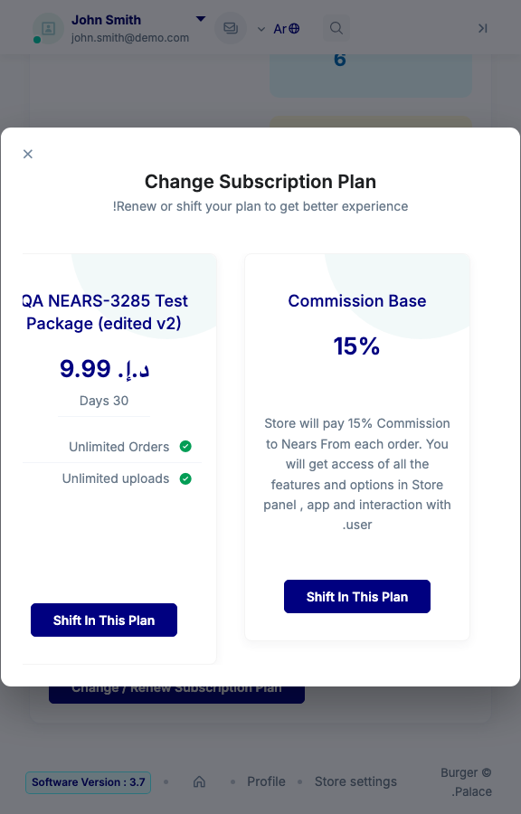</a> r2 ac4b S1 base rtl 576 n5 s0</td>
<td align="center" width="33%"> r2 ac4b S1 base rtl 576 n5 s4</td>
</tr>
<tr>
<td align="center" width="33%"> r2 ac4b S1 base rtl 576 real3</td>
<td align="center" width="33%"> r2 ac4b S1 base rtl 768 n3 s2</td>
<td align="center" width="33%"> r2 ac4b S1 base rtl 768 n5 s0</td>
</tr>
<tr>
<td align="center" width="33%"> r2 ac4b S1 base rtl 768 n5 s4</td>
<td align="center" width="33%"> r2 ac4b S1 base rtl 768 real3</td>
<td align="center" width="33%"> r2 ac4b S1 tip rtl 375 n3 s2</td>
</tr>
<tr>
<td align="center" width="33%"> r2 ac4b S1 tip rtl 375 n5 s0</td>
<td align="center" width="33%"> r2 ac4b S1 tip rtl 375 n5 s4</td>
<td align="center" width="33%"> r2 ac4b S1 tip rtl 375 real3</td>
</tr>
<tr>
<td align="center" width="33%"> r2 ac4b S1 tip rtl 576 n3 s2</td>
<td align="center" width="33%"> r2 ac4b S1 tip rtl 576 n5 s0</td>
<td align="center" width="33%"><a href="r2-ac4b-S1-tip-rtl-576-n5-s4.png">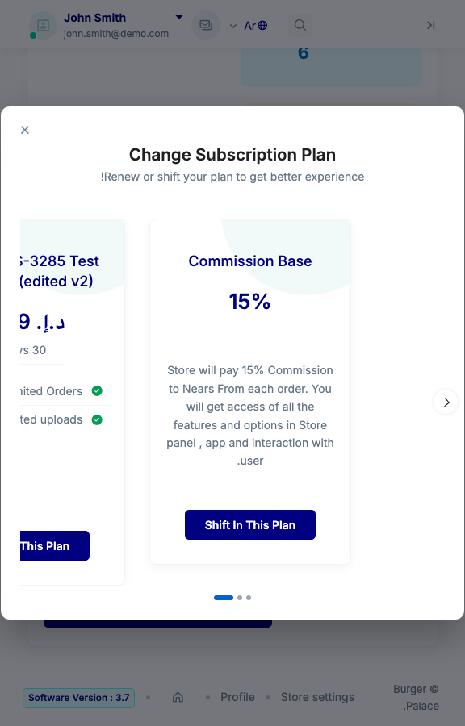</a> r2 ac4b S1 tip rtl 576 n5 s4</td>
</tr>
<tr>
<td align="center" width="33%"> r2 ac4b S1 tip rtl 576 real3</td>
<td align="center" width="33%"> r2 ac4b S1 tip rtl 768 n3 s2</td>
<td align="center" width="33%"> r2 ac4b S1 tip rtl 768 n5 s0</td>
</tr>
<tr>
<td align="center" width="33%"> r2 ac4b S1 tip rtl 768 n5 s4</td>
<td align="center" width="33%"> r2 ac4b S1 tip rtl 768 real3</td>
<td align="center" width="33%"> r2 ac4c S1 tip rtl 375 n3 s2 allshift</td>
</tr>
<tr>
<td align="center" width="33%"> r2 ac4c S1 tip rtl 375 n5 s4 allshift</td>
<td align="center" width="33%"> r2 ac4c S1 tip rtl 576 n3 s2 allshift</td>
<td align="center" width="33%"> r2 ac4c S1 tip rtl 576 n5 s4 allshift</td>
</tr>
<tr>
<td align="center" width="33%"> r2 ac4c S1 tip rtl 768 n3 s2 allshift</td>
<td align="center" width="33%"> r2 ac4c S1 tip rtl 768 n5 s4 allshift</td>
<td align="center" width="33%"> r2 ac5 S1 base ltr 1028</td>
</tr>
<tr>
<td align="center" width="33%"> r2 ac5 S1 base rtl 1028</td>
<td align="center" width="33%"> r2 ac5 S1 tip ltr 1028</td>
<td align="center" width="33%"> r2 ac5 S1 tip rtl 1028</td>
</tr>
<tr>
<td align="center" width="33%"> r2 ac5 S2 base ltr 1028</td>
<td align="center" width="33%"><a href="r2-ac5-S2-base-rtl-1028.png">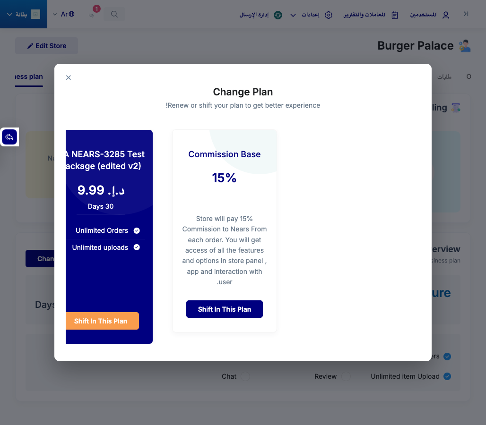</a> r2 ac5 S2 base rtl 1028</td>
<td align="center" width="33%"> r2 ac5 S2 tip ltr 1028</td>
</tr>
<tr>
<td align="center" width="33%"> r2 ac5 S2 tip rtl 1028</td>
<td align="center" width="33%"> r2 ac5 S3 base ltr 1028</td>
<td align="center" width="33%"> r2 ac5 S3 base rtl 1028</td>
</tr>
<tr>
<td align="center" width="33%"> r2 ac5 S3 tip ltr 1028</td>
<td align="center" width="33%"> r2 ac5 S3 tip rtl 1028</td>
<td align="center" width="33%"> r2 ctrl addon activation base</td>
</tr>
<tr>
<td align="center" width="33%"> r2 ctrl addon activation tip</td>
<td align="center" width="33%"> r2 ctrl package index base</td>
<td align="center" width="33%"> r2 ctrl package index tip</td>
</tr>
<tr>
<td align="center" width="33%"> r2 dots zoom ltr n4 1028</td>
<td align="center" width="33%"> r2 dots zoom ltr n5 1028</td>
<td align="center" width="33%"> r2 dots zoom ltr real3 375</td>
</tr>
<tr>
<td align="center" width="33%"> r2 dots zoom ltr real3 768</td>
<td align="center" width="33%"> r2 dots zoom rtl n3 768</td>
<td align="center" width="33%"> r2 dots zoom rtl n5 1028</td>
</tr>
<tr>
<td align="center" width="33%"> r2 dots zoom rtl n5 375</td>
<td align="center" width="33%"><a href="r2-overlap-S1-tip-1028-n4.png">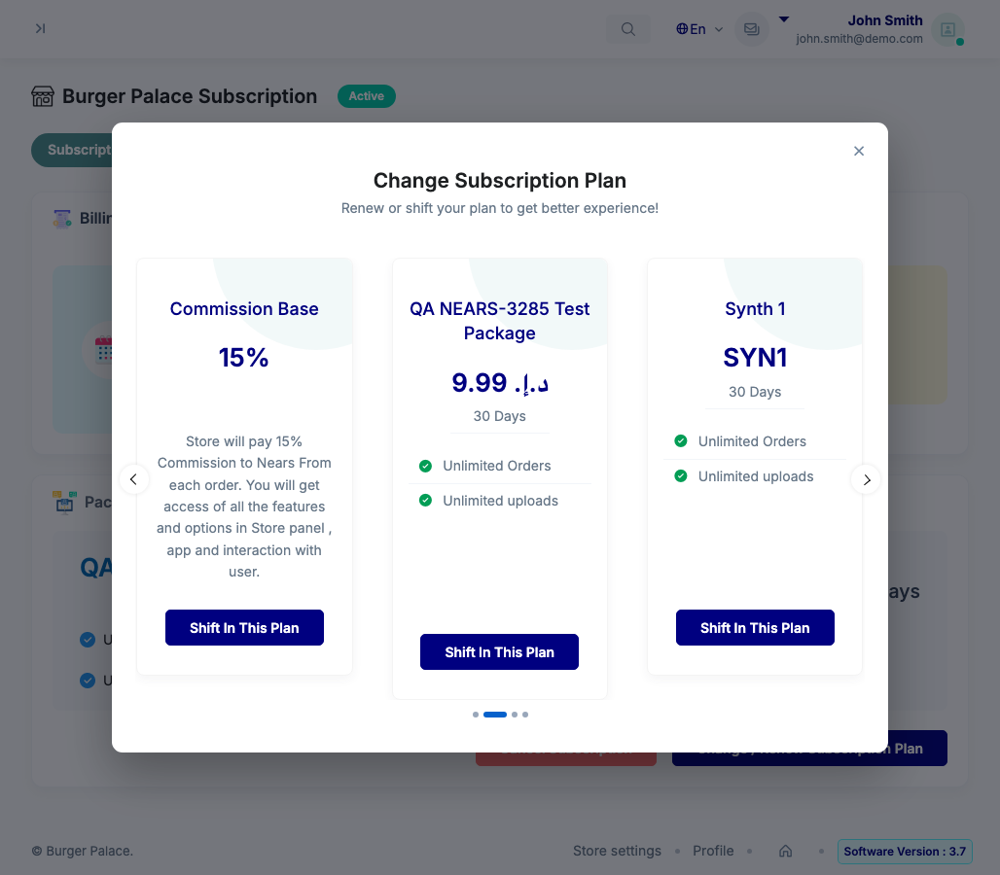</a> r2 overlap S1 tip 1028 n4</td>
<td align="center" width="33%"> r2 overlap S1 tip 1028 n5</td>
</tr>
<tr>
<td align="center" width="33%"> r2 overlap S1 tip 1199 n4</td>
<td align="center" width="33%"> r2 overlap S1 tip 1199 n5</td>
<td align="center" width="33%"> r2 overlap S1 tip 1200 n4</td>
</tr>
<tr>
<td align="center" width="33%"> r2 overlap S1 tip 1200 n5</td>
<td align="center" width="33%"> r2 overlap S1 tip 1440 n4</td>
<td align="center" width="33%"> r2 overlap S1 tip 1440 n5</td>
</tr>
<tr>
<td align="center" width="33%"> r2 overlap S1 tip 375 real3</td>
<td align="center" width="33%"> r2 overlap S1 tip 576 real3</td>
<td align="center" width="33%"> r2 overlap S1 tip 768 real3</td>
</tr>
<tr>
<td align="center" width="33%"> r2 overlap S1 tip 992 n4</td>
<td align="center" width="33%"> r2 overlap S1 tip 992 n5</td>
<td align="center" width="33%"> r3 xprobe VB rtl 768 n3 s0</td>
</tr>
<tr>
<td align="center" width="33%"> r3 xprobe VX rtl 768 n3 s0</td>
<td align="center" width="33%"> r3 xprobe VX3 rtl 768 n3 s0</td>
<td align="center" width="33%"> zoom arrows S1 1028 synth5 ltr</td>
</tr>
<tr>
<td align="center" width="33%"> zoom arrows S1 1028 synth5 rtl</td>
</tr>
</table>

### Other artifacts
- [`ac1-ac5-measure-1028.json`](ac1-ac5-measure-1028.json)
- [`ac2-measure.json`](ac2-measure.json)
- [`ac3-S1-base-matrix.json`](ac3-S1-base-matrix.json)
- [`ac3-S1-tip-matrix.json`](ac3-S1-tip-matrix.json)
- [`ac4-ac5-rtl-1028-real.json`](ac4-ac5-rtl-1028-real.json)
- [`ac4-rtl-option-experiment.json`](ac4-rtl-option-experiment.json)
- [`bug-no-visible-control-1028-3cards.log`](bug-no-visible-control-1028-3cards.log)
- [`bug-resize-position-reset-4cards.log`](bug-resize-position-reset-4cards.log)
- [`bug-rtl-dots-are-pages-not-plans.log`](bug-rtl-dots-are-pages-not-plans.log)
- [`bug-rtl-last-card-all-off-screen-1028.log`](bug-rtl-last-card-all-off-screen-1028.log)
- [`bug-rtl-last-card-shift-unreachable-768.log`](bug-rtl-last-card-shift-unreachable-768.log)
- [`bug-rtl-le768-better-than-base-regressing-rows.log`](bug-rtl-le768-better-than-base-regressing-rows.log)
- [`dots-hover-measure.json`](dots-hover-measure.json)
- [`options-matrix.json`](options-matrix.json)
- [`progress.md`](progress.md)
- [`r2-ac1-measure.json`](r2-ac1-measure.json)
- [`r2-ac2-measure.json`](r2-ac2-measure.json)
- [`r2-ac2-switch-post.json`](r2-ac2-switch-post.json)
- [`r2-ac3-tip-ltr-matrix.json`](r2-ac3-tip-ltr-matrix.json)
- [`r2-ac4a-geom.json`](r2-ac4a-geom.json)
- [`r2-ac4a-rtl-matrix.json`](r2-ac4a-rtl-matrix.json)
- [`r2-ac4b-better-than-base-table.json`](r2-ac4b-better-than-base-table.json)
- [`r2-ac4b-rtl-matrix.json`](r2-ac4b-rtl-matrix.json)
- [`r2-ac4c-allshift-rtl-matrix.json`](r2-ac4c-allshift-rtl-matrix.json)
- [`r2-ac5-measure.json`](r2-ac5-measure.json)
- [`r2-ctrl-package-index.json`](r2-ctrl-package-index.json)
- [`r2-ctrl.json`](r2-ctrl.json)
- [`r2-dots-measure-rtl-wide.json`](r2-dots-measure-rtl-wide.json)
- [`r2-dots-measure.json`](r2-dots-measure.json)
- [`r2-overlap-measure.json`](r2-overlap-measure.json)
- [`r2-resize-base.json`](r2-resize-base.json)
- [`r2-resize.json`](r2-resize.json)
- [`r3-xprobe-geometry-768-n5-s0.json`](r3-xprobe-geometry-768-n5-s0.json)
- [`r3-xprobe-matrix.json`](r3-xprobe-matrix.json)
- [`synth-ltr.json`](synth-ltr.json)
- [`synth-rtl.json`](synth-rtl.json)

---
*From `nears/docs/qa-evidence/NEARS-4163/` · public-repo scrub policy (no live secrets; verified clean).*
