# QA Evidence — NEARS-4171

**QA PASS: 419 marked + session-alive denial, all 7 AC live on tip 867d4ede6**

**24 screenshot(s).** Click any thumbnail for full resolution.

<table>
<tr>
<td align="center" width="33%"> ad create after ok</td>
<td align="center" width="33%"><a href="419-ad-create-notice.png">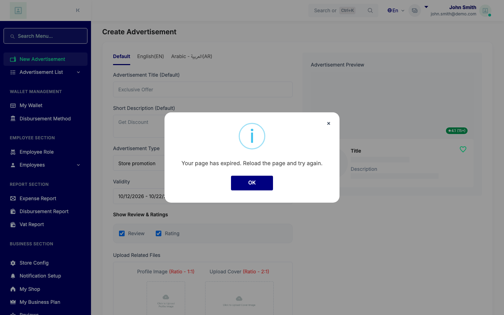</a> ad create notice</td>
<td align="center" width="33%"> add new after ok</td>
</tr>
<tr>
<td align="center" width="33%"><a href="419-add-new-notice.png">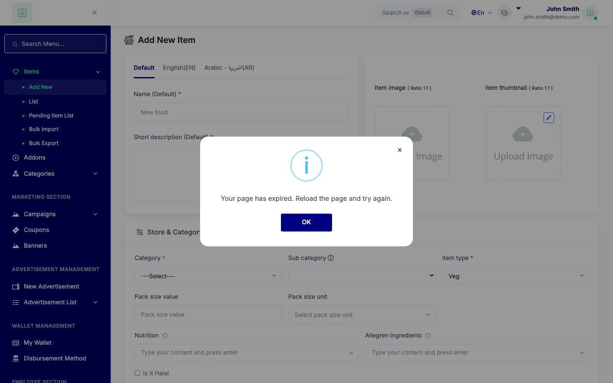</a> add new notice</td>
<td align="center" width="33%"> combo after ok</td>
<td align="center" width="33%"> combo notice</td>
</tr>
<tr>
<td align="center" width="33%"> concurrent dup cookie gone</td>
<td align="center" width="33%"> concurrent dup stale token</td>
<td align="center" width="33%"> edit after ok</td>
</tr>
<tr>
<td align="center" width="33%"> edit notice</td>
<td align="center" width="33%"> stale token prompt</td>
<td align="center" width="33%"><a href="ac3-1b-duplicate.png">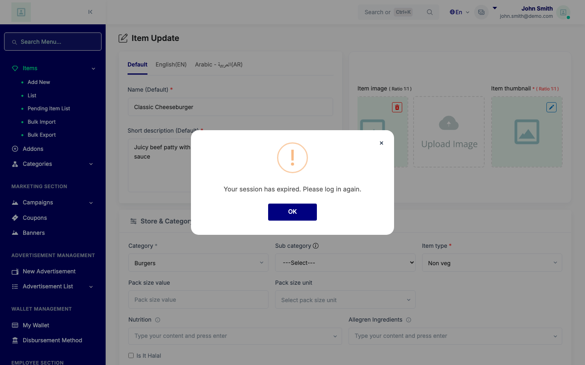</a> ac3 1b duplicate</td>
</tr>
<tr>
<td align="center" width="33%"> ac3 orderA ended wins over expired</td>
<td align="center" width="33%"> ac3 orderB ended replaces expired</td>
<td align="center" width="33%"><a href="ac4-denial-visibility.png">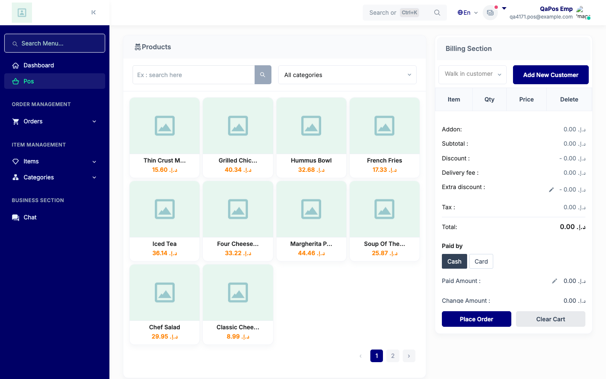</a> ac4 denial visibility</td>
</tr>
<tr>
<td align="center" width="33%"> ac4 employee denial notice</td>
<td align="center" width="33%"><a href="ac5-package-lacks-section-notice.png">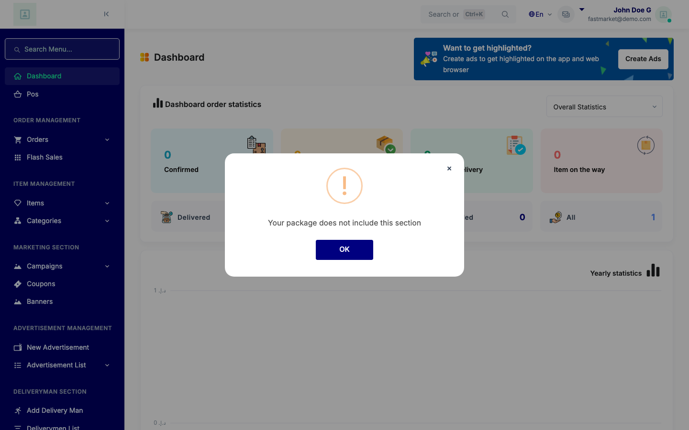</a> ac5 package lacks section notice</td>
<td align="center" width="33%"><a href="ac5-subscription-a-notice.png">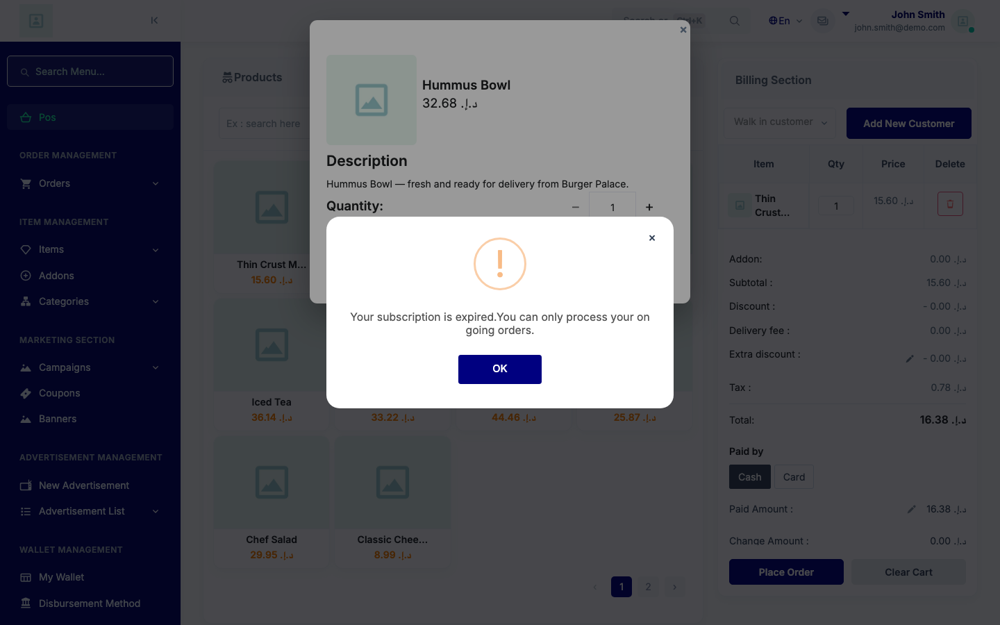</a> ac5 subscription a notice</td>
</tr>
<tr>
<td align="center" width="33%"><a href="ac5-subscription-b-none-notice.png">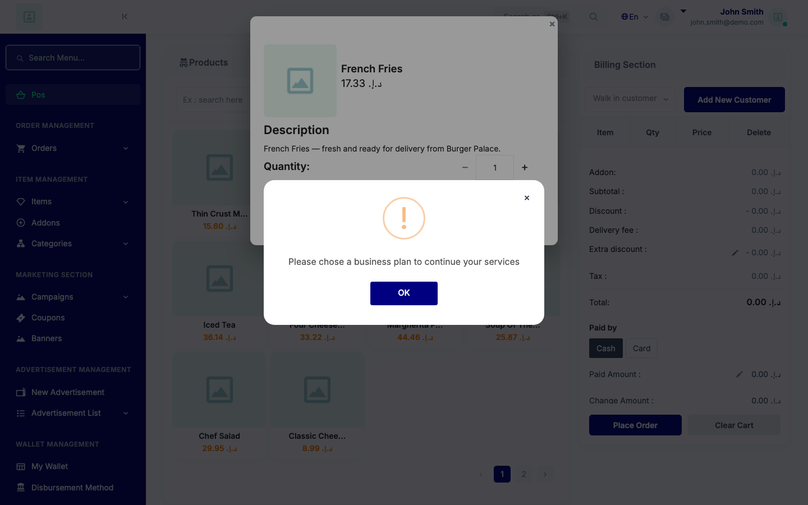</a> ac5 subscription b none notice</td>
<td align="center" width="33%"><a href="ac6-nonajax-denial-toastr.png">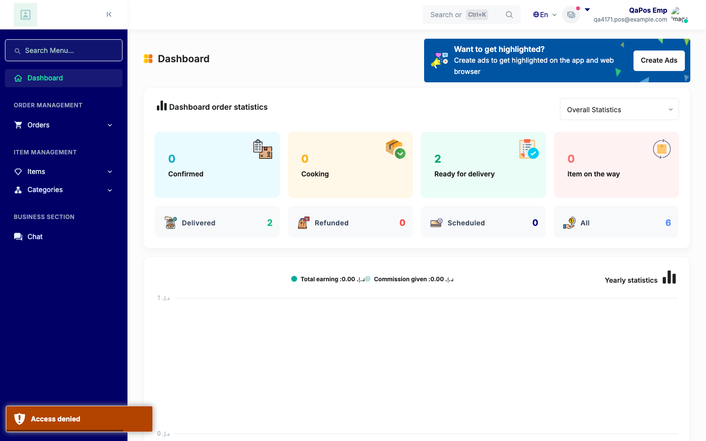</a> ac6 nonajax denial toastr</td>
<td align="center" width="33%"> ac7 ended modal</td>
</tr>
<tr>
<td align="center" width="33%"><a href="complete-reload-site-denied-no-reload.png">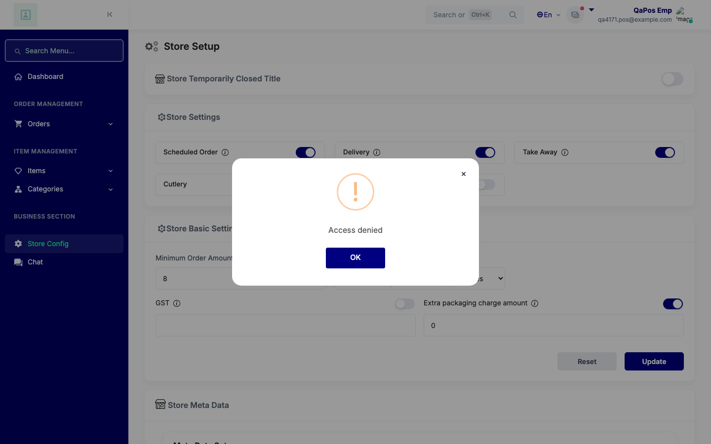</a> complete reload site denied no reload</td>
<td align="center" width="33%"><a href="quiet-chatless-employee.png">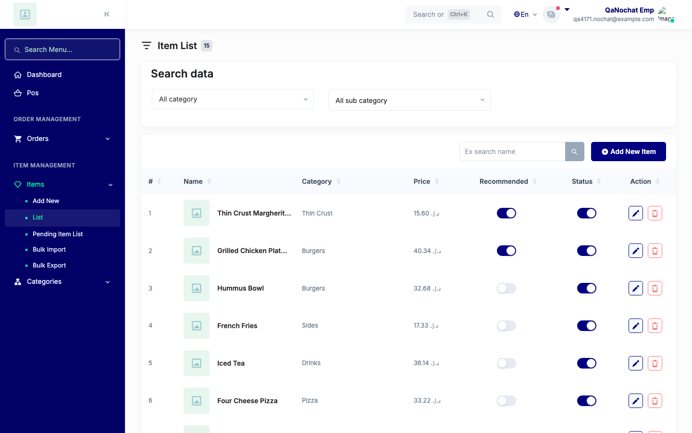</a> quiet chatless employee</td>
<td align="center" width="33%"><a href="quiet-owner-none.png">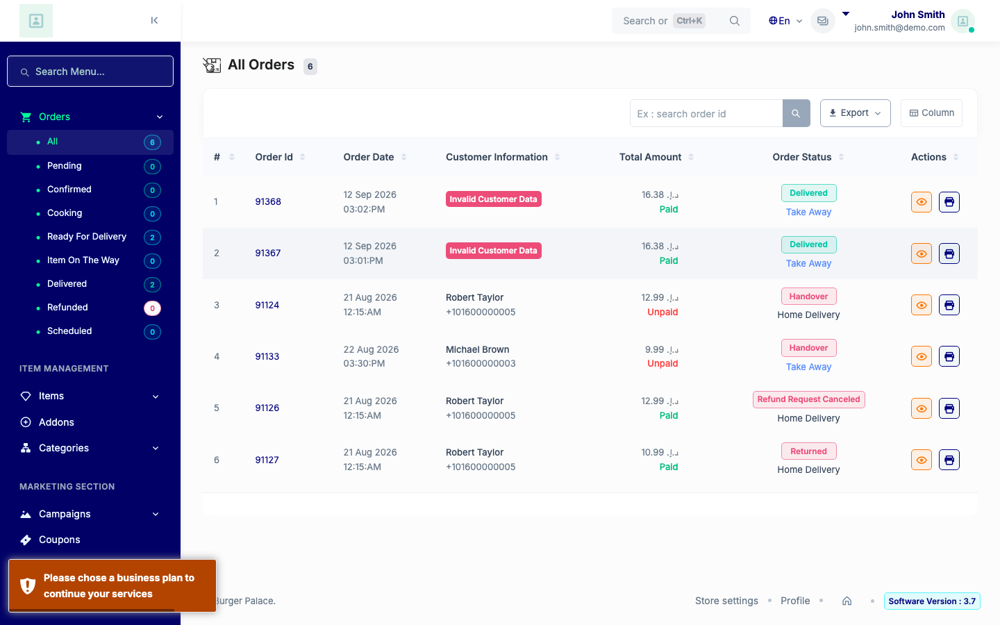</a> quiet owner none</td>
</tr>
</table>

### Other artifacts
- [`00-run-notes.txt`](00-run-notes.txt)
- [`419-ad-create-cookiegone.txt`](419-ad-create-cookiegone.txt)
- [`419-add-new-cookiegone.txt`](419-add-new-cookiegone.txt)
- [`419-combo-cookiegone.txt`](419-combo-cookiegone.txt)
- [`419-concurrent-duplicate-combination-update.txt`](419-concurrent-duplicate-combination-update.txt)
- [`419-edit-cookiegone.txt`](419-edit-cookiegone.txt)
- [`ac3-ac7-ended-vs-expired.txt`](ac3-ac7-ended-vs-expired.txt)
- [`ac4-ac5-employee-denial.txt`](ac4-ac5-employee-denial.txt)
- [`ac4-denial-visibility-rearm.txt`](ac4-denial-visibility-rearm.txt)
- [`ac4-quiet-and-ac6-employee.txt`](ac4-quiet-and-ac6-employee.txt)
- [`ac5-store21-package-arm.txt`](ac5-store21-package-arm.txt)
- [`ac5-subscription-a-and-quiet-owner.txt`](ac5-subscription-a-and-quiet-owner.txt)
- [`ac5-subscription-b-none.txt`](ac5-subscription-b-none.txt)
- [`ac5-subscription-b-restore.txt`](ac5-subscription-b-restore.txt)
- [`ac5-subscription-c-restore-owner-works.txt`](ac5-subscription-c-restore-owner-works.txt)
- [`ac7-ended-modal-arm1.txt`](ac7-ended-modal-arm1.txt)
- [`complete-reload-site-restaurant-index.txt`](complete-reload-site-restaurant-index.txt)
- [`controls.txt`](controls.txt)
- [`sentinel_clone_final.txt`](sentinel_clone_final.txt)
- [`sentinel_shared_after_1.txt`](sentinel_shared_after_1.txt)
- [`sentinel_shared_after_2.txt`](sentinel_shared_after_2.txt)
- [`sentinel_shared_before_1.txt`](sentinel_shared_before_1.txt)
- [`sentinel_shared_before_2.txt`](sentinel_shared_before_2.txt)

---
*From `nears/docs/qa-evidence/NEARS-4171/` · public-repo scrub policy (no live secrets; verified clean).*
