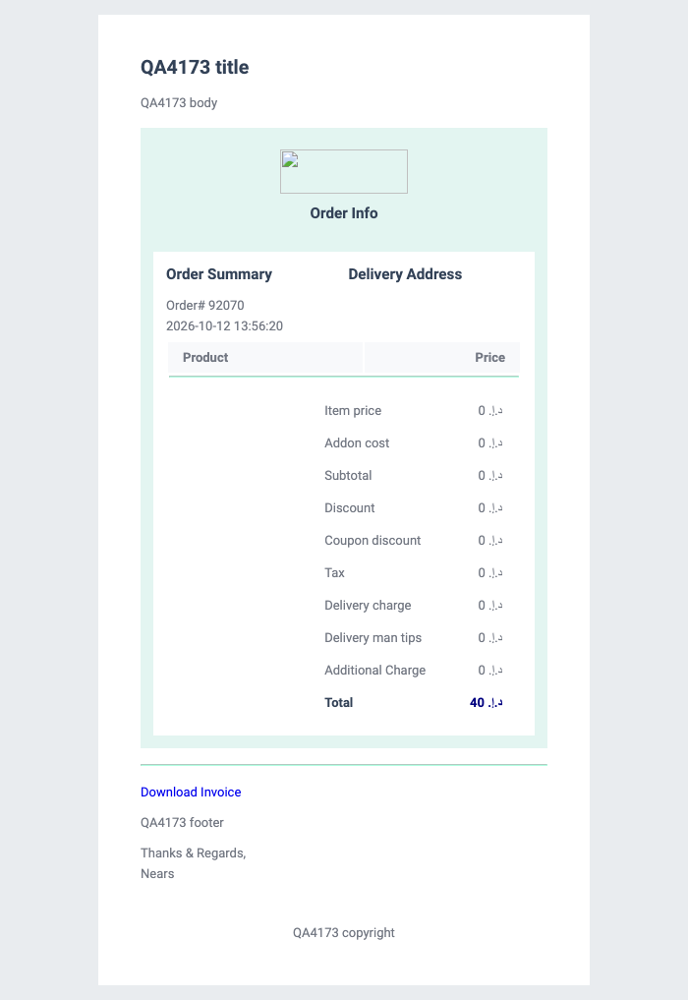
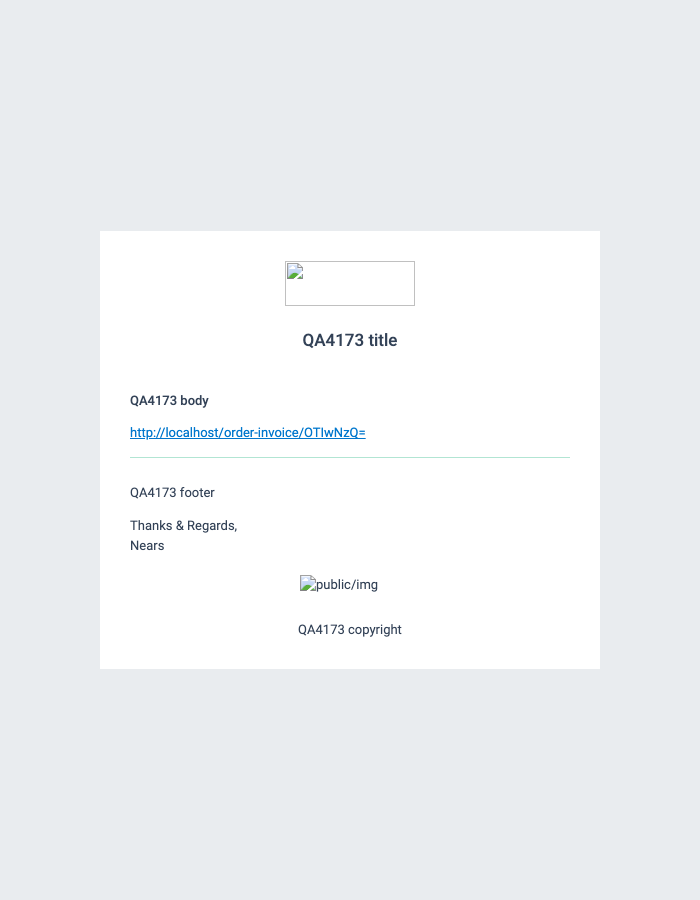
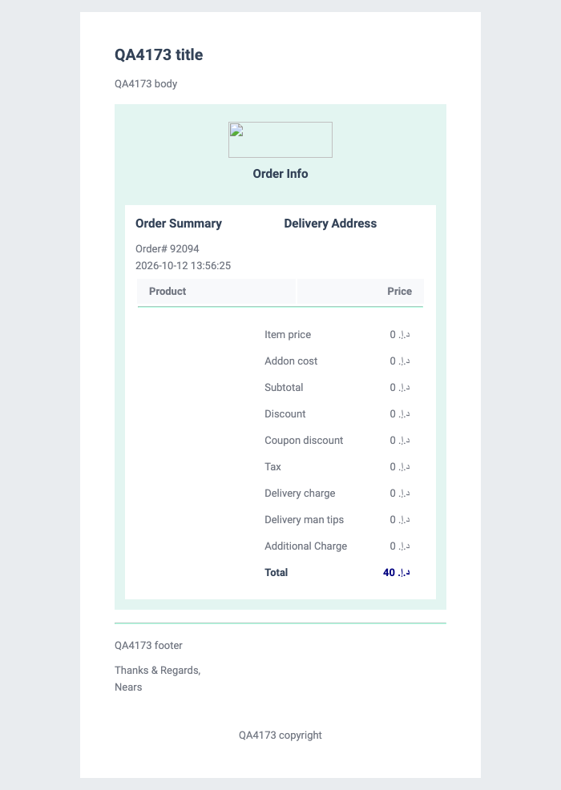
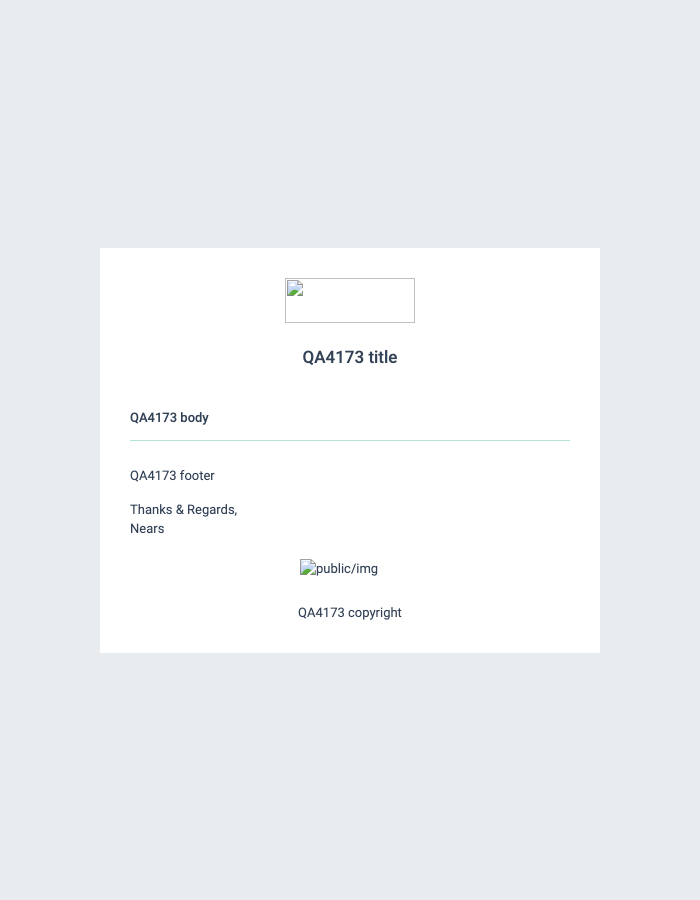

# QA Evidence — NEARS-4173

**QA PASS NEARS-4173: customer order-placed mail carries no invoice link (templates 3/5), auth + routes unchanged; base-RED twin 5/25 red**

**4 screenshot(s).** Click any thumbnail for full resolution.

<table>
<tr>
<td align="center" width="33%"> base RED template 3</td>
<td align="center" width="33%"> base RED template 5</td>
<td align="center" width="33%"> head fixed template 3</td>
</tr>
<tr>
<td align="center" width="33%"> head fixed template 5</td>
</tr>
</table>

### Other artifacts
- [`ac3-http-arms-A.txt`](ac3-http-arms-A.txt)
- [`ac3-http-arms-B.txt`](ac3-http-arms-B.txt)
- [`ac3-inproc-own-store-pdf.txt`](ac3-inproc-own-store-pdf.txt)
- [`dom-base-RED-template-3.json`](dom-base-RED-template-3.json)
- [`dom-base-RED-template-3.txt`](dom-base-RED-template-3.txt)
- [`dom-base-RED-template-5.json`](dom-base-RED-template-5.json)
- [`dom-base-RED-template-5.txt`](dom-base-RED-template-5.txt)
- [`dom-head-fixed-template-3.json`](dom-head-fixed-template-3.json)
- [`dom-head-fixed-template-3.txt`](dom-head-fixed-template-3.txt)
- [`dom-head-fixed-template-5.json`](dom-head-fixed-template-5.json)
- [`dom-head-fixed-template-5.txt`](dom-head-fixed-template-5.txt)
- [`phpunit-BASE-red.txt`](phpunit-BASE-red.txt)
- [`phpunit-HEAD-green.txt`](phpunit-HEAD-green.txt)
- [`phpunit-regression-subset-HEAD.txt`](phpunit-regression-subset-HEAD.txt)
- [`progress.md`](progress.md)
- [`render-all-templates-BASE.jsonl`](render-all-templates-BASE.jsonl)
- [`render-all-templates-HEAD.jsonl`](render-all-templates-HEAD.jsonl)
- [`render-refund-mailables-HEAD.txt`](render-refund-mailables-HEAD.txt)
- [`routes-invoice-BASE.txt`](routes-invoice-BASE.txt)
- [`routes-invoice-HEAD.txt`](routes-invoice-HEAD.txt)

---
*From `nears/docs/qa-evidence/NEARS-4173/` · public-repo scrub policy (no live secrets; verified clean).*
