# QA Evidence — NEARS-4183

**QA PASS (1 non-AC task_bug: top_rated gate)**

**21 screenshot(s).** Click any thumbnail for full resolution.

<table>
<tr>
<td align="center" width="33%"><a href="ac10-cold-selection-during-fetch.png">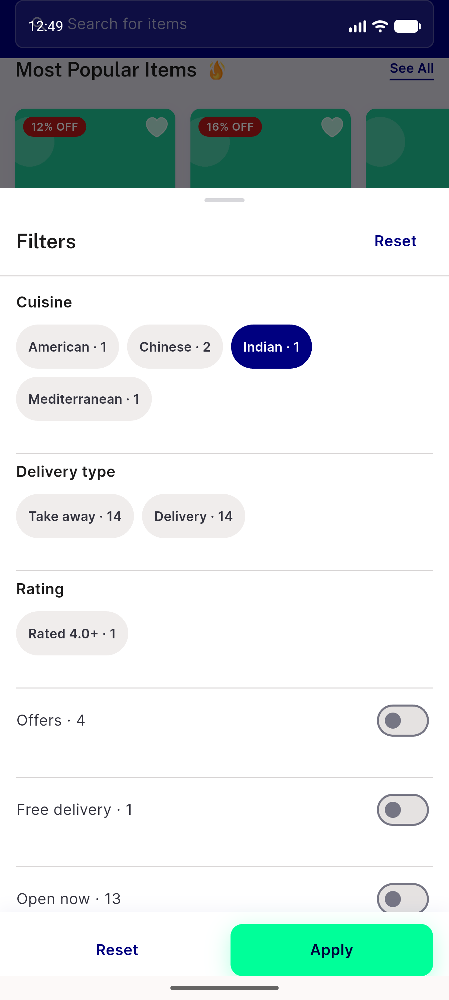</a> ac10 cold selection during fetch</td>
<td align="center" width="33%"><a href="ac10-warm-A-served-from-cache.png">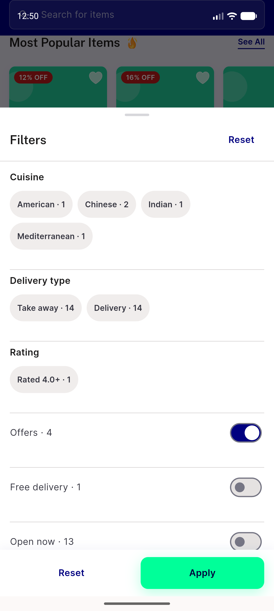</a> ac10 warm A served from cache</td>
<td align="center" width="33%"><a href="ac11-ar-320dp-x1.3-pharmacy.png">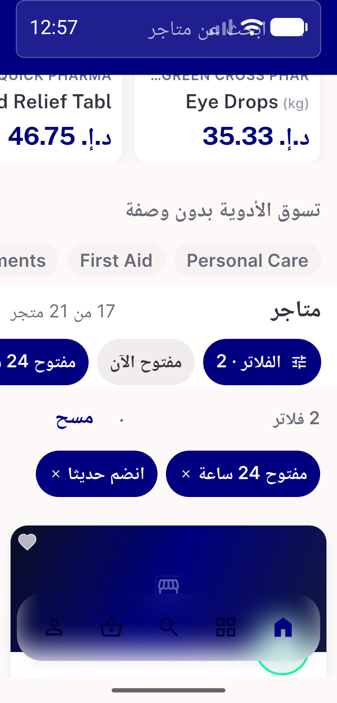</a> ac11 ar 320dp x1.3 pharmacy</td>
</tr>
<tr>
<td align="center" width="33%"><a href="ac11-ar-pharmacy-applied.png">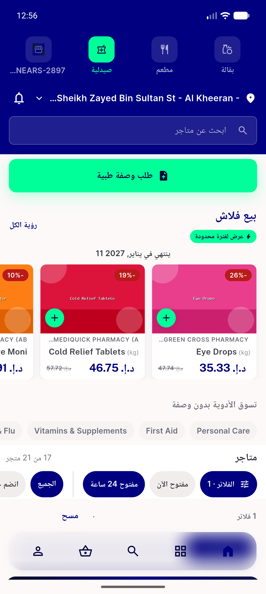</a> ac11 ar pharmacy applied</td>
<td align="center" width="33%"><a href="ac11-ar-pharmacy-rail.png">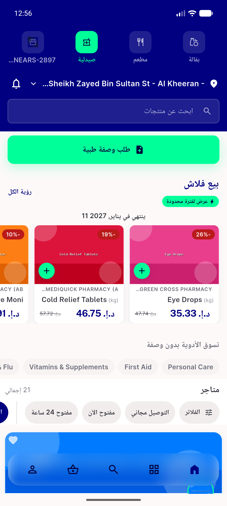</a> ac11 ar pharmacy rail</td>
<td align="center" width="33%"><a href="ac11-ar-sheet-pharmacy.png">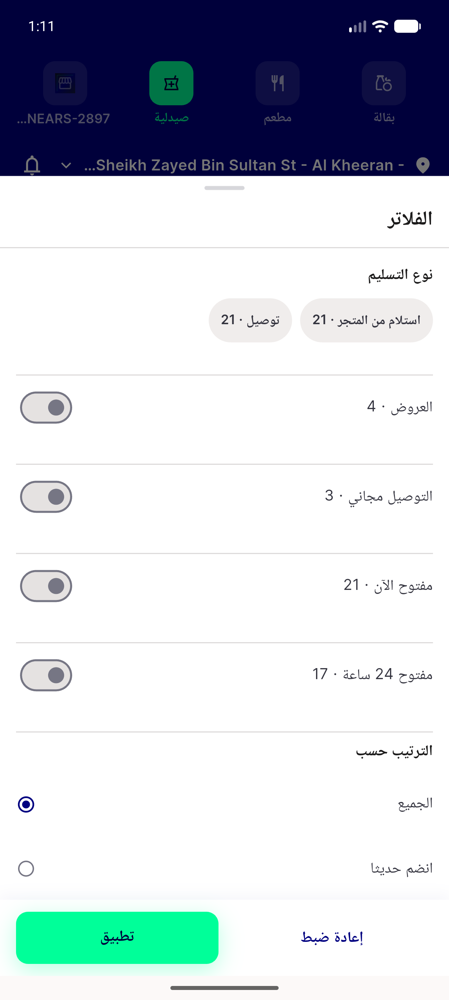</a> ac11 ar sheet pharmacy</td>
</tr>
<tr>
<td align="center" width="33%"><a href="ac11-ar-sort-chip-selected.png">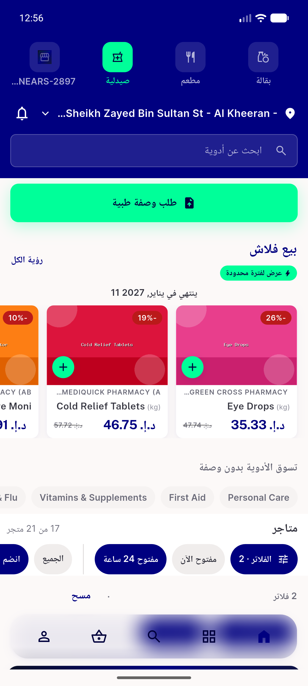</a> ac11 ar sort chip selected</td>
<td align="center" width="33%"><a href="ac11-ar-zero-result-empty-row.png">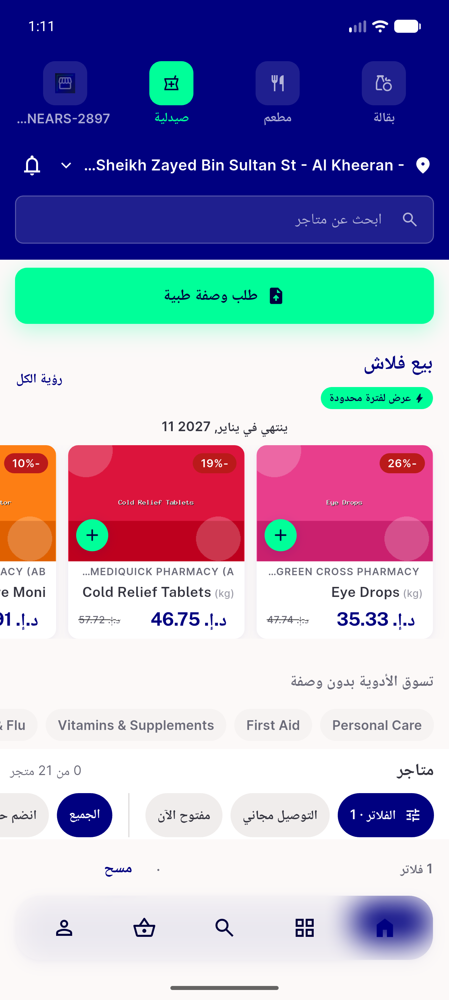</a> ac11 ar zero result empty row</td>
<td align="center" width="33%"><a href="ac11-en-320dp-x1.3-food.png">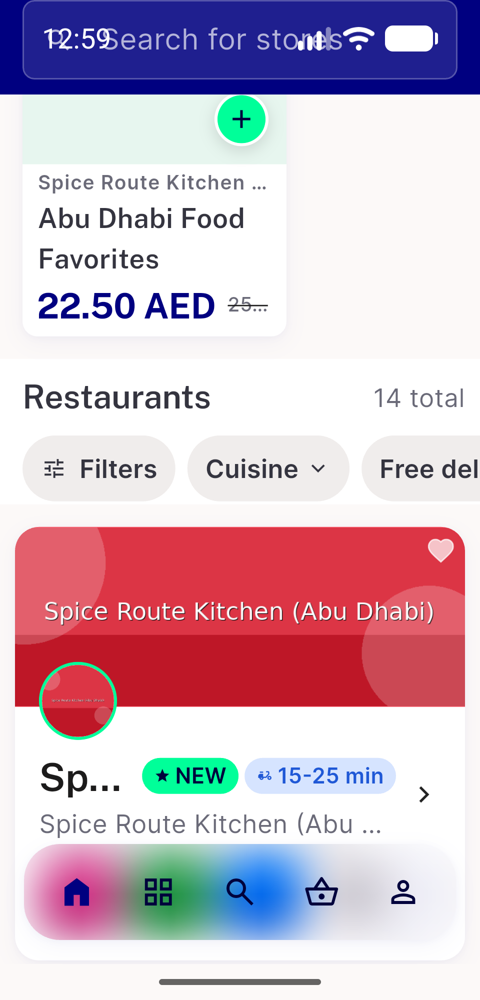</a> ac11 en 320dp x1.3 food</td>
</tr>
<tr>
<td align="center" width="33%"><a href="ac14-failed-filtered-fetch-list-area.png">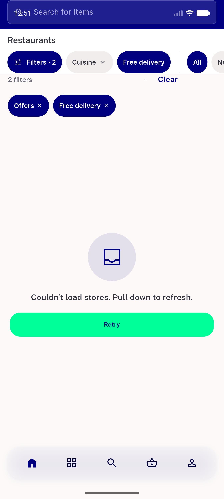</a> ac14 failed filtered fetch list area</td>
<td align="center" width="33%"><a href="ac14-failed-filtered-fetch.png">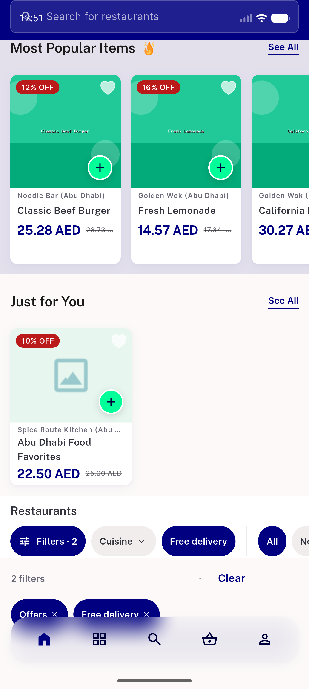</a> ac14 failed filtered fetch</td>
<td align="center" width="33%"><a href="ac6-cuisine-chip-sheet.png">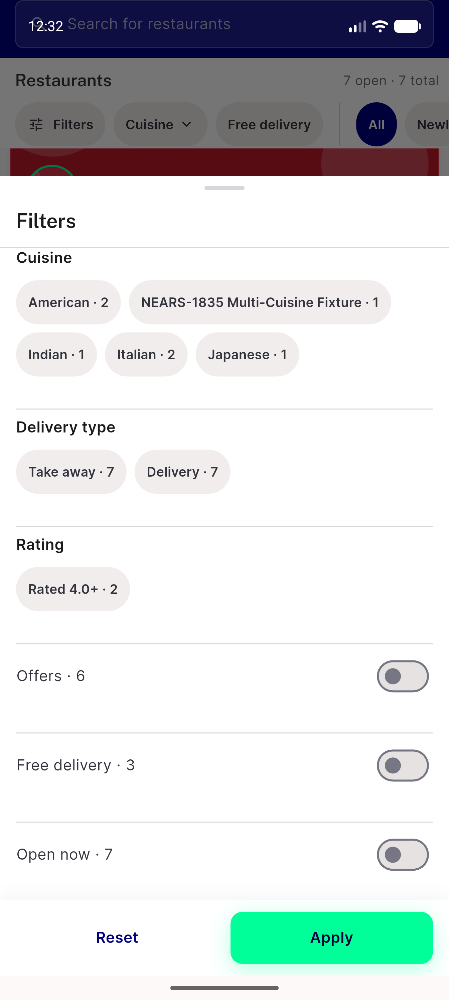</a> ac6 cuisine chip sheet</td>
</tr>
<tr>
<td align="center" width="33%"><a href="ac6-food-z1-home-rail.png">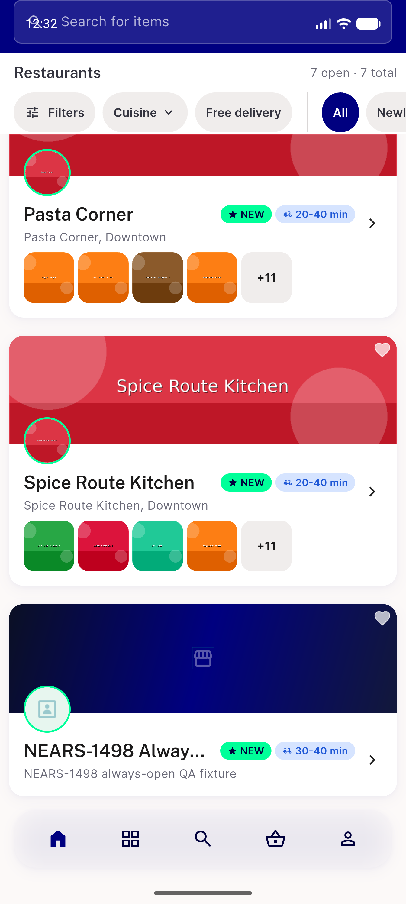</a> ac6 food z1 home rail</td>
<td align="center" width="33%"><a href="ac6-pharmacy-z2-home-rail.png">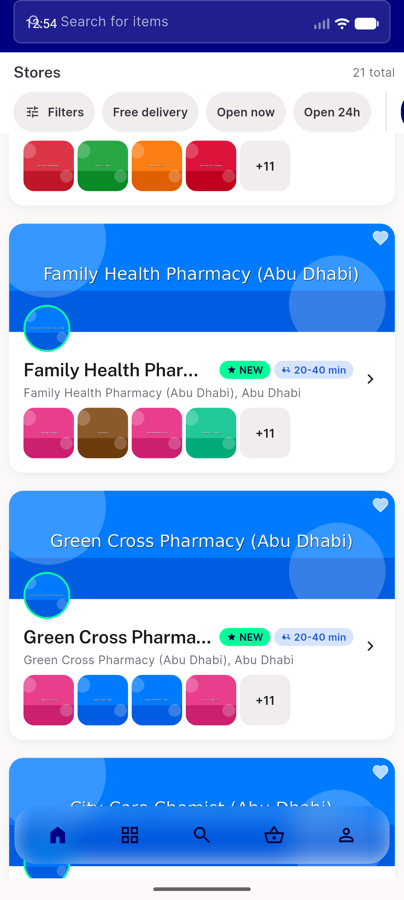</a> ac6 pharmacy z2 home rail</td>
<td align="center" width="33%"><a href="ac7-applied-bar-two-filters.png">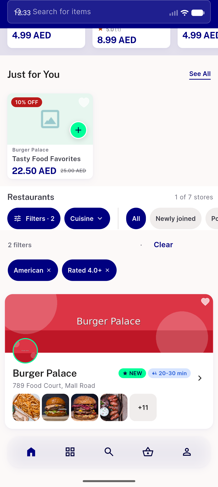</a> ac7 applied bar two filters</td>
</tr>
<tr>
<td align="center" width="33%"><a href="ac8-zero-result-food-home.png">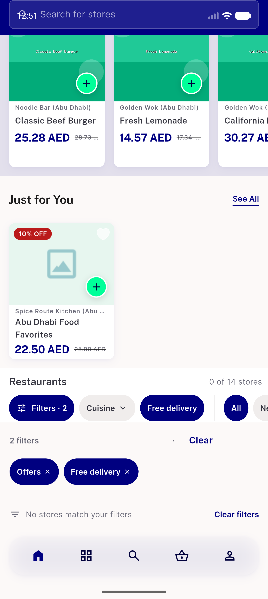</a> ac8 zero result food home</td>
<td align="center" width="33%"><a href="ac8-zero-result-grocery-gate-intact.png">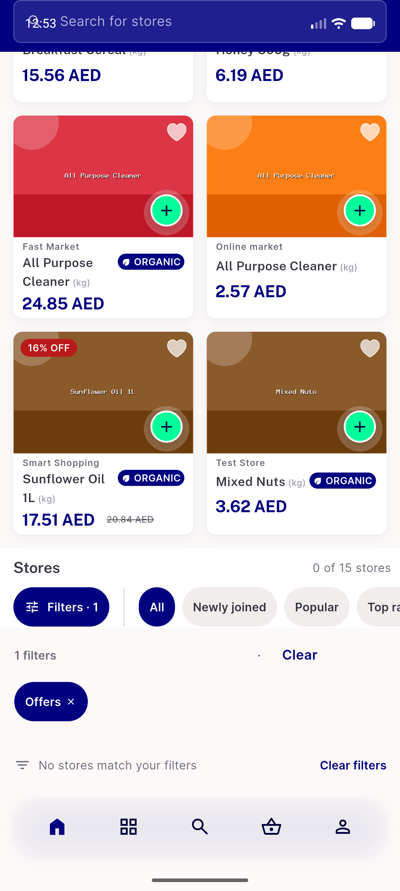</a> ac8 zero result grocery gate intact</td>
<td align="center" width="33%"><a href="ac8-zero-result-seeall-popular.png">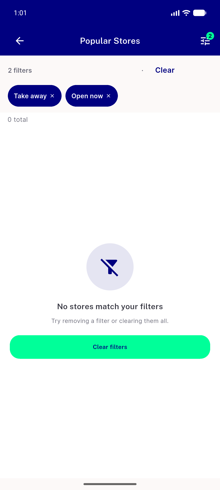</a> ac8 zero result seeall popular</td>
</tr>
<tr>
<td align="center" width="33%"> ac9 seeall latest shared selection</td>
<td align="center" width="33%"><a href="ac9-seeall-popular-shared-selection.png">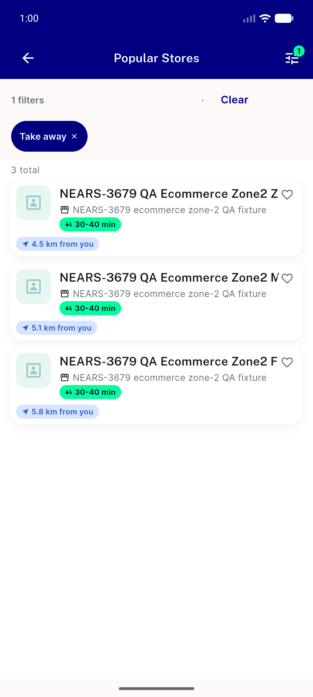</a> ac9 seeall popular shared selection</td>
<td align="center" width="33%"><a href="bug-top-rated-chip-vanishes-empty-list.png">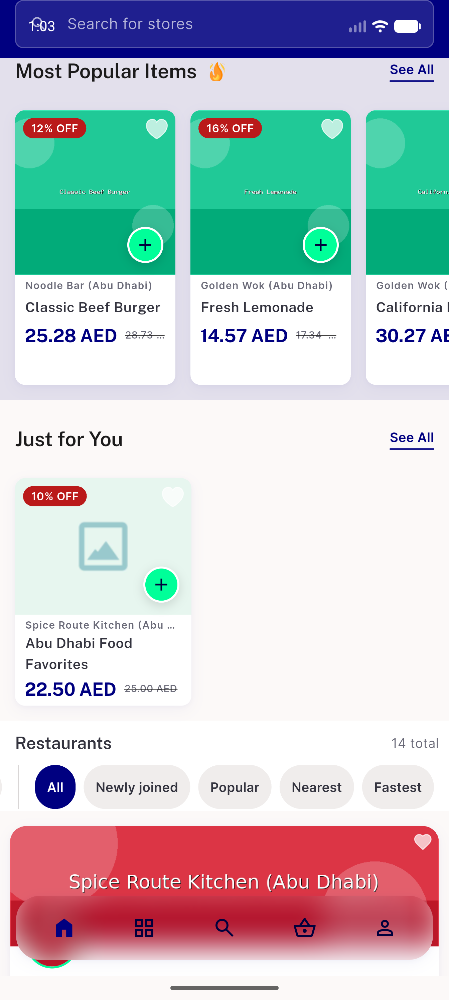</a> bug top rated chip vanishes empty list</td>
</tr>
</table>

### Other artifacts
- [`ac10-local-cache-ids-per-signature.log`](ac10-local-cache-ids-per-signature.log)
- [`api-t1.log`](api-t1.log)
- [`api-t2.log`](api-t2.log)
- [`api-t3.log`](api-t3.log)
- [`api-t4.log`](api-t4.log)
- [`bug-top-rated-chip-vanishes-empty-list.log`](bug-top-rated-chip-vanishes-empty-list.log)
- [`flutter-analyze-base.log`](flutter-analyze-base.log)
- [`flutter-analyze-branch.log`](flutter-analyze-branch.log)
- [`flutter-test-ft_branch.txt`](flutter-test-ft_branch.txt)
- [`flutter-test-id_base.txt`](flutter-test-id_base.txt)
- [`flutter-test-id_branch.txt`](flutter-test-id_branch.txt)
- [`phpunit-filters.log`](phpunit-filters.log)
- [`phpunit-mutation-check-stop-on-failure.log`](phpunit-mutation-check-stop-on-failure.log)
- [`phpunit-mutation-check.log`](phpunit-mutation-check.log)
- [`phpunit-storelist.log`](phpunit-storelist.log)
- [`progress.md`](progress.md)
- [`qa-proxy-request-log.log`](qa-proxy-request-log.log)

---
*From `nears/docs/qa-evidence/NEARS-4183/` · public-repo scrub policy (no live secrets; verified clean).*
