# QA Evidence — NEARS-4190

**BLOCKED at AC14 (mem-guard exit 96, swap 11.6 GB): L4 functional/backstop all green, latency unmeasured**

**13 screenshot(s).** Click any thumbnail for full resolution.

<table>
<tr>
<td align="center" width="33%"><a href="ac12-after-pill-remove.png">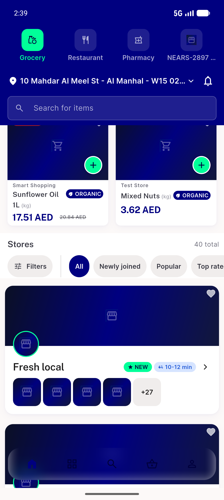</a> ac12 after pill remove</td>
<td align="center" width="33%"><a href="ac13-empty-state.png">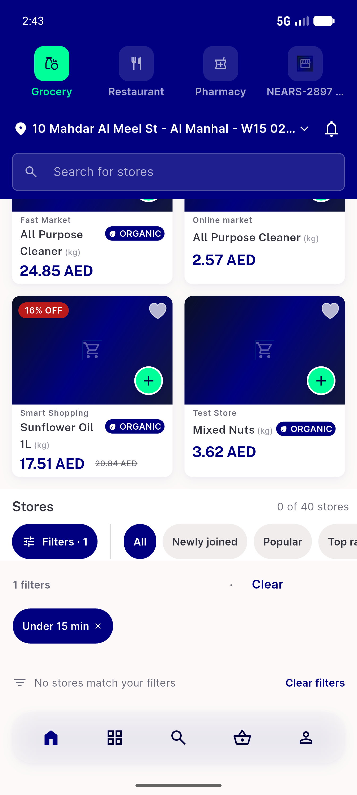</a> ac13 empty state</td>
<td align="center" width="33%"><a href="ac13-sheet-zero.png">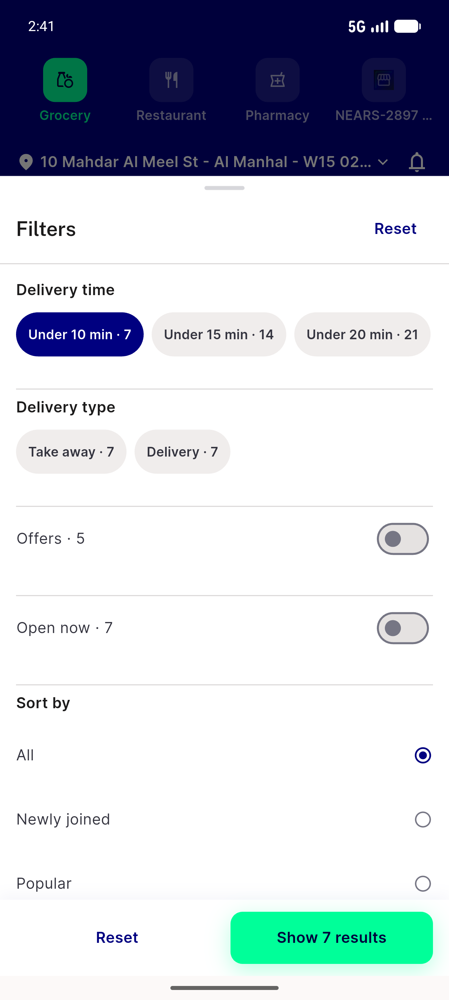</a> ac13 sheet zero</td>
</tr>
<tr>
<td align="center" width="33%"><a href="ac18-error-state.png">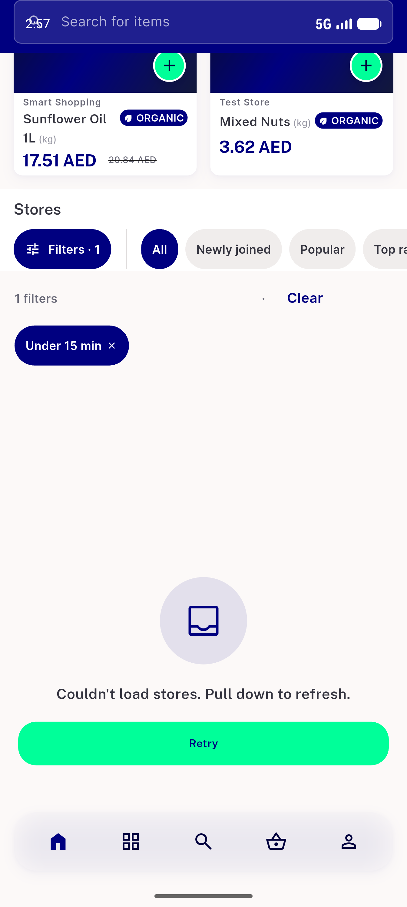</a> ac18 error state</td>
<td align="center" width="33%"><a href="ac2-ar-320dp-x1.3.png">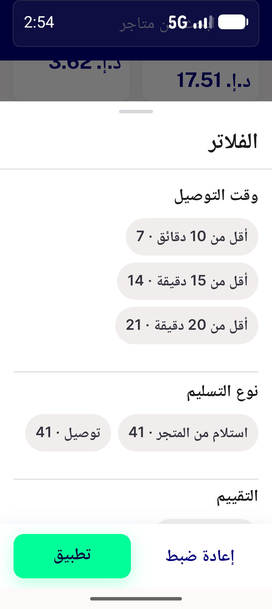</a> ac2 ar 320dp x1.3</td>
<td align="center" width="33%"><a href="ac2-sheet-ar-rtl.png">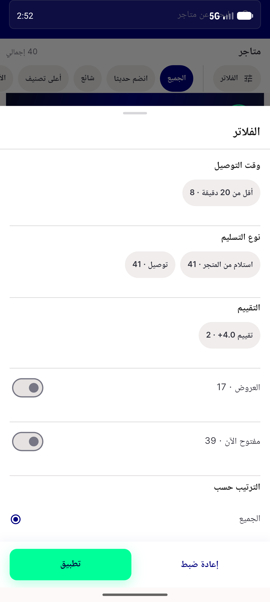</a> ac2 sheet ar rtl</td>
</tr>
<tr>
<td align="center" width="33%"><a href="ac2-sheet-home-en.png">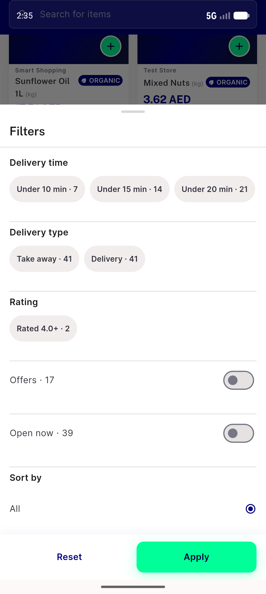</a> ac2 sheet home en</td>
<td align="center" width="33%"><a href="r2-ac12-applied-pill.png">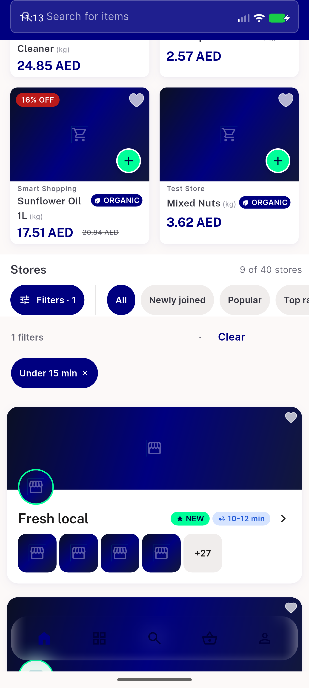</a> r2 ac12 applied pill</td>
<td align="center" width="33%"><a href="r2-ac13-zero-result.png">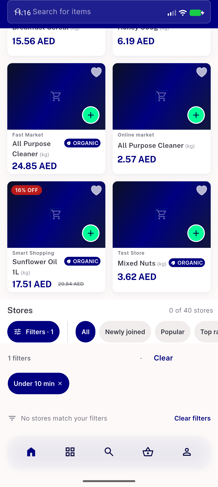</a> r2 ac13 zero result</td>
</tr>
<tr>
<td align="center" width="33%"><a href="r2-ac2-home-sheet-en.png">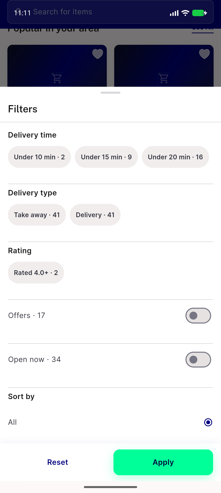</a> r2 ac2 home sheet en</td>
<td align="center" width="33%"> r2 ac2 seeall latest sheet</td>
<td align="center" width="33%"><a href="r2-ac2-seeall-popular-sheet.png">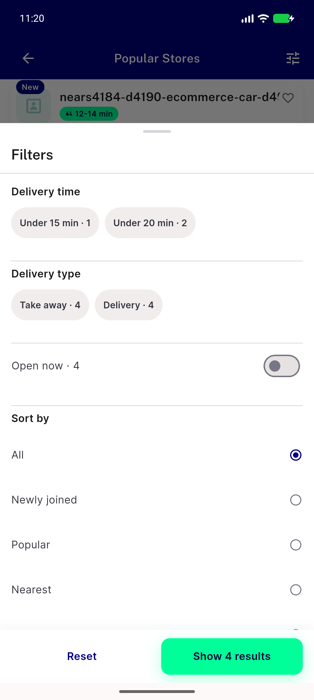</a> r2 ac2 seeall popular sheet</td>
</tr>
<tr>
<td align="center" width="33%"><a href="r2-ac2-seeall-recommended-sheet.png">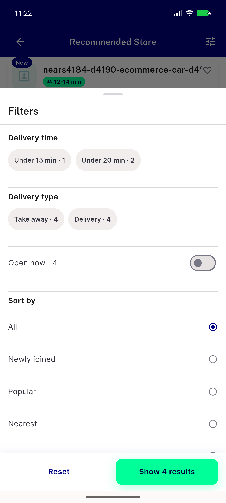</a> r2 ac2 seeall recommended sheet</td>
</tr>
</table>

### Other artifacts
- [`ac14-ab_control_base_vs_base.out`](ac14-ab_control_base_vs_base.out)
- [`ac14-ab_gateA_results.tsv`](ac14-ab_gateA_results.tsv)
- [`ac14-ab_gateA.out`](ac14-ab_gateA.out)
- [`ac14-engineer-fix1-measurements.txt`](ac14-engineer-fix1-measurements.txt)
- [`ac14-explain_capscale.out`](ac14-explain_capscale.out)
- [`ac14-explain_capscale2.out`](ac14-explain_capscale2.out)
- [`ac14-explain_zone.out`](ac14-explain_zone.out)
- [`ac14-measurements.txt`](ac14-measurements.txt)
- [`ac14-paired_1.out`](ac14-paired_1.out)
- [`ac14-paired_2.out`](ac14-paired_2.out)
- [`ac14-paired_control_base_vs_base.out`](ac14-paired_control_base_vs_base.out)
- [`ac14-paired_zone.out`](ac14-paired_zone.out)
- [`ac18-app-fail.log`](ac18-app-fail.log)
- [`ac18-filters_block_failed.log`](ac18-filters_block_failed.log)
- [`bug-module-switch-resetsessions-setstate-during-build.log`](bug-module-switch-resetsessions-setstate-during-build.log)
- [`progress.md`](progress.md)
- [`r2-ac14-capscale-21k-zone.json`](r2-ac14-capscale-21k-zone.json)
- [`r2-ac14-capscale-24k-zone.json`](r2-ac14-capscale-24k-zone.json)
- [`r2-ac14-explain-capscale-21k-zone.out`](r2-ac14-explain-capscale-21k-zone.out)
- [`r2-ac14-explain-capscale-24k-zone.out`](r2-ac14-explain-capscale-24k-zone.out)
- [`r2-ac14-explain-food-1000.out`](r2-ac14-explain-food-1000.out)
- [`r2-ac14-explain-grocery-1000.out`](r2-ac14-explain-grocery-1000.out)
- [`r2-ac14-explain-zone-1000.out`](r2-ac14-explain-zone-1000.out)
- [`r2-ac14-instrument-proof-slowed.json`](r2-ac14-instrument-proof-slowed.json)
- [`r2-ac14-paired-real_r1_1.json`](r2-ac14-paired-real_r1_1.json)
- [`r2-ac14-paired-real_r1_2.json`](r2-ac14-paired-real_r1_2.json)
- [`r2-ac14-paired-real_r1_zone.json`](r2-ac14-paired-real_r1_zone.json)
- [`r2-ac14-paired-real_r2_1.json`](r2-ac14-paired-real_r2_1.json)
- [`r2-ac14-paired-real_r2_2.json`](r2-ac14-paired-real_r2_2.json)
- [`r2-ac14-paired-real_r2_zone.json`](r2-ac14-paired-real_r2_zone.json)
- [`r2-ac14-paired-real_r3_1.json`](r2-ac14-paired-real_r3_1.json)
- [`r2-ac14-paired-real_r3_2.json`](r2-ac14-paired-real_r3_2.json)
- [`r2-ac14-paired-real_r3_zone.json`](r2-ac14-paired-real_r3_zone.json)
- [`r2-ac14-paired-real_r4_1.json`](r2-ac14-paired-real_r4_1.json)
- [`r2-ac14-paired-real_r4_2.json`](r2-ac14-paired-real_r4_2.json)
- [`r2-ac14-paired-real_r4_zone.json`](r2-ac14-paired-real_r4_zone.json)
- [`r2-ac14-paired-real_r5_1.json`](r2-ac14-paired-real_r5_1.json)
- [`r2-ac14-paired-real_r5_2.json`](r2-ac14-paired-real_r5_2.json)
- [`r2-ac14-paired-real_r5_zone.json`](r2-ac14-paired-real_r5_zone.json)
- [`r2-ac14-paired-real_r6_1.json`](r2-ac14-paired-real_r6_1.json)
- [`r2-ac14-paired-real_r6_2.json`](r2-ac14-paired-real_r6_2.json)
- [`r2-ac14-paired-summary.txt`](r2-ac14-paired-summary.txt)
- [`r2-ac18-filters_block_failed.log`](r2-ac18-filters_block_failed.log)
- [`r2-api-matrices-head.out`](r2-api-matrices-head.out)
- [`r2-byte-for-byte-grid.json`](r2-byte-for-byte-grid.json)
- [`r2-filters-dir-red-5.txt`](r2-filters-dir-red-5.txt)
- [`r3-ac14-memguard-refusal.log`](r3-ac14-memguard-refusal.log)
- [`r3-api_a.out`](r3-api_a.out)
- [`r3-api_b.out`](r3-api_b.out)
- [`r3-api_c.out`](r3-api_c.out)
- [`r3-api_d.out`](r3-api_d.out)
- [`r3-api_e.out`](r3-api_e.out)
- [`r3-api_f.out`](r3-api_f.out)
- [`r3-api_g.out`](r3-api_g.out)
- [`r3-explain3_zone.out`](r3-explain3_zone.out)
- [`r3-extra-suites-green.txt`](r3-extra-suites-green.txt)
- [`r3-filters-dir-971-5red.txt`](r3-filters-dir-971-5red.txt)
- [`r3-filters-dir-red-5.txt`](r3-filters-dir-red-5.txt)
- [`r3-grid.out`](r3-grid.out)
- [`r3-l4_b.out`](r3-l4_b.out)
- [`r3-l4_f.out`](r3-l4_f.out)
- [`r3-sqllog_b45_1_r.out`](r3-sqllog_b45_1_r.out)
- [`r3-sqllog_b45_zone_r.out`](r3-sqllog_b45_zone_r.out)
- [`r3-sqllog_head_1_r.out`](r3-sqllog_head_1_r.out)
- [`r3-sqllog_head_zone_r.out`](r3-sqllog_head_zone_r.out)

---
*From `nears/docs/qa-evidence/NEARS-4190/` · public-repo scrub policy (no live secrets; verified clean).*
