# QA Evidence — NEARS-4196

**cycle1 PASS: AC9 320dp x1.3 EN+AR Apply label whole, TB-2 gate verified, sweep clean**

**29 screenshot(s).** Click any thumbnail for full resolution.

<table>
<tr>
<td align="center" width="33%"> bug apply label truncated 320dp ar</td>
<td align="center" width="33%"> bug apply label truncated 320dp en</td>
<td align="center" width="33%"><a href="c1-ac9-01-sheet-items-1.0x.png">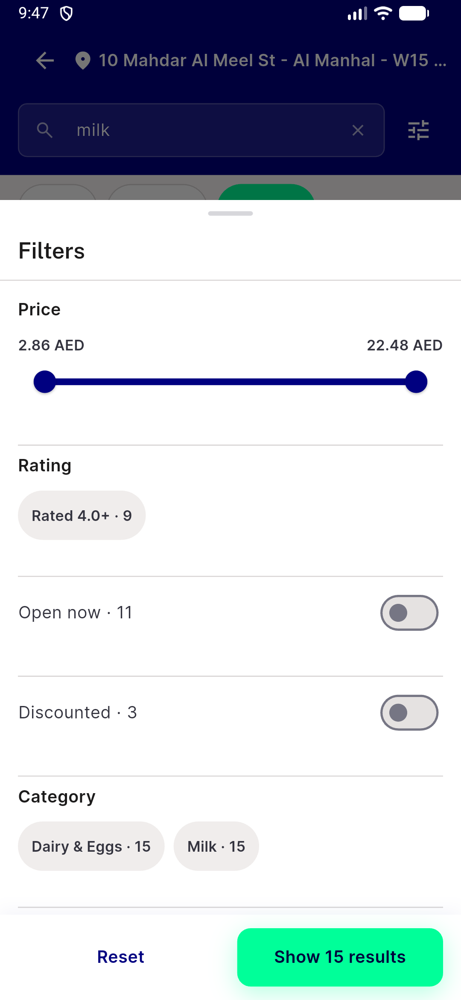</a> c1 ac9 01 sheet items 1.0x</td>
</tr>
<tr>
<td align="center" width="33%"><a href="c1-ac9-02-en-320dp-1.3x-items-milk.png">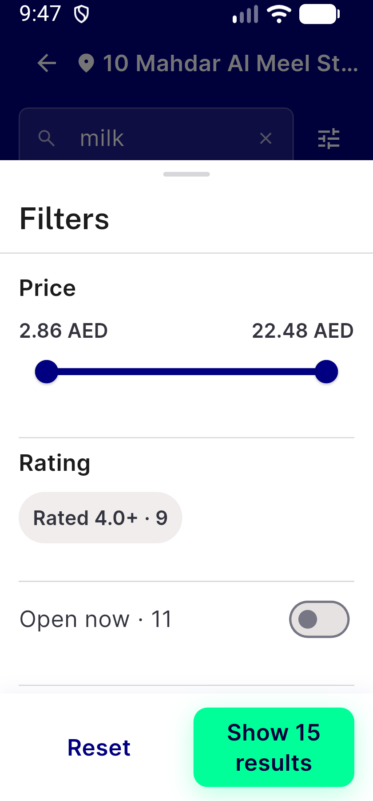</a> c1 ac9 02 en 320dp 1.3x items milk</td>
<td align="center" width="33%"><a href="c1-ac9-03-en-320dp-1.3x-all-ea.png">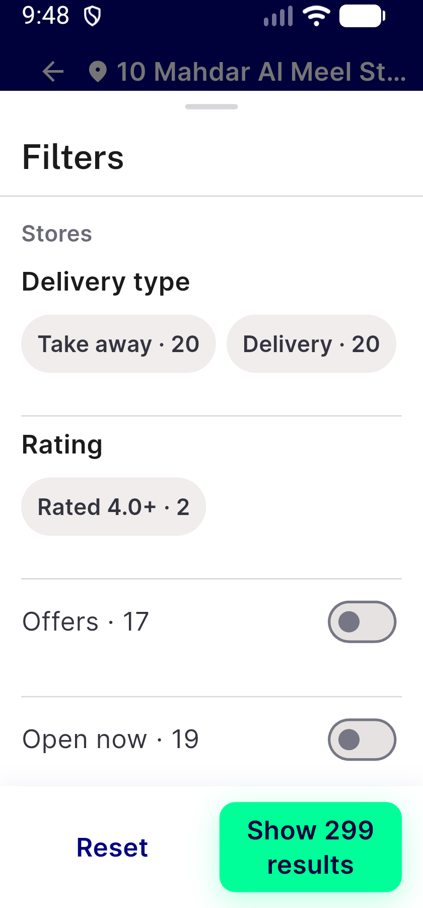</a> c1 ac9 03 en 320dp 1.3x all ea</td>
<td align="center" width="33%"><a href="c1-ac9-04-en-320dp-1.3x-stores-show2.png">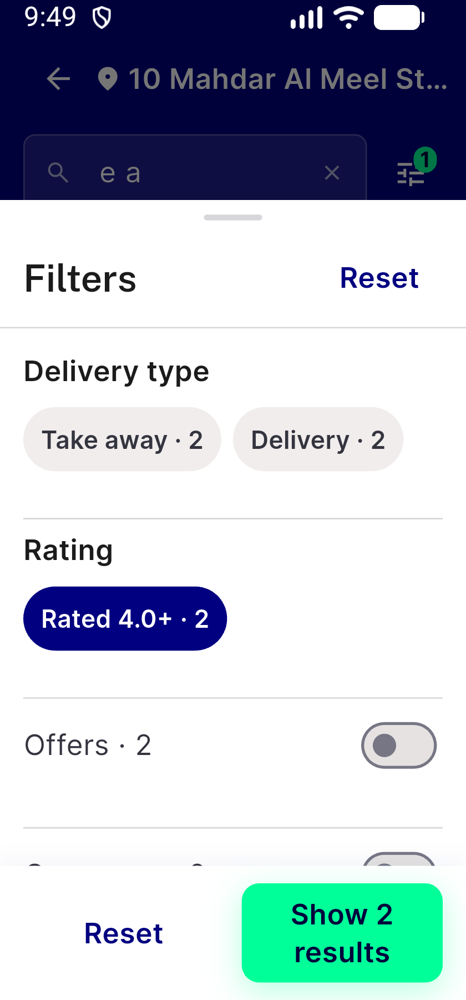</a> c1 ac9 04 en 320dp 1.3x stores show2</td>
</tr>
<tr>
<td align="center" width="33%"><a href="c1-ac9-05-en-320dp-1.3x-items-show29.png">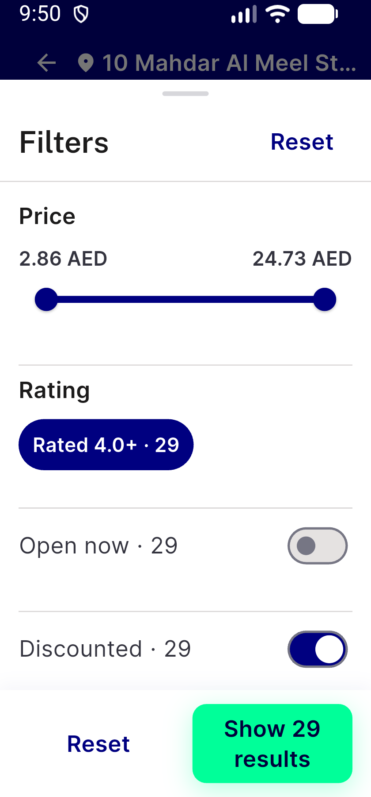</a> c1 ac9 05 en 320dp 1.3x items show29</td>
<td align="center" width="33%"> c1 ac9 06 ar 320dp 1.3x all 299</td>
<td align="center" width="33%"><a href="c1-ac9-07-ar-320dp-1.3x-items-29.png">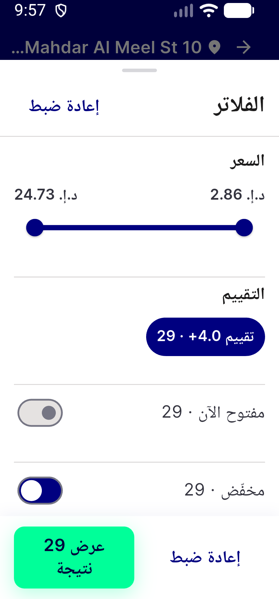</a> c1 ac9 07 ar 320dp 1.3x items 29</td>
</tr>
<tr>
<td align="center" width="33%"> c1 ac9 08 ar 320dp 1.3x stores 2</td>
<td align="center" width="33%"><a href="c1-sweep-01-home-stores-section-320dp.png">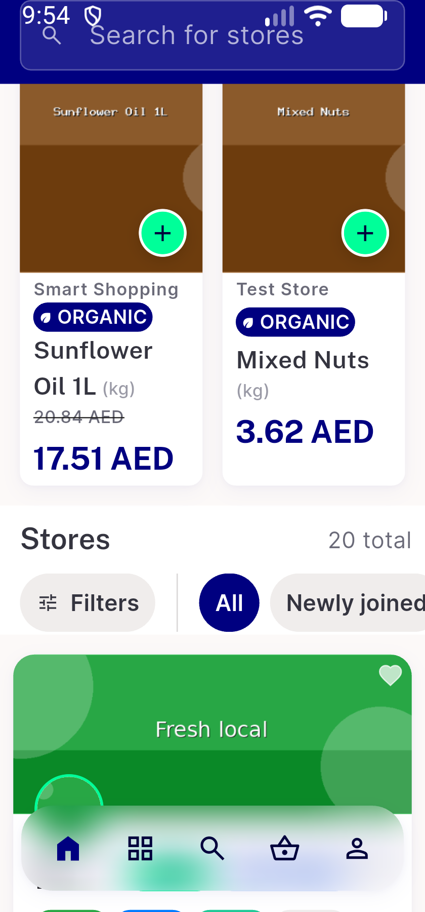</a> c1 sweep 01 home stores section 320dp</td>
<td align="center" width="33%"><a href="c1-sweep-02-store-see-all-sheet-320dp-1.3x.png">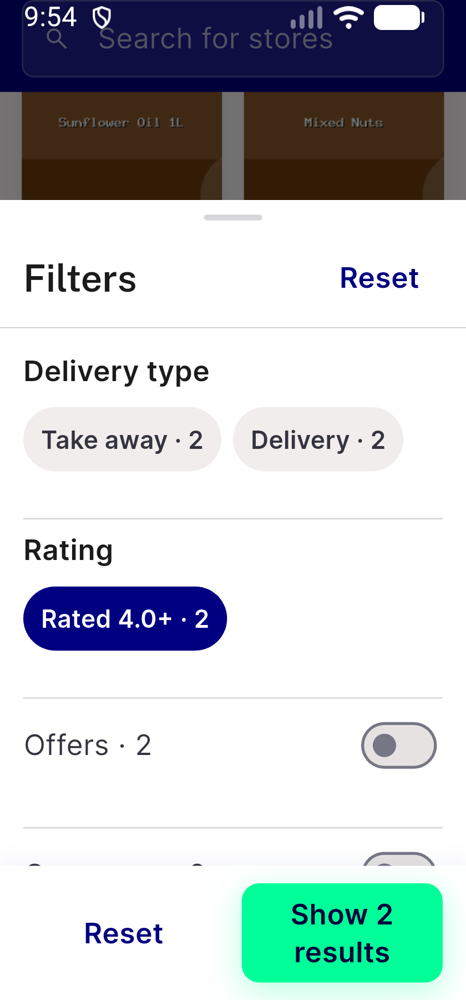</a> c1 sweep 02 store see all sheet 320dp 1.3x</td>
</tr>
<tr>
<td align="center" width="33%"><a href="c1-sweep-03-store-rail-filtered-320dp-1.3x.png">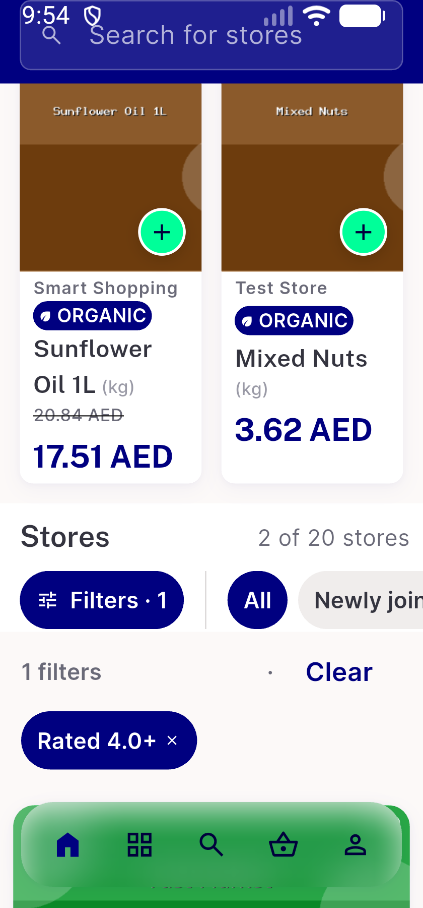</a> c1 sweep 03 store rail filtered 320dp 1.3x</td>
<td align="center" width="33%"><a href="c1-sweep-04-item-viewall-sheet-320dp-1.3x.png">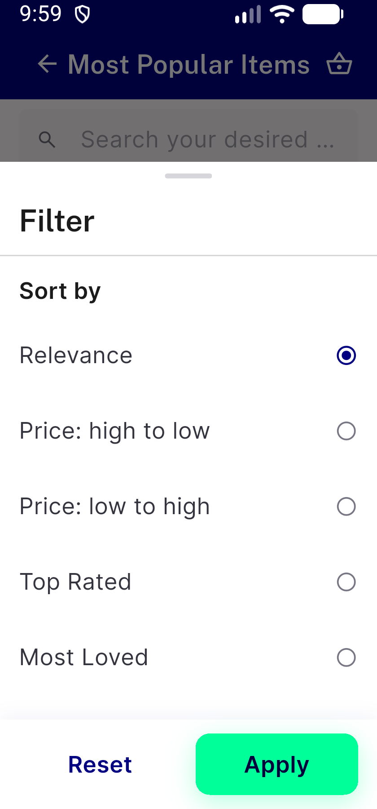</a> c1 sweep 04 item viewall sheet 320dp 1.3x</td>
<td align="center" width="33%"><a href="c1-sweep-05-item-viewall-sheet-availability-320dp-1.3x.png">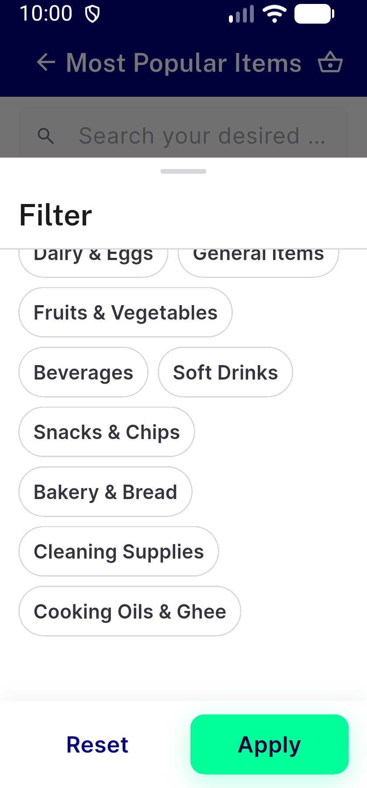</a> c1 sweep 05 item viewall sheet availability 320dp 1.3x</td>
</tr>
<tr>
<td align="center" width="33%"> c1 tb2 01 milk stores0 no entry</td>
<td align="center" width="33%"><a href="c1-tb2-02-stores-filter-empty-keeps-entry.png">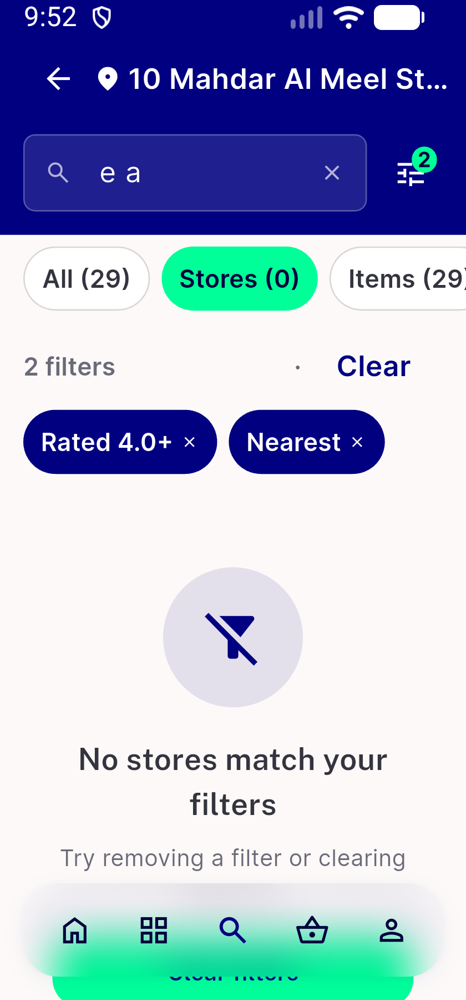</a> c1 tb2 02 stores filter empty keeps entry</td>
<td align="center" width="33%"> ui01 results milk all entry</td>
</tr>
<tr>
<td align="center" width="33%"> ui02 sheet all milk en light</td>
<td align="center" width="33%"> ui03 sheet all stores items en</td>
<td align="center" width="33%"> ui04 filter empty items en</td>
</tr>
<tr>
<td align="center" width="33%"> ui05 list failure with selection</td>
<td align="center" width="33%"> ui06 ar results entry</td>
<td align="center" width="33%"> ui07 ar sheet all</td>
</tr>
<tr>
<td align="center" width="33%"> ui08 ar pill strip</td>
<td align="center" width="33%"> ui09 ar 320dp 1.3x sheet all</td>
<td align="center" width="33%"> ui10 en 320dp 1.3x sheet all</td>
</tr>
<tr>
<td align="center" width="33%"> ui11 en 320dp 1.3x many pills</td>
<td align="center" width="33%"> ui12 item viewall sheet availability</td>
</tr>
</table>

### Other artifacts
- [`api-suite-h.py`](api-suite-h.py)
- [`api-suite-t4.py`](api-suite-t4.py)
- [`api-suite-t5.py`](api-suite-t5.py)
- [`api-suite-t6.py`](api-suite-t6.py)
- [`api-suite-t7.py`](api-suite-t7.py)
- [`bug-filters-label-plural-and-duplicate-clear.log`](bug-filters-label-plural-and-duplicate-clear.log)
- [`bug-preexisting-nitemcard-table-semantics-assert.log`](bug-preexisting-nitemcard-table-semantics-assert.log)
- [`bug-preexisting-pii-search-term-in-analytics.log`](bug-preexisting-pii-search-term-in-analytics.log)
- [`bug-preexisting-store-filter-hub-setstate-during-build.log`](bug-preexisting-store-filter-hub-setstate-during-build.log)
- [`bug-stores-tab-term-empty-entry-and-sort-sheet.log`](bug-stores-tab-term-empty-entry-and-sort-sheet.log)
- [`c1-ac9-ar-sheet-all-320dp-1.3x-nodes.txt`](c1-ac9-ar-sheet-all-320dp-1.3x-nodes.txt)
- [`c1-ac9-ar-sheet-items-29-320dp-1.3x-nodes.txt`](c1-ac9-ar-sheet-items-29-320dp-1.3x-nodes.txt)
- [`c1-ac9-ar-sheet-stores-2-320dp-1.3x-nodes.txt`](c1-ac9-ar-sheet-stores-2-320dp-1.3x-nodes.txt)
- [`c1-ac9-sheet-all-31-320dp-1.3x-nodes.txt`](c1-ac9-sheet-all-31-320dp-1.3x-nodes.txt)
- [`c1-ac9-sheet-all-ea-320dp-1.3x-nodes.txt`](c1-ac9-sheet-all-ea-320dp-1.3x-nodes.txt)
- [`c1-ac9-sheet-items-1.0x-411dp-nodes.txt`](c1-ac9-sheet-items-1.0x-411dp-nodes.txt)
- [`c1-ac9-sheet-items-ea-29-320dp-1.3x-nodes.txt`](c1-ac9-sheet-items-ea-29-320dp-1.3x-nodes.txt)
- [`c1-ac9-sheet-items-milk-320dp-1.3x-nodes.txt`](c1-ac9-sheet-items-milk-320dp-1.3x-nodes.txt)
- [`c1-ac9-sheet-stores-ea-320dp-1.3x-nodes.txt`](c1-ac9-sheet-stores-ea-320dp-1.3x-nodes.txt)
- [`c1-ac9-sheet-stores-rated-320dp-1.3x-nodes.txt`](c1-ac9-sheet-stores-rated-320dp-1.3x-nodes.txt)
- [`c1-api-suite-t4.out.txt`](c1-api-suite-t4.out.txt)
- [`c1-api-suite-t5.out.txt`](c1-api-suite-t5.out.txt)
- [`c1-api-suite-t6.out.txt`](c1-api-suite-t6.out.txt)
- [`c1-phpunit-budget-4244-testdox.txt`](c1-phpunit-budget-4244-testdox.txt)
- [`c1-phpunit-subset-tail.txt`](c1-phpunit-subset-tail.txt)
- [`c1-sweep-item-viewall-sheet-320dp-1.3x-nodes.txt`](c1-sweep-item-viewall-sheet-320dp-1.3x-nodes.txt)
- [`c1-sweep-store-home-sheet-320dp-1.3x-nodes.txt`](c1-sweep-store-home-sheet-320dp-1.3x-nodes.txt)
- [`c1-tb2-baqala-items0-nodes.txt`](c1-tb2-baqala-items0-nodes.txt)
- [`c1-tb2-stores-filter-empty-nodes.txt`](c1-tb2-stores-filter-empty-nodes.txt)
- [`progress.md`](progress.md)

---
*From `nears/docs/qa-evidence/NEARS-4196/` · public-repo scrub policy (no live secrets; verified clean).*
