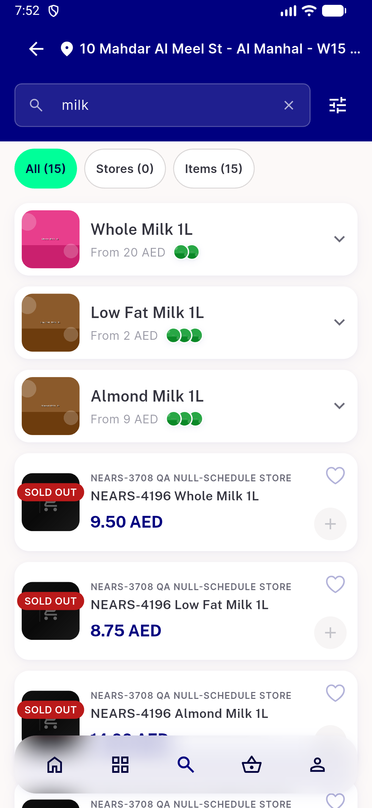
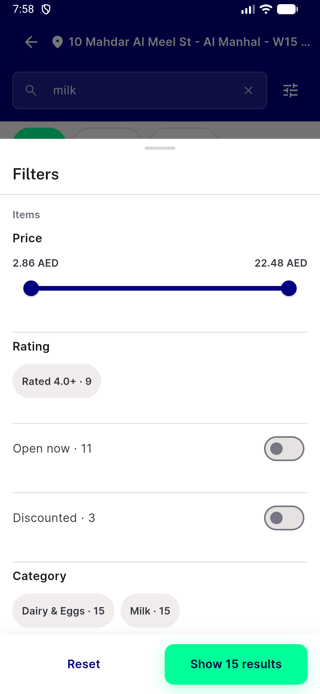
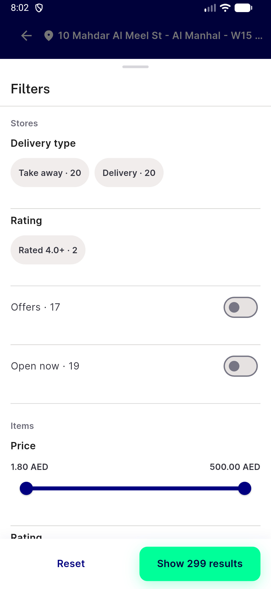
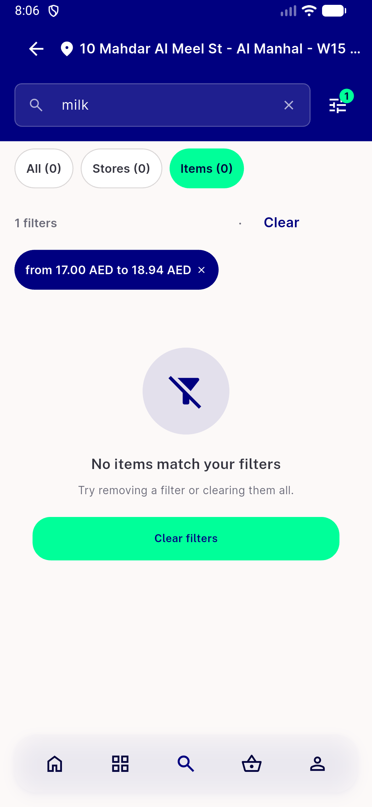
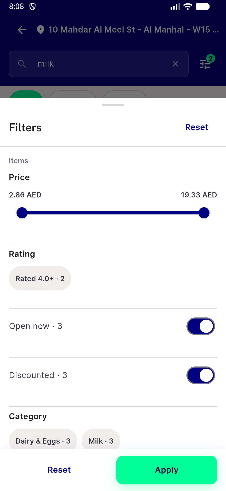
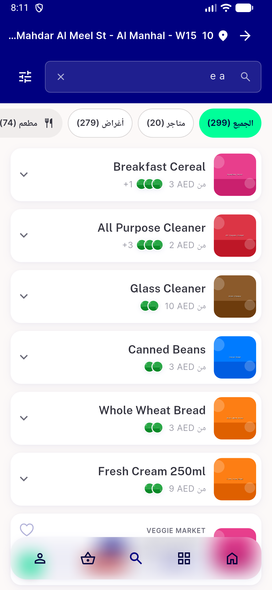
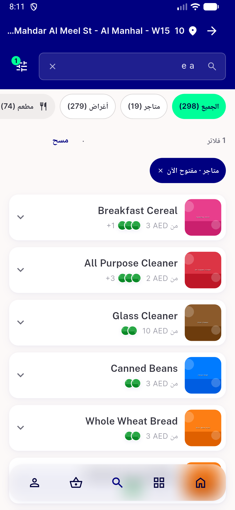
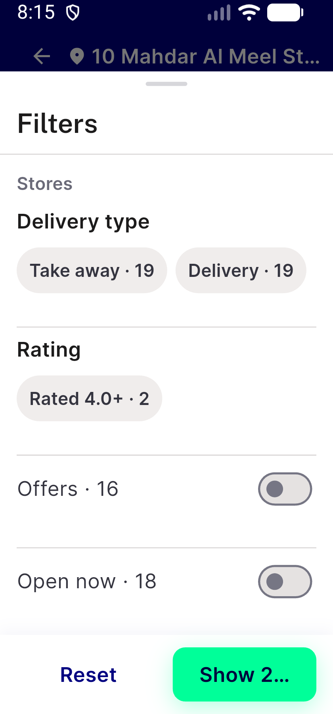
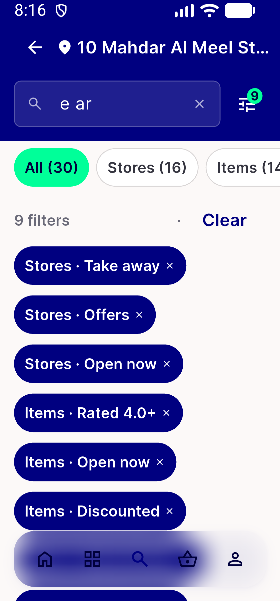
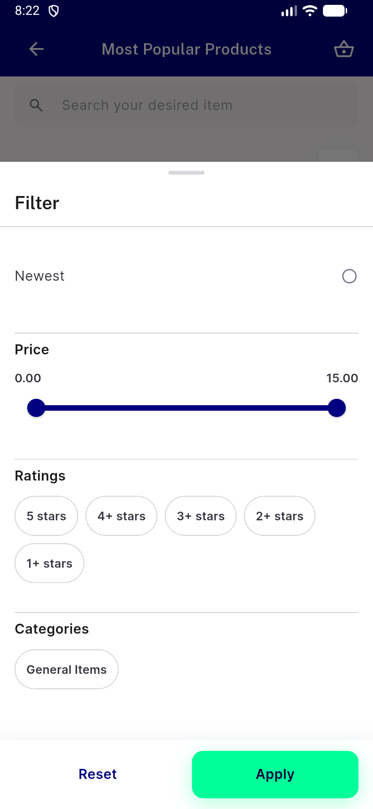

# QA Evidence — NEARS-4196

**FAIL: AC9 Apply label truncates at 320dp x1.3x (EN 'Show 2...', AR 'عرض 29...'); AC1-8,10,11 PASS**

**14 screenshot(s).** Click any thumbnail for full resolution.

<table>
<tr>
<td align="center" width="33%"> bug apply label truncated 320dp ar</td>
<td align="center" width="33%"> bug apply label truncated 320dp en</td>
<td align="center" width="33%"> ui01 results milk all entry</td>
</tr>
<tr>
<td align="center" width="33%"> ui02 sheet all milk en light</td>
<td align="center" width="33%"> ui03 sheet all stores items en</td>
<td align="center" width="33%"> ui04 filter empty items en</td>
</tr>
<tr>
<td align="center" width="33%"> ui05 list failure with selection</td>
<td align="center" width="33%"> ui06 ar results entry</td>
<td align="center" width="33%"> ui07 ar sheet all</td>
</tr>
<tr>
<td align="center" width="33%"> ui08 ar pill strip</td>
<td align="center" width="33%"> ui09 ar 320dp 1.3x sheet all</td>
<td align="center" width="33%"> ui10 en 320dp 1.3x sheet all</td>
</tr>
<tr>
<td align="center" width="33%"> ui11 en 320dp 1.3x many pills</td>
<td align="center" width="33%"> ui12 item viewall sheet availability</td>
</tr>
</table>

### Other artifacts
- [`api-suite-h.py`](api-suite-h.py)
- [`api-suite-t4.py`](api-suite-t4.py)
- [`api-suite-t5.py`](api-suite-t5.py)
- [`api-suite-t6.py`](api-suite-t6.py)
- [`api-suite-t7.py`](api-suite-t7.py)
- [`bug-filters-label-plural-and-duplicate-clear.log`](bug-filters-label-plural-and-duplicate-clear.log)
- [`bug-preexisting-nitemcard-table-semantics-assert.log`](bug-preexisting-nitemcard-table-semantics-assert.log)
- [`bug-preexisting-pii-search-term-in-analytics.log`](bug-preexisting-pii-search-term-in-analytics.log)
- [`bug-stores-tab-term-empty-entry-and-sort-sheet.log`](bug-stores-tab-term-empty-entry-and-sort-sheet.log)
- [`progress.md`](progress.md)

---
*From `nears/docs/qa-evidence/NEARS-4196/` · public-repo scrub policy (no live secrets; verified clean).*
