# QA Evidence — NEARS-4198

**QA cycle 1 (tip b909d7a44): TB1/TB2/TB3 fixed, delta clean**

**21 screenshot(s).** Click any thumbnail for full resolution.

<table>
<tr>
<td align="center" width="33%"><a href="ac6-history-delivered-chip.png">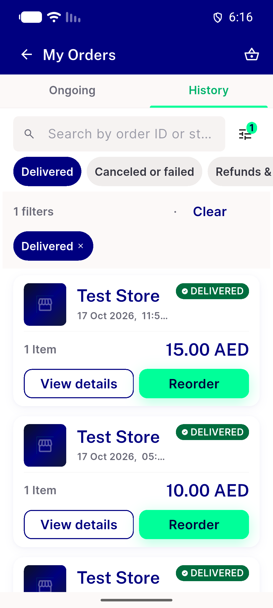</a> ac6 history delivered chip</td>
<td align="center" width="33%"><a href="ac6-history-initial.png">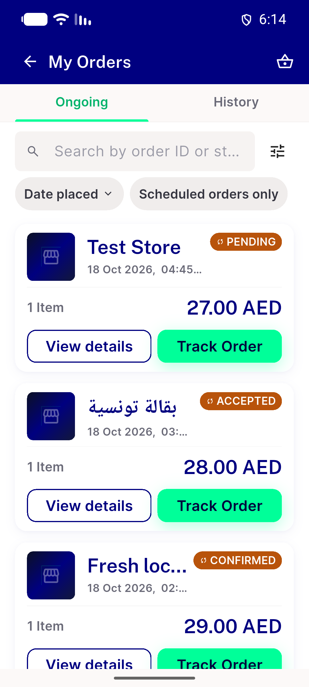</a> ac6 history initial</td>
<td align="center" width="33%"><a href="ac6-history-sheet.png">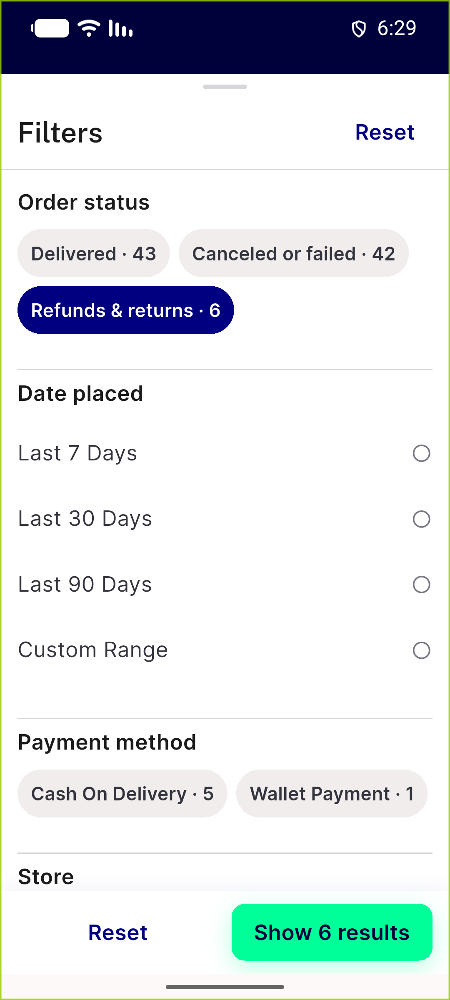</a> ac6 history sheet</td>
</tr>
<tr>
<td align="center" width="33%"><a href="ac6-wallet-sheet.png">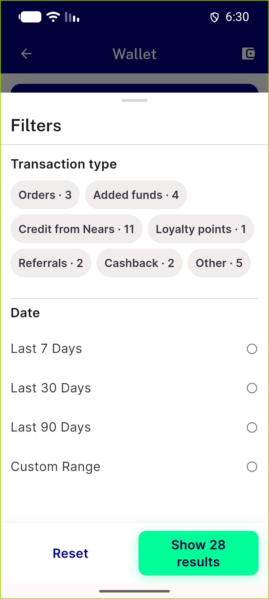</a> ac6 wallet sheet</td>
<td align="center" width="33%"><a href="ac7-custom-range-calendar.png">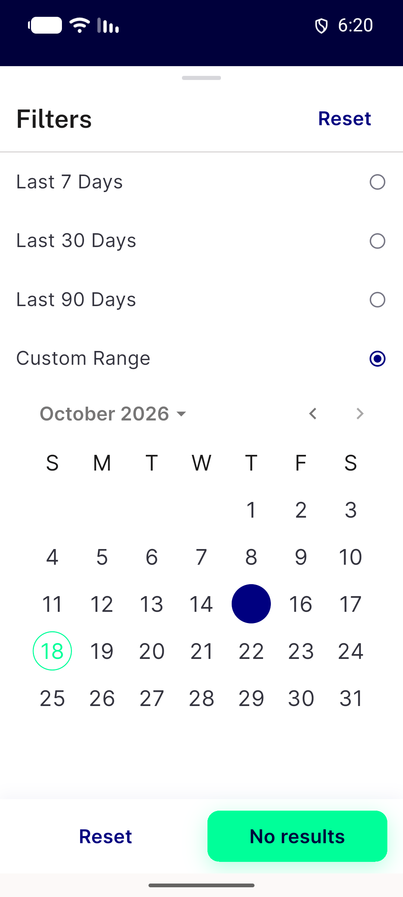</a> ac7 custom range calendar</td>
<td align="center" width="33%"><a href="ac7-date-chip-sheet-ongoing.png">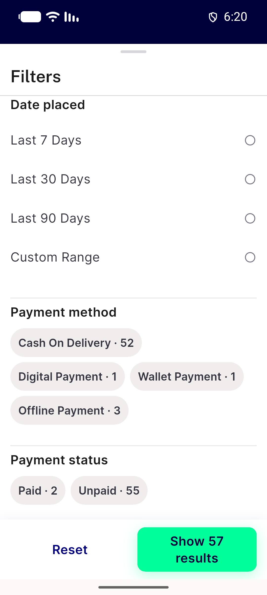</a> ac7 date chip sheet ongoing</td>
</tr>
<tr>
<td align="center" width="33%"><a href="ac8-history-search-empty.png">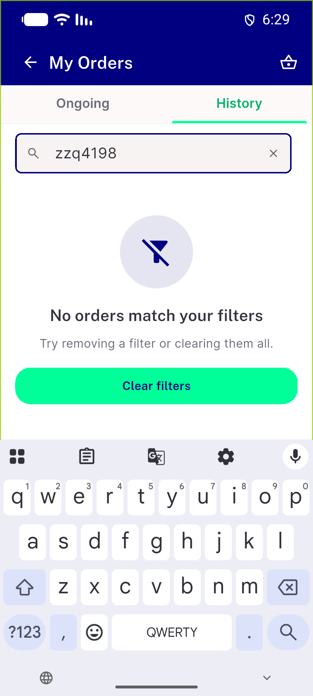</a> ac8 history search empty</td>
<td align="center" width="33%"><a href="ac8-loyalty-filtered-empty.png">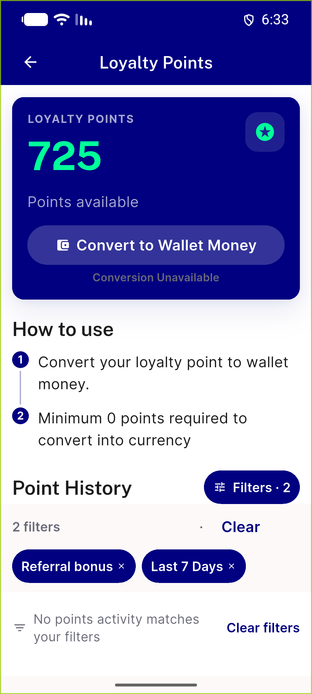</a> ac8 loyalty filtered empty</td>
<td align="center" width="33%"><a href="ac8-running-filtered-empty.png">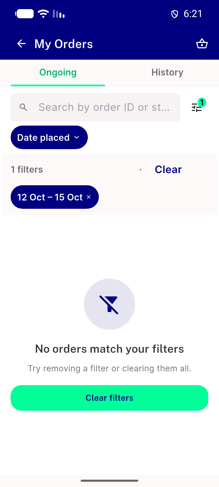</a> ac8 running filtered empty</td>
</tr>
<tr>
<td align="center" width="33%"><a href="ac8-search-only-empty.png">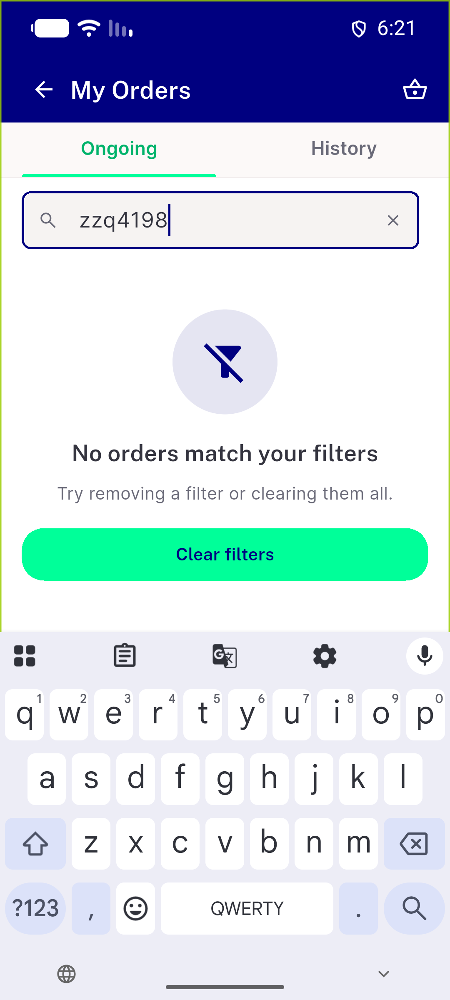</a> ac8 search only empty</td>
<td align="center" width="33%"><a href="ac8-wallet-filtered-empty.png">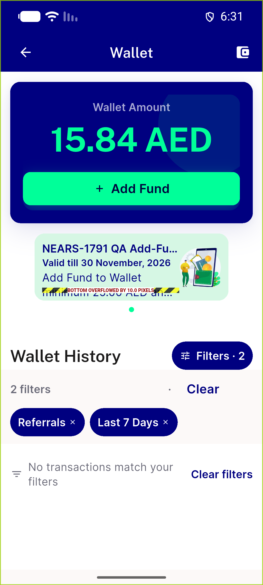</a> ac8 wallet filtered empty</td>
<td align="center" width="33%"><a href="ac9-320dp-13x-history-filtered.png">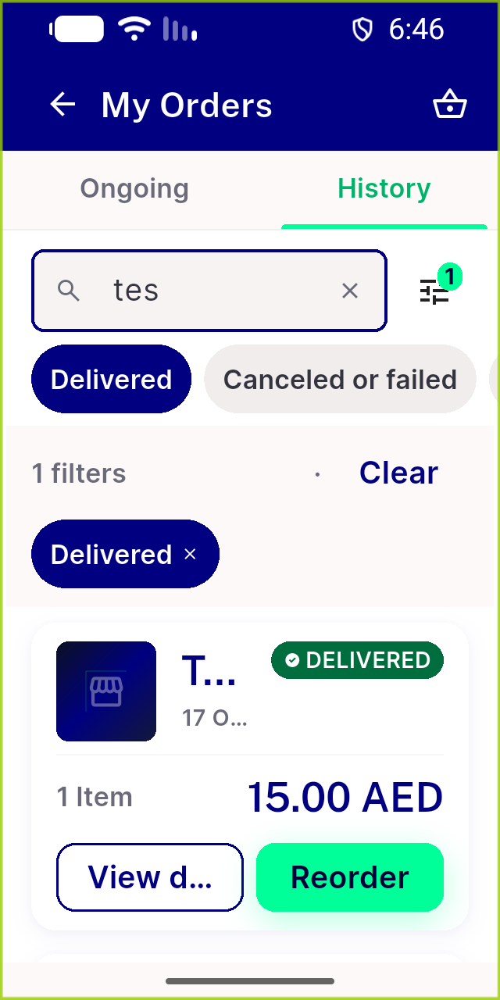</a> ac9 320dp 13x history filtered</td>
</tr>
<tr>
<td align="center" width="33%"><a href="ac9-320dp-13x-ongoing.png">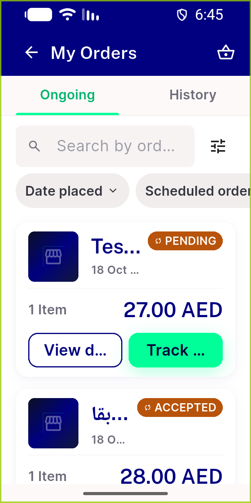</a> ac9 320dp 13x ongoing</td>
<td align="center" width="33%"><a href="ac9-320dp-13x-sheet-custom-open.png">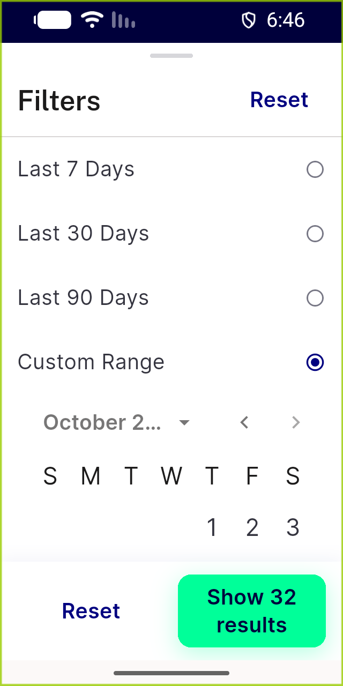</a> ac9 320dp 13x sheet custom open</td>
<td align="center" width="33%"><a href="ac9-320dp-13x-wallet.png">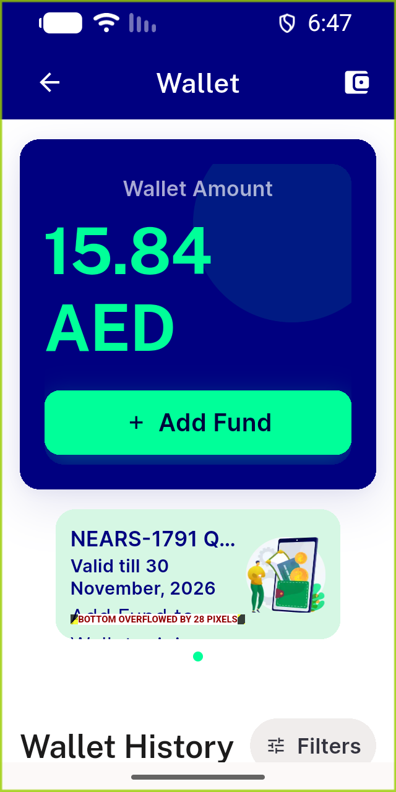</a> ac9 320dp 13x wallet</td>
</tr>
<tr>
<td align="center" width="33%"><a href="bug-failure-notice-giant-slab.png">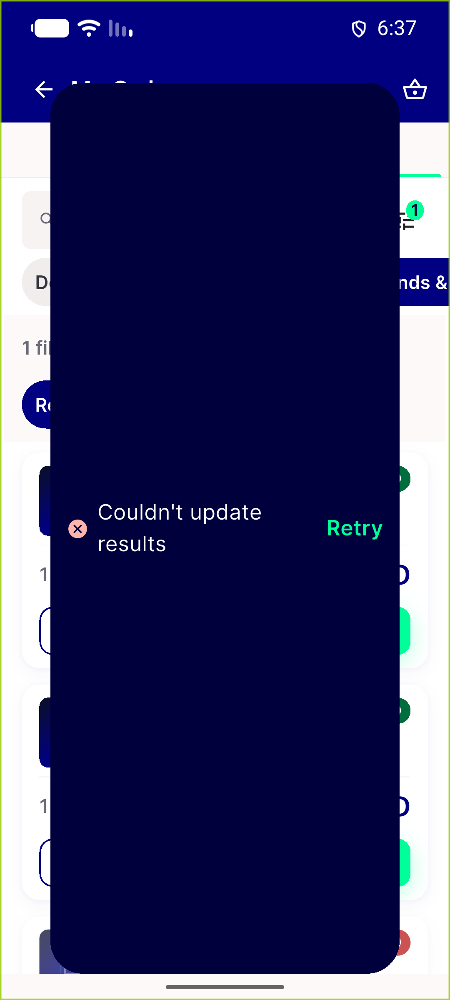</a> bug failure notice giant slab</td>
<td align="center" width="33%"><a href="err-first-page-failure.png">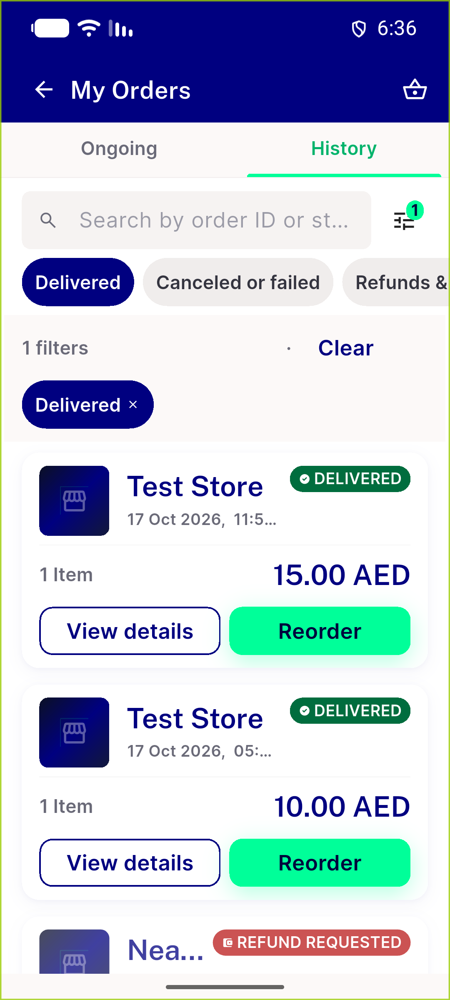</a> err first page failure</td>
<td align="center" width="33%"><a href="err-offline-first-load.png">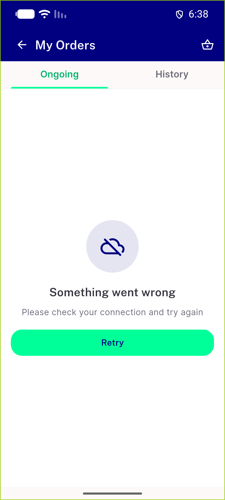</a> err offline first load</td>
</tr>
<tr>
<td align="center" width="33%"><a href="err-server-500.png">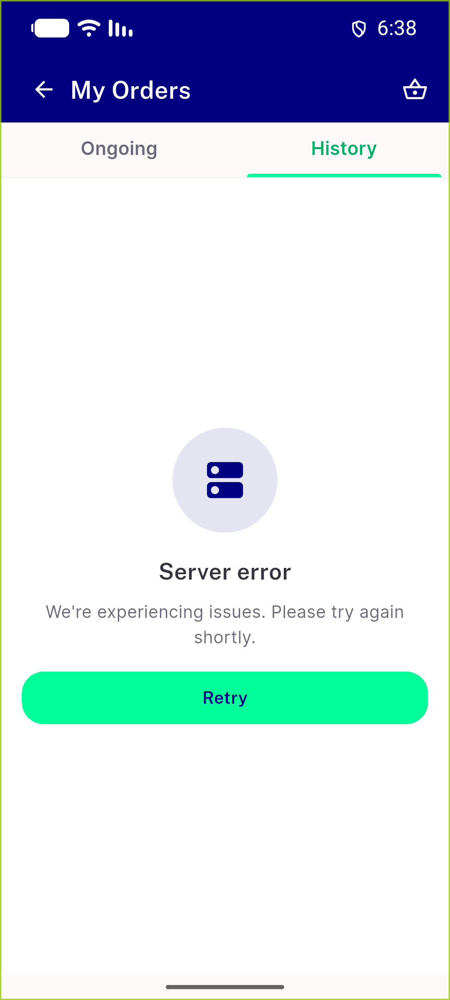</a> err server 500</td>
<td align="center" width="33%"><a href="extra-group-split-page-boundary.png">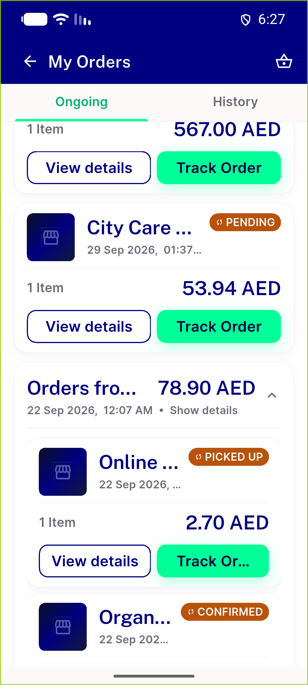</a> extra group split page boundary</td>
<td align="center" width="33%"><a href="user3-my-orders.png">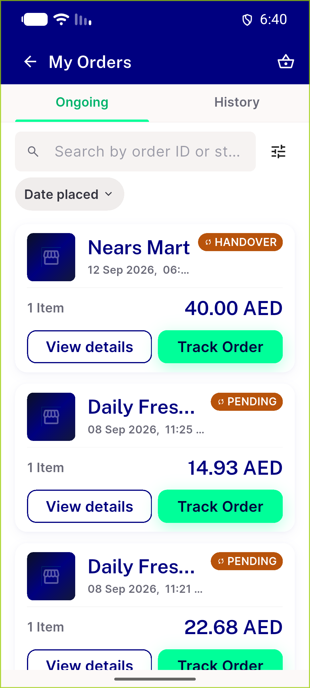</a> user3 my orders</td>
</tr>
</table>

### Other artifacts
- [`api-ac1-ac4-run.txt`](api-ac1-ac4-run.txt)
- [`automated-backstop.txt`](automated-backstop.txt)
- [`bug-catalog-yaml-stale.log`](bug-catalog-yaml-stale.log)
- [`bug-failure-notice-giant-slab.log`](bug-failure-notice-giant-slab.log)
- [`bug-superseded-tap-filter-applied.log`](bug-superseded-tap-filter-applied.log)
- [`cycle1`](cycle1)
- [`fa-wire-events-capture.txt`](fa-wire-events-capture.txt)
- [`pii-negative-control.txt`](pii-negative-control.txt)
- [`reg-order-card-overflow-320dp.log`](reg-order-card-overflow-320dp.log)
- [`reg-unified-search-snapshot-date.log`](reg-unified-search-snapshot-date.log)
- [`reg-wallet-bonus-banner-overflow.log`](reg-wallet-bonus-banner-overflow.log)
- [`request-log-tail.txt`](request-log-tail.txt)

---
*From `nears/docs/qa-evidence/NEARS-4198/` · public-repo scrub policy (no live secrets; verified clean).*
