# QA Evidence — NEARS-4199

**FAIL cycle0: AC1-7,9,10 PASS live (vendor+delivery APIs/apps, emulator-5554, own serve+clone); AC8 FAIL order_search_submitted never reaches FA (bool param); 3 low task bugs**

**14 screenshot(s).** Click any thumbnail for full resolution.

<table>
<tr>
<td align="center" width="33%"><a href="delivery-fetch-failure-light.png">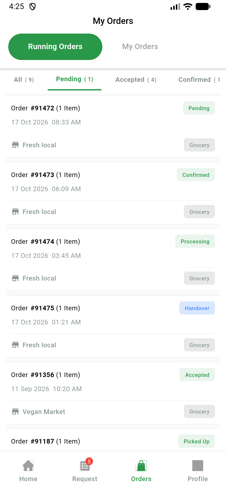</a> delivery fetch failure light</td>
<td align="center" width="33%"><a href="delivery-merged-date-sheet-my-point-light.png">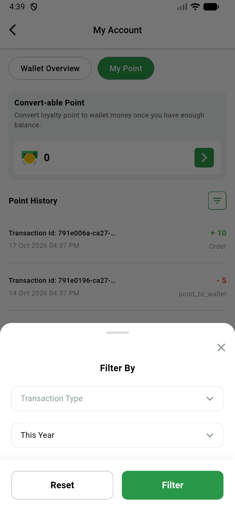</a> delivery merged date sheet my point light</td>
<td align="center" width="33%"><a href="delivery-request-screen-light.png">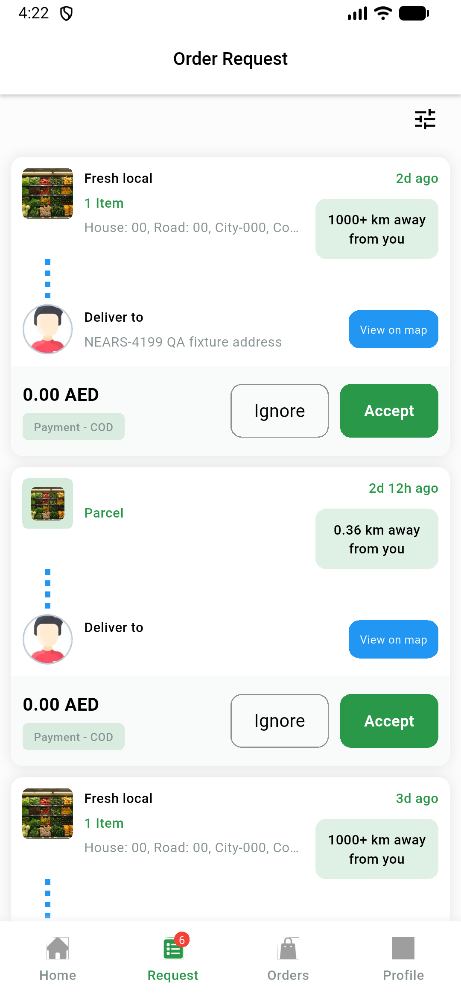</a> delivery request screen light</td>
</tr>
<tr>
<td align="center" width="33%"><a href="delivery-request-sheet-ar-1p3x-light.png">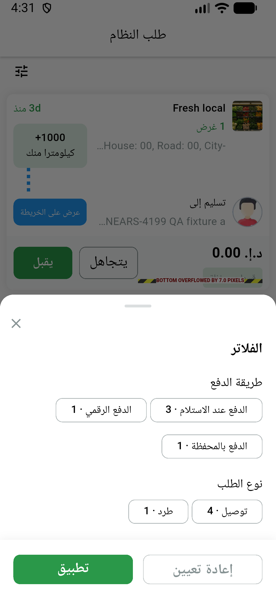</a> delivery request sheet ar 1p3x light</td>
<td align="center" width="33%"><a href="delivery-running-chips-ar-1p3x-light.png">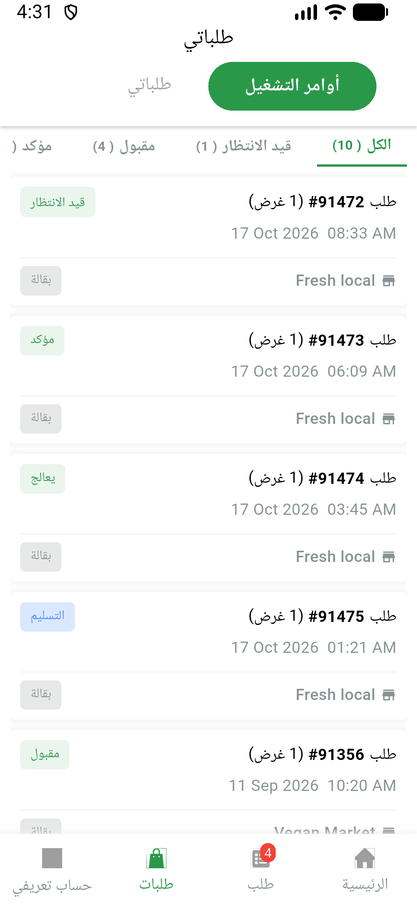</a> delivery running chips ar 1p3x light</td>
<td align="center" width="33%"><a href="delivery-running-chips-ar-light.png">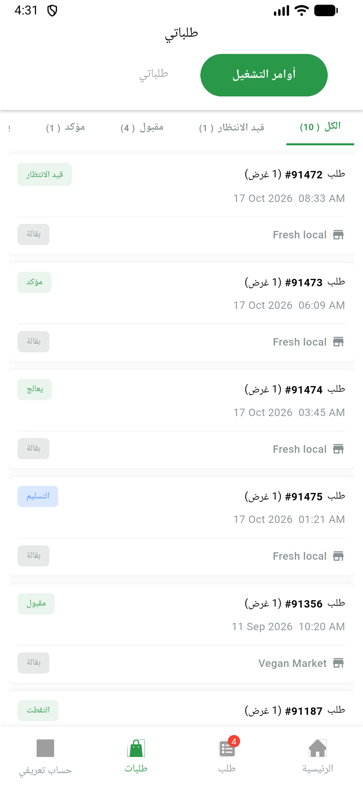</a> delivery running chips ar light</td>
</tr>
<tr>
<td align="center" width="33%"><a href="delivery-running-chips-light.png">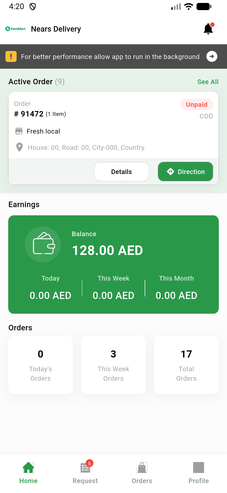</a> delivery running chips light</td>
<td align="center" width="33%"><a href="vendor-canceled-orders-light.png">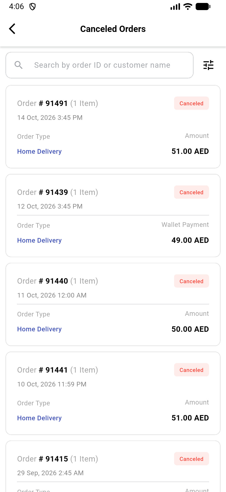</a> vendor canceled orders light</td>
<td align="center" width="33%"><a href="vendor-fetch-failure-light.png">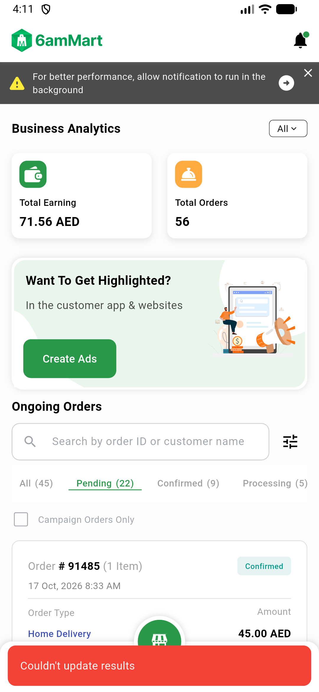</a> vendor fetch failure light</td>
</tr>
<tr>
<td align="center" width="33%"><a href="vendor-first-page-error-light.png">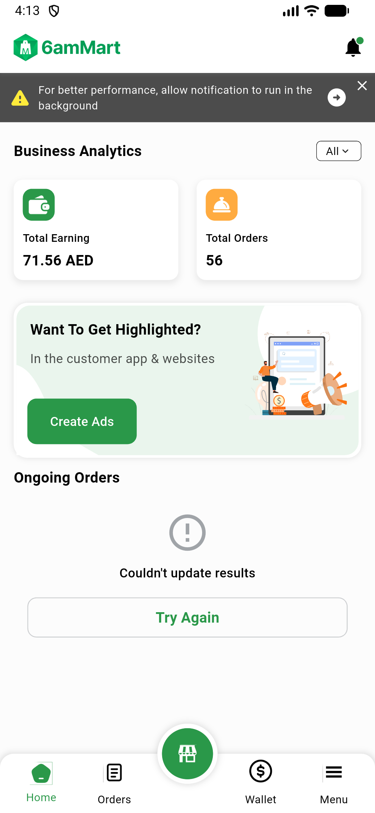</a> vendor first page error light</td>
<td align="center" width="33%"><a href="vendor-home-all-light.png">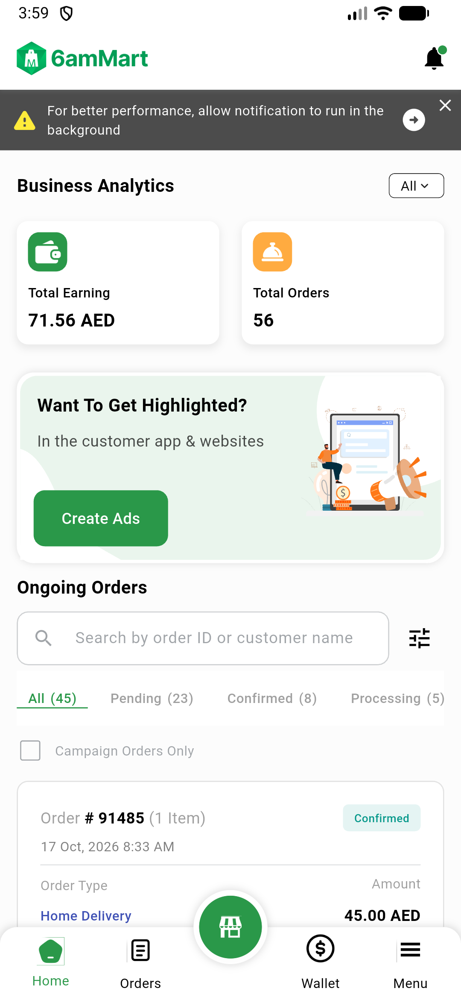</a> vendor home all light</td>
<td align="center" width="33%"><a href="vendor-home-applied-light.png">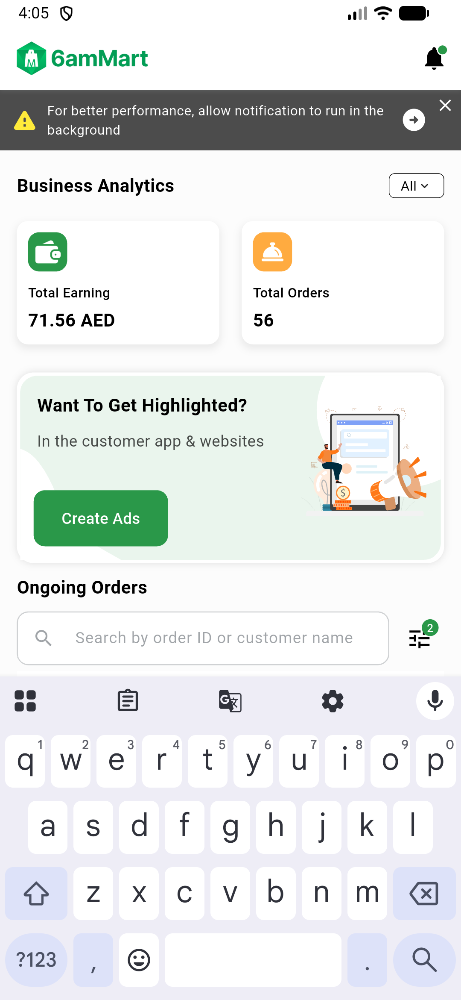</a> vendor home applied light</td>
</tr>
<tr>
<td align="center" width="33%"><a href="vendor-sheet-ar-rtl-light.png">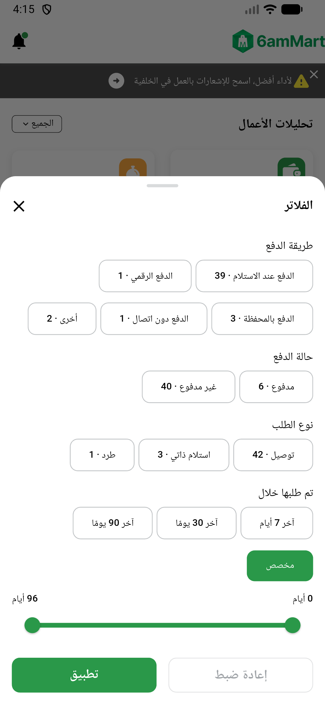</a> vendor sheet ar rtl light</td>
<td align="center" width="33%"><a href="vendor-sheet-custom-slider-light.png">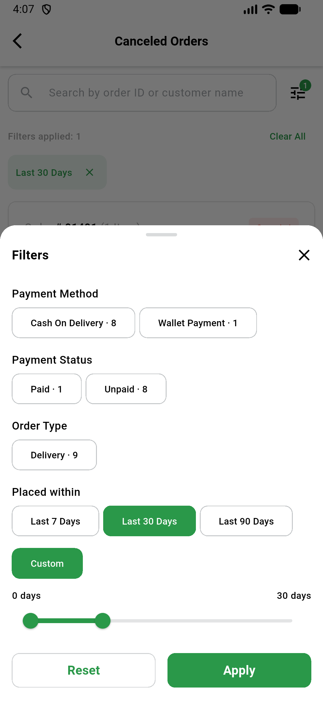</a> vendor sheet custom slider light</td>
</tr>
</table>

### Other artifacts
- [`ac8-evt-lines.log`](ac8-evt-lines.log)
- [`ac8-fa-events.log`](ac8-fa-events.log)
- [`ac9-delivery-fail-lines.log`](ac9-delivery-fail-lines.log)
- [`ac9-vendor-fail-lines.log`](ac9-vendor-fail-lines.log)
- [`api-scripts`](api-scripts)
- [`bug-order-search-submitted-not-delivered.log`](bug-order-search-submitted-not-delivered.log)
- [`bug-slider-rtl-thumb-labels-swapped.txt`](bug-slider-rtl-thumb-labels-swapped.txt)
- [`delivery-tick-access-log-no-selection.txt`](delivery-tick-access-log-no-selection.txt)
- [`flutter-tests-summary.txt`](flutter-tests-summary.txt)
- [`phpunit-filters.log`](phpunit-filters.log)
- [`progress.md`](progress.md)
- [`vendor-sheet-ar-slider-a11y-dump.txt`](vendor-sheet-ar-slider-a11y-dump.txt)
- [`vendor-sheet-ar-slider-a11y-dump.xml`](vendor-sheet-ar-slider-a11y-dump.xml)

---
*From `nears/docs/qa-evidence/NEARS-4199/` · public-repo scrub policy (no live secrets; verified clean).*
