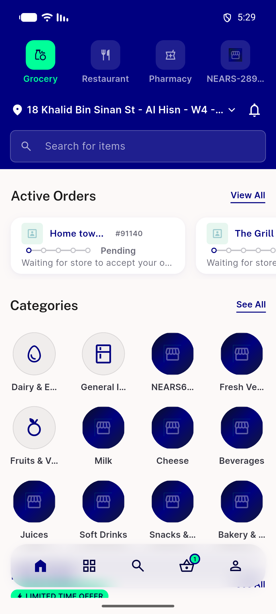

# QA Evidence — NEARS-4200

**PASS: live FA capture UserApp+VendorApp, see report**

**1 screenshot(s).** Click any thumbnail for full resolution.

<table>
<tr>
<td align="center" width="33%"> home</td>
</tr>
</table>

### Other artifacts
- [`fa-userapp-events.log`](fa-userapp-events.log)
- [`fa-vendorapp-events.log`](fa-vendorapp-events.log)
- [`userapp-fail-lines.log`](userapp-fail-lines.log)

---
*From `nears/docs/qa-evidence/NEARS-4200/` · public-repo scrub policy (no live secrets; verified clean).*
