# QA Evidence — NEARS-4201

**cycle2 delta: PASS - AC6 TB1 + TB2 verified, 1 low residual task bug**

**39 screenshot(s).** Click any thumbnail for full resolution.

<table>
<tr>
<td align="center" width="33%"><a href="ac1-add-form-initial.png">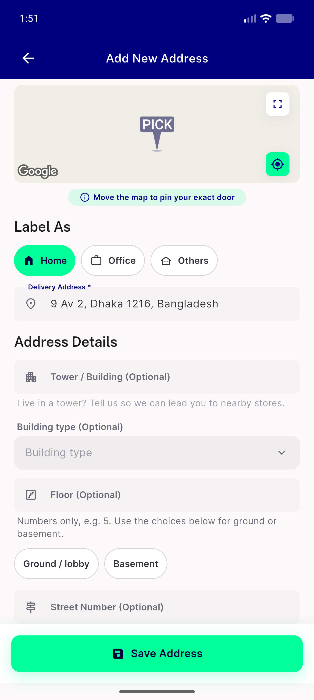</a> ac1 add form initial</td>
<td align="center" width="33%"><a href="ac1-tower-nonnumeric-error.png">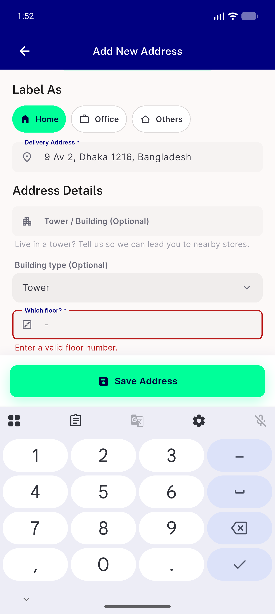</a> ac1 tower nonnumeric error</td>
<td align="center" width="33%"><a href="ac1-tower-save-blocked-empty.png">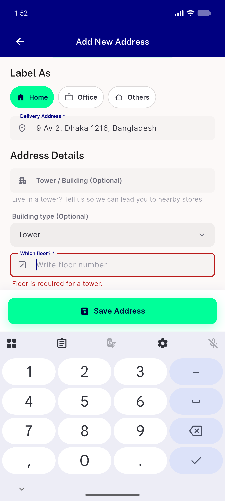</a> ac1 tower save blocked empty</td>
</tr>
<tr>
<td align="center" width="33%"> ac1 tower selected</td>
<td align="center" width="33%"><a href="ac2-apartment-floor-optional.png">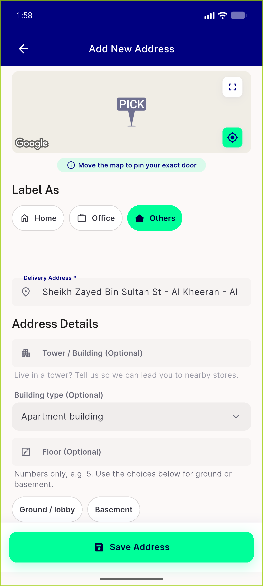</a> ac2 apartment floor optional</td>
<td align="center" width="33%"><a href="ac2-villa-no-floor.png">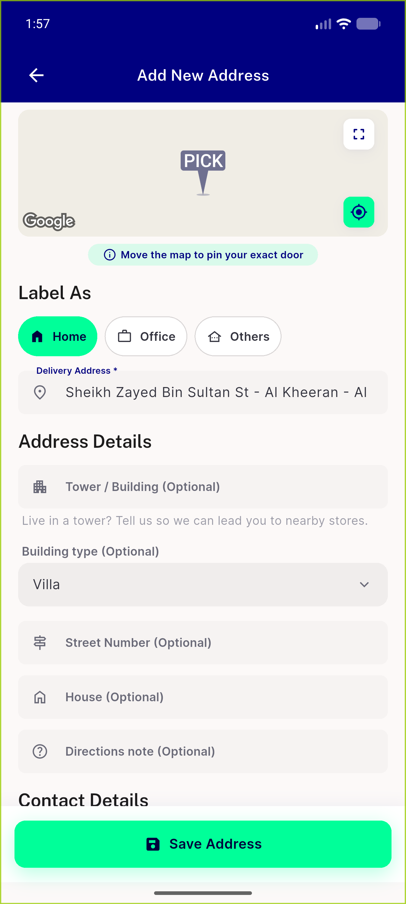</a> ac2 villa no floor</td>
</tr>
<tr>
<td align="center" width="33%"><a href="ac5-basement-chip.png">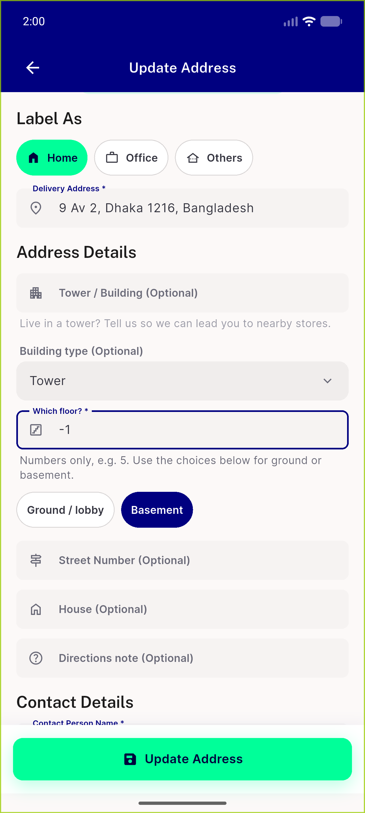</a> ac5 basement chip</td>
<td align="center" width="33%"><a href="ac5-ground-chip-selected.png">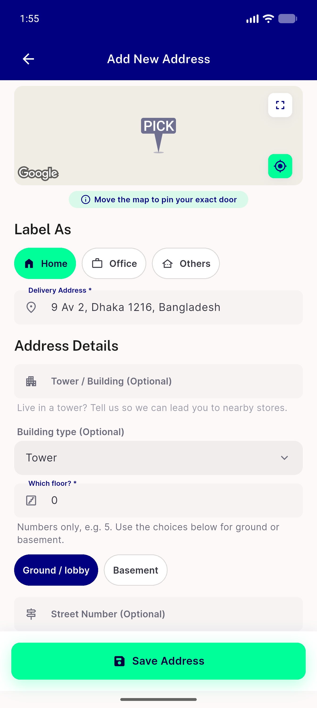</a> ac5 ground chip selected</td>
<td align="center" width="33%"><a href="ac6-after-save-no-prompt.png">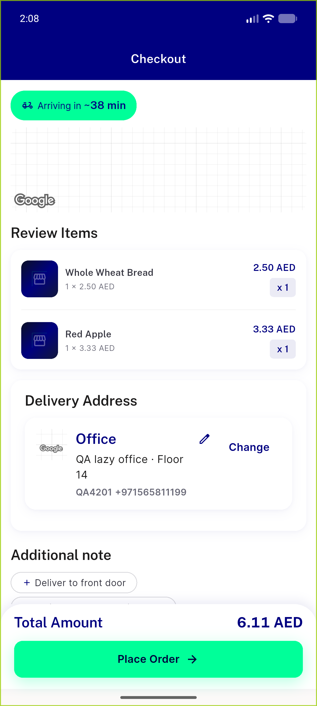</a> ac6 after save no prompt</td>
</tr>
<tr>
<td align="center" width="33%"><a href="ac6-lazy-prompt-shown.png">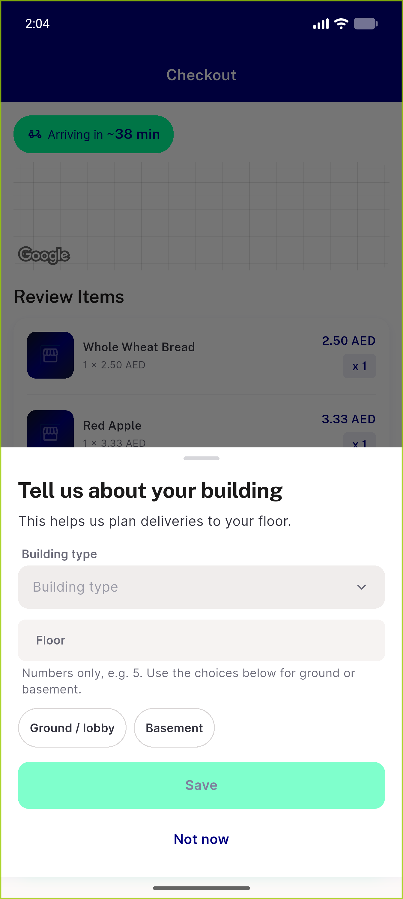</a> ac6 lazy prompt shown</td>
<td align="center" width="33%"><a href="ac6-prompt-dropdown-open.png">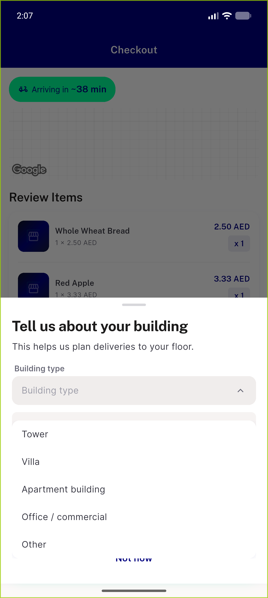</a> ac6 prompt dropdown open</td>
<td align="center" width="33%"><a href="ac8-ar-1.3x-prompt-dropdown.png">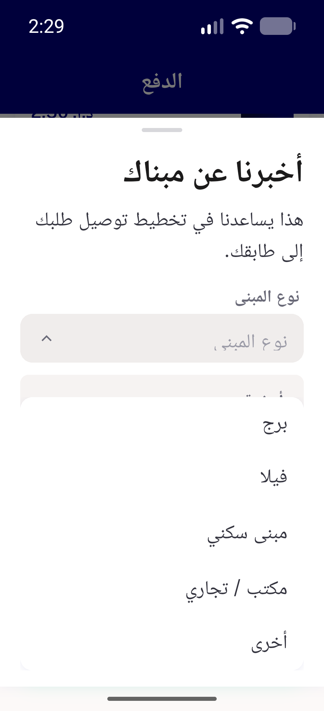</a> ac8 ar 1.3x prompt dropdown</td>
</tr>
<tr>
<td align="center" width="33%"><a href="ac8-ar-1.3x-prompt-keyboard-up-scrolled.png">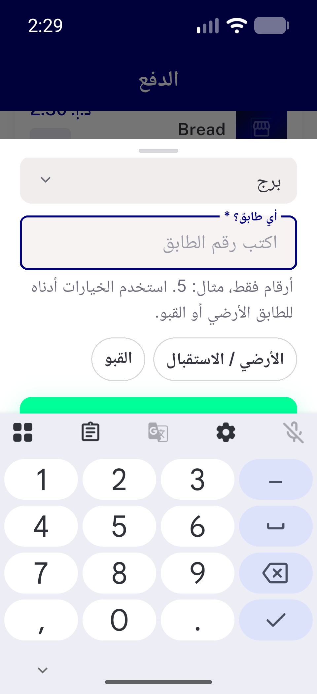</a> ac8 ar 1.3x prompt keyboard up scrolled</td>
<td align="center" width="33%"><a href="ac8-ar-1.3x-prompt-keyboard-up.png">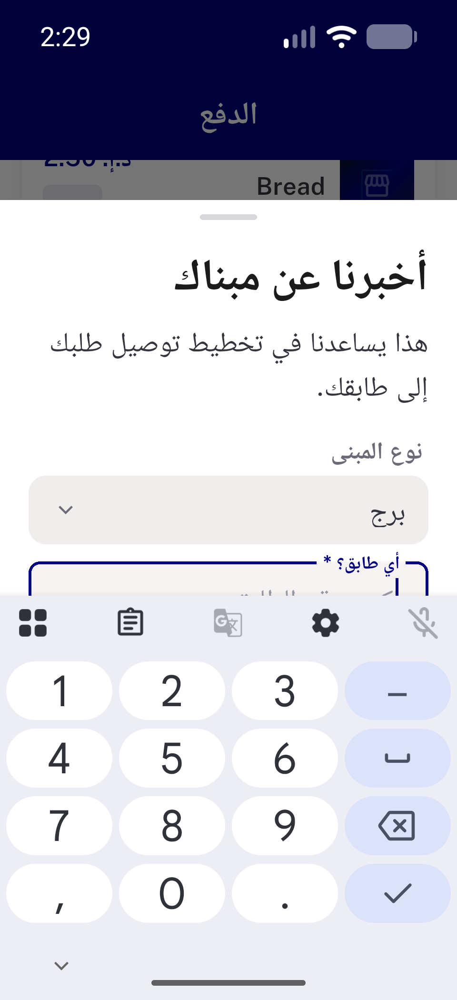</a> ac8 ar 1.3x prompt keyboard up</td>
<td align="center" width="33%"> ac8 ar 320dp 1.3x basement chip</td>
</tr>
<tr>
<td align="center" width="33%"><a href="ac8-ar-320dp-1.3x-floor-minus1.png">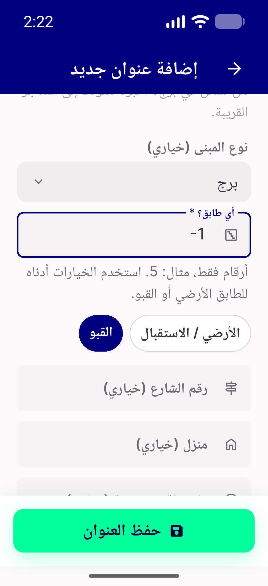</a> ac8 ar 320dp 1.3x floor minus1</td>
<td align="center" width="33%"> ac8 ar 320dp 1.3x invalid error</td>
<td align="center" width="33%"><a href="ac8-ar-320dp-1.3x-required-error.png">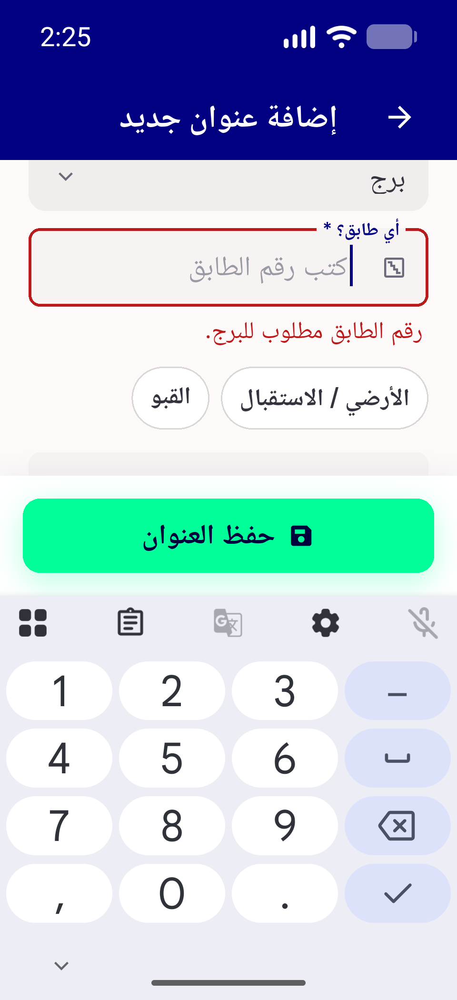</a> ac8 ar 320dp 1.3x required error</td>
</tr>
<tr>
<td align="center" width="33%"><a href="ac9-failed-save-error-state.png">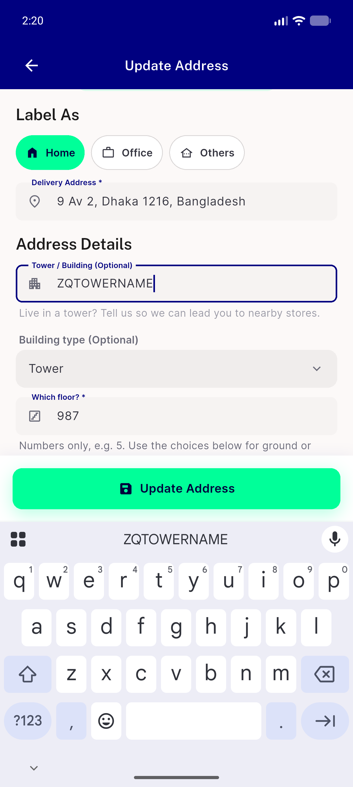</a> ac9 failed save error state</td>
<td align="center" width="33%"><a href="ac9-prompt-failed-save-stays-open.png">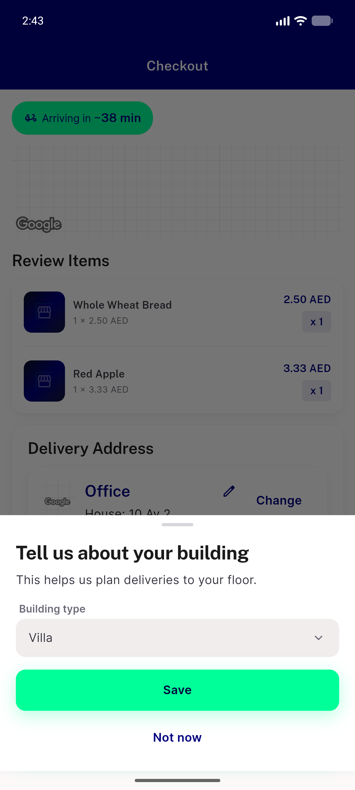</a> ac9 prompt failed save stays open</td>
<td align="center" width="33%"><a href="bug-new-address-from-checkout-prompts.png">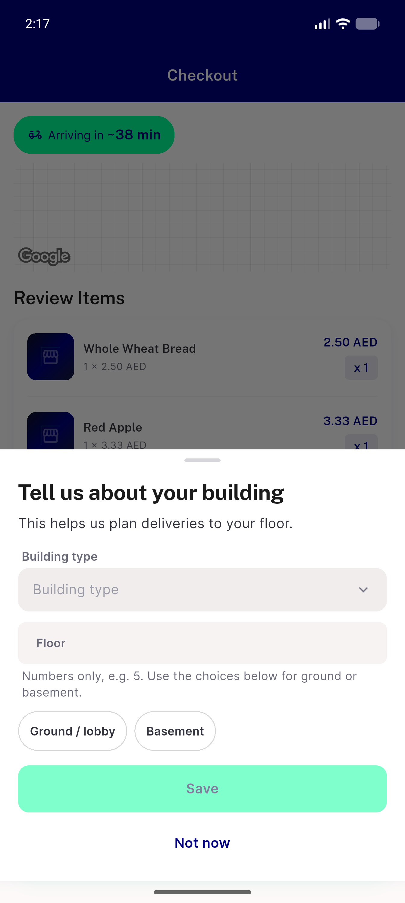</a> bug new address from checkout prompts</td>
</tr>
<tr>
<td align="center" width="33%"><a href="bug-new-address-picked-same-visit-prompts.png">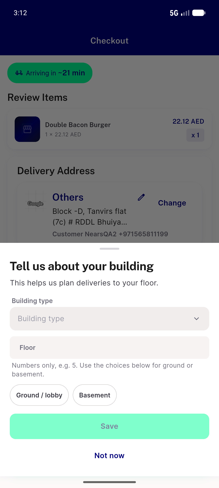</a> bug new address picked same visit prompts</td>
<td align="center" width="33%"> bug prompt keyboard covers save 320dp scrolled</td>
<td align="center" width="33%"> bug prompt keyboard covers save 320dp</td>
</tr>
<tr>
<td align="center" width="33%"><a href="cycle2-ac1-smoke-tower-floor-required.png">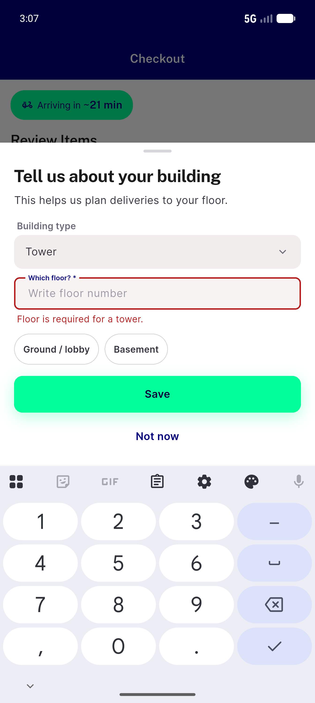</a> cycle2 ac1 smoke tower floor required</td>
<td align="center" width="33%"><a href="cycle2-ac6-initial-active-untyped-prompt.png">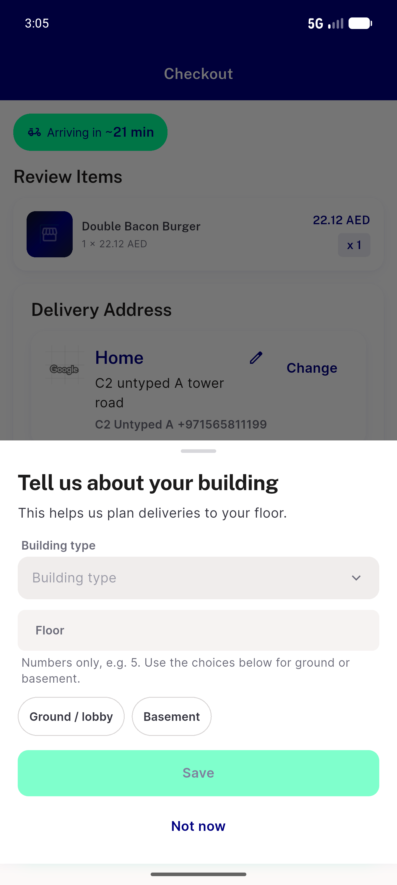</a> cycle2 ac6 initial active untyped prompt</td>
<td align="center" width="33%"> cycle2 ac6 picker untyped prompt</td>
</tr>
<tr>
<td align="center" width="33%"><a href="cycle2-ac6-tb1-add-from-address-sheet-no-prompt.png">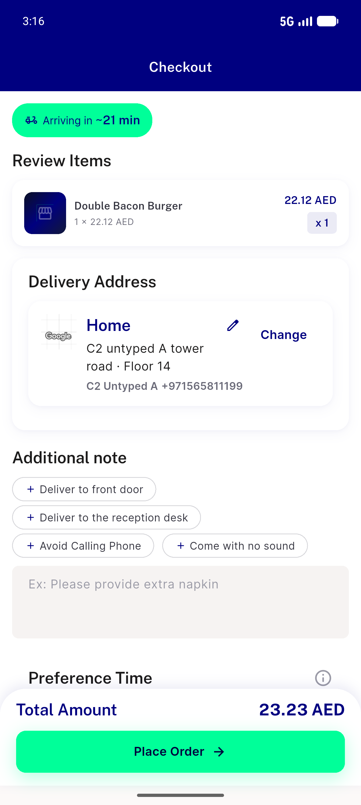</a> cycle2 ac6 tb1 add from address sheet no prompt</td>
<td align="center" width="33%"> cycle2 ac6 tb1 add while saved A active no prompt</td>
<td align="center" width="33%"><a href="cycle2-ac6-tb1-new-address-active-no-prompt.png">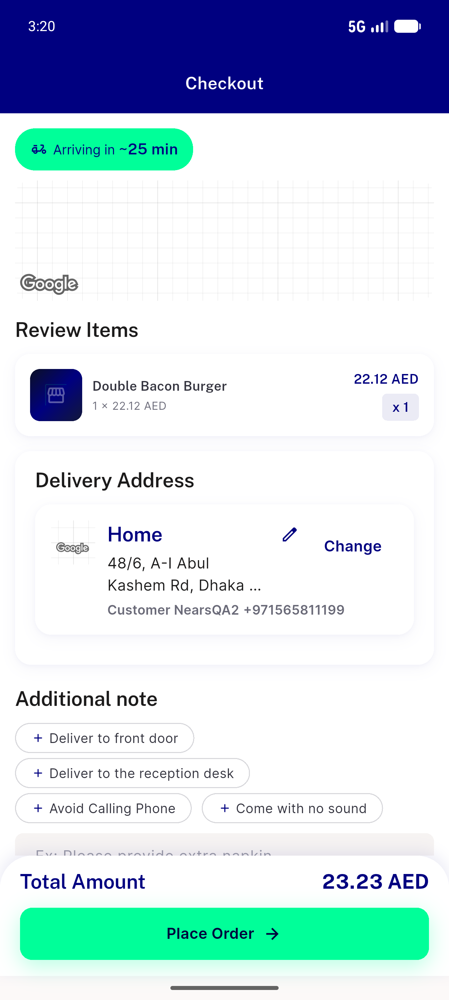</a> cycle2 ac6 tb1 new address active no prompt</td>
</tr>
<tr>
<td align="center" width="33%"><a href="cycle2-prompt-failed-save-stays-open.png">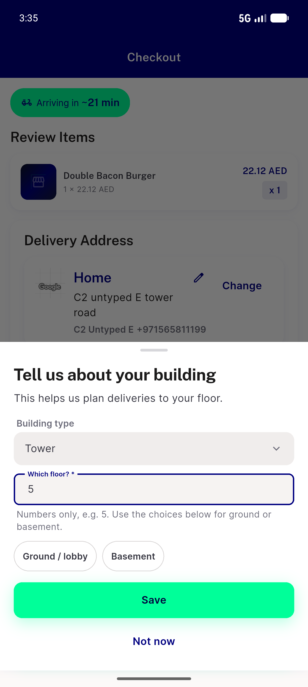</a> cycle2 prompt failed save stays open</td>
<td align="center" width="33%"><a href="cycle2-sweep-add-villa-hides-floor.png">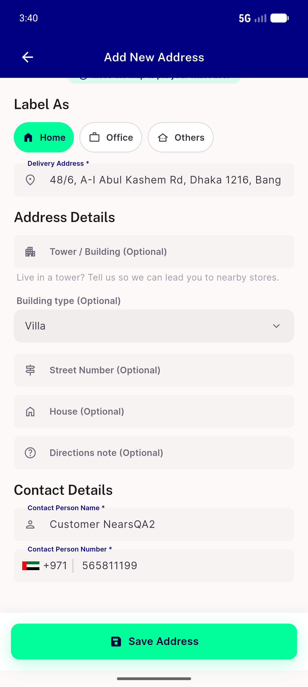</a> cycle2 sweep add villa hides floor</td>
<td align="center" width="33%"><a href="cycle2-sweep-edit-tower-to-villa-floor-hidden.png">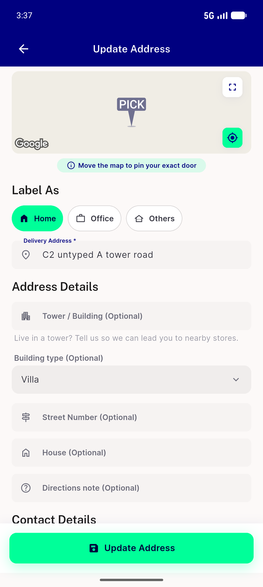</a> cycle2 sweep edit tower to villa floor hidden</td>
</tr>
<tr>
<td align="center" width="33%"><a href="cycle2-sweep-mobile-add-form-shared-control.png">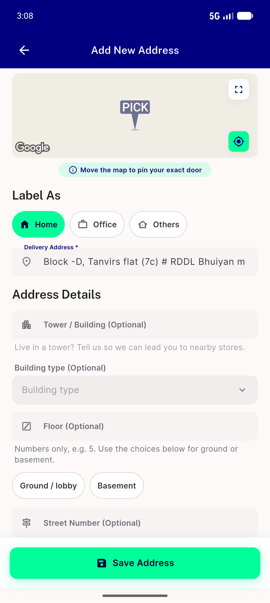</a> cycle2 sweep mobile add form shared control</td>
<td align="center" width="33%"><a href="cycle2-tb2-ar-320dp-1.3x-tower-keypad-down.png">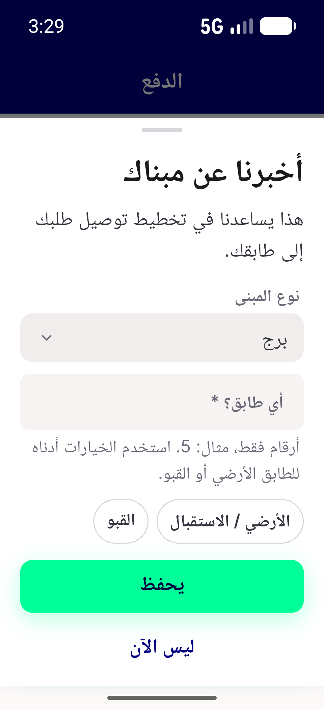</a> cycle2 tb2 ar 320dp 1.3x tower keypad down</td>
<td align="center" width="33%"><a href="cycle2-tb2-ar-320dp-1.3x-tower-keypad-up-scrolled.png">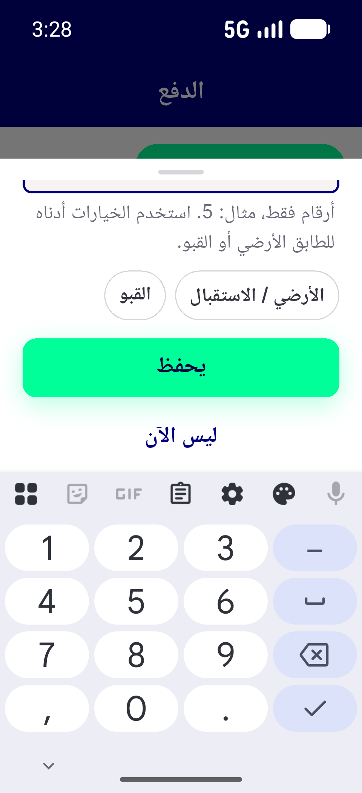</a> cycle2 tb2 ar 320dp 1.3x tower keypad up scrolled</td>
</tr>
<tr>
<td align="center" width="33%"><a href="cycle2-tb2-ar-320dp-1.3x-tower-keypad-up.png">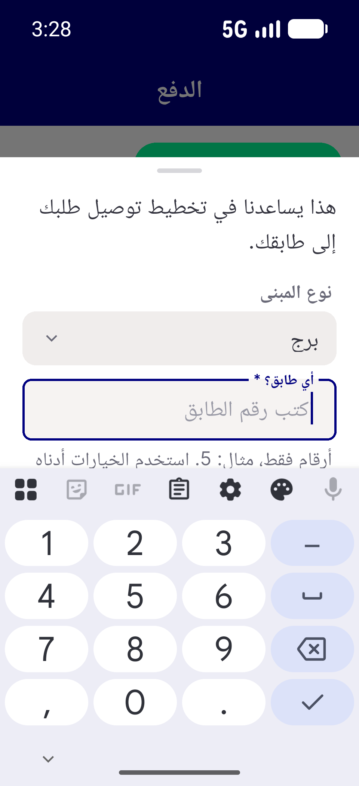</a> cycle2 tb2 ar 320dp 1.3x tower keypad up</td>
<td align="center" width="33%"> cycle2 tb2 en 1.0x keypad down</td>
<td align="center" width="33%"><a href="cycle2-tb2-en-1.0x-keypad-up.png">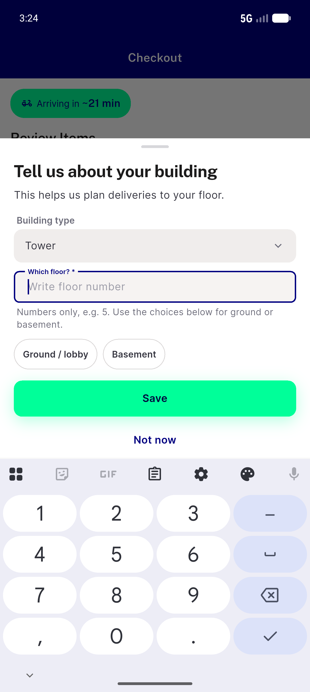</a> cycle2 tb2 en 1.0x keypad up</td>
</tr>
</table>

### Other artifacts
- [`a11y-dump-tower-floor-required.xml`](a11y-dump-tower-floor-required.xml)
- [`ac10-fa-svc-event-lines.txt`](ac10-fa-svc-event-lines.txt)
- [`ac9-failed-save-flutter-log.txt`](ac9-failed-save-flutter-log.txt)
- [`api-matrix-rerun-apartment-office.txt`](api-matrix-rerun-apartment-office.txt)
- [`api-matrix.txt`](api-matrix.txt)
- [`bug-new-address-from-checkout-prompts.log`](bug-new-address-from-checkout-prompts.log)
- [`bug-new-address-picked-same-visit-prompts.log`](bug-new-address-picked-same-visit-prompts.log)
- [`bug-prompt-keyboard-covers-save-320dp.log`](bug-prompt-keyboard-covers-save-320dp.log)
- [`cycle2-analytics-lines.txt`](cycle2-analytics-lines.txt)
- [`progress.md`](progress.md)

---
*From `nears/docs/qa-evidence/NEARS-4201/` · public-repo scrub policy (no live secrets; verified clean).*
