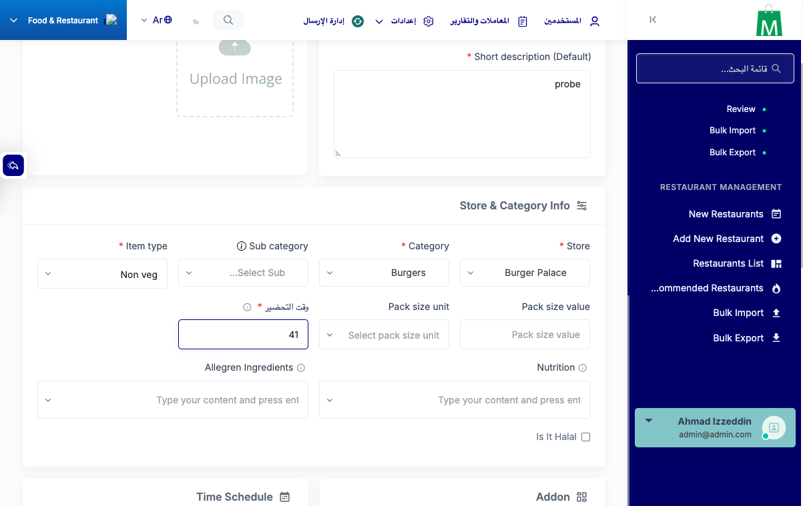
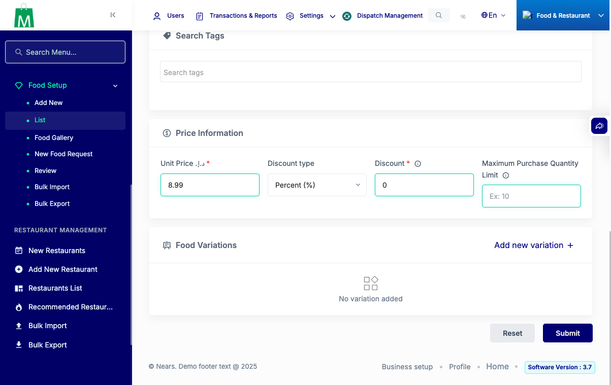
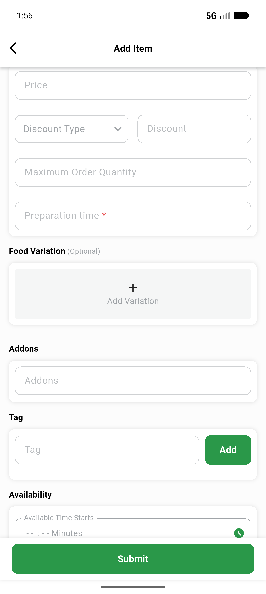
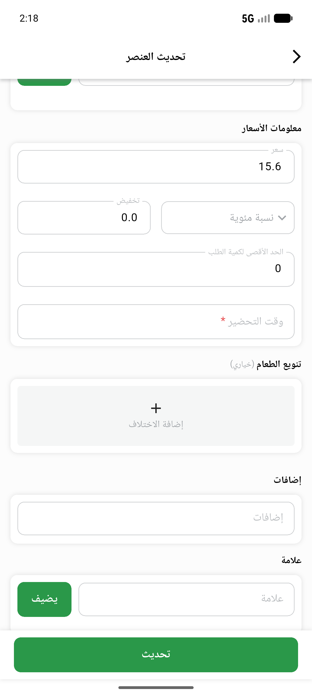

# QA Evidence — NEARS-4204

**NEARS-4204 QA: PASS - AC1-AC7 demonstrated; 2 pre-existing 500s + 1 Arabic-digit finding logged**

**7 screenshot(s).** Click any thumbnail for full resolution.

<table>
<tr>
<td align="center" width="33%"> ac2 admin edit food 61 submit</td>
<td align="center" width="33%"> ac2 admin edit food 61 toastr</td>
<td align="center" width="33%"> ac2 admin edit food ar rtl</td>
</tr>
<tr>
<td align="center" width="33%"> ac2 admin edit legacy null food blank toastr</td>
<td align="center" width="33%"> ac2 admin food create field</td>
<td align="center" width="33%"> ac2 vendorapp food add prep field</td>
</tr>
<tr>
<td align="center" width="33%"> ac2 vendorapp food edit ar rtl</td>
</tr>
</table>

### Other artifacts
- [`ac2-vendorapp-food-add-a11y.xml`](ac2-vendorapp-food-add-a11y.xml)
- [`ac2-vendorapp-food-edit-roundtrip-a11y.xml`](ac2-vendorapp-food-edit-roundtrip-a11y.xml)
- [`bug-panel-cross-store-update-500.log`](bug-panel-cross-store-update-500.log)
- [`bug-vendor-api-update-missing-translations-500.log`](bug-vendor-api-update-missing-translations-500.log)
- [`finding-arabic-indic-digits-filtered.log`](finding-arabic-indic-digits-filtered.log)
- [`progress.md`](progress.md)

---
*From `nears/docs/qa-evidence/NEARS-4204/` · public-repo scrub policy (no live secrets; verified clean).*
