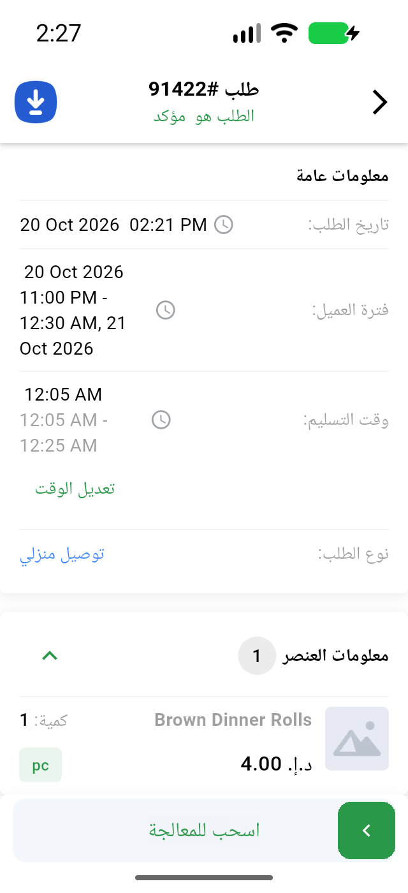
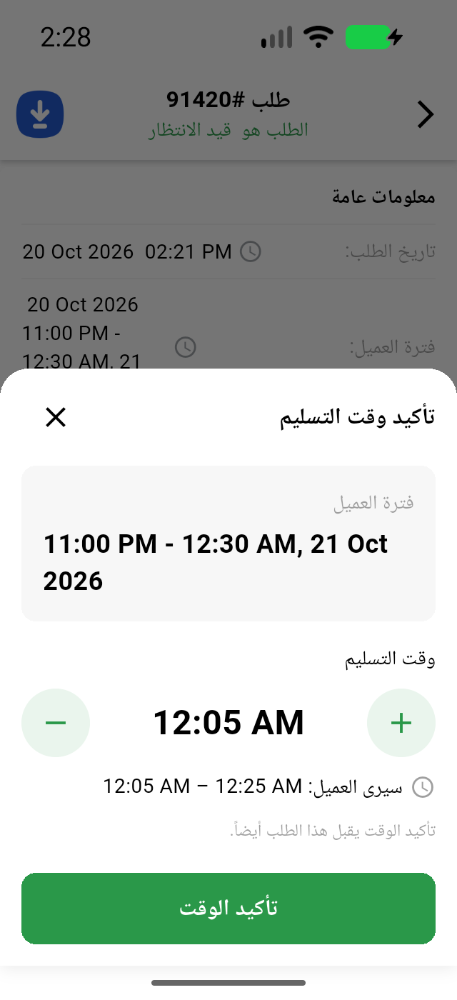

# QA Evidence — NEARS-4206

**NEARS-4206 delta re-QA: ROW A PASS (AR 12h Latin AM/PM), ROW B CONFIRMED (guest notification leak)**

**5 screenshot(s).** Click any thumbnail for full resolution.

<table>
<tr>
<td align="center" width="33%"> ac3 vendor sheet ar 320 x13</td>
<td align="center" width="33%"> ac4 user details ar 320 x13</td>
<td align="center" width="33%"> ac4 user track ar 320 x13</td>
</tr>
<tr>
<td align="center" width="33%"> rowa details ar 12h 320 x13</td>
<td align="center" width="33%"> rowa sheet ar 12h midnight 320 x13</td>
</tr>
</table>

### Other artifacts
- [`ac1_boundary.txt`](ac1_boundary.txt)
- [`ac5_timeout_fcm.txt`](ac5_timeout_fcm.txt)
- [`bug-guest-notification-leak.log`](bug-guest-notification-leak.log)
- [`flutter_test_userapp.txt`](flutter_test_userapp.txt)
- [`flutter_test_vendorapp.txt`](flutter_test_vendorapp.txt)
- [`panel_adjust_dialog_excerpt.txt`](panel_adjust_dialog_excerpt.txt)
- [`panel_after_save_rows_excerpt.txt`](panel_after_save_rows_excerpt.txt)
- [`panel_ar_modal_dialog_excerpt.txt`](panel_ar_modal_dialog_excerpt.txt)
- [`panel_error_dialog_excerpt.txt`](panel_error_dialog_excerpt.txt)
- [`panel_midnight_modal_dialog_excerpt.txt`](panel_midnight_modal_dialog_excerpt.txt)
- [`panel_modal_dialog_excerpt.txt`](panel_modal_dialog_excerpt.txt)
- [`phpunit_adjacent.txt`](phpunit_adjacent.txt)
- [`phpunit_mutation.txt`](phpunit_mutation.txt)
- [`phpunit_nears4206.txt`](phpunit_nears4206.txt)
- [`progress.md`](progress.md)
- [`rowa-details-ar-12h-dump.xml`](rowa-details-ar-12h-dump.xml)
- [`rowa-details-en-12h-dump.xml`](rowa-details-en-12h-dump.xml)
- [`rowa-details-en-24h-dump.xml`](rowa-details-en-24h-dump.xml)
- [`rowa-sheet-ar-12h-dump.xml`](rowa-sheet-ar-12h-dump.xml)
- [`rowa-sheet-ar-12h-midnight-dump.xml`](rowa-sheet-ar-12h-midnight-dump.xml)
- [`rowa-sheet-en-12h-dump.xml`](rowa-sheet-en-12h-dump.xml)
- [`rowa-sheet-en-24h-dump.xml`](rowa-sheet-en-24h-dump.xml)

---
*From `nears/docs/qa-evidence/NEARS-4206/` · public-repo scrub policy (no live secrets; verified clean).*
