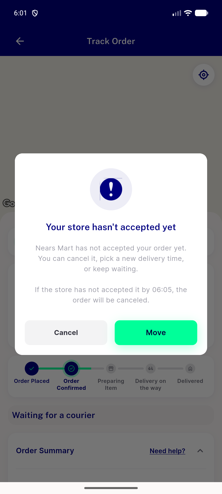
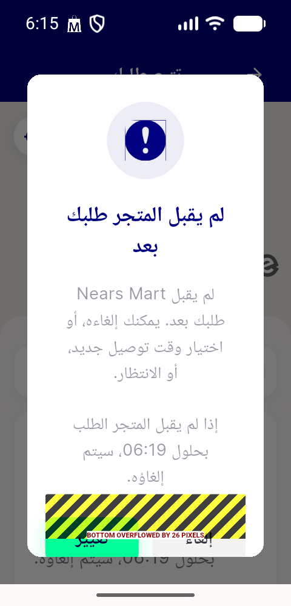
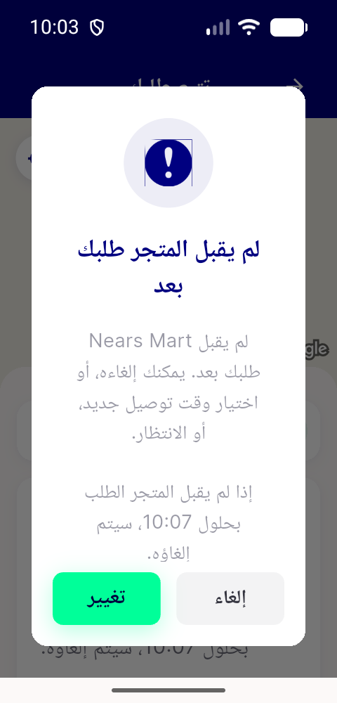

# QA Evidence — NEARS-4208

**QA window (d): simulated notification-tap intent resolves tracking+dialog/held card**

**3 screenshot(s).** Click any thumbnail for full resolution.

<table>
<tr>
<td align="center" width="33%"> ac3 offer dialog two action en light</td>
<td align="center" width="33%"> bug ndialog overflow 320dp x1.3 ar</td>
<td align="center" width="33%"> cycle1 ac3 ar two action 320dp x1.3</td>
</tr>
</table>

### Other artifacts
- [`ac1-refund-gate.md`](ac1-refund-gate.md)
- [`bug-ndialog-buttons-absent-320dp-x1.3-en-dump.xml`](bug-ndialog-buttons-absent-320dp-x1.3-en-dump.xml)
- [`bug-ndialog-overflow-320dp-x1.3-ar-dump.xml`](bug-ndialog-overflow-320dp-x1.3-ar-dump.xml)
- [`bug-ndialog-overflow-320dp-x1.3.log`](bug-ndialog-overflow-320dp-x1.3.log)
- [`cycle1-delta-results.md`](cycle1-delta-results.md)
- [`cycle1-real-push.log`](cycle1-real-push.log)
- [`hold-branch-rows.md`](hold-branch-rows.md)
- [`progress.md`](progress.md)
- [`window-d-simulated-tap.log`](window-d-simulated-tap.log)

---
*From `nears/docs/qa-evidence/NEARS-4208/` · public-repo scrub policy (no live secrets; verified clean).*
