# QA Evidence — NEARS-4212

**DELTA RE-QA (fix cycle 1) b5a3b3d25: FIR-1 PASS, FIR-2 PASS, ACs re-confirmed**

**56 screenshot(s).** Click any thumbnail for full resolution.

<table>
<tr>
<td align="center" width="33%"> A card ar 12h</td>
<td align="center" width="33%"> A card ar 24h</td>
<td align="center" width="33%"> A card en 24h</td>
</tr>
<tr>
<td align="center" width="33%"> A card en scale13</td>
<td align="center" width="33%"> A card history terminal 94006 en</td>
<td align="center" width="33%"> A card home en scroll1</td>
</tr>
<tr>
<td align="center" width="33%"> A card home en scroll2</td>
<td align="center" width="33%"> A card orders tab en scale13</td>
<td align="center" width="33%"> B details 94002 ar 24h</td>
</tr>
<tr>
<td align="center" width="33%"> B details 94002 ar</td>
<td align="center" width="33%"> B details 94002 en after extension</td>
<td align="center" width="33%"> B details 94002 en</td>
</tr>
<tr>
<td align="center" width="33%"> C details error ar</td>
<td align="center" width="33%"> C details error en</td>
<td align="center" width="33%"> C details retry spinner ar</td>
</tr>
<tr>
<td align="center" width="33%"> C poll failure content stays en</td>
<td align="center" width="33%"> D panel list ar 12h date hidden</td>
<td align="center" width="33%"> D panel list ar 12h</td>
</tr>
<tr>
<td align="center" width="33%"> D panel list ar 24h date hidden</td>
<td align="center" width="33%"> D panel list ar 24h</td>
<td align="center" width="33%"> D panel list en 12h date hidden</td>
</tr>
<tr>
<td align="center" width="33%"> D panel list en 12h</td>
<td align="center" width="33%"> E panel detail 94001 ar 12h</td>
<td align="center" width="33%"> E panel detail 94001 ar 24h</td>
</tr>
<tr>
<td align="center" width="33%"> E panel detail 94001 en 12h</td>
<td align="center" width="33%"> E panel detail 94002 ar 12h print emulated</td>
<td align="center" width="33%"> E panel detail 94002 ar 12h</td>
</tr>
<tr>
<td align="center" width="33%"> E panel detail 94002 ar 24h print emulated</td>
<td align="center" width="33%"> E panel detail 94002 ar 24h</td>
<td align="center" width="33%"> E panel detail 94002 en 12h print emulated</td>
</tr>
<tr>
<td align="center" width="33%"> E panel detail 94002 en 12h</td>
<td align="center" width="33%"> E panel detail 94004 ar 12h</td>
<td align="center" width="33%"> E panel detail 94004 ar 24h</td>
</tr>
<tr>
<td align="center" width="33%"> E panel detail 94004 en 12h</td>
<td align="center" width="33%"><a href="F1-panel-list-94002-ar.png">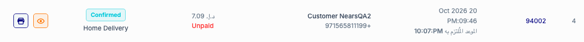</a> F1 panel list 94002 ar</td>
<td align="center" width="33%"><a href="F1-panel-list-94002-en.png">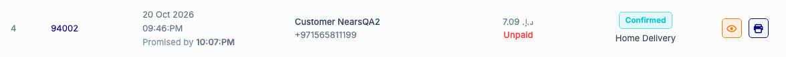</a> F1 panel list 94002 en</td>
</tr>
<tr>
<td align="center" width="33%"><a href="F1-panel-list-ar.png">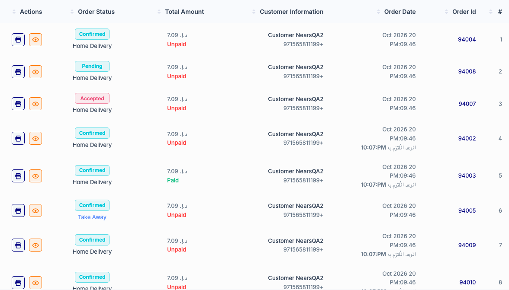</a> F1 panel list ar</td>
<td align="center" width="33%"><a href="F1-panel-list-en.png">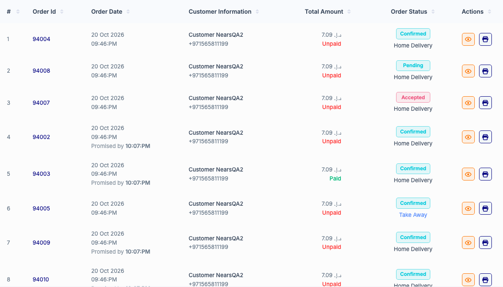</a> F1 panel list en</td>
<td align="center" width="33%"><a href="F2-details-94002-after-extend-en.png">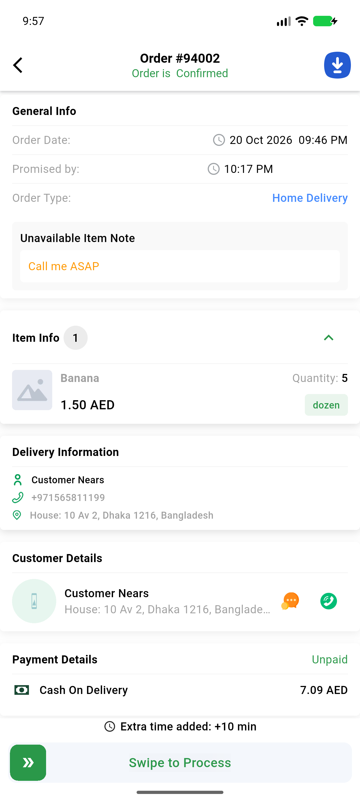</a> F2 details 94002 after extend en</td>
</tr>
<tr>
<td align="center" width="33%"><a href="F2-details-94002-before-extend-en.png">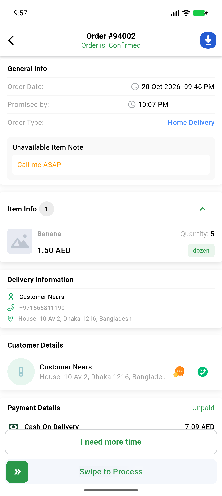</a> F2 details 94002 before extend en</td>
<td align="center" width="33%"><a href="F2-details-94003-after-extend-ar.png">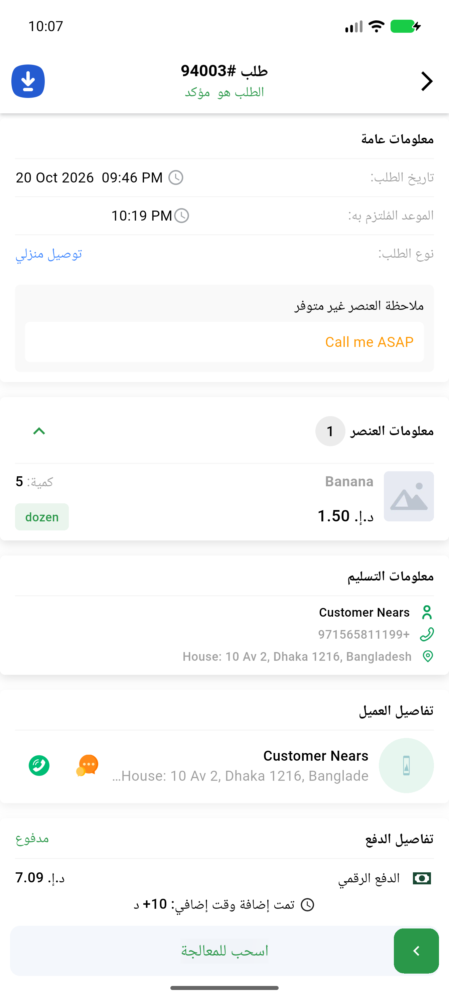</a> F2 details 94003 after extend ar</td>
<td align="center" width="33%"><a href="F2-details-94009-backend-down-en.png">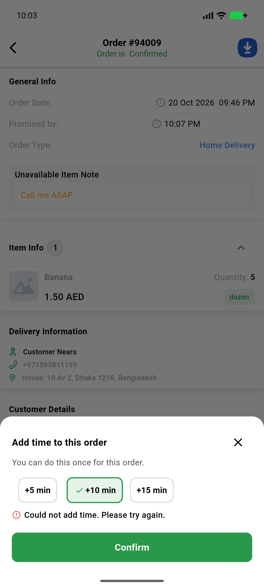</a> F2 details 94009 backend down en</td>
</tr>
<tr>
<td align="center" width="33%"><a href="F2-details-94009-refused-other-en.png">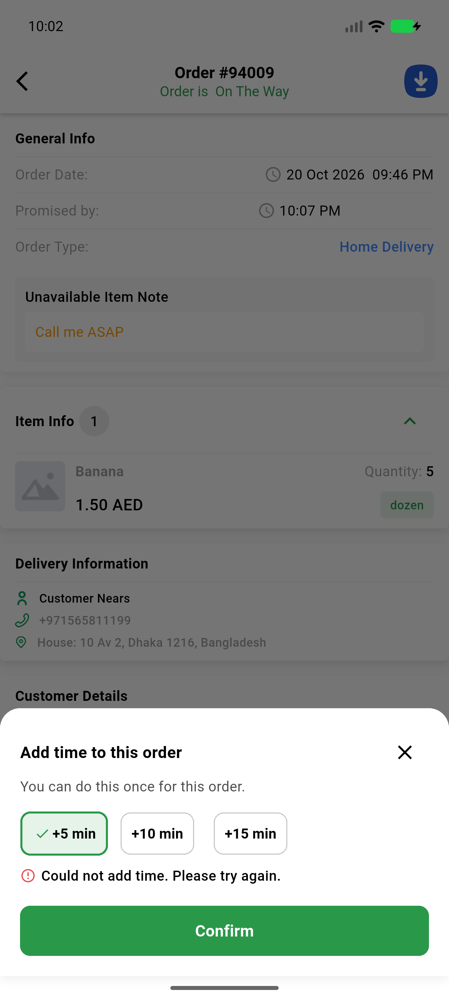</a> F2 details 94009 refused other en</td>
<td align="center" width="33%"><a href="F2-details-94010-403-used-en.png">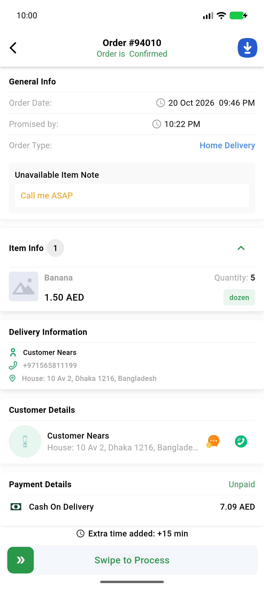</a> F2 details 94010 403 used en</td>
<td align="center" width="33%"><a href="F2-list-94002-after-extend-no-refresh-en.png">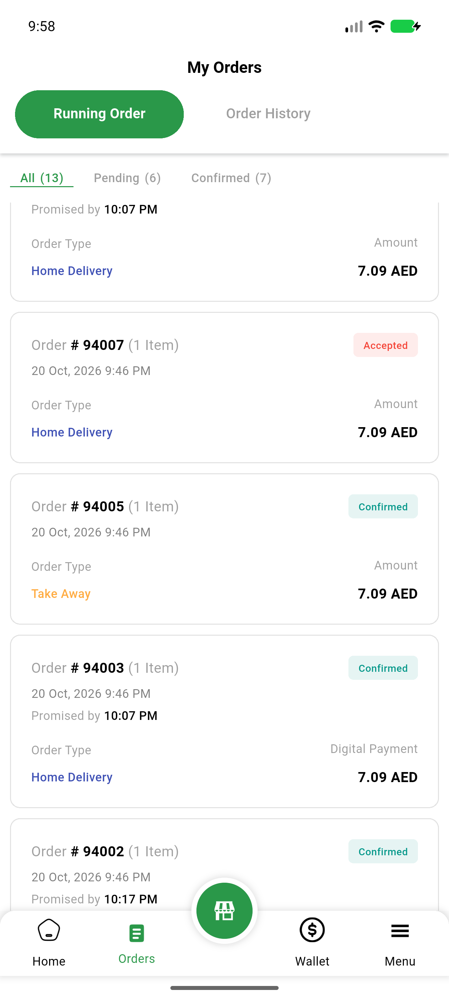</a> F2 list 94002 after extend no refresh en</td>
</tr>
<tr>
<td align="center" width="33%"><a href="F2-list-94003-after-extend-no-refresh-ar.png">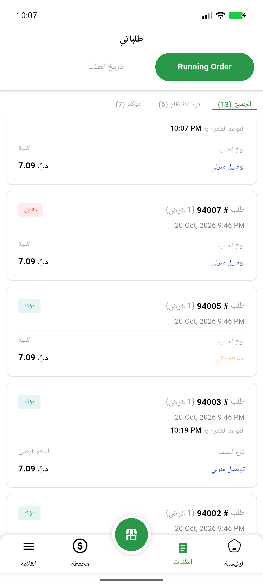</a> F2 list 94003 after extend no refresh ar</td>
<td align="center" width="33%"><a href="F2-list-94010-after-403-no-refresh-en.png">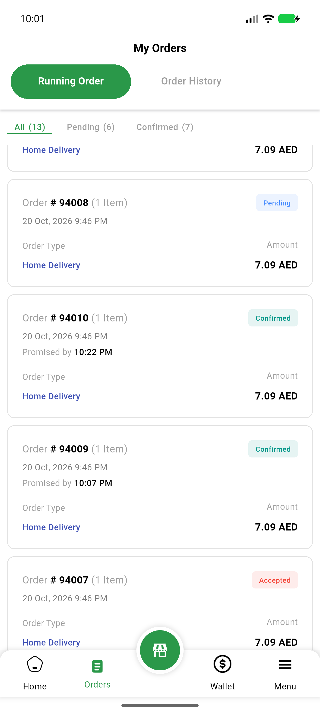</a> F2 list 94010 after 403 no refresh en</td>
<td align="center" width="33%"><a href="F2-panel-detail-94002-after-extend-en.png">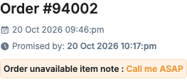</a> F2 panel detail 94002 after extend en</td>
</tr>
<tr>
<td align="center" width="33%"><a href="F2-panel-list-94002-after-extend-en.png">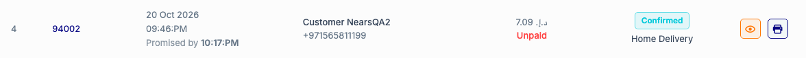</a> F2 panel list 94002 after extend en</td>
<td align="center" width="33%"><a href="G-details-error-delta-en.png">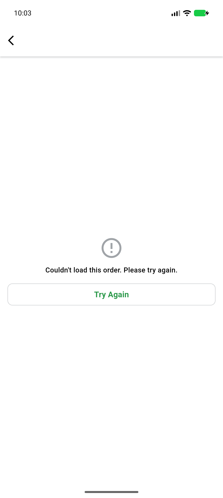</a> G details error delta en</td>
<td align="center" width="33%"><a href="P-parcel-94012-details-en.png">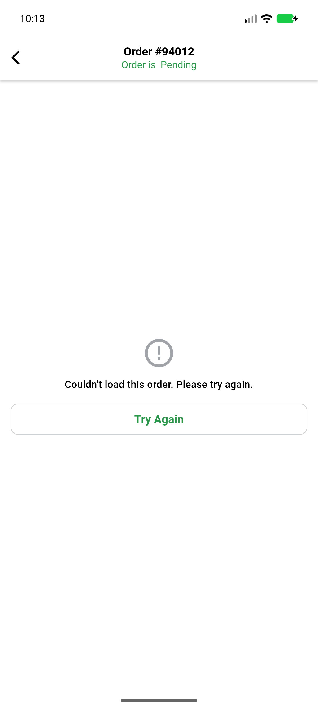</a> P parcel 94012 details en</td>
</tr>
<tr>
<td align="center" width="33%"><a href="P-parcel-rx-94011-details-en.png">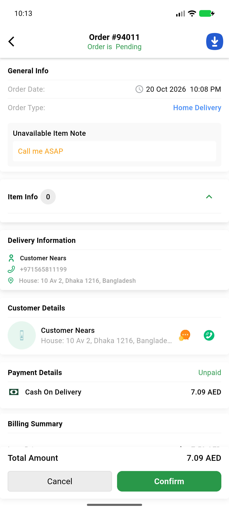</a> P parcel rx 94011 details en</td>
<td align="center" width="33%"> R busy card after tap</td>
<td align="center" width="33%"> R filter list error block</td>
</tr>
<tr>
<td align="center" width="33%"><a href="R2-details-94008-slot-en.png">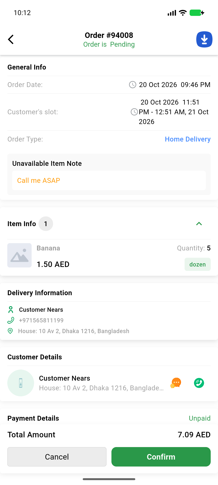</a> R2 details 94008 slot en</td>
<td align="center" width="33%"><a href="R2-home-busy-card-after-tap.png">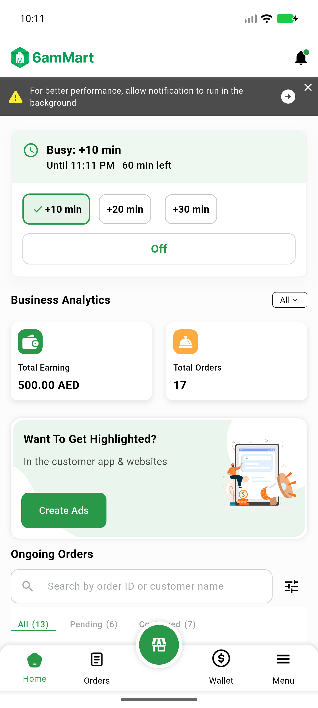</a> R2 home busy card after tap</td>
</tr>
</table>

### Other artifacts
- [`C-details-error-ar-dump.xml`](C-details-error-ar-dump.xml)
- [`C-details-error-en-dump.xml`](C-details-error-en-dump.xml)
- [`C-details-loaded-en-dump.xml`](C-details-loaded-en-dump.xml)
- [`C-details-retry-spinner-ar-dump.xml`](C-details-retry-spinner-ar-dump.xml)
- [`G-details-error-delta-en-dump.xml`](G-details-error-delta-en-dump.xml)
- [`G-logs-delta.log`](G-logs-delta.log)
- [`P-parcel-94012-details.log`](P-parcel-94012-details.log)
- [`progress.md`](progress.md)

---
*From `nears/docs/qa-evidence/NEARS-4212/` · public-repo scrub policy (no live secrets; verified clean).*
