# QA Evidence — NEARS-4212

**NEARS-4212 QA cycle 0: store promised-by (API, VendorApp, Store Panel)**

**36 screenshot(s).** Click any thumbnail for full resolution.

<table>
<tr>
<td align="center" width="33%"> A card ar 12h</td>
<td align="center" width="33%"><a href="A-card-ar-24h.png">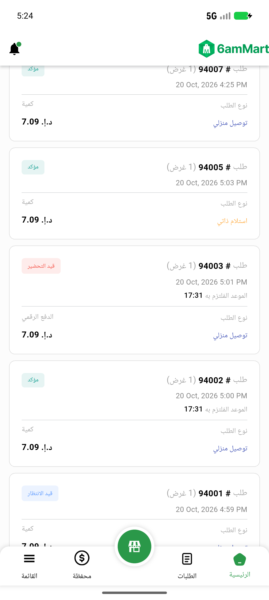</a> A card ar 24h</td>
<td align="center" width="33%"><a href="A-card-en-24h.png">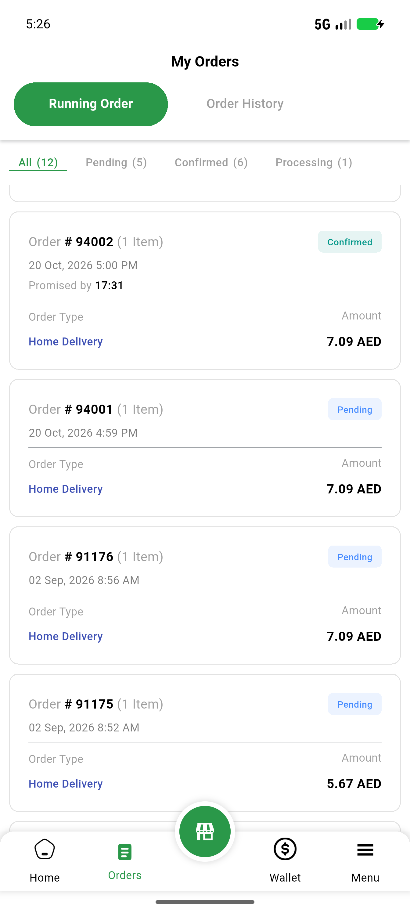</a> A card en 24h</td>
</tr>
<tr>
<td align="center" width="33%"><a href="A-card-en-scale13.png">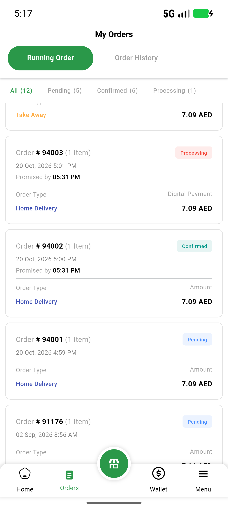</a> A card en scale13</td>
<td align="center" width="33%"><a href="A-card-history-terminal-94006-en.png">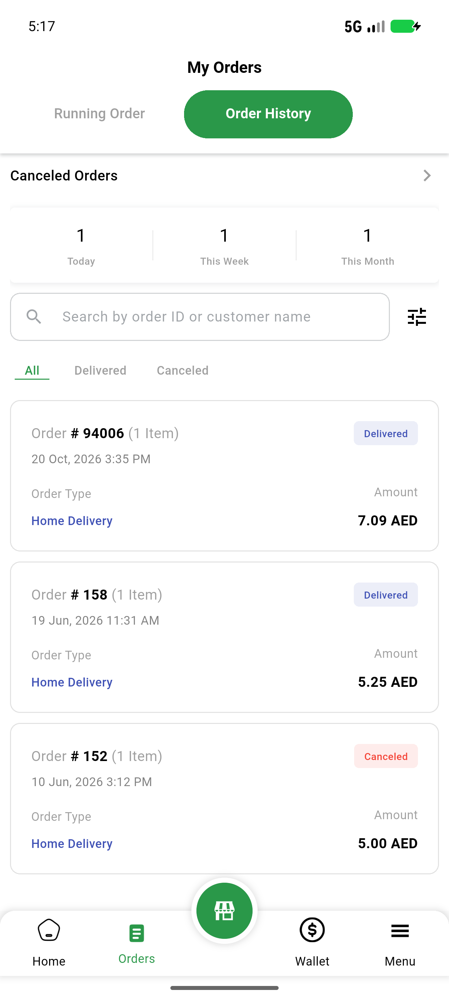</a> A card history terminal 94006 en</td>
<td align="center" width="33%"><a href="A-card-home-en-scroll1.png">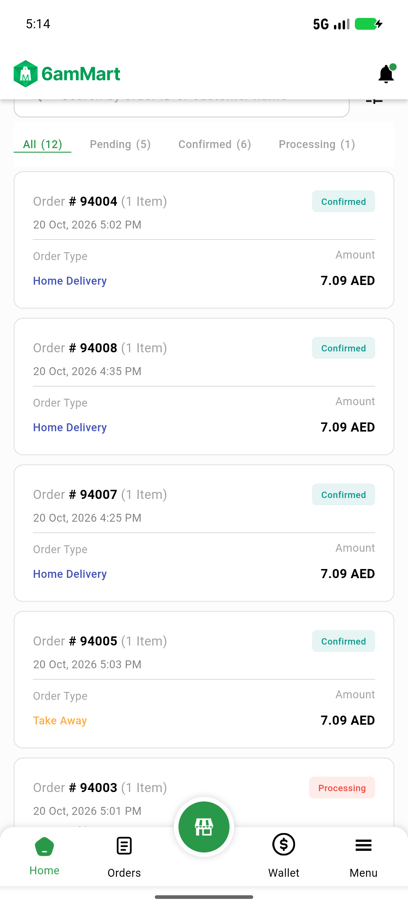</a> A card home en scroll1</td>
</tr>
<tr>
<td align="center" width="33%"><a href="A-card-home-en-scroll2.png">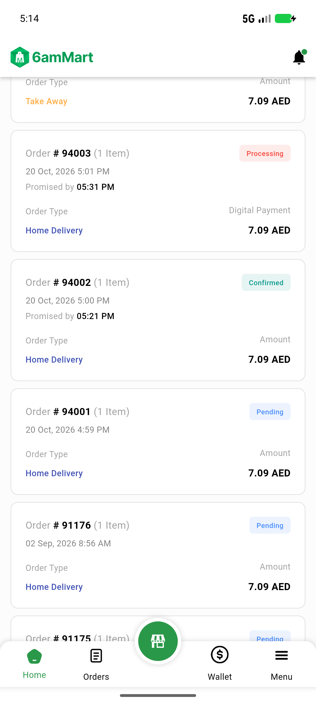</a> A card home en scroll2</td>
<td align="center" width="33%"><a href="A-card-orders-tab-en-scale13.png">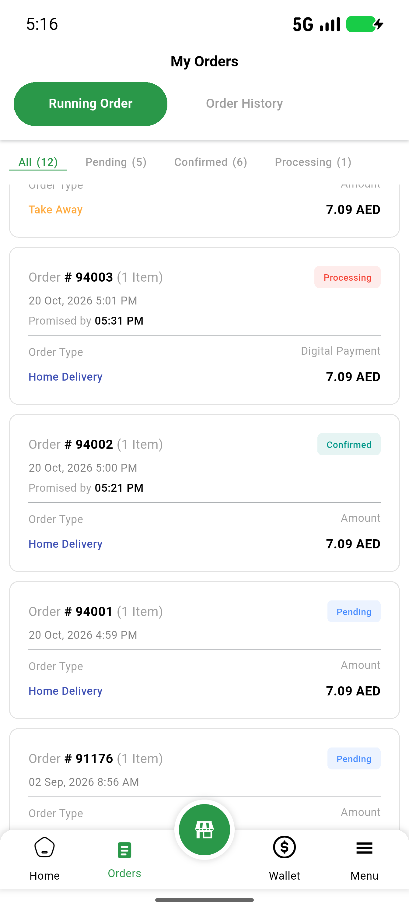</a> A card orders tab en scale13</td>
<td align="center" width="33%"> B details 94002 ar 24h</td>
</tr>
<tr>
<td align="center" width="33%"><a href="B-details-94002-ar.png">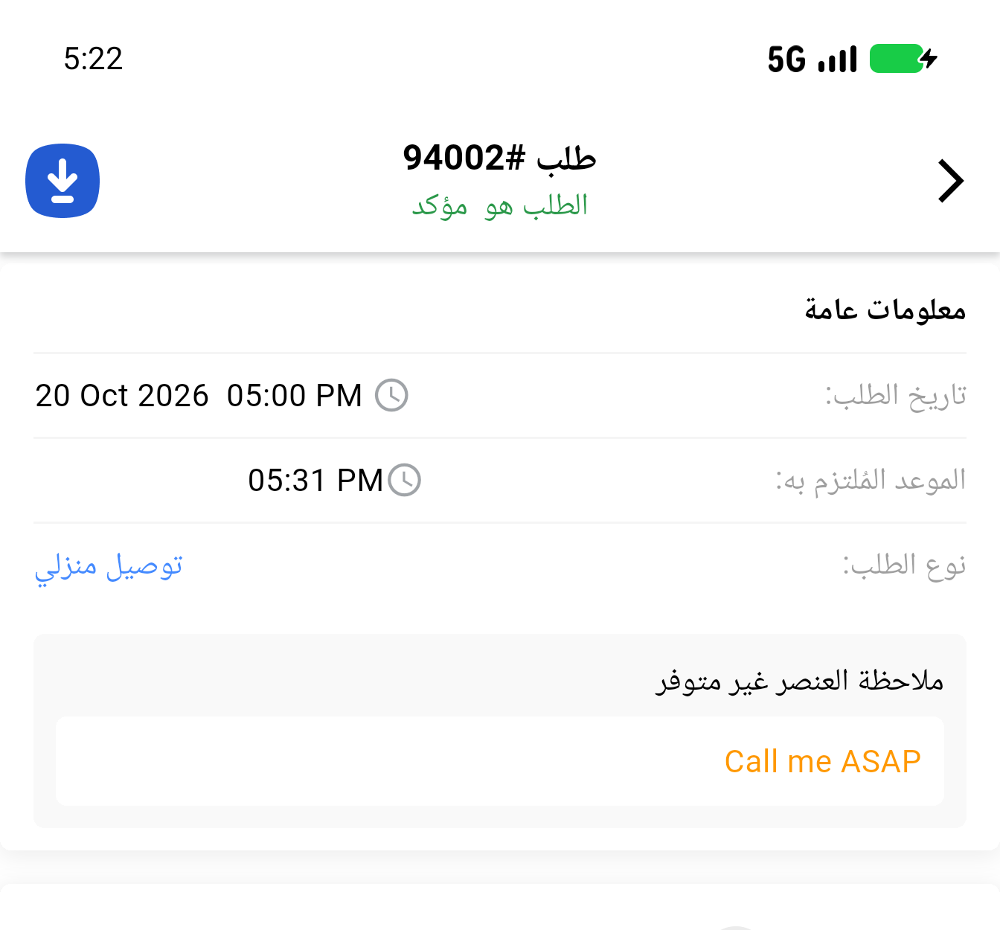</a> B details 94002 ar</td>
<td align="center" width="33%"><a href="B-details-94002-en-after-extension.png">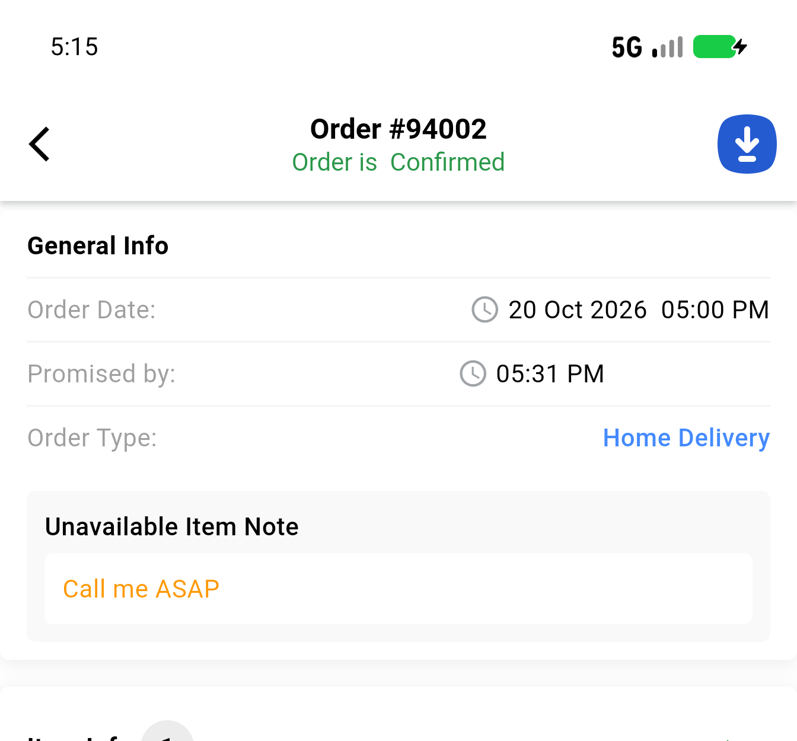</a> B details 94002 en after extension</td>
<td align="center" width="33%"> B details 94002 en</td>
</tr>
<tr>
<td align="center" width="33%"><a href="C-details-error-ar.png">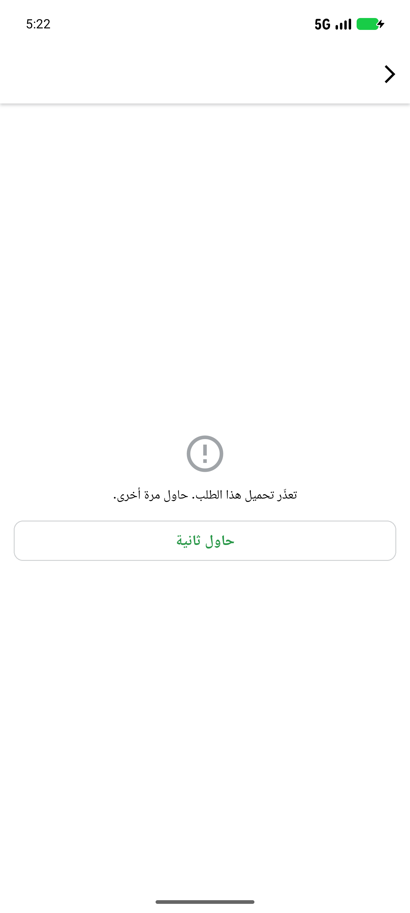</a> C details error ar</td>
<td align="center" width="33%"><a href="C-details-error-en.png">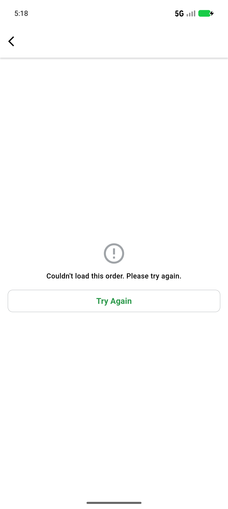</a> C details error en</td>
<td align="center" width="33%"><a href="C-details-retry-spinner-ar.png">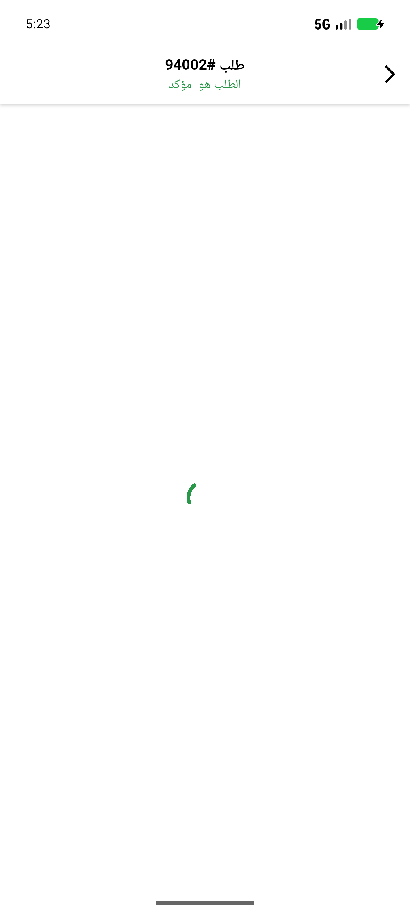</a> C details retry spinner ar</td>
</tr>
<tr>
<td align="center" width="33%"> C poll failure content stays en</td>
<td align="center" width="33%"><a href="D-panel-list-ar-12h-date-hidden.png">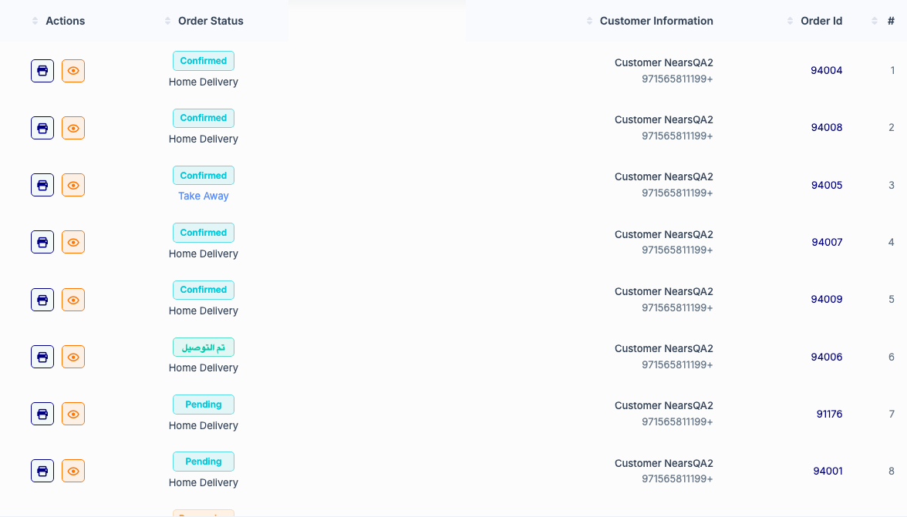</a> D panel list ar 12h date hidden</td>
<td align="center" width="33%"><a href="D-panel-list-ar-12h.png">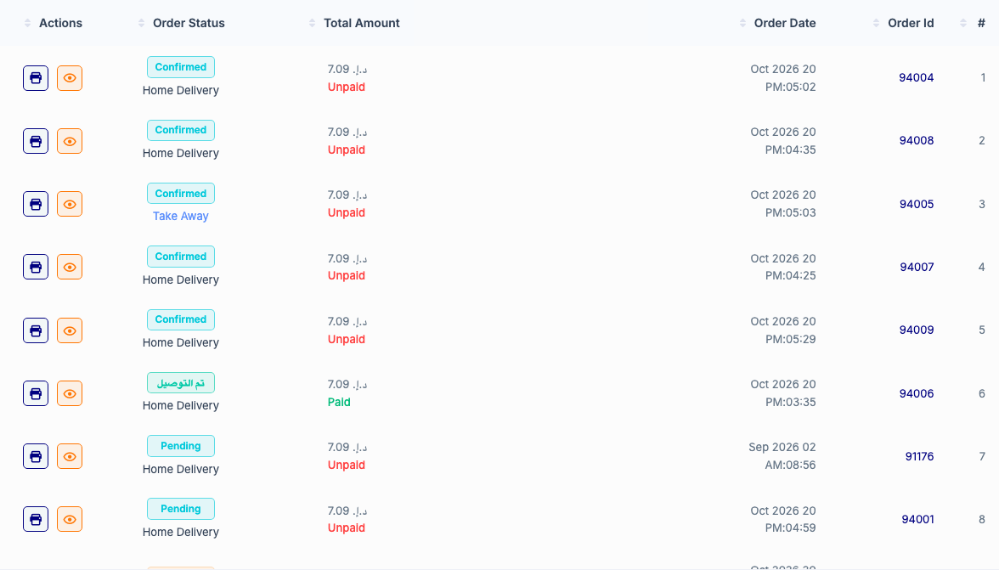</a> D panel list ar 12h</td>
</tr>
<tr>
<td align="center" width="33%"> D panel list ar 24h date hidden</td>
<td align="center" width="33%"> D panel list ar 24h</td>
<td align="center" width="33%"><a href="D-panel-list-en-12h-date-hidden.png">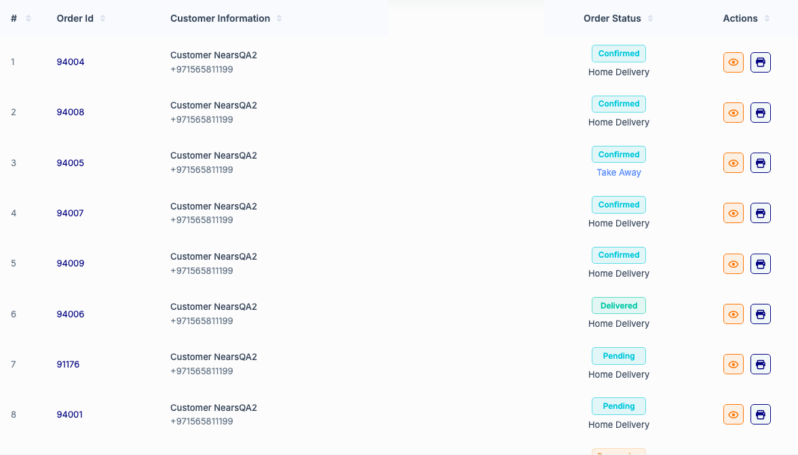</a> D panel list en 12h date hidden</td>
</tr>
<tr>
<td align="center" width="33%"><a href="D-panel-list-en-12h.png">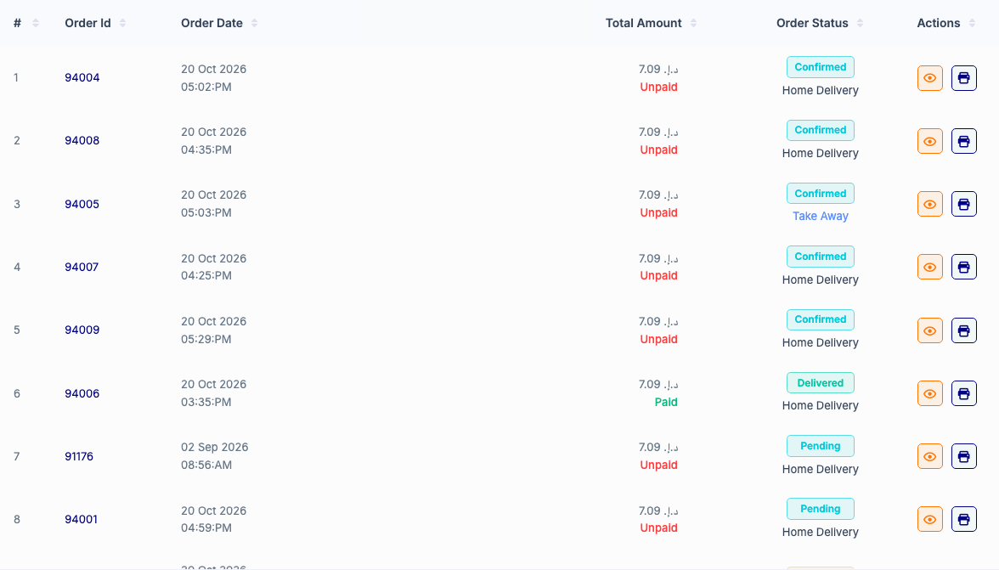</a> D panel list en 12h</td>
<td align="center" width="33%"> E panel detail 94001 ar 12h</td>
<td align="center" width="33%"><a href="E-panel-detail-94001-ar-24h.png">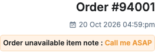</a> E panel detail 94001 ar 24h</td>
</tr>
<tr>
<td align="center" width="33%"><a href="E-panel-detail-94001-en-12h.png">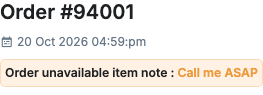</a> E panel detail 94001 en 12h</td>
<td align="center" width="33%"> E panel detail 94002 ar 12h print emulated</td>
<td align="center" width="33%"> E panel detail 94002 ar 12h</td>
</tr>
<tr>
<td align="center" width="33%"> E panel detail 94002 ar 24h print emulated</td>
<td align="center" width="33%"><a href="E-panel-detail-94002-ar-24h.png">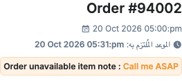</a> E panel detail 94002 ar 24h</td>
<td align="center" width="33%"> E panel detail 94002 en 12h print emulated</td>
</tr>
<tr>
<td align="center" width="33%"><a href="E-panel-detail-94002-en-12h.png">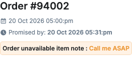</a> E panel detail 94002 en 12h</td>
<td align="center" width="33%"> E panel detail 94004 ar 12h</td>
<td align="center" width="33%"><a href="E-panel-detail-94004-ar-24h.png">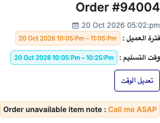</a> E panel detail 94004 ar 24h</td>
</tr>
<tr>
<td align="center" width="33%"><a href="E-panel-detail-94004-en-12h.png">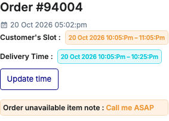</a> E panel detail 94004 en 12h</td>
<td align="center" width="33%"><a href="R-busy-card-after-tap.png">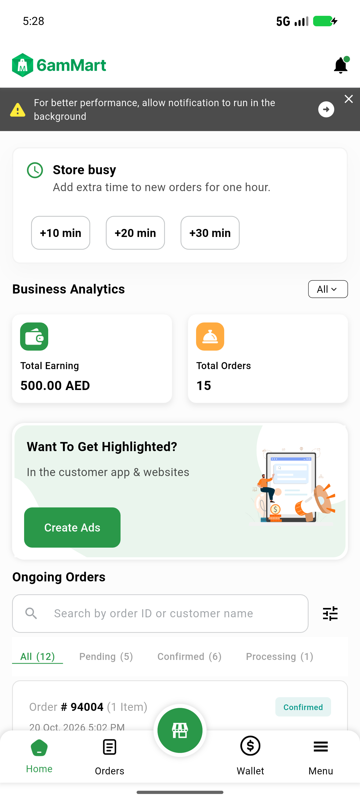</a> R busy card after tap</td>
<td align="center" width="33%"><a href="R-filter-list-error-block.png">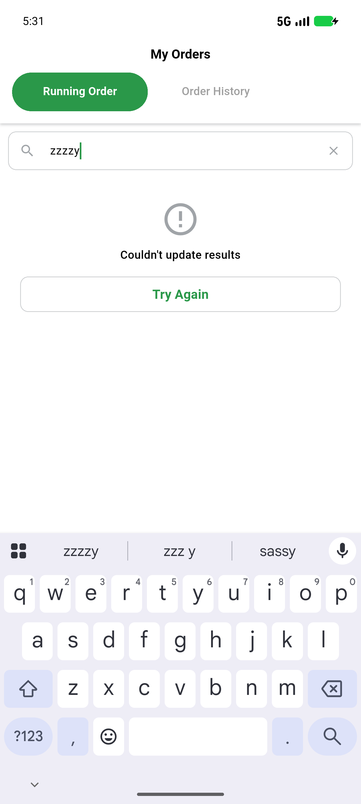</a> R filter list error block</td>
</tr>
</table>

### Other artifacts
- [`C-details-error-ar-dump.xml`](C-details-error-ar-dump.xml)
- [`C-details-error-en-dump.xml`](C-details-error-en-dump.xml)
- [`C-details-loaded-en-dump.xml`](C-details-loaded-en-dump.xml)
- [`C-details-retry-spinner-ar-dump.xml`](C-details-retry-spinner-ar-dump.xml)
- [`progress.md`](progress.md)

---
*From `nears/docs/qa-evidence/NEARS-4212/` · public-repo scrub policy (no live secrets; verified clean).*
