# QA Evidence — NEARS-4214

**BLOCKED(resourcing: backstop mem-guard refused) - live QA: AC1-AC10,AC12,AC13 demonstrated; AC12 task_bug (event fires on basket); AC14 pending [10]**

**18 screenshot(s).** Click any thumbnail for full resolution.

<table>
<tr>
<td align="center" width="33%"><a href="ac2-320dp-x13-checkout-b.png">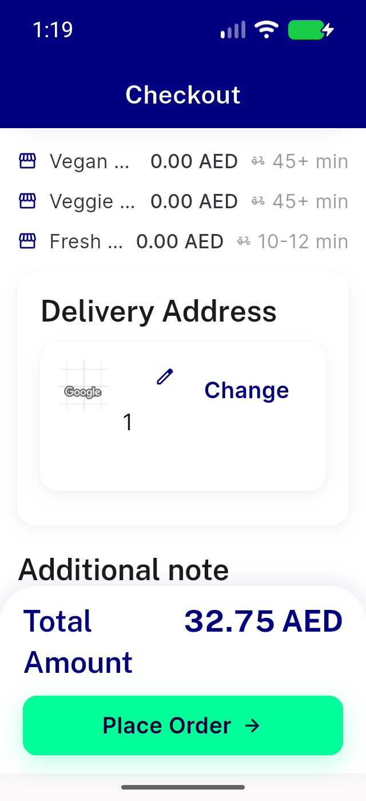</a> ac2 320dp x13 checkout b</td>
<td align="center" width="33%"><a href="ac2-320dp-x13-list.png">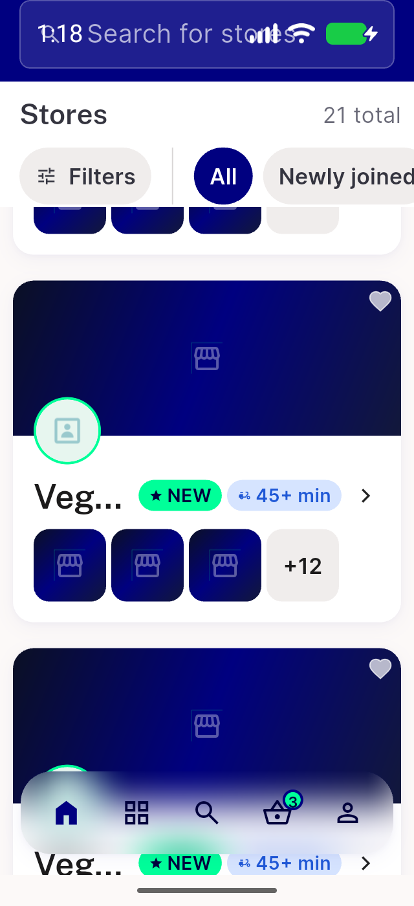</a> ac2 320dp x13 list</td>
<td align="center" width="33%"><a href="ac2-320dp-x13-storepage.png">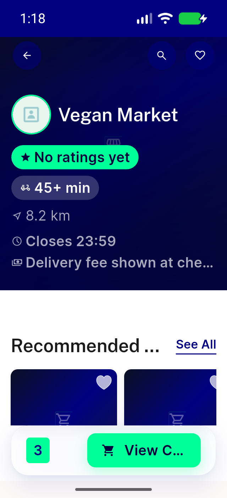</a> ac2 320dp x13 storepage</td>
</tr>
<tr>
<td align="center" width="33%"><a href="ac2-cap43-visible.png">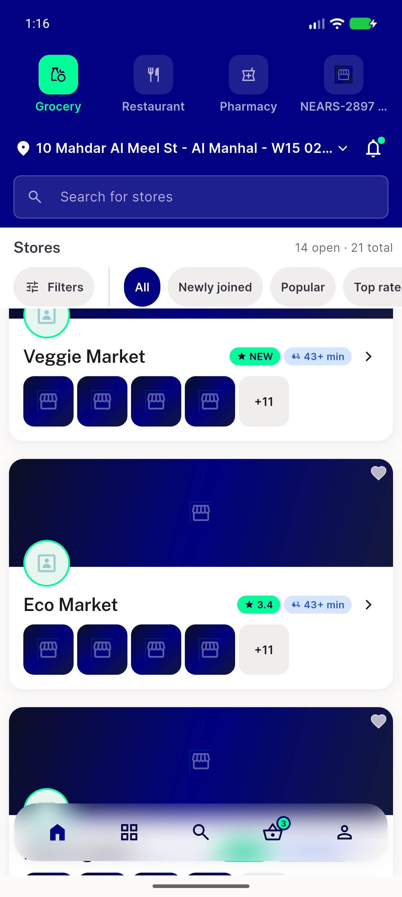</a> ac2 cap43 visible</td>
<td align="center" width="33%"><a href="ac2-cap50-boundary.png">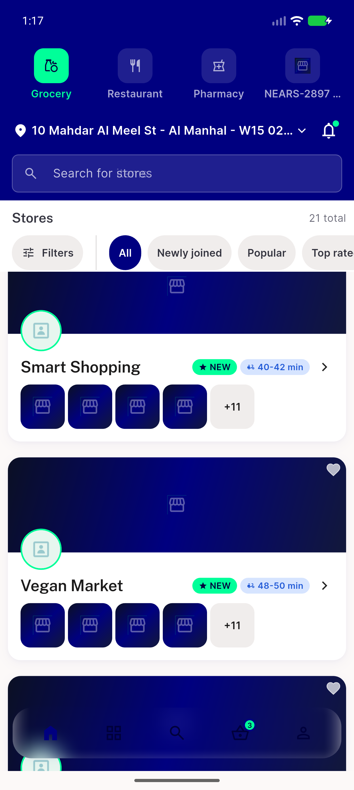</a> ac2 cap50 boundary</td>
<td align="center" width="33%"><a href="ac2-checkout-mixed-b.png">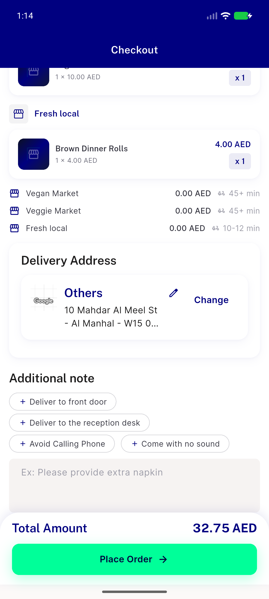</a> ac2 checkout mixed b</td>
</tr>
<tr>
<td align="center" width="33%"><a href="ac2-checkout-mixed.png">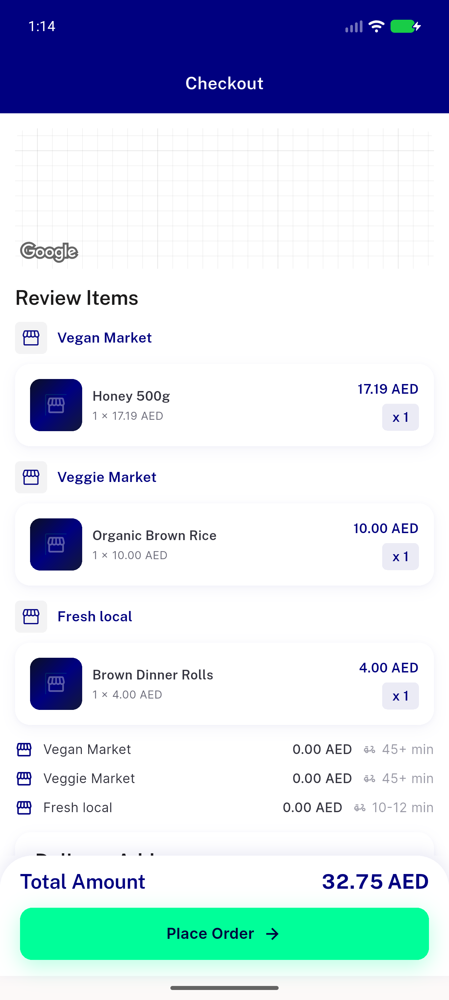</a> ac2 checkout mixed</td>
<td align="center" width="33%"><a href="ac2-checkout-single-vegan.png">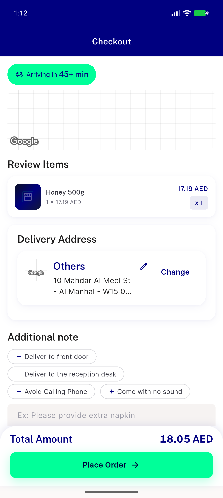</a> ac2 checkout single vegan</td>
<td align="center" width="33%"><a href="ac2-item-sheet-eco.png">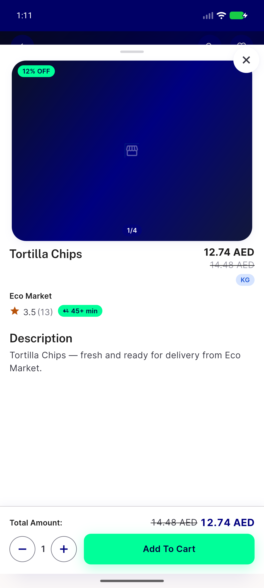</a> ac2 item sheet eco</td>
</tr>
<tr>
<td align="center" width="33%"><a href="ac2-list-stores-45plus.png">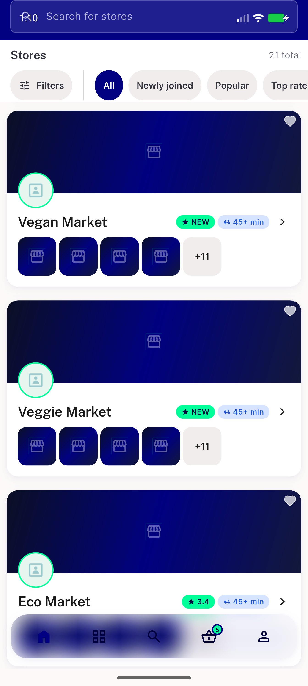</a> ac2 list stores 45plus</td>
<td align="center" width="33%"><a href="ac2-list-stores-under-cap.png">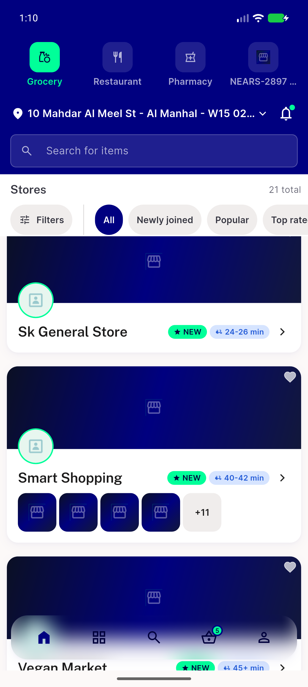</a> ac2 list stores under cap</td>
<td align="center" width="33%"><a href="ac2-search-over-cap.png">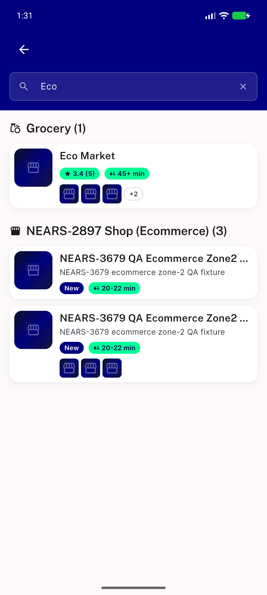</a> ac2 search over cap</td>
</tr>
<tr>
<td align="center" width="33%"><a href="ac2-store-page-eco.png">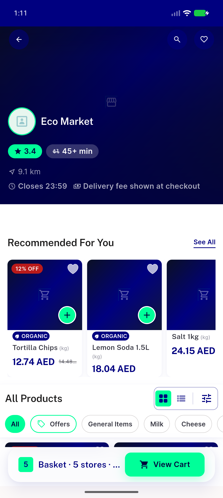</a> ac2 store page eco</td>
<td align="center" width="33%"><a href="ac9-home-running-rail.png">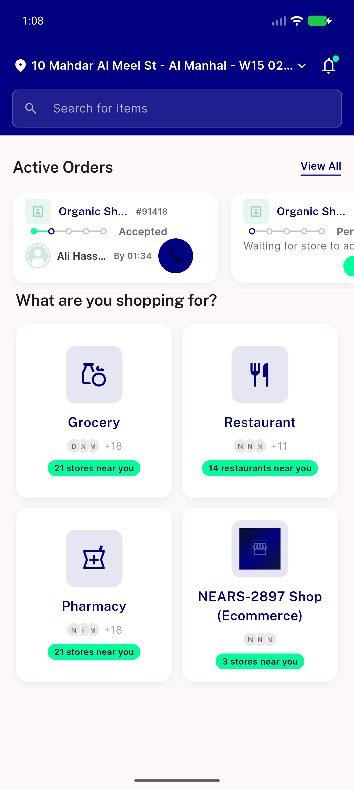</a> ac9 home running rail</td>
<td align="center" width="33%"><a href="ac9-tracking-91418-latest-arrival-by-0134.png">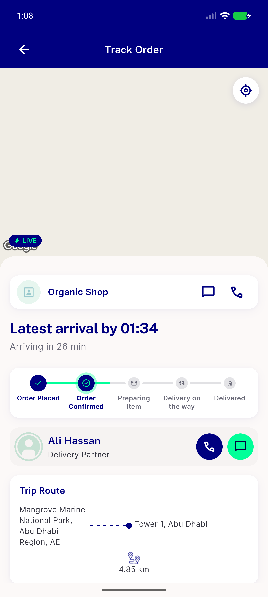</a> ac9 tracking 91418 latest arrival by 0134</td>
</tr>
<tr>
<td align="center" width="33%"><a href="ar-checkout-mixed2.png">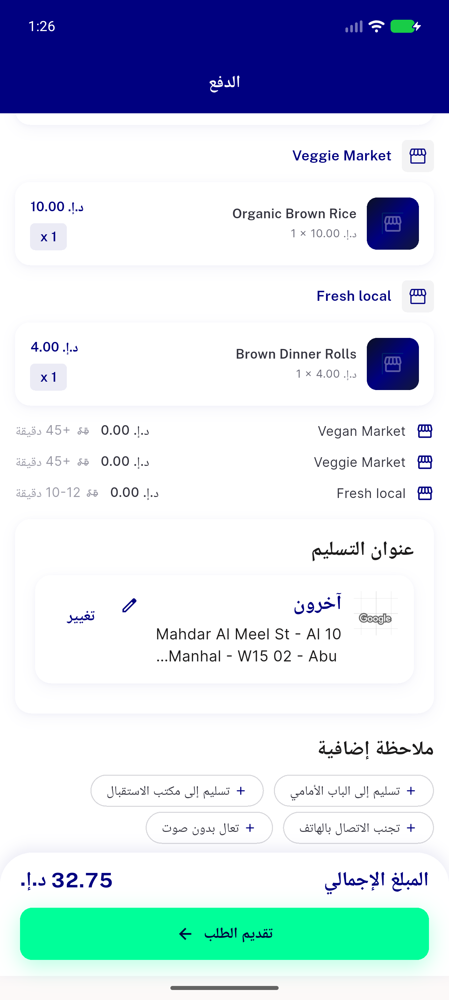</a> ar checkout mixed2</td>
<td align="center" width="33%"><a href="ar-list-over-cap.png">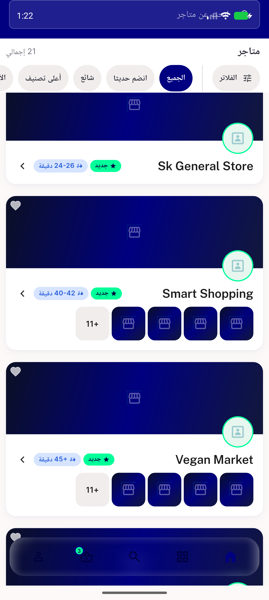</a> ar list over cap</td>
<td align="center" width="33%"><a href="reg-home-rail-takeaway.png">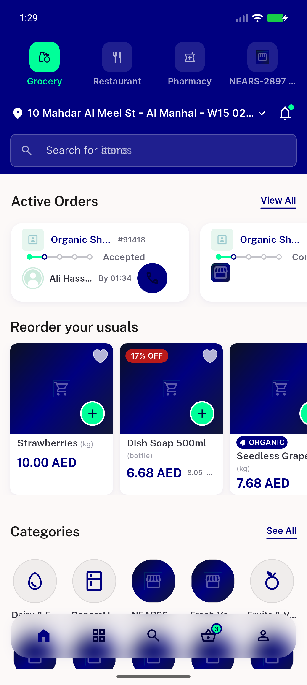</a> reg home rail takeaway</td>
</tr>
</table>

### Other artifacts
- [`bug-eta-over-cap-fires-on-basket.log`](bug-eta-over-cap-fires-on-basket.log)
- [`progress.md`](progress.md)

---
*From `nears/docs/qa-evidence/NEARS-4214/` · public-repo scrub policy (no live secrets; verified clean).*
