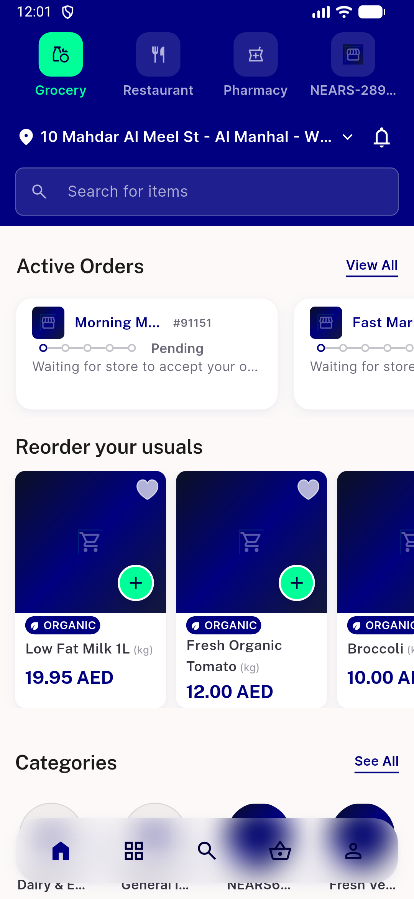
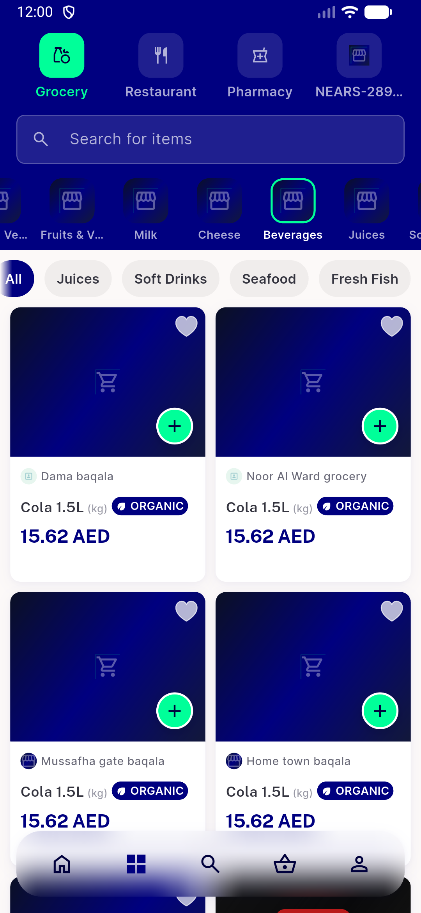
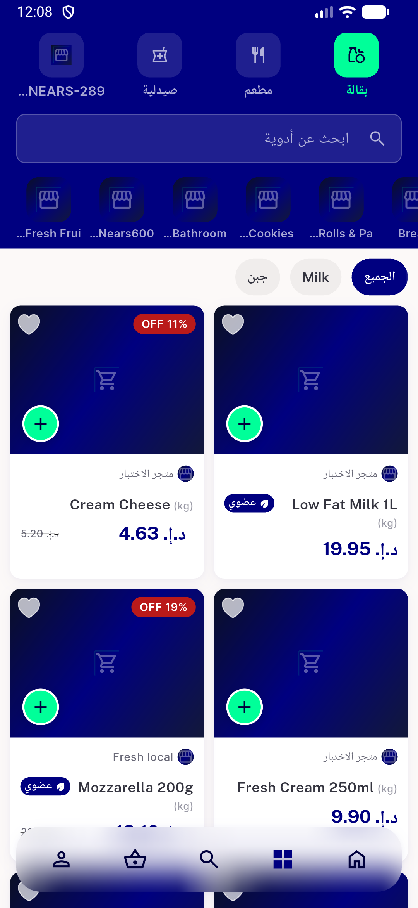
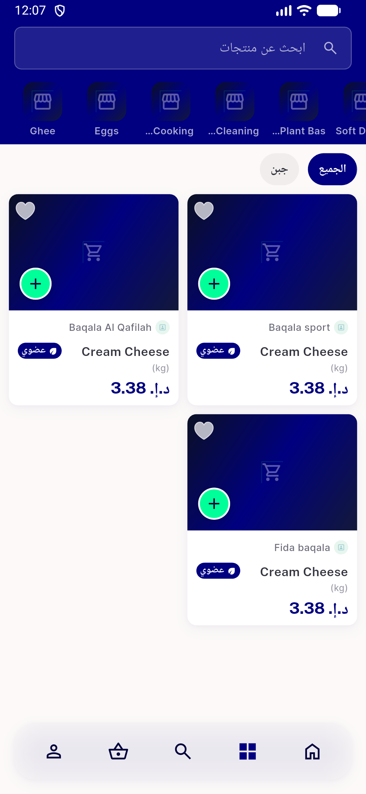
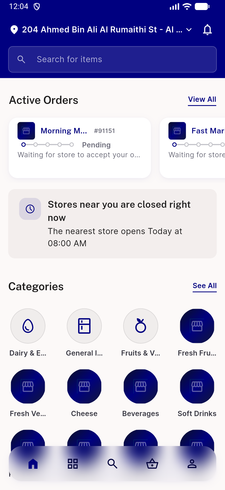
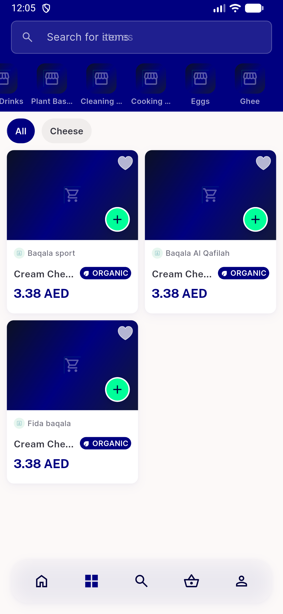
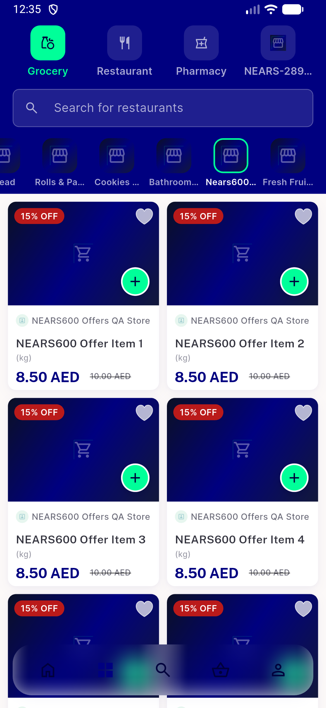
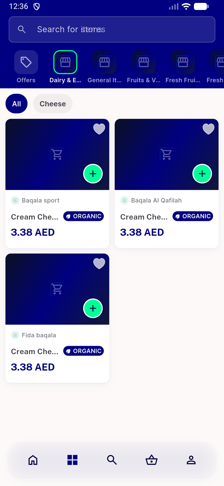
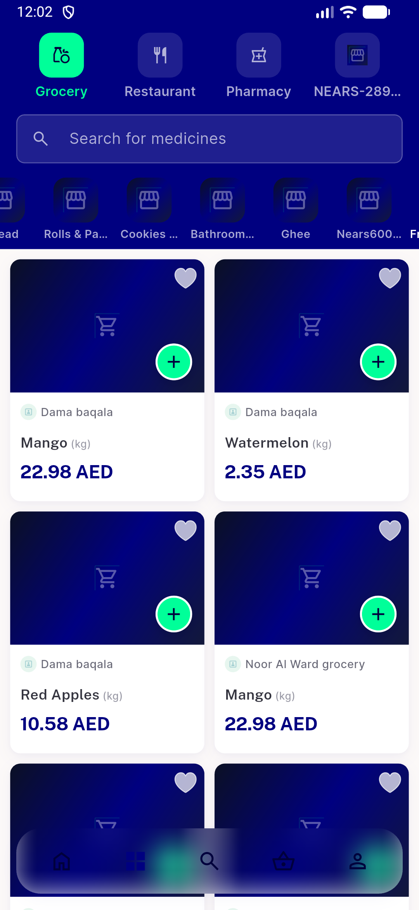

# QA Evidence — NEARS-4220

**PASS: 10/10 AC live (api+device), phpunit 62 OK, flutter 175 OK**

**9 screenshot(s).** Click any thumbnail for full resolution.

<table>
<tr>
<td align="center" width="33%"> ac7 z2 412 home rail en</td>
<td align="center" width="33%"> ac7 z2 412 rail beverages en</td>
<td align="center" width="33%"> ac7 z2 categories ar</td>
</tr>
<tr>
<td align="center" width="33%"> ac7 z364 categories ar</td>
<td align="center" width="33%"> ac7 z364 home rail en</td>
<td align="center" width="33%"> ac8 after switch z364 categories</td>
</tr>
<tr>
<td align="center" width="33%"> ac8 b z2 deals selected before switch</td>
<td align="center" width="33%"> ac8 b z364 after switch selection moved</td>
<td align="center" width="33%"> ac8 before z2 last category selected</td>
</tr>
</table>

### Other artifacts
- [`ac10-failopen.txt`](ac10-failopen.txt)
- [`ac3-variants.txt`](ac3-variants.txt)
- [`ac4-cache-keys-clone.txt`](ac4-cache-keys-clone.txt)
- [`ac5-consistency-loop.txt`](ac5-consistency-loop.txt)
- [`ac6-cache-writes.txt`](ac6-cache-writes.txt)
- [`ac6-ttl-measurement.txt`](ac6-ttl-measurement.txt)
- [`ac7-tileloop-z2-ar.txt`](ac7-tileloop-z2-ar.txt)
- [`ac7-tileloop-z364-en.txt`](ac7-tileloop-z364-en.txt)
- [`ac9-flutter-test-tail.log`](ac9-flutter-test-tail.log)
- [`ac9-phpunit.log`](ac9-phpunit.log)
- [`api-categories-z1.json`](api-categories-z1.json)
- [`api-categories-z2.json`](api-categories-z2.json)
- [`api-categories-z364.json`](api-categories-z364.json)
- [`bug-setstate-during-build-zone-switch.log`](bug-setstate-during-build-zone-switch.log)
- [`progress.md`](progress.md)

---
*From `nears/docs/qa-evidence/NEARS-4220/` · public-repo scrub policy (no live secrets; verified clean).*
