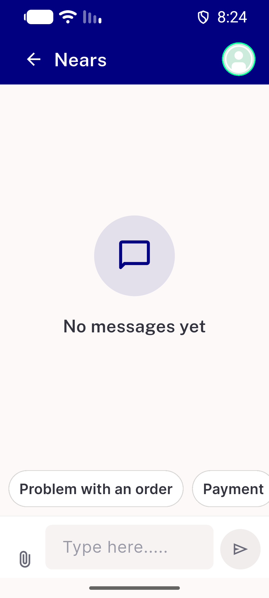
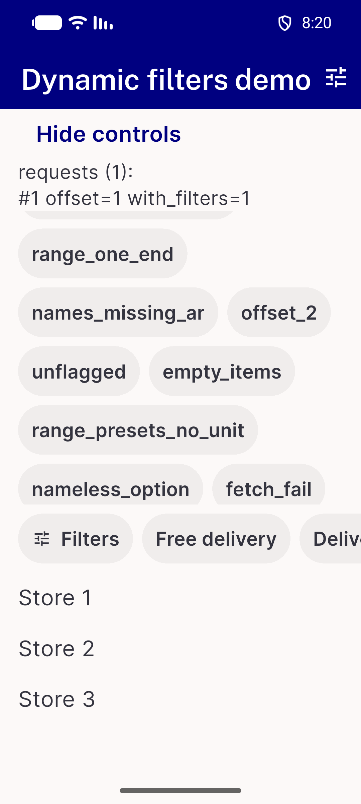
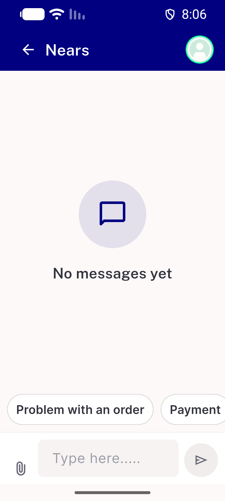
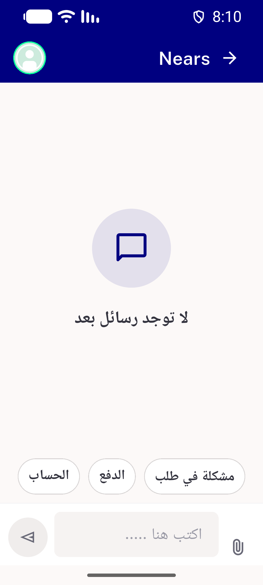
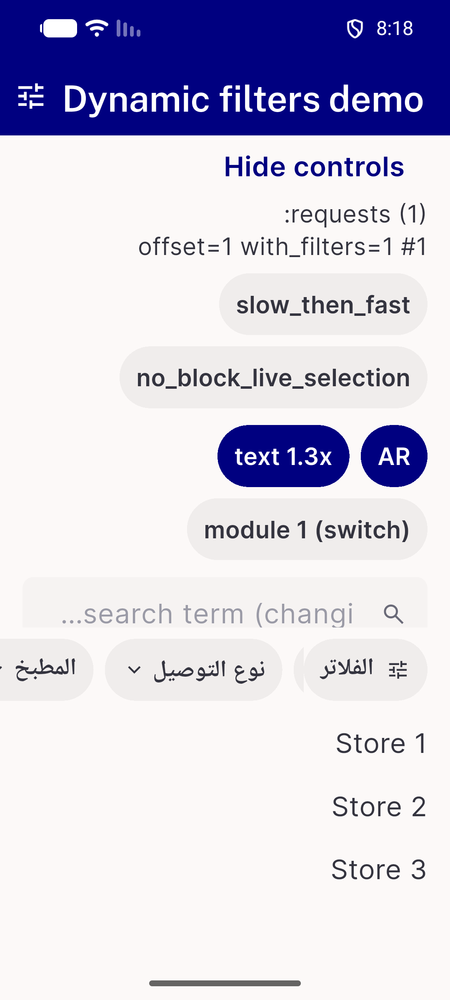
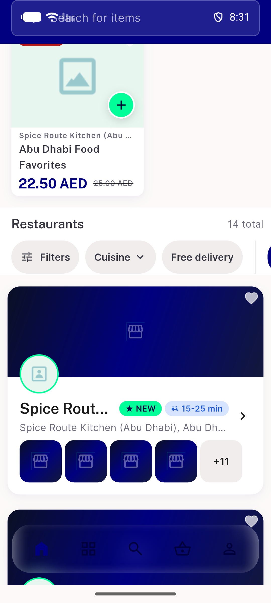

# QA Evidence — NEARS-4242

**PASS - NChipRail pixel-identical before/after (chat+demo), AC1-5 live**

**12 screenshot(s).** Click any thumbnail for full resolution.

<table>
<tr>
<td align="center" width="33%"> after chat 320dp x1.3 ltr</td>
<td align="center" width="33%"> after chat 320dp x1.3 rtl</td>
<td align="center" width="33%"> after demo 320dp s1.3 ar</td>
</tr>
<tr>
<td align="center" width="33%"> after demo 320dp s1.3 en</td>
<td align="center" width="33%"> after inline 360dp ltr</td>
<td align="center" width="33%"> after inline 360dp rtl</td>
</tr>
<tr>
<td align="center" width="33%"> before chat 320dp x1.3 ltr</td>
<td align="center" width="33%"> before chat 320dp x1.3 rtl</td>
<td align="center" width="33%"> before demo 320dp s1.3 ar</td>
</tr>
<tr>
<td align="center" width="33%"> before demo 320dp s1.3 en</td>
<td align="center" width="33%"> before inline 360dp ltr</td>
<td align="center" width="33%"> before inline 360dp rtl</td>
</tr>
</table>

### Other artifacts
- [`dumps`](dumps)
- [`measurements.txt`](measurements.txt)

---
*From `nears/docs/qa-evidence/NEARS-4242/` · public-repo scrub policy (no live secrets; verified clean).*
