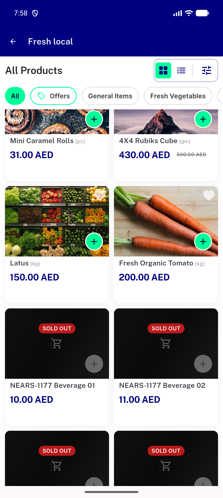
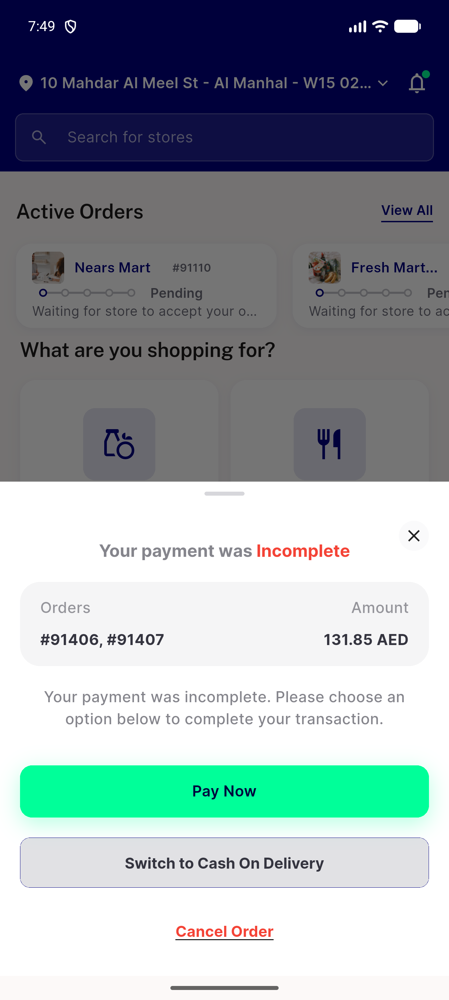

# QA Evidence — NEARS-4270

**NEARS-4270 [8] QA - Maestro pilot phase 1**

**2 screenshot(s).** Click any thumbnail for full resolution.

<table>
<tr>
<td align="center" width="33%"> bug cart add viewcart missing</td>
<td align="center" width="33%"> bug relaunch home dialog before search</td>
</tr>
</table>

### Other artifacts
- [`ac1-run1`](ac1-run1)
- [`ac1-run2`](ac1-run2)
- [`ac1-run2-retry05`](ac1-run2-retry05)
- [`ac1-run3`](ac1-run3)
- [`ac1-run3-retry05`](ac1-run3-retry05)
- [`ac1-run4`](ac1-run4)
- [`ac1-run5`](ac1-run5)
- [`ac2-dev1-5566-customer_a`](ac2-dev1-5566-customer_a)
- [`ac2-dev2-5570-customer_b`](ac2-dev2-5570-customer_b)
- [`ac2-orders-placed.txt`](ac2-orders-placed.txt)
- [`ac2-overlap-watch.txt`](ac2-overlap-watch.txt)
- [`ac2-processes.txt`](ac2-processes.txt)
- [`ac3-measurements.txt`](ac3-measurements.txt)
- [`ac3-t1-replay`](ac3-t1-replay)
- [`ac3-t2-replay`](ac3-t2-replay)
- [`ac3-t3-replay`](ac3-t3-replay)
- [`ac3-tok_between.py`](ac3-tok_between.py)
- [`ac4-wrong-appid`](ac4-wrong-appid)
- [`ac5a-control`](ac5a-control)
- [`bug-cart-add-viewcart-missing.log`](bug-cart-add-viewcart-missing.log)
- [`bug-maestro-phone-home-update-check.log`](bug-maestro-phone-home-update-check.log)
- [`bug-relaunch-home-dialog-before-search.log`](bug-relaunch-home-dialog-before-search.log)
- [`qa-flows`](qa-flows)
- [`telemetry-ab`](telemetry-ab)

---
*From `nears/docs/qa-evidence/NEARS-4270/` · public-repo scrub policy (no live secrets; verified clean).*
