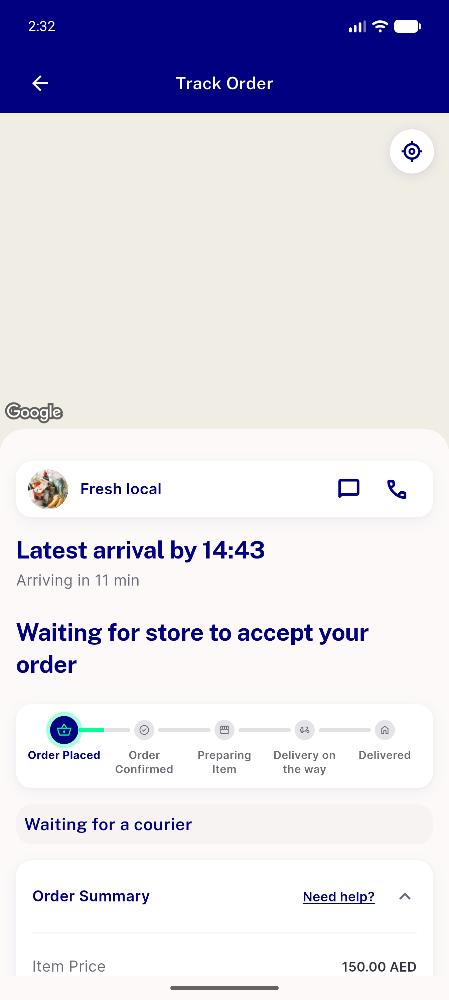
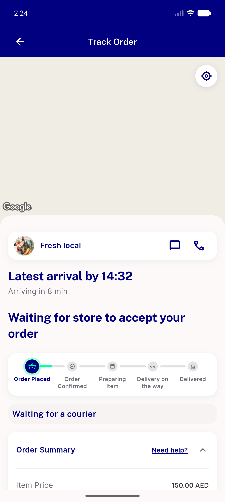

# QA Evidence — NEARS-4273

**NEARS-4273 QA [8] PASS - AC3 18/18, AC4 green at head + red at base, S1-S3 PASS (head 9e6c1f05d, emulator-5576)**

**2 screenshot(s).** Click any thumbnail for full resolution.

<table>
<tr>
<td align="center" width="33%"> ac4 track order base 91417</td>
<td align="center" width="33%"> ac4 track order head 91416</td>
</tr>
</table>

### Other artifacts
- [`a11y`](a11y)
- [`ac3`](ac3)
- [`ac4-static`](ac4-static)
- [`bug-login-field-longpress-selectword-null-check.log`](bug-login-field-longpress-selectword-null-check.log)
- [`guards`](guards)
- [`maestro`](maestro)
- [`progress.md`](progress.md)
- [`s1-s2-mcp`](s1-s2-mcp)
- [`visual-diff-base-vs-head.txt`](visual-diff-base-vs-head.txt)

---
*From `nears/docs/qa-evidence/NEARS-4273/` · public-repo scrub policy (no live secrets; verified clean).*
