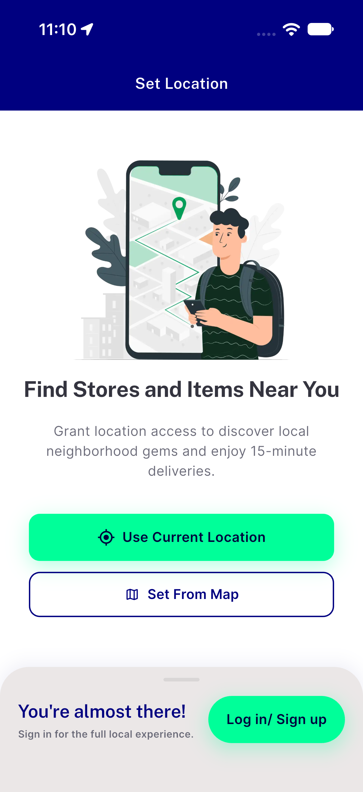
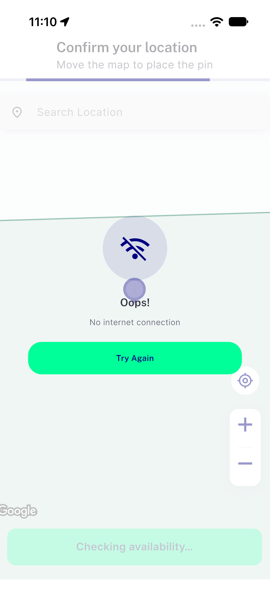

# QA Evidence — NEARS-4274

**NEARS-4274 [8] iOS QA: FAIL (AC1), AC2 PASS, AC3 PASS**

**2 screenshot(s).** Click any thumbnail for full resolution.

<table>
<tr>
<td align="center" width="33%"> bug ios false no internet after retry</td>
<td align="center" width="33%"> bug ios false no internet</td>
</tr>
</table>

### Other artifacts
- [`ac2-live-demo.log`](ac2-live-demo.log)
- [`bug-ios-apns-uncaught-async.log`](bug-ios-apns-uncaught-async.log)
- [`bug-ios-false-no-internet.log`](bug-ios-false-no-internet.log)
- [`bug-ios-hidekeyboard-signin-hidden.log`](bug-ios-hidekeyboard-signin-hidden.log)
- [`bug-ios-login-sheet-tap.log`](bug-ios-login-sheet-tap.log)
- [`bug-xcode27-pods-deployment-target.log`](bug-xcode27-pods-deployment-target.log)
- [`maestro`](maestro)
- [`progress.md`](progress.md)

---
*From `nears/docs/qa-evidence/NEARS-4274/` · public-repo scrub policy (no live secrets; verified clean).*
