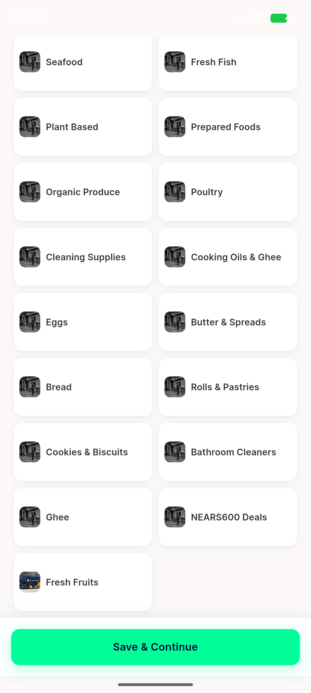
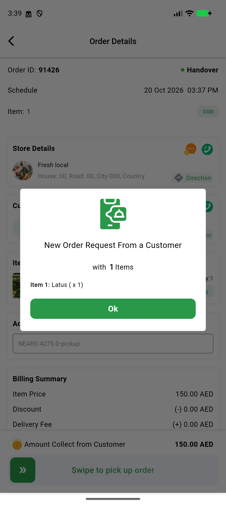

# QA Evidence — NEARS-4275

**NEARS-4275 QA [8-fix1] delta re-QA: PASS (AC1 Vendor 0/15, Delivery 0/10 rule raw 1/10; AC2 unattended chain 91422 to picked_up; AC3 shared 179/91415 unchanged)**

**2 screenshot(s).** Click any thumbnail for full resolution.

<table>
<tr>
<td align="center" width="33%"> bug chain customer interest picker</td>
<td align="center" width="33%"> bug rider order request dialog</td>
</tr>
</table>

### Other artifacts
- [`ac2-chain-selects.txt`](ac2-chain-selects.txt)
- [`ac3-shared-selects.txt`](ac3-shared-selects.txt)
- [`backend-db-proof.txt`](backend-db-proof.txt)
- [`backend-freshness.txt`](backend-freshness.txt)
- [`bug-chain-customer-interest-picker.log`](bug-chain-customer-interest-picker.log)
- [`bug-rider-order-request-dialog.log`](bug-rider-order-request-dialog.log)
- [`fixture-00-controls.txt`](fixture-00-controls.txt)
- [`fixture-chain.txt`](fixture-chain.txt)
- [`fixture-r1.txt`](fixture-r1.txt)
- [`fixture-r1d-retry.txt`](fixture-r1d-retry.txt)
- [`fixture-r2.txt`](fixture-r2.txt)
- [`fixture-r3.txt`](fixture-r3.txt)
- [`fixture-r4.txt`](fixture-r4.txt)
- [`fixture-r5.txt`](fixture-r5.txt)
- [`maestro`](maestro)
- [`maestro-ops`](maestro-ops)
- [`progress.md`](progress.md)
- [`re-qa-fix1`](re-qa-fix1)

---
*From `nears/docs/qa-evidence/NEARS-4275/` · public-repo scrub policy (no live secrets; verified clean).*
