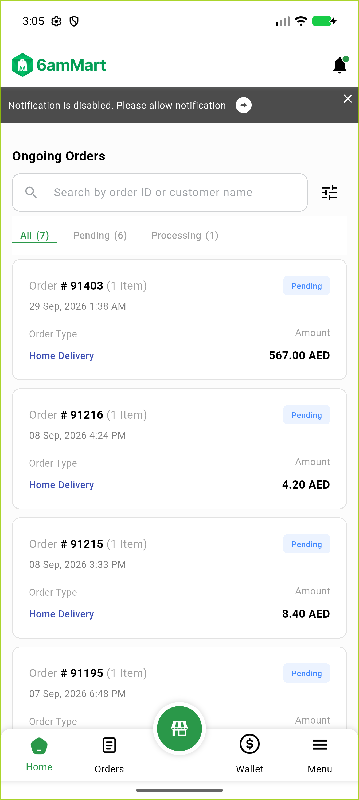
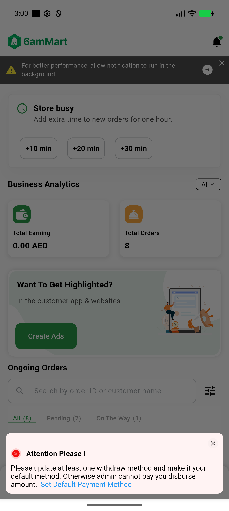

# QA Evidence — NEARS-4291

**NEARS-4291 [8b] regression-confirm 2 store-panel-role-delete**

**4 screenshot(s).** Click any thumbnail for full resolution.

<table>
<tr>
<td align="center" width="33%"> ac1 employee fresh signin home no snackbar</td>
<td align="center" width="33%"> ac2 owner fresh signin attention dialog</td>
<td align="center" width="33%"> rc empty modules menu full access</td>
</tr>
<tr>
<td align="center" width="33%"> rc2 role deleted menu full access</td>
</tr>
</table>

### Other artifacts
- [`ac1-employee-home-dump.xml`](ac1-employee-home-dump.xml)
- [`ac2-owner-default-method-home-dump.xml`](ac2-owner-default-method-home-dump.xml)
- [`ac3-logcat-gate-test.log`](ac3-logcat-gate-test.log)
- [`ac3-maestro-run.log`](ac3-maestro-run.log)
- [`ac3-nightly-test.full.log`](ac3-nightly-test.full.log)
- [`ac3-nightly-test.log`](ac3-nightly-test.log)
- [`ac3-ops-fixture.log`](ac3-ops-fixture.log)
- [`ac4-unit-base-red.log`](ac4-unit-base-red.log)
- [`ac4-unit-head.log`](ac4-unit-head.log)
- [`backend-freshness.txt`](backend-freshness.txt)
- [`bug-empty-modules-full-access.log`](bug-empty-modules-full-access.log)
- [`bug-role-delete-dangling-full-access.log`](bug-role-delete-dangling-full-access.log)
- [`logcat-ac1-employee-coldstart-after-revert.log`](logcat-ac1-employee-coldstart-after-revert.log)
- [`logcat-ac1-employee-coldstart.log`](logcat-ac1-employee-coldstart.log)
- [`logcat-ac1-employee-fresh-signin.log`](logcat-ac1-employee-fresh-signin.log)
- [`logcat-ac2-owner-coldstart.log`](logcat-ac2-owner-coldstart.log)
- [`logcat-ac2-owner-default-method.log`](logcat-ac2-owner-default-method.log)
- [`logcat-ac2-owner.log`](logcat-ac2-owner.log)
- [`logcat-ac2-wallet-employee-fresh-signin.log`](logcat-ac2-wallet-employee-fresh-signin.log)
- [`logcat-opt-profile-401-failclosed.log`](logcat-opt-profile-401-failclosed.log)
- [`logcat-opt5-manual-owner.log`](logcat-opt5-manual-owner.log)
- [`logcat-reg-wallet-employee-disbursement-menu.log`](logcat-reg-wallet-employee-disbursement-menu.log)
- [`maestro`](maestro)
- [`maestro-ops`](maestro-ops)
- [`progress.md`](progress.md)
- [`rc-empty-modules-menu-dump.xml`](rc-empty-modules-menu-dump.xml)

---
*From `nears/docs/qa-evidence/NEARS-4291/` · public-repo scrub policy (no live secrets; verified clean).*
